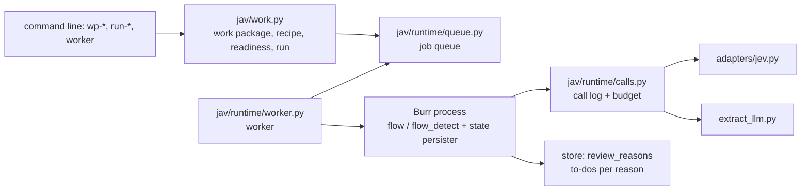
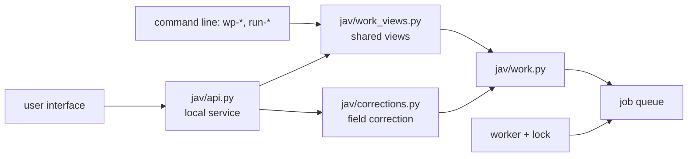
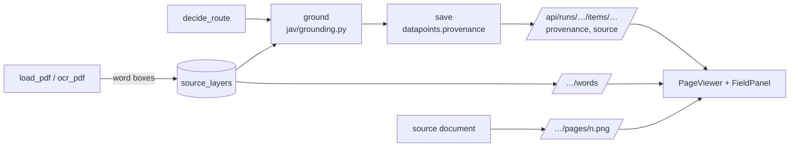
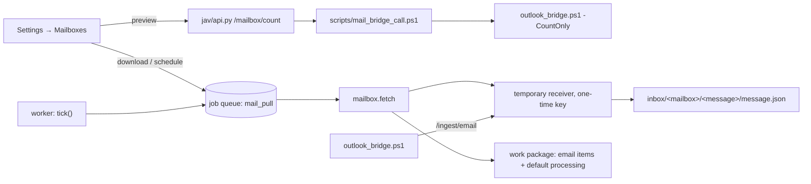

# Architecture — the end-to-end process and the five planes

**Date:** 2026-09-27, reviewed 2026-09-30 · **Status:** describes the structure that actually works. The guarantees of section 6 apply to the path that runs through the worker; the command-line measurement paths are outside them.

**Plain-language summary.** The system is a general framework for processing documents and emails with AI. Each flow
reads a document or an email, lets code, JEV and OpenAI each make the decisions they are suited to, and stores the
result, together with its to-dos, in a local database. Three reference flows show how it works: document type
recognition, invoice data extraction and email intent. Documents and emails go into work packages, whose runs a
background worker processes, reserving the cost before every paid call; a local service and a browser interface give
access to all of this. This page describes the process end to end, the five planes the flows share and the layers built
on top of them.

**What this is:** a general, multilingual document- and email-processing **AI-flow framework**
(Burr + Pydantic + sidecar + JEV) in which the flows are instances and the framework layer (adapter, registry schema,
call-site schema, policy schema, eval, store, contract, input adapters) is shared. The process below shows the three
reference flows (M1 document type recognition, M2 Hungarian invoice with two paths, M3 email intent); a new flow sits on the same
planes. The reference flows are the yardstick for the efficiency and reliability of the framework and of the
JEV–Pydantic AI–Burr combination. Teachable document processing is a complementary goal: a versioned processing recipe
for a known type, general data-point proposals with source checking for an unknown one. The shared source- and
structure-checking capabilities serve both; the learning branches (section 13) are not wired into the recognition and
intake path. OpenAI and JEV can both be used, for documents and emails alike; the division of labour between them is
decided per task by measurement (section 3).

**Package layout.** `jav/` is largely flat; the execution layer and the provider adapters are sub-packages
(`jav/runtime/`, `jav/adapters/`), and the trial runners live in `jav/experiments/`. The legacy project's database is
not a runtime dependency.

**Native document path.** Work packages also accept DOCX, XLSX, TXT and CSV. The worker dispatches these to
`jav/flow_native.py`; the readers preserve structured source elements, and `jav/native_results.py` stores immutable
readings and interpretation publications. Model calls use the existing provider adapters, receipts and budget ledger.
The API exposes complete source elements and source-linked facts to the native review views. Corrections retain the
original proposals, approval is bound to the displayed review version, and the shared result datasets include native
facts and reading status. PDF and email items keep their existing flows. A PDF whose recognised type has no fitting
type pack (a scan with the reader's local OCR) continues from detection into the native flow when the recipe's
`unknown_documents` setting is
`facts` (the default, 120); its result is then chosen by its native publication (`native_results.native_item`), not
by its suffix. The storage boundaries, failure states and
source-location contract are described in [Native document processing](guides/NATIVE_PROCESSING.md).

This page is written by hand. The generated parts are the graphs' `docs/flows/<flow>/FLOW.md` (in the repository), and
the JEV call-site catalogue and the state snapshot (local, generated from the store: `python -m jav.cli docs`,
`admin --write`). Rules: `CLAUDE.md` and the [development guide](guides/DEVELOPMENT.md); JEV capabilities:
`docs/JEV_PLAYBOOK.md`; security: `docs/SECURITY.md`; config files: `docs/guides/CONFIGS.md`.

## 1. The process from an email to a decision

```
 Settings → Mailboxes: download now, or a schedule (section 11)
        │
        ▼
 worker: jav/mailbox.py fetch (starts the temporary receiver below)
        │
        ▼
 scripts/mail_bridge_call.ps1
        │
        ▼
 scripts/outlook_bridge.ps1 (148: ported from 10_AIFLOW_V4; the Inbox, its direct subfolders and Sent Items; reads desktop Outlook, read-only; -RepoRoot inbox/.bridge)
        │
        ├─► attachment files: inbox/.bridge/data/inbox/email/<acct>/<eid>/
        │
        │ POST /ingest/email
        ▼
 jav/ingest_server.py: temporary receiver on a free port, one-time key (the bridge protocol)
        │
        ▼
 inbox/<mailbox>/<msgid>/message.json (points to the attachment files)
        │
        ▼
 work package with the default processing (a person starts the paid run; the worker runs it)
        │
        ▼
 M3 email_intent graph (jav/flow_email.py)
 load_message → classify_attachments → intent → route → tasks → save
                         │                        │              │
                         │                        │              └─► store.emails + email_results + review_queue
                         │                        ▼
                         │            policy.email_next_flow (code) ──► m2:<type> · m1:detect · human:* · archive*
                         ▼
 M1 graph for each PDF (jav/flow_detect.py)
 load_pdf [→ ocr_pdf] → detect → save ──► store.documents
                        JEV: doc_type + issuer_hu + language (+ the detailed type)

 folder corpus (PDFs) ──► detect-corpus ──► M1 graph per document ──► store.documents (type × year report)

 store.documents (a type with a type pack; the detailed type) ──► M2 invoice graph (jav/flow.py; the type pack
 configs/types/<type>.json supplies the fields, questions, prompt and validators), two paths in one graph:
     load_pdf [→ ocr_pdf], then
     S: find_candidates (code) → jev_select (JEV Choice, 3 batched requests) → normalize_picks
     G: extract_llm (gpt, Pydantic AI) → jev_verify (code evidence + JEV Noul fan-out) → normalize_llm
        without JEV: extract_llm → code_verify (code evidence only, the word layer too; a value printed nowhere → source:not_found)
        (extract_llm also keeps the token probabilities of the answer's values: llm_token_p)
        (extract_llm's instructions: the pack's prompt, its prompt_note, then the shared block of configs/gpt_extract.json)
        → normalize_llm; when JEV is unavailable, jev_verify keeps the code evidence and the required-field check
     both → validate (code) → decide_route (policy) → ground (code) → save → done | needs_review
```

Each PDF attachment is also an item of the email's work package and gets the full document processing
(M1 + M2, section 10). The email input can still be driven by hand: an old bridge started without `-RepoRoot` posts to
`python -m jav.cli email-ingest-server` and keeps its attachments under the legacy project's `data/inbox/email/<acct>/<eid>/`;
the receiver resolves both attachment roots (`jav/ingest_server.py` `host_path`), and `email-inbox inbox/` then runs M3.

The **golden loop** is the same for every flow: golden set (referenced from the legacy project; the PII stays there) → run
with the cache ($0 thanks to the request hash) → report (`runs/*.jsonl` + Markdown) → discrepancy analysis from the raw
run → general rule (config change with a version bump) → rerun → determinism measurement without the cache. From live
data: a manual labelling list (`*_manual_sample.md`) → our own golden set (`golden_labels`). Situations the legacy sets do
not cover (credit notes, receipts without an invoice number; 151: the outgoing invoice) have invented cases in
`configs/golden_synthetic.json` (`golden --synthetic`), run and reported apart, so the legacy results stay comparable.
151: a local case list outside git (`golden --cases <file>`, `evals.load_case_file`) measures a path on real documents
against reference values, such as the other path's results; its run file is `<type>_local_<arm>` and its score is an
agreement, not an accuracy.

## 2. The five planes

| Plane | What | Where | Control |
|---|---|---|---|
| **Flow** (Burr) | five graphs: the three reference flows and the two learning branches (section 13); `@action.pydantic` typed state, `run_id` = app_id, local tracker | `jav/flow.py`, `flow_detect.py`, `flow_email.py`, `flow_learning.py`, `flow_email_learning.py`; a `CONTRACT` at the end of each | `python -m jav.cli flows` lint + FLOW.md; tracker UI `burr` |
| **Decision** (JEV + GPT) | the families of JEV call sites: detect and detect_detail, email_intent, select (Hungarian, foreign, utility), verify (per type) — one file each under `configs/callsites/`; two generative steps: the G path's extractor (extract_llm) and the email task proposals (`configs/email_tasks.json`); the adapter (`jav/adapters/jev.py`) puts the concrete model version into the cache key, calls with a RetryPolicy and passes SDK errors on as `JevUnavailableError` | question sets `configs/callsites/*.json`, registries `configs/doc_types.json`, `intents.json`; code: `jav/detect.py`, `intent.py`, `jev_select.py`, `jev_verify.py`, `extract_llm.py` | `configs` (version, hash), the call-site catalogue (local, generated by `python -m jav.cli docs`), bands and routes in `configs/policy.json` (`bands` / `band_for`, `jav/policy.py`) |
| **Data** (SQLite) | documents · datapoints · emails · review_queue · ledger · golden_labels; also the tables for work packages, runs, the job queue, to-do reasons, the call log, email results, mailboxes and watched folders (full list: the `CREATE TABLE` statements in `jav/store.py`, `jav/work.py`, `jav/runtime/queue.py`, `jav/runtime/calls.py`, `jav/mailbox.py`, `jav/app_settings.py`, `jav/corrections.py`, `jav/source_layer.py`, `jav/legacy_import.py` and `jav/parties.py`); the process state lives in a separate store (`store/burr_state.sqlite`) | `store/jav.sqlite`, `jav/store.py` (additive migration) | `store` statistics (row counts of the core tables); the ledger records every AI call with its `config_hash` and, on failure, an `error` |
| **Measurement** (eval) | flow-independent list of judgements from the raw runs: accuracy and band per question, calibration (ECE), top-prob vs. conf, policy re-evaluation without calls, determinism; the measurements without JEV (`*_gpt`, `*_G_nojev`) are flows of their own with the GPT call sites, a GPT field's confidence calibrated against its score, and the silent errors (wrong, no to-do in the recorded run) per flow | `jav/eval_report.py` (input `runs/*.jsonl`), the flow-specific runners `jav/evals*.py` | `eval-report` → `runs/<time>_eval_report.md`; golden / determinism commands per flow |
| **Administration** | config versions and hashes, models and prices, lint, golden results, review queue; session rules and hooks | `jav/cfg.py`, `configs/models.json`, `jav/admin.py`, `CLAUDE.md`, `.claude/settings.json`, `scripts/hooks/` | `admin` on one screen; hooks at session start, before compacting and at stop (a non-blocking reminder), plus a review agent; see the [development guide](guides/DEVELOPMENT.md) |

## 3. Where each decision is made — the decision hierarchy in practice

1. **Code** (deterministic, tested): candidate finders, validators, body cleaning, anchor features, evidence matching,
   `next_flow`, the review latch. This is the mechanism.
2. **JEV** (judgement over a finite set of options): one of the tools for selection, presence and verification steps. One call site = one JSON config
   + one `build_state` + one `build_questions` + one `jev.ask(...)` through the adapter. Raw probability goes into the state,
   thresholds only into `policy.json`: a named band set per call site (`band_for`), Noul no / uncertain / yes,
   Choice auto / uncertain / human (confidence threshold + gap to the second option); the `uncertain` band triggers review only
   with `uncertain_review: true`. Because of the request-hash cache, the same (concrete model version, state, questions) gives the same answer
   for $0; the alias (`jev-latest`) is resolved with a probe (`runs/cache/_model_versions.json`, 24 h TTL). If JEV still
   does not answer after the SDK retries, the adapter writes a ledger entry (`error`) and raises `JevUnavailableError`; the flows turn this
   into a `jev_unavailable:<reason>` review (M1/M3 `final_status = jev_unavailable`) instead of crashing. Processing without JEV
   is a guarantee (160, `jav/engine.py`): a flow application built with `jev=False` runs every step inside `jev.disabled()`, so a
   JEV question asked anyway is refused before the model probe, the cache and the call log (`JevUnavailableError("disabled")`,
   the `jev_unavailable:disabled` to-do; `get_adapter()` refuses too, whatever adapter a run installed). In the tests the refusal
   fails the test (`tests/conftest.py`); a test of the refusal itself is marked `jev_refusal` (`tests/test_jev_safety_net_160.py`).
   The engine matrix (`configs/engine_matrix.json`, checked by `jav/engine_matrix.py` in the preflight) lists every JEV call
   site with its counterpart without JEV or a stated exception, and the tests that cover it; the paired tests
   (`tests/test_paired_*_160.py`) run each flow with both engines. Which engine a run uses: the application's AI engine
   (`app_settings.engine_default`, an `app_options` row; JEV and GPT unless someone changes it) is the default of every new
   processing setting that does not name one (`work.default_params`, `engine_params`): a package without saved settings, a
   mailbox download's package, a watched folder's package, an assignment without `jev`. Saved settings and started runs keep
   their own (a run freezes its settings when it starts); an assignment saved before the engine setting existed (recipes 1.9.0, 2026-10-02) has no `jev` and stays JEV and GPT.
3. **OpenAI, through Pydantic AI**: the existing G path and the document-learning branch produce structured proposals and then apply source checking. The graphs described here neither restrict OpenAI to generating extracts nor make JEV the only tool for every interpretive decision: further interpreting, classifying and verifying roles are also permitted, for documents and emails alike. Any new division of labour must be built in on the basis of targeted measurement; source checking, separate cost accounting and manual activation apply to every role. The Burr states are plain Pydantic models, not Pydantic AI.
4. **OCR pipeline**: `jav/ocr.py` + `configs/ocr.json` — PDF without text → page image (pypdfium2,
   300 dpi) → tesseract word boxes (native tesseract on the machine; the Hungarian + English language packs taken from the old sidecar's Docker image
   into `tools/tessdata`; fallback: the old sidecar image via `docker run`) → the same line/cell builder as for the text layer
   (`jav/pdf.py: build_layout`). A separate graph step (`ocr_pdf`) in the M1 and M2 graphs, a disk cache in `runs/ocr/`,
   raw quality signals in the state, thresholds in the `ocr` block of `policy.json`. The rest of the old sidecar (torch, the matcher)
   has not been ported. When local OCR is weak, `ocr_with_escalation` asks Azure DI (paid): since 121 directly over its REST API
   (`jav/adapters/azure_di.py`, standard-library HTTP, ported from the old sidecar's provider) when `AZURE_DI_ENDPOINT` and
   `AZURE_DI_KEY` are set, otherwise through the old sidecar, which sees only the legacy data folder. The call goes through the
   call log (`azure_recognise`): in a worker run the page count is reserved from the run's Azure budget (recipe switch
   `azure_ocr`); an analysis Azure accepted but whose result was lost is an uncertain call. A blocked or failed escalation leaves
   the local text and, unless the recipe switch is off, a to-do (`ocr:escalation_blocked:*`: budget, uncertain earlier attempt,
   no route to Azure, failed call). Since 123 the original Azure recognition (word polygons, page size, unit, angle)
   is kept once in the store, under the sha256 of its canonical JSON (`ocr.save_recognition`, artifact kind
   `azure_recognition`), and the digest travels with the recognition signals (`recognition_sha256`); the text, the
   OCR cache key and the call's request hash are unchanged. Since 124 detection names the recognition whose text
   went on (`ocr_recognition`; an Azure text cached before 123 has no kept original and names nothing), and a scan
   continuing into general facts takes it over in the native reader (`jav/readers/external_recognition.py`, see
   `docs/guides/NATIVE_READERS.md`). Heavy dependencies may only go behind a sidecar.
5. **Isolated PDF reading**: `jav/isolated_pdf.py` + `configs/service.json` `pdf_reader` — the third-party PDF parsers
   (pdfplumber for the text layer, PDFium for the OCR page images, the page sizes and the review page images) run in one
   long-lived helper process per calling process (worker, local service), one request at a time, with a time limit per
   request and a memory limit (on Windows a job object). Our own processing (words → lines and cells) stays in the
   calling process. Over a limit the helper is stopped and replaced; text extraction fails the item with a named error
   (`PdfReaderLimit`, no retry), the OCR page images give a to-do (`ocr:unavailable:PdfRenderLimit`), and a review page
   image is answered with 422. `isolated: false` runs the same functions in-process. 138: the same helper parses a
   tabular statement export (`statement_table.parse_rows`: openpyxl, defusedxml, the CSV reader) within the read time
   limit; a parser error keeps its message and a limit is a named refusal (`StatementTableError`, 422).

## 4. Tuning and changes — the procedure

| Change | Where | What follows |
|---|---|---|
| type or intent description (`what`), boundary (`not_for`), example (`examples`), family (`parent`) | `configs/doc_types.json` / `intents.json` (schema v2), bump `meta.version` + changelog | `detect-golden` / `email-golden` (new hash → live calls), `detect-determinism` / `email-determinism`; `eval-report` (parent-label section); regenerate `docs` |
| JEV instruction, Noul question | `configs/callsites/<callsite>.json` | the same; the local, generated call-site catalogue shows the statistics per version |
| band, threshold, route | `configs/policy.json` (`bands`, `band_for`, routes) | no rerun needed: `eval-report` shows from the raw runs (`runs/*.jsonl`) how many cases would change band |
| model, price, timeout, retry, cache version, alias TTL | `configs/models.json` | bumping `cache_version` invalidates every cache key; a model-version change (detected by the probe) produces a new key by itself |
| graph step | flow module + `CONTRACT` | `flows` lint + FLOW.md |
| code (regex, cleaner, validator) | `jav/*.py` + test (TDD) | `pytest`, `recall`, golden |

Pitfalls: a `use_cache=False` run **updates** the cache file (it refreshes the reference), except for the determinism measurement,
which runs under `JevAdapter.no_cache_write()`: no reads and no writes, so the reference answer stays untouched.
The old inbox folders contain attachments only; any change to a Choice criterion means a new cache key. The cache
key contains the concrete model version (introduced with `cache_version` 2): even a fully cached golden run
needs one probe a day (an API key is required; offline, the resolution stored in the file is used, with a warning).

## 5. What Claude needs to know to develop efficiently

- Session protocol: `CLAUDE.md` §2 and the [development guide](guides/DEVELOPMENT.md) §4; the hooks back it up
  (SessionStart / PreCompact / Stop / review). Session start: `python -m jav.cli preflight` (pytest + UI checks +
  contract lint + engine matrix + configs + git state + data guard + language guard + Ruff ratchet + the local state snapshot, among
  others). Never copy state numbers anywhere by hand: refer to the generated state snapshot.
- Designing a JEV question: `docs/JEV_PLAYBOOK.md` (facts from the docs, gap analysis per call site, checklist).
- A new JEV question: config JSON + `build_questions` (registry reference `registry:<name>`), the `docs.typesafe.ai` cookbook, a test
  modelled on `tests/test_cfg.py`, a golden run before and after.
- A new flow: module + `CONTRACT` + `TERMINALS` + `build_app` (tracker project in `models.json`) + lint + a golden runner
  modelled on `evals_*.py`; a flow never imports an SDK, only the adapter.
- Search the legacy project first (`CLAUDE.md` §3).

## 6. Execution layer: work package → run → worker

**Plain-language summary.** Documents go into a work package, the package gets its processing settings (or runs with
the default ones), and the run goes through a
durable job queue in the background. Before every paid call, an entry is written and the cost is reserved. After a stop,
the run resumes from the saved step, and a call that has already been paid for is not repeated. To-dos can be resolved
reason by reason, and a live run can only be approved when it has no open to-dos.



| Layer | File | Guarantee | Test |
|---|---|---|---|
| Work package, recipe, run | `jav/work.py`, `configs/recipes.json` | version conflict → `RevisionConflict`; readiness blockers; fixed input; idempotent start; approval only in live mode and with no open to-dos. A recipe has a `status`: `active` (offered in the UI; one since 1.8.0: `processing`), `internal` (`invoice-extraction`: a given document type, no recognition; command line and tests), `retired` (`document-processing`, `email-intent`: kept for old runs' titles and old assignments; `assign_recipe` raises `RetiredRecipe`). Without an assignment, readiness uses the default processing with its defaults (`assignment_default`) and `start_run` saves them in the same transaction; `migrate_assignments` / `processing-migrate` moves old assignments onto `processing`, keeping the settings (`carried_params`). 151: a finished live run that is not approved (its reasons pinned until it is approved) can be superseded by a person once a later finished live run of the package has all its items (`supersede_info`, `supersede_run`, `/runs/{id}/supersede`): in one transaction the run becomes `cancelled`, its own open reasons `superseded` (`store.close_run_reasons`), and the package's events get `run_supersede` with the later run; the run view carries `supersede` (the offer, with the human work left on the run) and `superseded` (`work.superseded`). 152: the package view carries `supersedable` (`work.supersedable_runs`: every such run of the package, oldest first, with its offer), so the Processing section offers them too; 153: the package list counts them (`older_runs`). 153: the package's next step, its Review and Result tabs and the list's open to-dos follow the current run (`work_views.current_run`: the newest run, passing over runs a person stopped after it), so a later stopped run hides neither the to-dos nor the approval of an earlier finished run; the view carries `current_run` beside `last_run`, and a workflow step stays done when a later live run was stopped. 153: the package's view, its readiness check, the run's view and the run list read through one connection (`store.session`; a package of 468 documents opened in 4 s with 944 connections, now 0.3 s on a copy of the store), and a run's open to-dos are counted by a range on its item flow ids, served by the index `ix_review_reasons_status_run`. 153 (review): a package's to-do counts (the list's "incl. earlier runs" column, the package's to-dos, its items table) leave out the reasons another package's runs raised (`work_views.own_reasons`; a measurement's or the command line's still show): a to-do belongs to the document's content, so the same file in another package carried that package's to-dos in. No run closes another's reasons by itself. 160-C S1 (decisions 163 D2, D3): removing an item is virtual and needs a person and a reason (`remove_item(actor=, reason=)`, `/workpackages/{id}/items/{item}/remove` with `reason`, 422 without one); the item keeps `removed_at`, `removed_by` and `removed_reason`, the package's events get `item_remove`, and `restore_item` (`/items/{item}/restore`, event `item_restore`) brings it back. A removed item stays out of readiness and the next run; a run already started keeps it in its frozen input. The `workpackage_items` dataset shows removed items with the `removed` scope (`_removed` per row). 160-C (decision 163 D7): items removed from the package since a run started are left out of that run's release (`work.excluded_items`, `work.released_items`): their to-dos block neither its status nor its approval, the run list does not count them, and the downloads (tables, JSON, Excel, named copies) and the statement package's approval rule leave them out. The approval then needs the count the approver saw (`confirm_removed`; otherwise 409 `not_ready` with the `removed_items` blocker) and records the items left out (`runs.excluded_items`), so a later removal or restore does not change a released result (decision 160 D1); the run view carries `removed_items`. 160-C S2: a person adds documents to an existing package with `add_to_package` (`POST /workpackages/{id}/items`, the response's `added`: added, already in the package, restored, and the names a live run of another package processed): by content, a document already in use changes nothing (no revision step), a removed one is restored, and an actual change is logged (`items_add`) in the same transaction (`add_entries(event=)`); a statement or reconciliation package refuses it (`SURVEYED_KINDS`, 422). `pending_items(wp, mode)`: the items in use that no non-cancelled run of that mode has finished; after a run they are the package's next step (`pending`). 160-C S3: readiness carries `supplement` per mode when a run of that mode finished some of the items in use and others are pending: the pending items' count, their own blockers and warnings (an earlier item's changed source does not hold it up), budget, plan and input hash. `start_run(scope="pending")` (`StartRun.scope`, `run-start --pending`) freezes only those items (`runs.scope = 'pending'`, the runs dataset's Run scope column); it does not start while another run of the package is queued or running (`run_active`), and its idempotency key counts the package's stopped and failed runs of that mode, so a double click gets the same run and a stopped one can be started again. `work.open_live_runs`: finished, unapproved, not stopped live runs no later finished live run repeated on all their items, oldest first. `work_views.current_run` is now a queued or running run, else the oldest open live run, else the 153 rule, so a later run over the pending items or a later trial hides neither the to-dos nor the approval of an earlier live run; the package view carries `open_runs`, Review opens on the current run and names the other open runs with to-dos, and a workflow step is done only with an approved live run and no other live run still going or open (`workflows._live_run_approved`). 168 (plan F-item-list-and-adding): adding is previewed first. `preview_additions` (`POST /workpackages/{id}/items/preview`, the given files or a folder's documents, with `recursive` its subfolders' too, without the output folder of the named copies; `folder_contents` also names the other files it leaves out) marks each document `new`, `already`, `removed` or `repeated`, and `elsewhere` when a live run of another package processed it, without writing anything; the add request takes the same sources and leaves out what the person unticked (`exclude`: new documents; `restore`, when given: the only removed ones to bring back), counted as `left_out`. `remove_items` / `restore_items` (`POST /workpackages/{id}/items/remove|restore`): several items in one revision step and one log event (`items_remove`, `items_restore`), all or nothing. `item_states(wp, items)`: per item the run whose result counts now (approved live > live > trial, a stopped or superseded run does not count) and the state `approved` / `live` / `trial` / `running` / `failed` / `pending`; the `workpackage_items` dataset shows them (State, Counted run, Run started, Result; a removed item reads `removed`). A statement package's survey and add take `recursive` too (`statement_package.expand_folders`: each subfolder read as a folder of its own, a companion PDF folder left to its parent). | `tests/test_work.py`, `tests/test_flexible_package_160c.py`, `tests/test_package_items_168.py`, `tests/test_work_cli.py`, `ui/src/pendingRun160c.test.tsx`, `tests/test_processing_080.py`, `tests/test_supersede_runs_151.py`, `ui/src/supersedeRuns151.test.tsx`, `tests/test_supersede_package_152.py`, `ui/src/supersedePackage152.test.tsx` |
| Package's current result | `jav/package_result.py` | 171: per item of a package, the result that counts now, decided in one window query (`counted_results`): the latest finished one of an approved live run, else of a live run, else of a trial run; a stopped or superseded run and an unfinished item do not count. The item list's state (`work.item_states`) and its name (`naming.package_item_names`) both come from that run. `effective_values` is the one merge of a machine result and the latest correction, used by the item result and the correction check (`corrections`), the run export, the reconciliation's and the duplicate search's document readers. 172: `in_use` gives the same for the items in use, in the package's item order. A result table (`emails`, `email_tasks`, `documents`, `datapoints`, `native_facts`, `line_items`, `utility_cost`, `utility_sources`) takes exactly one of a `run_id` or a `workpackage_id` scope (`Dataset.one_of`): a run's table is the run's, as before; the package's current result reads each item in use from its counted run (`datasets.result_parts`), each row's link naming that run, and is cached by the package's fingerprint (the items in use and their order, each item's counted run and tier, each counted run's own fingerprint). A page of the package's table carries the result's mark (`result_mark`), which Approve and release sends back. `/workpackages/{id}/result` carries the views with data (`tables`, `work_views.result_tables(workpackage_id=)`; the file names only when one run gives every item's result, as the named copies are made per run), `/result/export.xlsx` the current result as a workbook (`package_release.current_workbook`) and `/result/utility-cost` its utility report. 174: `counted_documents` gives each document's counted result row across every package it is in use in, in the same order, with a command-line result (a measurement) below a trial and counting only when no run has finished the document; a run that ended without a result row (a to-do before the data points) gives way to an earlier one that left one, and a document removed from every package it was in has none (decision 160 D3). The reconciliation (`reconcile.snapshot`, `statements`), the duplicate search and through it the own-tax scan, the role history (`party_history`) and a statement's relations (`statement_months.item_view`) read these rows (`result_rows`, with `latest_corrections`); before, each read the store's latest result row, a later trial's too. A statement package's rule after an approval reads the approved run's own statements (`run_documents`, `reconcile.run_statements`). The reconciliation workspace's mark includes each run's mode and whether it was stopped, and the removed package items | `tests/test_package_result_171.py`, `tests/test_package_result_names_171.py`, `tests/test_package_result_tables_172.py`, `tests/test_document_result_174.py` |
| Approve and release | `jav/package_release.py` (`package_versions`, `package_version_files`), `/api/workpackages/{id}/result`, `/release`, `/versions/{n}/files/{name}`, `python -m jav.cli package-versions-backfill` | 171: one step approves every open live run of a package (`work.approve_run`, each with the reviewed version the person saw) and records a released package version: the approved items, each from its run, and their downloads (workbook, JSON, the CSV tables) stored as files, so a released version's download never changes. The person's `expected_mark` (the package result's mark) must still hold, and again after the files are made; open to-dos block it before any approval. The view reads `not_released`, `released`, `partly_released` (an item in use without a released result) or `changed_since_release` (a released item removed or replaced). A package approved before gets its first version recorded afterwards (`backfill`, `backfilled_at`). A reconciliation package is approved in its own statement. 172 (DECISIONS 172): the interface approves only here, on the package's result (a run's own result can still be viewed); the package's next step is `release` (Approve and release) for a finished live run and also while an approved live run is newer than the latest version (`unreleased_approval`: an approval the way before v1.20.0, or a release stopped after its approvals); the package list's fingerprint includes `package_versions` | `tests/test_package_release_171.py`, `tests/test_package_result_tables_172.py`, `ui/src/resultRelease156.test.tsx` |
| Job queue | `jav/runtime/queue.py` | dedup key, claiming, attempts + back-off → `dead`, release, stop, handling of orphaned claims at start-up (modelled on the V4 `jobq.py`) | `tests/test_runtime_queue.py` |
| Call log, budget | `jav/runtime/calls.py` | reservation of an upper bound before the network call (UTF-8 bytes + a fixed overhead per request, growing conversation retries, transport retries; a call above its reservation stops the run's further calls with that provider); 149: a GPT call whose full bound no longer fits the budget left is sent with its lean bound (`invoke(lean=…)`: one request, no validation retry, still a true bound; the call log notes `lean_bound`), so a tight budget is not left unused; failed calls are logged too; an unknown cost stays reserved; an uncertain attempt is not repeated; a GPT question (`reusable`, its `request_hash` an `answer_key` of the model, instructions, schema, settings and text: only what GPT is sent, so a change only JEV reads keeps the answer reusable, and the settings fingerprint stays in the ledger, 128) gets an earlier answer to the same question when the run's earlier-answers setting allows it (`use_run(reuse=…)`, `worker.reuse_answers`): cost 0, noted `reused_answer:<id>`, a cached ledger row (`tests/test_gpt_reuse_090.py`); 160-D: a command-line measurement reuses too (`measurement(reuse=…)`): a golden measurement and a processing command follow their cache setting (`--no-cache` asks again), a determinism measurement never reuses, a reused answer needs no budget, and the measurement prints its live calls and reused answers (`scope_calls`, `tests/test_measurement_reuse_160d.py`); only an uncertain attempt can be settled by hand (one conditional write; a reserved one may still be running), and a late answer does not overwrite a settlement; a successful step is replayed; every reservation names its holder, a lock file next to the store (`call-holders/`) that the reserving process keeps locked for its lifetime, and a worker start makes uncertain only the reservations of holders that have stopped (or of reservations without a holder), so a command-line measurement waiting for its answer keeps its reservation (`holder`, `recover_uncertain`) | `tests/test_runtime_calls.py`, `tests/test_runtime_adapters.py`, `tests/test_reservation_holder_092.py`, `tests/test_gpt_reuse_key_128.py`, `tests/test_lean_reservation_149.py` |
| Worker | `jav/runtime/worker.py` | stable identifier + Burr state persistence (`burr_state.sqlite` next to the store); resumption from the next step; stop at a step boundary; a changed source is rejected | `tests/test_runtime_worker.py`, `tests/test_work_cli.py` |
| Flow registry | `jav/runtime/flows.py` (`FlowSpec`, `get`, `specs`), `jav/runtime/worker.py`, `jav/admin.py` (`flow_lint_targets`), `jav/work.py` (`native_flow`, `_item_arm`) | 173: one entry per flow under the name stored in every run's frozen recipe (`invoice`, `doc_detect`, `email`, `native`, `statement_table`; `document` is the recipe flow made of the stages `doc_detect` and `invoice`; the two learning flows have a lint graph only). An entry names the flow's module, how the worker builds its graph for one item, how the contract lint builds one, whether the flow takes its budget and path from the native reader's estimate, and where an item's document type is known before the run (the recipe's settings or an earlier detection). The worker's flow map and building, the contract lint's targets and the run plan's and budget's native branches read it instead of their own lists; an unknown name is `UnknownFlow` | `tests/test_flow_registry_173.py`, `tests/test_characterisation_171.py` |
| To-dos | `jav/store.py` `review_reasons` | each reason is opened and closed by the step that raised it; human decisions carry an author | `tests/test_review_reasons.py` |
| Partial OCR | `jav/policy.py` `ocr_coverage_reasons` | a skipped page is always a to-do | `tests/test_ocr_coverage.py` |
| Email receiver | `jav/ingest_server.py`, `jav/emails.py`, `jav/path_text.py` | paths stay inside the root (153, 167: a network path, a drive-relative one or, from the bridge, anything but a plain relative path after `/data/` is refused by its text before it is resolved), size and structure limits, mandatory key (without one it prints a one-time key at start-up), requests from a browser are rejected, replay protection by content hash | `tests/test_ingest_security.py`, `tests/test_container_path_167.py` |
| Cost view | `jav/costs.py`, datasets `run_items` (cost columns), `runs` (`cost_usd`) and `package_costs`, the run view (`costs`), `ui/src/views/Runs.tsx` (`PlanVsActual`), `ui/src/views/PackageCosts.tsx` | the cost per item, run and package is read from what is already recorded, nothing is stored twice: the call log (a flow's call by the item's flow identifier, an Azure recognition by the document's fingerprint in its step) and the ledger (questions answered from an earlier JEV answer or an earlier Azure recognition, 0 USD); per provider and model: paid calls, failed and open among them, the known cost, and apart the reserved maximum of the calls without a known cost (not added to the cost); the pre-start overview is saved with the run (`runs.plan`) and each provider is shown as expected / possible / not expected next to the actual calls, with a warning when a provider was called against the overview | `tests/test_cost_view_082.py`, `ui/src/costView082.test.tsx` |
| Operational safety net | `jav/runtime/worker.py`, `jav/runtime/queue.py`, `jav/mailbox.py`, `jav/app_settings.py`, `jav/work.py` | the worker loop does not stop on an unexpected error (the job is closed and the error logged); an orphaned job is restarted at most 3 times and then marked dead; a stop requested while the worker was down is completed at start-up; a stop cancels the run's queued jobs and asks the running one to stop in one transaction (so the worker cannot finish the running item and refresh the run, or claim the next item, half-way through the stop), and a job that fails or is released after a stop request is cancelled instead of going back to the queue, so a stopped run always ends as stopped; an interrupted run start is completed on retry and is not "done" until then; emails that arrived before a download was interrupted still go into a package; a watched folder marks a file as seen only after it has been added successfully, and only one process scans a folder at a time; PDFium calls run under a lock | `tests/test_stability_063.py`, `tests/test_cancel_status_082.py` |
| Log, backup | `jav/runtime/applog.py`, `jav/backup.py` | permanent, rotating log (`runs/logs/`); store backup even while runs are in progress, with an integrity check (`python -m jav.cli backup`) | `tests/test_stability_063.py` |
| Daily backup, store thinning | `jav/backup.py`, `jav/runtime/persistence.py`, `jav/runtime/worker.py`, `scripts/backup-task.ps1`, `configs/service.json` `backup` | scheduled daily backup, verified copy to a second location, status file and UI warning; of a closed item's process states only the last one is kept (Burr `load` also reads only that one); `burr-prune` for a one-off thinning and compaction of the old store | `tests/test_ops_064.py`, `ui/src/ops064.test.tsx` |

**Limits.** The call log and the budget only apply on the path that runs through the worker (`calls.use_run`). The
command-line measurements (`golden`, `determinism`, `run` …) make their calls outside it, so that measurements stay
comparable with earlier ones; they do log failed GPT calls. Only one worker can run at a time (guarded by a lock, see
section 7). The email process is part of the same processing (the `processing` recipe chooses the flow per item kind, section 11), and it includes the attachments. The
experimental `TrialBudget` is separate and the experiments rely on it: it reserves an up-front call count and stops at
the cost already booked, instead of reserving the maximum cost of the next request.

## 7. Local service

**Plain-language summary.** The user interface and the command line use the same gateway: a service that can only be
reached from the local machine. It does not run anything itself; it only queues work and reads from the store. The
separate worker does the processing, so closing the browser or the service does not stop a run. A request that comes
from another machine or a web page, is too large, is not JSON or contains unknown fields never reaches the business
operation. Documents can be added from any existing local folder; a setting can restrict this to permitted
folders. Field corrections are versioned: a save based on an outdated version is rejected.



| Layer | File | Guarantee | Test |
|---|---|---|---|
| Gateway | `jav/api.py`, `configs/service.json` | loopback address only; `Host` and `Origin` checks; write requests must be JSON; body size limit, also for chunked transfer; Pydantic schemas that reject unknown fields; identifier patterns; folders and files: an existing path (links resolved), anywhere — with the `restrict_paths: true` setting, only under a permitted root | `tests/test_api.py` |
| Browser security headers | `jav/api.py` (`_SecurityHeaders`, the outermost layer) | on every response, including the gateway's rejections: framing forbidden (`X-Frame-Options: DENY`, `frame-ancestors 'none'`), `nosniff`, `Referrer-Policy: no-referrer`, COOP/CORP `same-origin`; on the UI's HTML a content security policy that allows only the app's own origin (`data:` for the embedded font and the favicon, `blob:` for downloads); `/api/` responses are `no-store` (page images included), with a locked-down policy; on the source PDF the policy only forbids framing (because of the browser's PDF viewer) | `tests/test_security_headers_071.py` |
| Version | `jav/version.py`, `pyproject.toml` | a single version source; `/api/health` returns the version and the commit recorded at start-up (`dirty`: uncommitted changes); the **System** (*Rendszer*) page shows it; `ui_build` (`version.ui_build`) fingerprints the UI build served now, and a tab whose commit or UI build differs from those at page load shows a reload banner (`ui/src/components/UpdateBanner.tsx`) | `tests/test_version_071.py`, `ui/src/version071.test.tsx`, `tests/test_version_banner_091.py`, `ui/src/versionBanner091.test.tsx` |
| Shared views | `jav/work_views.py` | the command line's `--json` output and the service's response are identical; money as text, not floating point | `tests/test_api.py::test_cli_and_service_give_the_same_answer` |
| Field correction | `jav/corrections.py` | version + 409 on conflict; only fields of the type pack; money and dates checked in code; forbidden on an approved run; the machine data is kept | `tests/test_api.py::test_correction_is_versioned_and_conflict_is_refused` |
| Verified fields | `jav/corrections.py` (`save(confirm=…)`, `reason_field`), `ui/src/review/FieldPanel.tsx`, `ui/src/review/fieldFilter.ts` | the ✓ next to a field saves that field, records it in the version (`confirmed`: field → value, kept while the value does not change) and resolves the document's to-dos on the field (the run's own and the earlier runs'); each to-do of a document item carries its field (`field`: the code's third or first part when it is a simple field of the pack); the panel filter To fix / Uncertain / All | `tests/test_field_verdict_083.py`, `ui/src/fieldVerdict083.test.tsx` |
| Worker lock, stop | `jav/runtime/lock.py`, `jav/runtime/worker.py` | operating-system lock (released automatically on a crash); a stop request takes effect after the item in progress | `tests/test_api.py` |
| Registrations | `jav/registrations.py` (`load_all`), the modules' `register()` (`jav/statement_package.py`, `jav/reconcile_package.py`, `jav/workflows.py`), `jav/cli.py` (`main`), `jav/api.py` (`create_app`), `jav/before_after_replay.py` | 173: what a module adds to the shared code (a package kind's rule the worker asks, a delete guard, a party reference) is added by one explicit call, not on import, so a process that does not happen to import a module still has its rules. The command line (every command, the worker included), the local service and the before/after replay call it at start; a repeated call adds nothing. The tables a module needs are still registered on import (`store.register_schema`) | `tests/test_registrations_173.py` |
| Code loaded at start | `jav/runtime/preload.py`, `jav/runtime/worker.py`, `jav/api.py` (`serve`) | the worker and the local service import every module of the application (not `jav.experiments`) when they start, so a running process is one consistent state of the code it started from: a module changed on disk later (development in the same working tree) cannot mix in through a deferred import; a module that cannot be imported stops the start (`PreloadError`) | `tests/test_preload_091.py` |
| Start-up | `scripts/dev.ps1 start/status/stop` | service + one worker in the background, logs under `runs/dev/` | manual test |
| Folder and file picker | `jav/local_picker.py`, `jav/picker_dialog.py`, `configs/service.json` `picker` | `POST /api/local/pick-folder` and `/api/local/pick-files` open the operating system's own picker on the service's machine (the browser is on the same machine). The dialog runs in a separate process, one at a time (409 `picker_busy`); one left open past `timeout_s` counts as cancelled; no window possible → 503 `picker_unavailable`. The chosen path is checked like a typed one (403 `forbidden_path` under `restrict_paths`) | `tests/test_folder_browse_081.py`, `ui/src/folderBrowse081.test.tsx` |
| Package from a folder | `jav/work.py` `create_from_folder` | the folder's direct PDFs, or with `recursive` those of every subfolder; the output folder of the named copies is left out, and so is a link pointing outside the folder; in the views a subfolder document is titled with its path below the folder | `tests/test_folder_browse_081.py` |

**Error codes:** 404 unknown identifier · 409 version conflict, cannot be started or cannot be approved · 413 body too large ·
415 not JSON · 422 invalid input or missing author · 403 another machine, foreign origin or forbidden folder. Human
operations require the `X-Actor` header: decisions (approval, correction, closing a to-do) and also creating
and changing a package, the recipe, and starting or stopping a run or the worker. The machine-readable list of endpoints
on a running service: `/api/openapi.json` (the clickable `/api/docs` is switched off because it would load
program code from an external host).

**Limits.** There is no login and no permission system (a single-user local tool). We follow the V4 endpoint names
(`workflow`, `readiness`, `start`, `runs`); the work package resource is called `workpackages` instead of the V4 `intake-batches`. The report
endpoint returns the run's per-item result (machine data, correction, merged value); the export and the utility-cost report
are described in section 10 (Reports row).

## 8. User interface

**Plain-language summary.** The browser UI opens at the local service's address (`http://127.0.0.1:8930/`), with no
separate server. The main menu is **Work packages** (*Munkacsomagok*) + **Settings** (*Beállítások*) (section 10, UI structure row).
The UI contains no business rules. The service makes every decision (version, readiness, approval); the UI only displays
and forwards. Corrections are made next to the source document and are not lost when a save fails.

| Part | File | What it does | Behavioural guarantee (test) |
|---|---|---|---|
| App shell | `ui/src/App.tsx`, `ui/src/styles.css` | sidebar (two menu items), worker status, **Who is working?** (*Ki dolgozik?*) (with a non-empty name list, choosing from the list is mandatory; a **My work today** (*Mai munkám*) link) | `ui/src/users.test.tsx` |
| Routing | `ui/src/route.ts`, `ui/src/hooks.ts` | the selected package, run and item are in the URL (bookmarkable) | a package that has disappeared is not replaced by another one; an old response does not overwrite a newer one |
| Work packages | `ui/src/views/Workpackages.tsx`, `WorkpackageDetail.tsx` | list, creation from a folder or from files, **Items** (*Tételek*), Processing (processing settings, readiness with the pre-start overview, trial or live start) | on a version conflict the view reloads and the settings are kept |
| To-dos | `ui/src/views/ReviewWorkspace.tsx`, `ui/src/review/FieldPanel.tsx` | item list, source PDF, own and earlier to-dos (a field's to-dos at the field, the document's at the top), resolution per reason, ✓ / ✗ per field, field correction; 150: an earlier reason carries `trial` (`work.items_reasons`: raised by a trial run, `work.trial_runs`), and the review page leaves those out unless the person's switch is on (`ui/src/review/trialReasons.ts`; the run items' hidden earlier count leaves them out too) | the working copy survives network errors and conflicts |
| Run | `ui/src/views/Runs.tsx` | list, detail view with live updates during a run, budget bar, job queue, call log expanded, stop, approval | – |

**Technology.** React 19, Vite 8, TypeScript 5.9; tests: Vitest 4 + Testing Library (jsdom). 137 npm packages in total (2026-09-30),
no component library. The font (Geist) comes from a local package, so no internet access is needed. The build goes into `ui/dist/`
(git-ignored), and the service serves it at the root. The browser always re-requests the entry HTML. For development,
`npm run dev` (port 5173) forwards `/api` calls to the service. Preflight runs the UI's type check and tests if
`ui/node_modules` is installed.

**Limits.** The **Who is working?** name is not a login (there is no password) but the active user: with a non-empty name list, the service accepts only a name on the list for human operations. The Hungarian
field names are in a shared label configuration; a test checks that every field of every type pack has one. Section 9
describes how the source is displayed; the browser's PDF viewer has been retired.

## 9. Source-grounded review

**Plain-language summary.** When a run reads the text, it also saves where each word is (the word layer), and for every
extracted field it computes where the field is on the document (the source location). The review UI draws a box around
the selected field on the document's page image. It also shows the other candidates, and a field can be filled from words
selected on the image. All of this happens in code, without AI calls. If the location is ambiguous, there is no box,
only an explanation: no box is better than a wrong box.



| Part | File | What it does | Test |
|---|---|---|---|
| Word layer | `jav/source_layer.py`, `jav/pdf.py`, `jav/ocr.py` | page-relative boxes from the reader's set of words (text layer, local OCR, Azure), with a content-based identifier; the lines and the JEV requests are unchanged | `tests/test_source_layer.py` |
| Source location | `jav/grounding.py`, `configs/grounding.json` | S path: the selected candidate in its own line (text wrapped onto the following lines is followed in the same column) + the other candidates with their probabilities; if it cannot be found anywhere, an approximate box on the chosen line (`approximate`); search: comparison by kind, label context (V4 dictionary), part of a larger number excluded, names, addresses and texts over up to `multi_line_max_lines` lines of one column; an address also with its words in another order inside one column block (`address_unordered`) and without regard to punctuation; an identifier glued to a label word (never inside a longer number); several identifiers listed in one field found part by part (`search_parts`); a currency sign glued to an amount; a country's code against its printed name (`countries`); a label belongs to the first value after it, so a label with its own value beside it labels neither the lines below it nor the words beyond its value (for words, not for amounts and dates); a party heading (seller, buyer) also supports that party's address, tax number and country; several positions → no box, the positions become alternatives. The code's own source check of the G path without JEV (`code_verify`, also the fallback when JEV is unavailable) asks the same search (`printed`) when its line search finds nothing, so a field with a box is never reported as not printed; since 160 the JEV verification asks the same search before it reports a field unsupported (`jev:unsupported`), its evidence lines and questions unchanged (`tests/test_verify_word_layer_160.py`) | `tests/test_grounding.py`, `tests/test_grounding_frames_092.py` |
| Process step | `jav/flow.py` `ground` | `decide_route → ground → save`; on an error the run continues without a source location | contract lint, `test_flow_run_saves_provenance` |
| Correction with a location | `jav/corrections.py` | selected words (`sources`) with a version; the valid location: manual > search for the corrected value > machine; the old box of a corrected field is only an alternative | `tests/test_api.py` |
| Endpoints | `jav/api.py`, `jav/page_image.py` | page image (PNG, 72–200 dpi, hash-protected), word layer, normalisation, settings | `tests/test_api.py` |
| UI | `ui/src/review/` | page image, box in the band's colour, clicking on the image, alternatives, selection (word, rectangle), working-copy store, splitter, keyboard shortcuts | `ui/src/behaviour.test.tsx` |

**Limits.** Old runs and documents read from the old OCR cache have no word layer (the layer is built during the
run). Line-item positions on the image: section 10, Boxes and line-item positions row. A correct box does not mean accuracy: the
box shows where the value comes from, not that the value is correct.

## 10. Unified document types

**Plain-language summary.** All 23 document types of the legacy project are complete type packs. After the broad category,
recognition picks the detailed type, extraction runs with that type's pack, and old results can be imported for
comparison.

| Element | File | What it does |
|---|---|---|
| Pack format | `jav/typepack.py`, `jav/models.py` | `list` field with an item description (`list_fields`), `boolean`, enumerated values (`enums`; a violation is a to-do); `arms`, `parent`, `auto_detect`, `detect` (old keywords) |
| Converter | `jav/typepack_convert.py` | old type copy (`configs/legacy_types/`) → pack + G-path verification call site; schema and prompt verbatim, provenance with the manifest's sha256 hashes |
| Statement rules | `jav/validators.py` → `jav/legacy_validation.py` | running balance, closing balance, totals, period — as record checks (an unchanged port of the old validator) |
| Detailed type | `jav/detect_detail.py`, `configs/callsites/detect_detail.json`, `policy.json detect_detail` | a receipt whose issuer the recogniser judged foreign (the `no` band of its own issuer question) → the foreign invoice pack (`detect_detail.foreign_issuer_pack`, method `issuer`); the category's own pack as the only candidate → that one; a single pack narrower than its category (receipt → the tax authority's receipt, ticket, contract, tax return) → the question below with `none`, so it is never taken blind (`tests/test_detect_single_pack_122.py`); the old anchor score at the start of the document (V4 `anchor_check`), code decides when the lead is clear; otherwise JEV Choice with `none` (without JEV: the same question to GPT, method `gpt`); a type left open = to-do. 149: an uncertain choice between an outgoing and an incoming invoice pack (`detect_detail.direction_sides`, the runner-up on the other side) is settled after the extraction by the direction the own parties alone give (`flow.confirm_detail_by_direction`, `policy.detail_direction`; the worker passes the detection's probabilities on): a match closes the uncertainty to-do, a contradiction is a `detect_detail:direction_mismatch` to-do (`tests/test_detail_direction_149.py`) |
| Recognition without JEV | `jav/gpt_choice.py` (the shared call and probability arithmetic), `jav/detect_gpt.py`, `configs/gpt_detect.json`, `policy.json` `detect.doc_type.gpt` / `detect.detail_type.gpt` | the three questions of the JEV recognition (type, issuer's nationality, language) and the detailed type asked of GPT in one structured request each, with the JEV call site's document excerpt and question texts; each option offered with the first clause of its description; confidence from the answer's token log-probabilities (the product over the chosen value's tokens; an alternative token's branch credited to the one option it leads to); without log-probabilities the confidence is unknown and the type is a `detect:confidence_unavailable` to-do; a failed call (no budget, provider error) is a `detect:gpt_failed` to-do; a type or detailed type that presumes a Hungarian issuer while GPT's own issuer answer is in the `no` band is a `detect:issuer_mismatch` to-do, the type kept (a cross-check in code, `policy.issuer_mismatch_reason`, `policy.json` `detect_issuer`: GPT's type errors are confident, so its confidence cannot flag them); every call through the call log and the OpenAI budget (`tests/test_gpt_detect_086.py`, `tests/test_gpt_type_check_090.py`) |
| Field confidence without JEV | `jav/extract_llm.py` (`extract_scored`), `jav/token_confidence.py`, `jav/flow.py` (`_gpt_confidence` in `ground`), `policy.json` `gpt_field_confidence` | the extraction is a native structured answer with token log-probabilities (the saved answer carries a format mark; an answer saved before has none and is read without probabilities, and the reuse key includes the format); each top-level value is measured on the tokens that print it, quotes included (`joint` = product, `min`, `first`); on the G path without a JEV verification a field's confidence is the configured measure, capped by a failed field check (the source location does not cap it: GPT rewrites values, and in the measurement that cap flagged many right fields for few wrong ones), with its basis (`confidence_basis`) in the source location; without a token probability only a cap below 1 is shown; its own display band (`gpt_field_confidence.bands`, sent with `/api/settings` as `confidence_bands.gpt`; the review picks it by the basis, `bandsFor`); below `review_below` an accounting field (the pack's scored, not informational, and high-stakes fields, less its `info_only` fields: an outgoing invoice's buyer address, 164) with a value and no failed check is a `gpt:low_conf:<field>:<p>` to-do, raised in `decide_route` from the same token probability (`policy.apply_gpt_confidence_policy`), and such a field without a token probability is a `gpt:confidence_unavailable:<field>` to-do (160; on the golden measurement of 2026-10-02 every accounting field with a value had one); a run with JEV never gets it, not even on the code's fallback when JEV does not answer; the JEV path keeps 1 − the strongest flag (`tests/test_token_confidence_091.py`, `tests/test_gpt_extract_logprobs_091.py`, `tests/test_gpt_field_confidence_091.py`, `tests/test_gpt_todo_092.py`, `tests/test_gpt_confidence_unavailable_160.py`) |
| Email intent without JEV | `jav/intent_gpt.py`, `configs/gpt_intent.json`, `policy.json` `email.intent.gpt` | the questions of the JEV email-intent call site (the intent among the registered intents, the yes/no signals, the urgency level) asked of GPT in one structured request, with the same email excerpt; each intent offered with its registry description and what it is not for; confidence and P(yes) from the answer's token log-probabilities, as above; the signals route and flag as with JEV (`email.signal`); an unmeasurable confidence is an `intent:confidence_unavailable` to-do, a failed call an `intent:gpt_failed` to-do; a test never sends such a question to OpenAI (the suite's guard in `tests/conftest.py`; `tests/test_gpt_intent_089.py`) |
| Recipe | `configs/recipes.json` `processing` (flows per item kind; before recipes 1.8.0 `document-processing`), `jav/runtime/worker.py` | a document: recognition → extraction with the detailed type's pack, the path is the one requested if the pack supports it; an email: intent + attachments (section 11). The `jev` setting off: no JEV budget for the run (`param_item_usd` `drop`), GPT recognition, every document on the G path with `code_verify`, GPT recognises an email's intent (0.07 USD OpenAI per email; before recipes 1.10.0 an `intent:jev_off` to-do) and its attachments are recognised only as items of their own. The interface shows `arm` and `jev` as one setting, the processing path (`path`: auto / S / G / gpt; jev / gpt for a package of emails only; `ui/src/labels.ts` `shownParams`, `pathValue`, `applyPath`); the saved settings keep the two values (`tests/test_no_jev_switch_086.py`, `tests/test_gpt_intent_089.py`, `ui/src/pathPicker090.test.tsx`) |
| Invoice line items | `configs/types/{invoice_hu,*_szamla}.json`, `jav/validators.py`, `jav/policy.py` | `line_items` list with the item fields of the GPT schema; `line_items_total` (sum of the items = invoice total; it is enough if one side, net or gross, is complete) and `line_items_arithmetic` (arithmetic per line; not on MOHU invoices); `"review": false` = flag only (`CheckResult.advisory`; the to-do rule skips it); `default_arm` + recipe `arm=auto` (utilities: G) |
| Boxes and line-item positions | `jav/grounding.py` (`locate_value`, `locate_rows`, `ground_lists`), `jav/reground.py`, CLI `reground`, `ui/src/review/PageViewer.tsx` | a value that appears in several places: box at the most probable position (`multiple`, alternatives); currency signs ("Ft"); table columns are not merged into one number; the list's rows in `provenance[<list>].rows` (138: a row's amount is found with either sign, as a statement prints a debit "-44.970,00" whose extracted amount is unsigned; the reconciliation package places its lines with the same locator); recomputing an existing run (the position chosen during the run is kept); on the image every box is drawn faintly and the selected one strongly |
| Reports | `jav/export.py`, `jav/report_utility.py`, `configs/reports.json`, API `/runs/{id}/export`, `/runs/{id}/reports/utility-cost`, `ui/src/views/UtilityReport.tsx` (in the package's **Result** (*Eredmény*) stage) | export from the run's valid data (`run_records`: machine + correction, valid source location, open to-dos); CSV with `;` + BOM + formula protection, XLSX text is never a formula; utility grid: daily pro-rating with Decimal, duplicate (type + invoice number) and settlement invoices, the water summary is informational only; the old `tabular.py` and `csv.ts` helpers ported |
| Unified data view | `jav/tablequery.py`, `jav/datasets.py`, `configs/datasets.json`, `configs/field_labels.json`, API `GET /datasets`, `POST /datasets/{name}/query`, `POST /datasets/{name}/export`, `ui/src/components/` (DataTable, Picker, DatasetPicker, DownloadPanel, Popover), `ui/src/views/ResultStage.tsx` (the package's Result stage) | datasets with column descriptions; search (accent-insensitive), column filters, Hungarian collation (ö/ő and ü/ű as separate letters; in a mixed text column, pure numbers sort as numbers), paging in the service; the run's data (`datasets.run_records`) is cached per fingerprint and shared by the tables, the utility report and the full export (153, review B3: building it reads the run's to-dos in one query and keeps each item's source locations by the version of its result and correction, `export._item_provenance`, so a finished item no longer rebuilds every document's: 0.83-0.90 -> 0.15 s for 468 documents on a copy of the store); 140: the work package list has a fingerprint too (`LIST_INPUTS` and the reconciliation's `inputs_mark`, by `store.table_marks`: per table the row count, the largest rowid and what changes in place), so a filter on unchanged data no longer builds it again (measured on a copy of the store: 1.5-3.1 s before, 14-17 ms after); 153: the list is a `refresh_behind` dataset: when its fingerprint has changed (an input, or the reconciliation's 120 s time slot) it answers with its last rows at once, marked `refreshing`, and rebuilds them in one background thread on the request's store (measured live: 5.2 s once every two minutes before); the UI says ‘Updating…’ and asks again after 2 s; a download and a run's tables are never served outdated; 158: the service builds the list in the background when it starts (`datasets.warm_up`, called by `api.serve`), a request for rows still being built waits for that build instead of starting a second one, and the cache pushes out a run's tables before a refresh-behind dataset (reported: the list was slow the first time it was opened after a start, 5-8 s while the six reconciliation workspaces were built); 159: the list's fingerprint and its reconciliation packages' next step use their own 15-minute time slot (`reconcile_package.LIST_KEEP_SECONDS`), so the list no longer builds every reconciliation workspace again every two minutes when nothing has changed (5-6 s on one core, slowing every other request); a change the marks see still shows at once, and the pairing page keeps 120 s; download of all / filtered / selected rows with chosen columns (using the CSV and XLSX writers of `jav/export.py`); UI: TanStack Table 8 + Virtual (above 80 rows only the visible rows are rendered, measured, as a wrapped row is taller); column widths by dragging (`ColumnResize.tsx`: automatic layout until the first change, then fixed widths kept per table in local storage; the line list of Review uses it too) |
| UI structure | `ui/src/App.tsx`, `ui/src/route.ts`, `ui/src/views/WorkpackageDetail.tsx` (+ `ProcessStage`, `ResultStage`, `PackageItems` and `PackageAdd`: 168, the package's item list, the same in Processing and Review, and adding in three steps; 169: `reconcile/ReconcileInputs`, a reconciliation package's inputs in the same card), `ui/src/views/Settings.tsx` (+ `settings/`), `jav/work_views.py` `next_step`, `jav/work.py` `start_run(rerun_of=)` | main menu: Work packages + Settings; package stages process / review / result (**Processing** (*Feldolgozás*) / **Review** (*Ellenőrzés*) / **Result**), old URLs redirected; the next step is computed in the service, as a code + parameters, and the UI translates it; 150: after a trial run with to-dos the step is `go_live` with `trial_reasons` (a trial cannot be approved), only a live run's to-dos make it `review` |
| Settings | `jav/app_settings.py`, API `/settings/users`, `/settings/folders`, `/settings/folders/{id}/scan`, `app_settings.tick()` in the worker loop | user name list (local store); watched work folders the V4 way (one shared / daily package, recipe, frequency), any existing folder (with the restriction on, only under a permitted root), read-only, a file already seen (path + size + mtime) is not hashed again, a removed document does not come back, no run starts by itself |
| AI engine | `jav/app_settings.py` (`engine_setting`, `save_engine_default`; `app_options` row `engine`), `jav/work.py` (`engine_params`, `default_params`), API `GET/PUT /settings/engine`, `ui/src/views/settings/EnginePanel.tsx` (Settings › Processing), the wizard's step choice (`ui/src/views/workflows/NewWork.tsx`) | JEV and GPT (the default) or GPT only for the application; every new processing setting that does not name the engine takes it (a package without saved settings, a mailbox or watched-folder package, an assignment without `jev`), and the catalogue shows it as the default; saved settings and runs keep their own (`tests/test_engine_default_160.py`, `ui/src/engine160.test.tsx`); Sz6: a run's engine from its frozen settings (`work.run_engine`) is in the run view and in an item's result (none for a statement read by code or an email intent taken from another run), shown as a neutral mark on the release line, the review bar and beside an email's intent (`ui/src/components/EngineMark.tsx`; `tests/test_engine_mark_160d.py`, `ui/src/engineMark160d.test.tsx`) |
| Users and assignment | `jav/app_settings.py` (`canonical_user`), `jav/api.py` (`human_actor` → `UnknownUser` 403 `unknown_user`; creating a package, its items, the recipe and starting a run are human operations too), `jav/work.py` (`workpackages.owner`, `set_owner`), API `/workpackages/{id}/owner`, `jav/activity.py`, `jav/datasets.py` (`workpackages` `owner` scope, `activity`), `ui/src/views/Activity.tsx`, `ui/src/hooks.ts` (`useActor`, `useEvent`) | no password; with an empty name list any name is accepted (first setup); the name is stored in the spelling used in the list; the **Assignee** (*Felelős*) is not a permission; the activity log is built from the existing rows that carry an author (package events, recipe, run start / approval, correction, closing a to-do, task decision, mailbox download); a day is the local calendar day |
| Run start with confirmation | `ui/src/views/StartConfirm.tsx`, `ui/src/route.ts` (`#/workpackages/{id}/process/start?mode=…&rerun=1`) | the run buttons lead to the confirmation page; it shows a summary (mode, package, processing settings, number of items, maximum cost per provider), the pre-start overview (`work.run_plan` → `readiness.plan`, `labels.ts` `planLines`: per service the budget and what it is for, and the services that will not be called) and the only start button |
| Package management, status, fingerprint | `jav/work.py` (`archive_/restore_/rename_/delete_workpackage`, `workpackage_events`, `resolve_reason`, `fingerprint` + `file_fingerprints`), API `/workpackages/{id}/archive|restore|rename|delete`, `jav/work_views.py` `result_tables`, `ui/src/views/WorkpackageActions.tsx` | hiding = `workpackages.status='archived'` (the list asks for hidden packages with the `include_archived` scope); deletion only when there are no runs, with an event log; closing a to-do updates the state of the run it belongs to; readiness and the page image use a hash remembered by size + mtime, the start and the worker a full one; the Result views come from the run's data (`tables`) |
| Emails in the processing | `jav/store.py` (`email_results`), `jav/emails.py` (`body_coverage`), `jav/flow_email.py` `save`, `jav/mailbox.py` (`email_result_for`, `effective_email_result`, `add_attachments`), `jav/corrections.py` (`_save_email`), `jav/export.py` (`email_records`, `emails_table`), `jav/datasets.py` (`emails`), `jav/work.py` (`parent_item_id`, `flow_for`, `run_budget`), `configs/recipes.json` `processing` (before recipes 1.8.0 `email-intent`) | the email result is stored per run; the share of the text that was seen is computed in code; intent correction is versioned, the next step is derived in code from the corrected intent, and the intent to-do closes with the decision; a PDF attachment becomes a document of the package that points to its email, and the recipe chooses the flow (`flows`) and the budget (`max_item_usd_by_kind`) per item kind; a sent message (`folder: sent`) is not asked about its intent, because the question reads the sender's aim: its attachments decide the next step (`policy.email_sent_route`, else `archive:sent`), no task proposal is made, a missing intent is no to-do, and `email_results.folder` keeps the reason for the review page (`tests/test_sent_mail_intent_149.py`, `ui/src/review/sentMail149.test.tsx`); 154 (DECISIONS 154): the attachments of an email routed by a signal (`policy.email.signal_routes`, an injected instruction -> `human:suspicious`) are processed but marked: `work.mark_suspicious_source`, called by the worker after every item (so the order of the email and its attachments does not matter), gives each an `attachment:suspicious_email` to-do in the run, which keeps the run from approval until a person has looked at it, and the reconciliation's snapshot marks a statement from one (`suspicious_source`), which never replaces another statement by rule (`tests/test_suspicious_attachment_154.py`, `ui/src/suspiciousAttachment154.test.ts`) |
| Task proposals | `jav/email_tasks.py` (proposals from GPT through the call log and the budget, `gate`), `jav/flow_email.py` `tasks` step (route → tasks → save), `configs/email_tasks.json`, `jav/prompts/email_tasks_prompt.md` (the old v1.3.0 verbatim), `store.email_results.tasks` + `email_task_decisions`, `jav/mailbox.py` (`task_view`, `decide_task`), API `/runs/{id}/items/{item}/tasks/{n}/decision` and `/tasks/{n}/done` (manual **Done** (*Elvégezve*), `email_task_decisions.done_by` / `done_at`), `jav/datasets.py` `email_tasks` | the recipe's `tasks` parameter (off by default); no call on the archive route (code); the gate applies the old rules (verbatim quotations only from the subject / body, a YYYY-MM-DD deadline, a verbatim assignee), and an invalid proposal drops out with a reason code, together with its content, the part that failed (`failed_parts`) and a check per quotation (`quotes`); identical proposals within one email are merged (`merged`); a proposal becomes a to-do that closes after the human decisions |
| Language and appearance | `ui/src/i18n/` (t, useLocale, en-*.json), `ui/scripts/check-i18n.mjs` (+ `--audit`, part of preflight), `ui/src/appearance.ts` | the V4 i18n pattern ported: Hungarian keys, and the English dictionary is loaded only when switching to English; labels that come from the service (dataset columns, enumerated values, field, type and recipe texts) must be translated too; an error a person sees is raised with `jav/user_messages.py` `explained()`: an English template with `{{name}}` slots and its parameters, which the service sends next to the message and the interface translates like its own labels (`tests/test_user_messages_167.py` checks that every template has a Hungarian translation); theme (light / dark / system) and density per viewer |
| Old results | `jav/legacy_import.py`, CLI `legacy-import` / `legacy-compare` | the old batch exports are only read, by sha256, into a separate table (`legacy_results`); comparison = agreement, not accuracy |
| Capability catalogue | `configs/capability_catalog.json`, `jav/capability_catalog.py` (`python -m jav.capability_catalog`) | links the type and intent registries, the type packs and the legacy packs; builds a deterministic catalogue without any calls, using the existing loaders, with the effective schema, nested field paths, the recognition description, status and source hashes; the existence of a pack is not automatic evidence for routing; the config appears in the usual `cfg` version / hash report |

**Line lists in the UI.** Correcting a `list` field replaces the whole list, and each cell is
checked against the item field's kind and enumerated values (`jav/corrections.py` `list_columns`, `_check_list`). The item
result (`item_result`) also returns the list's columns (`lists`) and the pack's checks on the corrected data (`checks`, with `rows` for
errors that point at rows). In the UI the right panel's tabs are **Fields** (*Mezők*) / one tab per list (`ui/src/review/ListTable.tsx`); a
list tab keeps its own image-to-panel ratio. List rows have boxes on the image (the Boxes and line-item positions row). Tests: `tests/test_list_corrections.py`,
the line-list block of `ui/src/behaviour.test.tsx`.

`documents.doc_type` is the broad category and `documents.detail_type` the detailed type; `datapoints.doc_type` is the
pack used for extraction. The old type copies remain as sources (hash-checked); the separate old runner
(`jav/legacy_runtime.py`) has not been retired yet.

## 11. Mailbox reading and scheduling

**Plain-language summary.** In the **Mailboxes** (*Postafiókok*) section of Settings you choose which mailbox to read
and for which period. First you can ask for a free preview of the message count, then start a one-off download or a schedule (default: hourly). The worker does the download with the old Outlook script. New
emails become a work package with the default processing; a person starts the paid processing. Outlook must be running
on the machine.



| Element | File | What it does | Test |
|---|---|---|---|
| Preview, download | `jav/mailbox.py` `count`, `fetch` | the script ported from the legacy project (148: it reads the Sent Items folder too, by the sent time, and a sent message's `message.json` has `folder: sent`; a folder name it cannot find is an error, not an empty folder); its project root is `inbox/.bridge` (attachments, "already read" list), not the legacy project; all messages (`-AllEmails`); a work package from the new / changed messages | `tests/test_mailbox.py`, `tests/test_mail_sent_items_148.py` |
| Temporary receiver | `jav/ingest_server.py` `make_server(0, token=…, on_ingest=…)` | free port, one-time key; the existing replay protection (identical content = replay) | `tests/test_mailbox.py`, `tests/test_ingest_security.py` |
| Download log, schedule | `jav/mailbox.py` (`mailbox_pulls`, `mailbox_schedules`), `jav/runtime/worker.py` | every download is a job-queue task; the worker calls `tick()` on every loop; an error goes to the log and is not retried | `tests/test_mailbox.py` |
| Email item | `jav/work.py` `add_items(kind="email")`, `review_subject`; `configs/recipes.json` `processing`; `jav/flow_email.py` (`run_id`, state persistence) | item = the email's `message.json`; the subject of the to-dos is the email's identifier | `tests/test_mailbox.py` |
| UI | `ui/src/views/Mailbox.tsx`, `ui/src/review/EmailReview.tsx` | form, preview, download, schedules, log; in the review workspace, the email and its intent | `ui/src/behaviour.test.tsx` |

Limitation: the download runs in the worker's thread (possibly for minutes), and document items make no progress in the
meantime. Manual intent correction and attachment processing are described in section 10 (Emails in the processing
row): a PDF attachment runs in its email's package with the same processing, not in a separate document work package.

## 12. Data checks, limits and safeguards

**Plain-language summary.** The system is deliberately strict in several places. It checks tax numbers against
recognised formats and the check digit, it does not claim false certainty for a field with no candidates, a damaged
glyph does not turn into a negative amount, and a document without a type pack gets a to-do. The
input limit stops documents that are too large, and the PDF parsers run in a separate helper process with a time and
memory limit, so a broken PDF cannot hang the worker or the service. On the code side the data guard protects what goes to GitHub, on the
browser side the security headers protect the UI, and the running version is visible. The full security picture:
[security notes](SECURITY.md).

| Element | File | Guarantee | Test |
|---|---|---|---|
| Tax number | `jav/taxid.py`, `jav/validators.py` `tax_id` | recognised format (Hungarian domestic, Hungarian EU VAT (*közösségi adószám*), other EU and some non-EU); the label is stripped; for Hungarian numbers the check digit, VAT code and county code are checked; anything unrecognisable is a to-do, which names the field (`validator:<code>:<field>`, as every failed field check does, so it stands at that field in Review) | `tests/test_taxid_069.py`, `tests/test_properties_067.py`, `tests/test_validator_field_090.py` |
| Field without candidates | `jav/jev_select.py` | a "no estimate" flag and a presence question; an empty field never gets 100% | `tests/test_no_candidate_field_069.py` |
| Party name tail | `jav/candidates.py` `trim_after_legal_form`, used by `jav/jev_select.py` (S path, after the choice) and `jav/models.py` `normalize_value` (G path, field kind `name`) | the text after a party name's last legal form is cut when it is clearly not part of a registered name: it has a digit (an address, a tax or registration number), it follows a separator (a remark), or it is a phrase of two or more words with a lower-case word (a shop's tagline); another legal form, a partner ("& Co."), a branch, a winding-up state ("f.a."), a trading name ("dba") and a single capitalised word are kept; the candidates sent to JEV are unchanged, so saved JEV answers stay valid | `tests/test_name_tail_129.py` |
| Lost glyph | `jav/pdf.py` `fix_lost_glyphs` | a damaged currency sign does not produce a hyphen (a negative amount) | `tests/test_lost_glyph_069.py` |
| Document without a type pack | `jav/flow_detect.py` | a recognised type that has no pack gets a to-do | `tests/test_no_type_pack_069.py` |
| Duplicate invoice | `jav/duplicates.py`, `configs/policy.json` `duplicates`, `jav/policy.py` `apply_duplicate_policy` | in a worker run, an invoice-like document whose normalised invoice number (letters and digits, at least one digit) and supplier (tax-number key, otherwise the significant words of the name) match an earlier document of the same family gets a `duplicate:<copy\|variant\|undecidable>:<other id prefix>` to-do; the compared values are the effective ones (machine value + correction, the latest result of each document); a pro forma invoice is its own family; a person's decision (`duplicate_decisions`, one per pair, frozen on an approved run) closes the pair's to-dos on both documents, is part of the reviewed version, and the pair never comes up again; nothing is deleted: the documents table and the export mark the repeat, the utility report counts the pair once unless a person found them different; `python -m jav.cli duplicates [--write]` lists the pairs already in the store and opens the same to-do once on runs not yet approved | `tests/test_duplicates_126.py`, `ui/src/review/duplicates126.test.tsx` |
| Invoice–bank reconciliation | `jav/reconcile.py`, `configs/reconcile.json`, `configs/golden_reconcile.json`, `python -m jav.cli reconcile [--golden]` | pairs a statement line with an incoming invoice only with the same currency, an exactly equal amount and at least one signal (invoice number in the memo, the supplier's account with the IBAN and the domestic number as one, the supplier's name); an equal amount alone is no pair, a signal with another amount is listed but not proposed; the line must fall in the invoice's window; every excluded invoice and line has a reason code; own accounts are the statements' accounts (a line to one is a transfer); coverage only from statements verified by their balance checks, and an invoice is never "unpaid" (`no_payment_found` only when every own account of its currency covers its whole window); stable line ids from the line's content; the store's effective values (latest result + latest correction; a confirmed duplicate copy drops out, an undecided duplicate waits). Ported selectively from the legacy `payables.py` 0.1.1. A person's decision (`reconcile_decisions`, one per pair): confirmed (`paid_by`) or rejected with a reason (`not_this`); a rejected pair is never proposed again, and a confirmed pair takes its line and invoice out of every other proposal (one line pays one invoice). 137 (DECISIONS 137): the decisions are made in the reconciliation package; the processing opens no pair to-do on the documents, and the review page's pair panel, the run's Reconciliation view and the command line's `--write` are retired. The panel's decisions of 129–136 stay valid and part of the reviewed version of their run (`decisions_for`, `corrections.review_version`). **Card payments in another currency:** a forint line of a credit card statement (`fx.statement_types`) and an invoice of another currency form a candidate with a signal and a line within the card window around the issue date (`fx.window`, -3 ... +10 days); the invoice amount is converted at the MNB rate of the issue date (`jav/fx.py`), and the pair is proposed when the line is within `policy.json` `reconcile.fx_tolerance` (-2% ... +5%) of it (`fx_within`), listed but not proposed outside it (`fx_outside`, `amount_differs`) or without a known rate (`no_rate`, status `rate_missing`); the card accounts count in a foreign-currency invoice's coverage too; the rates come in the snapshot, so the core stays pure; the command line and the reconciliation package's recomputation fetch a missing rate, a view only reads the stored ones. **Bank lines in forints and another currency (149):** a forint line of a bank account (`fx.bank.statement_types`) meets an invoice of another currency (`meets` → `fx_bank`; not a card purchase printed with its original currency) in the invoice's payment window; it is compared at the MNB rate of each day of `fx.bank.rate_days` in turn (`bank_rate_days`: the invoice's fulfilment day, else its issue day, then the line's booking day), each with its own band (`policy.json` `reconcile.fx_bank_tolerance`, ±0.5% and ±2%), the first within giving `fx_within` and the conversion's `basis`; outside every band (or without a rate) the pair is listed only when the line names the invoice (`named`), and the amounts are compared before the name signals. The snapshot asks for the fulfilment days and every forint bank booking day per foreign currency (`bank_rate_needs`); CHF is a handled currency; the forint bank accounts count in the coverage of an outgoing invoice of another currency (`tests/test_reconcile_fx_bank_149.py`). 151 (engine 1.16.0): a forint bank line naming two or more invoices of one other currency, none proposed alone, is compared with their sum (`convert_combined`: each invoice at its own fulfilment day's rate, then all at the booking day's, each with its band) and within it they are proposed together (`combined`, each pair's `fx` at the deciding day and the group's `combined_fx`); the package allocates such a group in whole, the line split in the ratio of the converted amounts (`split_line`, `reconcile_package._converted_groups`), with a reason outside the band and refused without a rate for every invoice (`tests/test_reconcile_fx_combined_151.py`, `ui/src/views/reconcile/fxCombined151.test.ts`). **Payment method, equal amounts, learnt names:** the invoice's payment method fitting a configured channel and the line naming its payment app is a signal (`payment_channel`, `payment_channels`: the postal cheque); alone it ties no other amount; a line with exactly an invoice's amount in one currency, in its window, without a signal, is listed for a person (`amount_only`, status `amount_only`, never proposed, not for a converted amount and not beside a proposed pair of its line or invoice); a confirmed pair ties the line's counterparty name without reference numbers (`name_key`) to the supplier's tax number and name (`supplier_keys`), a signal for later pairs (`learned_name`, from `learning.min_confirmations` confirmations; a payment app line teaches nothing). **Looser names, reference numbers, strength (134):** the supplier's name is compared without an address printed after its legal form (`name_words`); a distinctive word of it glued to a suffix on the line, cut short (holding `fuzzy_name.min_prefix_share` of it) or one letter off, or the same whole word leading the name (its brand), is the weak `supplier_name_fuzzy` signal, which alone ties only an equal amount; a word in the names of many suppliers or many lines (a city) ties nothing (`common_words`, computed per snapshot; `signal_context` gives it and the learnt names to every caller); the invoice's customer id, customer code, order or contract number (`invoice_fields.references`) in the memo is the `reference` signal; a utility bill's `supplier_bank_account` is the supplier's account too; every candidate carries a 0-100 `strength` with `days_after_issue` and `by_due` (`strength` weights), which orders the candidates on the pairing page and is no threshold. **A card purchase's original amount (137, engine 1.6.0):** a bank account line that carries `original_amount` and `original_currency` (the Erste export completed from its PDF statement) meets an invoice of that currency (`meets`: `same`, `original`, `fx`; `pair_window`) in the card window and is compared on the original amount exactly (`equal` / `different`, the candidate's `original`), without the MNB rate; it is allocated only in whole, and such an account counts in the coverage of a foreign-currency invoice's card window; the package's invoice list, its allocation check and the AI's preselection and amount facts use the same rule. **Accounts registered in advance (138, engine 1.7.0):** a reconciliation package's snapshot carries its scope's registered accounts (`own_accounts`: key, kind, currencies, the days it was open, from `jav/parties.py`); each has to be covered like an account with statements, only for the part of a window it was open, and a registered forint card counts in a foreign-currency invoice's card window, so a missing statement keeps an invoice from `no_payment_found`; without a package (the command line) nothing is registered and the result is unchanged. **141 (DECISIONS 141, the sports club's trial; engine 1.9.0):** a line whose memo names two or more invoices whose amounts left add up to it exactly proposes them together (`amount_relation` `combined`, `combined`: the group in the order of issue, at most `combined.max_invoices`; one proposal of its line, so accepting the unambiguous proposals allocates it whole); a credit note that cancels exactly one eligible invoice of its supplier (supplier, currency and exact amount, issued on or before it, nothing allocated, no line naming the invoice proposed) settles it (status `credited`, `credited_by`; the credit note excluded as `credit_note`, `credits`); a line booked more than `proposal.unnamed_days_before_issue` days before the issue date is a candidate only with the invoice's number or a reference in its memo; a line naming an invoice proposes no other, and a named invoice is proposed on no other line (they stay listed); golden 76/76. 147 (engine 1.12.0, golden 1.10.0): every invoice of the snapshot carries its `direction` (`parties.direction`), and one whose direction is outgoing is left out as `outgoing_invoice` like an `outgoing_types` type: an own party's invoice to a customer is never a payment's candidate; one between own parties stays the buyer's incoming invoice; 148 (engine 1.13.0, golden 1.11.0): a known direction decides over the type; 148 (engine 1.14.0, golden 1.12.0): incoming money pays an outgoing invoice (`pays`: a debit pays an incoming invoice, a credit an outgoing one), the signals compare the invoice's partner (`partner_view`: the buyer of an outgoing invoice, whose own bank account ties nothing), credit notes cancel within the buyer, a credit without a candidate stays `not_outgoing_payment`, and a package's party owns an outgoing invoice by its supplier (`reconcile_package._Parties`); the workspace and the quick review name an invoice by its partner (`partner_name`, `outgoing`; the cards show the buyer and an "Outgoing invoice" tag) | `tests/test_invoice_direction_147.py`, `tests/test_invoice_direction_148.py`, `tests/test_reconcile_outgoing_148.py`, `tests/test_reconcile_128.py`, `tests/test_reconcile_k2_129.py`, `tests/test_reconcile_fx_130.py`, `tests/test_reconcile_channel_131.py`, `tests/test_reconcile_prematch_134.py`, `tests/test_party_accounts_138.py`, `ui/src/review/reconcileRetired137.test.tsx`, `tests/test_reconcile_141.py`, `ui/src/views/reconcile/combined141.test.tsx` |
| MNB exchange rates | `jav/fx.py`, `configs/fx.json`, `python -m jav.cli fx-rates [--fetch FROM TO] [--currency C]` | the official daily rates of the Hungarian central bank for the days a reconciliation needs, in one `GetExchangeRates` call per gap, kept in the store (`fx_rates`, every attempt in `fx_fetches`); only dates and currency codes leave the machine; the service answers over plain HTTP only, so a response is refused as a whole when a rate is not positive, is outside the request or changes by more than `max_day_change` from the previous published day, and a failed or refused attempt is not repeated within `retry_after_minutes`; a day without a publication takes the latest published day within `lookback_days`, but only when every day in between was fetched (a never-fetched day is unknown, not a holiday), and a fetch does not vouch for its own day; rates stored as published (forints per `unit`, 100 for JPY); a test never reaches the network (the test setup installs a refusing transport) | `tests/test_fx_130.py` |
| Reconciliation package | `jav/reconcile_package.py`, `jav/statement_original.py`, `jav/reconcile.py` (`reconcile_allocations`, `reconcile_line_marks`, `active_allocations`, `active_marks`), `jav/work.py` (`record_event`, `register_delete_guard`), `jav/work_views.py`, `jav/api.py` (`/reconcile/accounts`, `/reconcile/packages`, `/workpackages/{id}/reconcile[/scope|refresh|allocate|accept-proposed|reject|mark|unmark|revoke|matches]`) | a work package of its own kind (`source_kind = 'reconcile'`) whose input is a scope, not files: own accounts or cards (the statements' account keys) and a period (`reconcile_scopes`, with a revision); no run and no worker. The workspace lists the scope's lines booked in the period and the invoices they may pay (candidates, allocations, and every invoice whose window meets the period), each with its state, the amount allocated and left; the coverage per account and month; and the approval's blockers (a source from an unapproved run or from an evaluation on the command line; 145: an unverified statement is a warning, `warnings`). Decisions belong to the pair, not to the package: an allocation of an amount (split and combined payments; a line's and an invoice's allocations never exceed its amount; a converted card pair only in whole; 151: only a line on the invoice's side, `reconcile.pays`: incoming money for an outgoing invoice, a payment for an incoming one), 'not this one' with a reason, 'needs no invoice' with a reason (`configs/reconcile.json` `line_marks`), each revocable; a step that leaves a rest on a side it touches (a split), or a converted pair outside the card band or without a rate, needs a reason; the unambiguous proposals can be accepted at once. The core compares what is left after the allocations (a `paid_by` decision counts as both whole amounts), takes only the scope's lines and coverage (`scope_statements`), and the amounts allocated so far from every statement; status `partly_paid`. A decision is written only if no other one was recorded since the state was read (`work.RevisionConflict`; 153: nor a scope changed). 153 (decision of 2026-10-13, review A4): a payment is a transfer between own accounts (`own_account_transfer`) only to an account an own party holds (`parties.registered_accounts`, carried by the snapshot as `registered_accounts`); a payment to an account that only a stored statement prints stays in the pairing, flagged (`unregistered_own`, the workspace line's `own_account_unregistered`); a snapshot without registrations (a measurement case) keeps the statements' accounts. 153 (review A3): an allocation that no longer fits its line or invoice (an amount corrected or read again since, `reconcile._settled` returns it as `unfit`) is listed in the workspace (`unfit`, `unfit_rows`), blocks the approval (`allocation_no_longer_fits`) and is revoked from the Preparation stage; 160 (review M-1): so is an allocation whose invoice left the pairing (`reason` `invoice_left_out`, blocker `allocation_invoice_left_out`) and an allocation or a mark whose line is no longer on its statement (`line_gone`, blocker `decision_line_gone`; the engine returns the marks as `unfit_marks`); before, it vanished from every view while it stayed recorded. A package with decisions can only be hidden. Its decisions are logged in the package's events. 132 (E2): 'needs no invoice' for several lines in one step (all or none); a step that settles every side it touches needs no reason (instalments, a combined payment); the workspace says where each document opens (`open`: package, run, item, pages); `locate` finds a line on its statement page in the word layer by its amount and booking date (`/workpackages/{id}/reconcile/locate`); 138: through the review page's row locator (`place` → `grounding.locate_rows`, the statement's lines together in document order, a sure place only), so one locator serves both pages. The interface: `ui/src/views/reconcile/` (create form, Preparation, the two-list Pairing page with the selection bar, amounts and reasons, keys and the documents side by side; `pairing.ts` mirrors the service's rules, `money.ts` adds amounts exactly). 133: a package is one own party's (`reconcile_scopes.party_id`, optional on the create and scope requests): its invoices and the unassigned ones are its own; another party's invoice is listed with its party (`party`, `own`), its candidate does not set the line's state and is shown apart (`other_candidates`), and the bulk acceptance leaves it to a person; a package without a party takes every invoice as its own; the accounts list names each account's party. 135: each line has its partner (`reconcile.name_key` of its counterparty name) and the reasons a person gave the partner's other lines in any package, the most frequent first (`earlier_marks`; 140: the workspace is kept per package until an input changes (`WORKSPACE_INPUTS`: the documents' data and corrections, the runs' approvals, the duplicate, pair and statement decisions, allocations, marks, scopes, AI answers, rates and parties; the configurations and the day), and the caller gets its own copy (153, review B5: a caller that only reads it - the next step, the quick review, the sure pairs, the service's JSON answers - takes the kept one, `kept_workspace`, without the copy that was 85-93 % of their time) (about 1 s to build, 16-24 ms when kept; 151: the first quick review after a restart 1.8-1.9 s instead of 6-7 s on the largest package: the GPT module is loaded with the first GPT question, `reconcile_ai._gpt`, the pairing passes over a line booked outside both of an invoice's windows before the costlier checks, and the name words are memoised); an AI answer, replaced in place, counts by its content, and a time slot (`KEEP_SECONDS`, 120 s; for the package list's next step `LIST_KEEP_SECONDS`, 15 min, 159) bounds how long anything is kept; 140: `category_mark`, the reason the line's own category suggests by `reconcile.json` `category_marks`, after the earlier ones and before the AI's, a suggestion only; a line through a payment app teaches nothing); `unmark` (`/workpackages/{id}/reconcile/unmark`) revokes several lines' marks in one step; the pairing page groups the lines by partner, marks or unmarks a group in one step, chooses the suggested reason in advance (the earlier one, else the AI's kind when the engines agree; `ui/src/views/reconcile/partners.ts`), filters the lines whose kind expects an invoice that has no candidate, and shows a candidate's strength and the engines that chose it; both lists have filters (`filters.ts`, `FilterRows.tsx`: the lines by partner, kind, direction and amount; the other invoices by supplier, party, currency, state, issue date, amount or nearness to the selected line's amount, and having a candidate). 142 (DECISIONS 142): the workspace's `overview` (`jav/reconcile_overview.py`, code only, it decides nothing): the lines and invoices joined by their allocated and proposed pairs into groups (a transfer with the invoices it pays, an invoice with its lines; a line of a possible double payment joins the invoice it may repeat, the nearest when several), each with its kind, flags and lists; every pair's days from the invoice's due date to the booking day (every day after it is a delay); per invoice its last payment day, its days late, and the days it is overdue with nothing paid or proposed by the engine's `checked_until`; the count of groups per list. The workspace also carries each line's value day and balance and each invoice's tax number, payment account, references, buyer, fulfilment date, net and VAT. The pairing page opens on the cards (`ReconcileCards.tsx`: the groups with every fact, the pairs against the due date, the lists as chips, the documents of the selected card, by themselves when it asks for a look); the two lists stay for pairing by hand, a card's line arriving there selected. 143 (DECISIONS 143): `matches` (`/workpackages/{id}/reconcile/matches?line_id=`) compares one line with every invoice of the page by `reconcile.compare` (the signals, a line paid to another account than the invoice's, the amounts and their difference on what is left of both sides, a paid invoice on its whole amount, whether the line is in the invoice's payment window, the strength with no timing weight outside it), with how each fits (`_fit`: the engine's proposal or candidate, its number or reference named in the line, a signal that is not weak or the same amount within its window) and its days against the due date: the engine's proposals first, the other fitting ones by strength, then the rest by the nearest amount; the store-wide inputs (learnt names, common words, rates) are kept until the workspace's inputs change. The two lists' invoice pane is the finder (`ReconcileFinder.tsx`, `finder.ts`): the line pinned with a bar of how much the ticked invoices cover, the fitting invoices, the rest by amount only, the bound or settled ones closed, and per row a column for the name, the number and the account. 144 (DECISIONS 144): `locate` returns the statement as read (`statement`: heading facts and every line in its order) and the page image to show (`image`: `item`, the statement's own document; `original`, the bank's PDF behind a statement read by code, `jav/statement_original.py`: the statement file's `source` or its ledger export's `companion`, found among the store's fingerprinted paths or by name under the folders of the packages holding the statement, used only while its content hash is the recorded one, its word layer read from a temporary copy of the verified bytes and kept in memory; `original.state` `found`, `missing` or `export`); `/workpackages/{id}/reconcile/original/pages/{n}.png?line_id=` serves its pages from the verified bytes; the scope check no longer computes the proposals, and a statement's line places are kept in memory (`_placed`). The interface shares a line's facts (`LineFacts.tsx`: the card, the finder's pinned line, the documents' statement pane), without the statement's file name, which stands in the documents only | `tests/test_reconcile_package_131.py`, `tests/test_reconcile_ui_132.py`, `tests/test_parties_package_133.py`, `tests/test_reconcile_partners_135.py`, `tests/test_reconcile_overview_142.py`, `ui/src/views/reconcile/reconcile132.test.tsx`, `ui/src/views/reconcile/partners135.test.tsx`, `ui/src/views/reconcile/cards142.test.tsx`, `tests/test_reconcile_finder_143.py`, `ui/src/views/reconcile/finder143.test.tsx`, `tests/test_statement_original_144.py`, `ui/src/views/reconcile/lineFacts144.test.tsx` |
| Reconciliation package's inputs | `jav/reconcile_package.py` (`reconcile_exclusions`, `left_out`, `leave_out`, `restore_left_out`, `targets`, the workspace's `statements` and `left_out`), `jav/reconcile.py` (`prepare`: `left_out_by_person`), `jav/datasets.py` (`reconcile_inputs`), `jav/work.py` (`run_briefs`), `jav/api.py` (`/workpackages/{id}/reconcile/leave-out`, `/restore-left-out`, `/targets`), `ui/src/views/reconcile/ReconcileInputs.tsx` | 169 (DECISIONS 169): a reconciliation package's item list, the same card as every package's (168), in Preparation and behind a fold in Pairing. Its rows are the scope's statements and the invoices the pairing may take (another party's on request), each with the package and the run its result comes from (`_open_refs`, `run_briefs`: approved, live, trial, accepted, command line), whether it blocks the approval and its state in the pairing; read from the kept workspace. A person leaves documents out of this package only, with a reason, all or none (`leave_out`; the owner's choice: they stay in their own packages and in every other reconciliation) and restores them (`restore_left_out`; a restoration keeps the row, as a revoked allocation does). A left-out statement leaves the scope (`scoped_snapshot`); a left-out invoice goes into the package's snapshot as `left_out`, which `reconcile.prepare` excludes as `left_out_by_person` (not proposed, not counted as paid; an allocation on it shows as `invoice_left_out`, and `allocate` refuses it); the store-wide snapshot has none, so the golden set does not change. Refused while the package is approved (`Locked`) and for a document a pairing or a mark on a line of the package rests on; the decisions' optimistic check and the workspace's marks cover the table. An approved version records what was left out (`left_out`, only when there is any, so other fingerprints stay). Files are added to an existing documents package (those giving the package documents first) or a statement package of its party (`targets`, DECISIONS 168) with that package's three steps, and processed there | `tests/test_reconcile_inputs_169.py`, `ui/src/reconcileInputs169.test.tsx` |
| Reconciliation result | `jav/reconcile_statement.py`, `jav/reconcile_package.py` (`reconcile_versions`, `reconcile_source_acceptances`, `Locked`, `active_versions`, `approval`, `locks`, `accepted_sources`), `configs/reports.json` `reconcile_statement`, `configs/field_labels.json`, `jav/api.py` (`/workpackages/{id}/reconcile/statement[?version=]`, `/statement.xlsx[?version=]`, `/approve`, `/reopen`, `/accept-sources`) | 145 (DECISIONS 131, 132, 133, 145): the statement of a reconciliation package, computed in code from its workspace (`build`): every own invoice of the page with its result (`paid`, `partly_paid`, `credited`, `undecided` - a proposal is no decision -, `no_payment_found` in the covered period, `not_covered`), the lines that paid it and its payment timing from the overview; another party's invoice only when a line of the scope paid it, named with its party; every line of the scope in the period with its result (`paired`, `partly_paired`, `needs_no_invoice` with the person's reason, `left_out` with the code's reason, `open`) and the invoices it paid; the warnings (a statement whose balances do not check out, a scope account's month without a statement: warnings, not blockers); the counts; its fingerprint is the sha256 of the content. The approval (`approve`) needs no blocker (a source from an unapproved run, a command-line source not accepted, a decision left on a replaced statement; an invoice's source counts when a line of this package paid it, and for the package party's own invoice also when it has a candidate or a payment elsewhere, so an unassigned invoice or another party's one paid in another package does not block) and the fingerprint the person saw (else `work.RevisionConflict`; the decisions' optimistic check covers the approvals too); it stores the content as the package's next version (`reconcile_versions`) with the lines it locks. While a version is not reopened, its package takes no decision and keeps its scope, and its lines take no decision and lose none in any package (`reconcile_package.Locked`, 422 `reconcile_locked`; the bulk acceptance of another package skips them; a line of a statement that replaced a locked one is locked too); an invoice is not locked. `reopen` needs a reason and keeps the version as an earlier one. `accept_sources` records a person's acceptance of a command-line result as a source (the document and its flow run: a later result needs a new one). Open lines do not block the approval; the statement lists them. The download (`xlsx`) is an Excel workbook with two sheets, invoices and lines, each under a heading block (package, party, period, accounts, the draft or the version with who approved or reopened it), the header frozen and filtered, money as numbers, a text never a formula, and a control character from a PDF text layer a space (`export._cell_text`, in every Excel download: such a character failed the whole file); the file name folds the package name's accents (`naming.safe_part`); the labels are data (`reports.json` `reconcile_statement`, the field names of `field_labels.json`). A package with a version can only be hidden. The package's next step is `reconcile_approved` while a version is active | `tests/test_reconcile_statement_145.py` |
| Reconciliation AI proposals | `jav/reconcile_ai.py`, `configs/callsites/reconcile_line.json`, `configs/gpt_reconcile.json`, `jav/reconcile_package.py` (`workspace`: the line's `ai`), `python -m jav.cli reconcile-ai <package> [--engine jev\|gpt\|both] [--jev-budget-usd X] [--budget-usd Y] [--redo] [--stale]` | 134: for the lines a package still has to decide, code preselects the invoices a line may pay (own and unclaimed, something left to pay, in the payment window, within `amount_share` or a code candidate, at most `max_options`) and computes the facts of each option (the amounts compared, the booking against the issue and due dates, the payment method), as JEV does no arithmetic; JEV (one request per line, `JevAdapter.ask`) and GPT (`gpt_choice.ask`, the same texts) answer which invoice it pays or none (`pays`) and what kind of payment it is (`line_kind`); the raw answers (choice, probability, distribution) are kept per line and engine in `reconcile_ai_proposals`, with the needs-no-invoice reason a kind suggests; nothing is decided or applied; without a budget only the free estimate, with one the measurement runs under `calls.measurement` (a provider without a limit is never called) and writes `runs/<stamp>_reconcile_ai.jsonl`; a failure on a line is recorded and the run goes on. 135: `evaluate` (`reconcile-ai <package> --evaluate`, free, read only) measures the stored answers per engine against a person's decisions on the package's lines: the invoice choice against the invoices paired (none for a line marked as needing no invoice; `right`, `missed`, `wrong`, `not_offered` when the preselection missed the paired invoice), the kind's suggested reason against the person's reason, and whether the kind expected an invoice for a paired line; open lines do not count. 136: a run asks only about the lines without an engine's answer (`--redo`: all), and the kind once per partner (`partner`: `reconcile.name_key` of the counterparty name, as on the pairing page): a line without preselected invoices takes over the answer a line of its partner already has, from an earlier run or this one, without a call, and its row names the line that was asked (`asked_line_id`); a line with preselected invoices is still asked on its own, a line through a payment app or without a name alone; a failed answer is never lent; the free estimate plans the requests per engine. 147: the kind of payment gains `salary` (call site 1.1.0, `kind_marks` salary); `--stale` asks again only the lines whose answer came from an older version of the question (another `config_hash`, now in the workspace's `ai` and in its cache mark), and such an answer is never lent. 158: incoming money (a credit) is asked its own kind question (call site 1.2.0, `credit_kind`: `customer_payment`, `own_transfer`, `income`, `interest`, `refund`, `owner_contribution`, `other`) under the same answer key, and its request says the money came in; a line going out keeps its request byte for byte (and so its JEV cache key, which is made of the model, the state and the questions); the lines code left out as not an outgoing payment (`preselect.excluded_reasons`) are asked the kind only (`--incoming`: the incoming money alone, for a package whose lines going out were never asked); the partner key carries the direction and an answer of the other direction's question (`kind_question`, a new column; empty = `line_kind`) counts as none; `income` suggests the salary reason, `interest` the fee reason, and a customer's payment expects an invoice, so the quick review lists such left-out lines under ‘an invoice is expected’ (`reconcile_review`; for information: each group also says how many of its lines a person decides, `to_decide`, and the page counts only those); the preselection offers only the invoices on the line's side (`reconcile.pays`); `golden` (`reconcile-ai --golden`) measures the incoming question per engine on the invented lines of `configs/golden_credit_kinds.json`, under the sub-budget, storing nothing. 160-D: without `--engine` the command follows the application's AI engine (JEV and GPT: both engines; GPT only: GPT alone), `--golden` asks both unless told; with GPT alone the quick review has no "AI sure" group, since a sure proposal needs both engines to agree (decision 163) | `tests/test_reconcile_ai_134.py`, `tests/test_reconcile_ai_evaluate_135.py`, `tests/test_reconcile_ai_partner_136.py`, `tests/test_incoming_kinds_158.py`, `tests/test_engine_cli_160.py` |
| Reconciliation quick review | `jav/reconcile_review.py`, `jav/reconcile_package.py` (`proposed_pairs`, `mark_each`), `jav/reconcile.py` (`salary_mark`, `reconcile_line_marks.basis`), `configs/policy.json` (`reconcile.ai_sure`), `configs/reconcile.json` (`salary_marks`), `jav/api.py` (`/workpackages/{id}/reconcile/quick-review`, `/quick-review/accept`), `ui/src/views/reconcile/ReconcileQuickReview.tsx` | 147 (DECISIONS 147): the first view of the pairing. `review` puts each line a person still decides (not locked) in the first group that fits: `sure_pairs` (`proposed_pairs`, the conditions of `accept_proposed`; 149: read from the kept workspace, so a request pairs the scope at most once), `earlier` (the partner's most frequent earlier reason), `bank_category` (`category_mark`), `salary_rule` (`salary_mark`: `salary_marks` patterns on the normalised memo and description), `ai_sure` (both engines' usable answers give the same kind, it suggests a reason, JEV's `kind_probability` ≥ `policy.RECONCILE["ai_sure"]["min_jev_probability"]`; GPT's probability is not used), `ai_review` (below it, or one engine only), `expects_invoice` and `rest` (no action); a line with a candidate or an allocated amount is never in a reason group. Each group has its action (`pair`, `mark`, `none`), lines (with the suggestion, the invoices of a pair, the AI's kinds), count and totals per currency; the excluded lines are counted by reason. `accept` re-reads the review and takes only the lines still in the group (`work.RevisionConflict`, 409, otherwise), all or none: `allocate` for the sure pairs, `mark_each` (several reasons in one write) with the group as `basis` for the rest. No AI call | `tests/test_reconcile_review_147.py`, `tests/test_quick_review_speed_149.py`, `ui/src/views/reconcile/quickReview147.test.tsx` |
| Tabular bank statements | `jav/statement_table.py`, `configs/statement_tables.json`, `python -m jav.cli statement-table <file>` | 136 (E4): a bank's statement exported as a table (a workbook or a CSV file) is read by code, without AI. A profile names the transaction table by its column headers, an account by its title with the currency, and the labels of the account number and the opening and closing balances in the summary; the n-th summary of a title belongs to its n-th table. Reading stays within the configured limits (the workbook archive is inspected first, `readers.limits.inspect_package`) and records its repairs (CSV records in the first cells, UTF-8 read as cp1250, HTML entities). Each account becomes a statement with the fields of the bank statement type packs (the counterparty's name from the description column, the category as the description, a positive amount with its direction); code checks the running balance line by line, the total row and the closing balance, and reports a line it cannot read. The account's key is its number with the currency (one number may hold several currencies) or its title with the occurrence. A work package gets the chosen accounts only (`work.create_from_statement_table`, `work.add_statement_tables`; `POST /statement-tables/survey`, `/statement-tables/workpackage`, `/workpackages/{id}/statement-tables`; since 140 the UI makes such items through the statement package, `jav/statement_package.py`): each account becomes a canonical statement file (`statement_table.derive`, next to the store) and an item of the `statement_table` kind, which the processing recipe routes to `jav/flow_statement_table.py` (verify the frozen file, the type pack's checks, save as the item's document and data points with `doc_type` `statement_table` and `arm` `code`, to-dos for failed checks and unreadable lines) with an empty item budget; the reconciliation reads it like an extracted statement (`configs/reconcile.json` `statement_types`). The type pack `configs/types/statement_table.json` (fields and checks of the bank statement packs, `arms` `code`, `auto_detect` false) is not offered to detection or as a type to extract (`typepack.extractable_keys`). **137 (DECISIONS 137): a ledger export and its PDF companion.** A profile with `layout: ledger` reads an export that lists every line with its own account and statement number (the Erste Excel 2003 XML export, SpreadsheetML read with defusedxml; amounts as machine numbers): one statement per account and statement number, the period from the file name's month. Such an export has no balance and a card line names no merchant, so the profile's `companion` finds the same month's PDF statement next to the export or in a `pdf` subfolder and reads its text layer (the isolated PDF reader) with the profile's patterns, without the repeated page footer and header: the period, the account, the opening and closing balances and every line with its running balance, the merchant and a foreign purchase's original amount and currency. The export's lines are matched to the PDF's by booking date and amount, in order; the export stays the list of lines (partner, partner account, memo, transaction type), the PDF adds the balances, the merchant of a card line and `original_amount` / `original_currency` (type pack 1.1.0); a line on one side only, or a PDF of another account, is a finding (`companion_mismatch` to-do). Without a PDF the balances cannot be checked: one `statement_table:balance_unchecked` to-do, and the statement stays unverified for the reconciliation. A folder is read as a whole (`read` on a folder, at most `limits.max_files` exports; the files no profile reads are listed); the statement file keeps its own export and companion with their fingerprints. The key of a ledger statement is its account digits, the currency and the period's start. **141 (DECISIONS 141): a statement printed as text.** A profile with `layout: text` reads a statement from a PDF's text layer (the isolated PDF reader) or from the bank's fixed-width text export (`.txt`, in one of the profile's `encodings`): the CIB current account and investment client account statement. The profile knows its statement by `signature`; `header` gives the statement number, period, currency, giro and IBAN numbers, the opening and closing balances and the printed totals; the lines between `lines_start` and `lines_end`, without the page breaks, are a first row (booking date, kind, signed amount, running balance), a value date row (the counterparty's account, then the next unlabelled row is the name; a foreign transfer's original amount; or the bank's description of a fee, kept as the memo when no memo is printed) and labelled rows (the counterparty's name and account, the memo). Texts keep single spaces, so the PDF and the text export of a month give the same statement. Code checks the running balance, the printed totals and the closing balance (`parse_text_statement`, `_text_account`); the key is the account digits, the currency and the period's start. A folder's PDF or text file no profile reads is not listed as skipped: a PDF may be a companion or a statement to extract. A second text profile reads the CIB credit card statement: a row with the booking and purchase days and the amount, no running balance (`checks_ok` then takes the closing balance), the merchant the first unlabelled row after it (`name_from: first_unlabelled`), a purchase's own-currency amount its own row (`original_row`), and `drop_rows`; a number the PDF prints with every character twice (the first row after a page break) is read once (`_undoubled`). **141: a bank's ISO 20022 camt.053 statement** (`layout: camt053`, `parse_camt` in the isolated reader's helper with defusedxml, `_camt_account`): the IBAN, currency, number, period, booked opening and closing balances and printed totals of each statement, and every entry's dates, signed amount, running balance (`POSTBALANCE`), counterparty (the creditor of a debit, the debtor of a credit) with its account, and memo; a bank known by its BIC (`banks`) adds the texts of its transaction codes (`kinds`) and its card details (`details`: merchant, original amount), another bank's statement keeps its codes; the key is the account digits, currency and period start, as for the Excel export of the same month. **144 (DECISIONS 144): a line's facts beyond the money** (type pack 1.2.0, `LINE_DETAILS`; a line keeps only the ones its statement prints): the bank's reference (the CIB kind cell after its semicolon in the profile's `reference` shape; the camt.053 `TxId`, else `AcctSvcrRef`), the order id and the parties' end-to-end id (CIB labels; camt `EndToEndId`), a card purchase's card number, day and time (the CIB detail row `card_row`, kept even where a digits-only drop would remove it; the credit card's card number head (`card_section`) names the card of the purchases below it; the camt and Erste PDF card block, `details.card`), the terminal and the authorisation code, the exchange rate, the fee (the bank's text, else the camt charges; the Revolut fee column) and a transfer's acceptance time (camt `AccptncDtTm`). A full card number never leaves a reader (`read` masks the texts with `jav/card_numbers.py`: sixteen digits in one run or in four groups not inside a longer grouped number, with a right Luhn check digit, kept as the first six and last four digits; 167: the groups may be separated by spaces, hyphens or dots, a 15-digit American Express number (34/37) counts too, and the data guard uses the same pattern, `card_numbers.CARD`); the reconciliation masks the texts of a statement extracted by AI after taking the line's id (`reconcile._masked`). The camt reader is chosen by the root element (`_is_camt`), not by a namespace the head merely declares: the Erste Excel export declares a `camt` prefix on its `Workbook` root. **153 (review C1, C3): bounded input.** The size limit is checked before a file is read (`_within_size`; also a companion PDF), a CSV stops at `max_cells` while it is read, a text statement's lines (and a companion PDF's) pass `_bounded` (space runs of three or more become two, a line still over `LINE_MAX` = 2,000 characters is left out with a repair), a camt.053 entry's additional information is cut to `LINE_MAX`, `_xml_amount` reads at most 40 characters by a pattern that does not backtrack, and the Erste `rate` pattern reads a bounded number (`statement_tables.json` 1.5.1) | `tests/test_statement_table_136.py`, `tests/test_flow_statement_table_136.py`, `tests/test_statement_erste_137.py`, `tests/test_statement_cib_141.py`, `tests/test_statement_camt_141.py`, `tests/test_statement_fields_144.py` |
| Valid statement per account and day | `jav/statement_months.py`, `configs/reconcile.json` `replacement`, `jav/reconcile.py` (`snapshot`, `statements`), `jav/policy.py` `apply_statement_policy`, `jav/flow_statement_table.py`, `jav/api.py` (`/runs/{run}/items/{item}/statements/{other}/choice`), `ui/src/review/StatementPanel.tsx` | 139 (DECISIONS 139): two files can bring the same account's same days into the store (the Erste export without its PDF and later with it; a PDF extracted by AI and the same month read by code), and each was a statement of its own, so the reconciliation saw the lines twice. Of two statements of one account and currency that book the same days (a card cycle starting on the previous closing day is adjacent), the better source by `replacement.ranks` (read by code and checked by its balances, extracted and checked, unchecked) replaces the other when it covers the other's whole period; an equal rank or a partial cover is a conflict, and the later processed statement gets a `statement:overlap:<other>` to-do in a worker run. A person's choice (`statement_choices`, the latest per pair counts, until the run is approved; part of the reviewed version) wins over the rule and can keep either, or hand it back to the rule; it closes the pair's to-dos on both documents. Nothing is deleted: the snapshot leaves a replaced statement out (`replaced`, `conflicts`), moves the allocations, marks and pair decisions made on its lines to the same lines of the valid one (`carry`: the same booking day, amount and direction, repeated lines in order; `line_map`, the AI's answers follow) and lists the rest (`left_over`): the reconciliation package shows them with a `decision_not_carried` blocker, to be revoked and made again; the month view counts the valid statements and names the replaced ones (`replaced`); engine 1.8.0. 144 (`replacement.reread`, engine 1.11.0): two statements of the same rank and period whose lines are the same lines are one statement read twice; the later processed reading replaces the earlier (`how: reread`) without a to-do, so a newer reader is applied by reading the sources again. 154 (`replacement.keep_every_line`, engine 1.17.0): the rule replaces only when every line of the other statement has its same line on the better one, or when the better one comes from an approved live run (`work.approved_runs`; its lacking lines are left over as before); otherwise the pair is a conflict a person decides, so a file nobody approved cannot hide real lines. A statement that came as an attachment of a suspicious email (`suspicious_source`) never replaces another by rule, and a clean reading of the same lines replaces it. No AI call | `tests/test_statement_months_139.py`, `tests/test_statement_months_store_139.py`, `tests/test_statement_replacement_154.py`, `ui/src/review/statements139.test.tsx` |
| Statement package | `jav/statement_package.py`, `configs/statement_tables.json` `package`, `jav/work.py` (`PackageRule`, `add_entries`, `create_with_items`), `jav/runtime/worker.py`, `jav/api.py` (`/statement-packages/survey`, `/statement-packages`) | 140 (DECISIONS 137, 139, 140): a work package of its own kind (`source_kind = 'statements'`) for one own party and a period (`statement_scopes`). Its items are the bank statements of a folder or of the given files: an export read by code becomes one `statement_table` item per account and month (a ledger export with its companion PDF; 141: a PDF or text statement a text profile reads, such as the CIB statement), and a PDF no export uses as its companion and no text profile reads becomes a `document` item, processed as any PDF. Before anything is written, `survey` lists every statement with its account's last four characters, month, checks and source rank, whether the store already has it (its id is the statement file's fingerprint, `statement_table.derived_id`), what it would replace or be replaced by (`statement_months.resolve` with the store's statements) and whose account it is, and the PDFs with what the store knows of them; `create` takes the ticked ids, so a file changed in between is refused. A package kind may register a `work.PackageRule` the worker asks (the runtime never imports an application module): for this kind, a PDF recognised as anything but an accepted coarse category (`package.accepted_parents`: `bank_statement`) stops after detection with a `statements:not_a_statement:<type>` to-do, without extraction or general facts; when a statement is saved, another party's account is a `statements:other_party:<party>` to-do; 153 (decision of 2026-10-13): an account no party holds (or one dismissed as no own party's) goes to the package's party when the live run is approved (`PackageRule.after_approval`, called by `work.approve_run` after the approval; a failure is logged and never undoes it), with a `statement_account` event naming the approver. The package view (`workpackage_view` `statements`) shows the scope and each item's statement: valid, replaced, in a conflict, or pending. The UI (`ui/src/views/Workpackages.tsx` `CreateForm`: the goal first - documents, emails, bank statements, reconciliation - then the source; `StatementPackageCreate.tsx`, `StatementPackagePanel.tsx` in the Result stage) replaces the earlier ‘Bank statement from a table’. No AI call in the package itself. 160-C S2: an existing statement package grows only through its own survey (`survey_for`: the package's party and period, `in_package` on what it holds, which is not proposed again; `/workpackages/{id}/statements/survey`), and `add` (`/workpackages/{id}/statements/add`) takes the ticked statements and PDFs in one revision step, logs `statement_add` and refuses one the package already holds; the UI's `SurveyChoices` is shared by the creation and the addition (`ui/src/views/PackageAdd.tsx`) | `tests/test_statement_package_140.py`, `tests/test_statement_package_add_160c.py`, `ui/src/views/statementPackage140.test.tsx` |
| Bank files catalogue | `jav/bank_files.py`, `configs/bank_files.json`, `jav/api.py` (`/bank-files`), `docs/BANK_FILES.md` (`python -m jav.cli docs`), `ui/src/views/BankFiles.tsx` | 146 (backlog D-bank-files, the owner's request of 2026-10-11): which bank files the system processes, as data. Each entry of `configs/bank_files.json` names its reader - a profile of `configs/statement_tables.json` (read by code) or a bank statement type pack (`parent` `bank_statement`, extracted by AI) - with the bank, the statement, the files, the statement's and each line's facts it reads (field names), its checks and notes. `catalogue()` adds what the readers' own configuration says: a profile's kind, the file types of its layout and the readers' version; an AI type's fields (`fields`, `list_fields`), checks (`validators`) and version; for both the line facts not read (the `statement_table` type pack's line fields it lacks; a line's direction and the original amount's currency go with the amount). A reader without an entry is listed from its configuration alone (`described` false) and named by `problems()`; an entry naming an unknown reader, field or check raises `BankFilesError`. The same catalogue is served with the field labels (`labels()`, `configs/field_labels.json`) and written as `docs/BANK_FILES.md`; the interface shows it in Settings › Processing and, folded and fetched on opening, on the statement package's form. Read only: no store, no AI call | `tests/test_bank_files_146.py` (every reader one entry; a code profile's facts are exactly what its reader gives on the readers' synthetic test files), `ui/src/views/bankFiles146.test.tsx` |
| Workflows | `jav/workflows.py` (`workflows`, `workflow_steps`, `workflow_events`), `configs/workflows.json`, `jav/api.py` (`/workflow-templates`, `/workflows`, `/workflows/estimate`, `/workflows/{id}`, `/workflows/{id}/repeat`, `/workflows/{id}/steps/{step}/start`, `/link`), `jav/runtime/worker.py` (`workflows.tick` in the loop), `jav/work_views.py` (`workflow` in a package's view), `ui/src/views/workflows/` (`NewWork.tsx`, `Workflows.tsx`) | 146 (DECISIONS 146): the kinds of work package and their templates as data; a one-step template is a single package (the wizard shows its own form), a template of several steps makes a workflow of one own party and a period that keeps the template as made (`definition`). A step's source (folder, files, mailbox request, existing package, none) and budget ({provider: usd}) are checked when it is made (the service checks the paths like typed ones). `advance` moves the chain: a step whose `after` steps are satisfied (the package's latest live run approved, a reconciliation's version approved, or nothing new) is claimed (`waiting` → `starting`, a guarded update) and started: documents from the folder or files (an empty one is deleted and the step is `nothing_new`), the statements of its survey's proposed ticks, a mailbox download (`pulling`, then its package), the reconciliation for the party's accounts with statements and the period. A run starts as a live run only when its readiness estimate fits the step's budget, otherwise `needs_budget` with the estimate; the budget changes only by a person's `start_step` (recorded). A failure stays on the step (`failed`, its reason) for a person to retry. The worker calls `tick` in its loop (at most every 10 s, the open automatic workflows with a step to move); creation and a person's start advance at once. `view` gives the control view (each step's status from its state and its package's next step, what needs a person first, the events); `workflow_of` names a package's workflow. 147 (DECISIONS 147): `repeat_draft` gives the workflow for the next period without writing (`next_period`: whole calendar months by as many months, otherwise as long right after; the sources and budgets carried, a documents step with `only_new`, a mailbox's own date range moved; a linked package's step takes the package's folder or no source), served at `/workflows/{id}/repeat`; `create(previous=…)` links the two (`previous_id`; `view` gives `repeat_of` and `repeated_as`). A documents step's `only_new` leaves out the documents a live run has processed (`work.unprocessed`: by content hash, an item done in an `apply` run; a trial or a failed item does not count) and records how many (`left_out` event); a folder of processed documents only is `nothing_new`. No AI call here: the runs it starts call them within their budgets 153 (review D1): a workflow is a reference of its party (`parties.register_reference`: a merge moves it to the party merged into, and a party a workflow names cannot be deleted), and the package of an open workflow's step cannot be deleted (`work.register_delete_guard`, `workflow_step`; it can be hidden, or the workflow archived first, after which the step lets its package go). 153 (review D2): a start interrupted after its claim (the process stopped) releases the claim to `failed`, and the worker's turn releases a claim older than `STALE_START_S` (`release_stale_starts`), so a person can start the step again; before, it stayed "starting" for good. 154: the wizard's and a step's package picker read the brief package list (`GET /workpackages?brief=true`: the packages as stored, without their to-dos and next step), so a picker no longer waits for every reconciliation workspace to be built. 160-D: a step that makes and runs its own package (a folder, files or a mailbox) may name its AI engine (`workflow_steps.engine`: jev | gpt); `_give_engine` puts it on the package (keeping its other settings) before the readiness check sizes the budget, the wizard's estimate and the repeat follow it, and a step without one follows the application's engine when it starts. | `tests/test_workflows_146.py`, `tests/test_workflow_repeat_147.py`, `tests/test_workflow_engine_160.py`, `tests/test_package_picker_154.py`, `ui/src/views/workflows/workflows146.test.tsx`, `ui/src/views/workflows/repeat147.test.tsx` |
| Own parties | `jav/parties.py`, `jav/party_views.py`, `configs/parties.json`, `jav/fact_checks.py` `significant_words`, `jav/api.py` (`/parties`, `/parties/accept`, `/parties/identities`, `/parties/{id}/rename\|merge\|delete`, 138: `/parties/{id}/accounts`, `/parties/accounts/details`, `/parties/{id}/months`) | the companies, associations and people whose money is reconciled (`own_parties`), each with identities (`own_party_identities`): tax numbers by their party key, buyer name variants by their significant words (legal forms, numbers and single letters left out, order ignored) and accounts by the statements' account key; an identity belongs to one party at most or is dismissed as no own party's. An invoice's party is read at read time: the buyer's tax number first, then a known variant, then a name holding every word of exactly one party's variant with a misread letter allowed (`similar`; two parties' variants decide nothing, `ambiguous`). The proposal (`suggest`) works on the store's effective documents (`party_views.observations`: the buyer side of every incoming invoice, `reconcile.json` `invoice_fields.buyer_name`/`buyer_tax_id`; for every account the words at the top of a statement's first page, `holder_zone`): a tax number on enough invoices is a party, the numbers printed under one name are one party's, a name printed only with a party's numbers is its variant, a name holding one party's variant or own name joins it, the other names group by their words (a shorter variant of two words at least found in a longer one), an account goes to the one party whose variant stands at its top; a buyer equal to the invoice's own supplier is a misreading and left out; 134: a buyer tax number read from the supplier's side teaches nothing (`_supplier_tax_numbers`: swapped with the supplier's, whose side holds a number printed as the buyer's more often, or printed as a supplier's more often than as a buyer's); the stored identities stay as they are. **The supplier tax check** (134, `review_reasons`, through `policy.apply_party_policy` in a worker run only): an incoming invoice (`supplier_check.doc_types`) whose supplier tax number is an own party's while the buyer's is another or missing gets the `parties:own_tax_as_supplier` to-do (swapped numbers, or an outgoing invoice); 157: `own_tax_reasons` is the check itself, shared with `scan_own_tax`, and `python -m jav.cli own-tax [--write]` lists the invoices already in the store that it flags (counts only) and opens the same to-do once on runs not yet approved, as the duplicates' scan does (`duplicates.documents` takes the fields and types to read). Acceptance recomputes the proposal and refuses a changed one (409). A merge moves the users of the merged party (`register_reference`), a party in use cannot be deleted. No AI call. The interface: **Settings › Own parties** (`ui/src/views/settings/PartiesPanel.tsx`: the suggestions with an editable name, the parties with their identities to move, merge, rename or delete, the unassigned and the dismissed ones); the reconciliation package's create form starts from the party (`PartyChoice`: its accounts ticked, the period set to its statements' span), Preparation can change it, and the pairing page shows the other parties' invoices with a switch or a search  **Accounts registered in advance and the monthly data status (138, DECISIONS 137):** an account or card is registered with its party by its number (`party_views.register_account`: the statement's key, an IBAN and its domestic number being one) with its details (`own_accounts`: kind `account`/`card`, bank, currencies, the days it was opened and closed); whose it is stays an `account` identity, so moving and merging are unchanged; another party's account is refused, a dismissed one is taken; `set_account` edits the details of any account a party holds. The overview lists a party's registered accounts without a statement too (`statements: 0`, `registered`), and the reconciliation package can take them into its scope (`reconcile_package.accounts`). `party_views.months` gives a party's data month by month (default: this year to the last closed month, at most 120 months): per account and currency (`_column`) a state (`ok`, `unapproved`, `unverified`, `partial`, `missing`, `none`: not expected before the account was opened (registered, else its first statement), after it was closed, or in the running month) and the flags `overlap` (two statements book the same days) and `break` (an opening balance that is not the adjacent previous statement's closing one; a card cycle starting on the previous cycle's closing day, as a credit card statement prints it, is adjacent, not an overlap), from the store's effective statements and `work.approved_runs`; and the party's incoming invoices per issue month by the state of their run (`approved`, `not_approved`, `no_run`; a confirmed duplicate copy left out). The settings page folds it open per party (`ui/src/views/settings/MonthStatus.tsx`), and the reconciliation package's create form shows it for the chosen accounts and period with its gaps as warnings, never a block. 147: `direction` tells an invoice's direction from the identities on its two sides (the supplier resolved as the buyer is, by the reconciliation's field names): `incoming`, `outgoing` (or an `outgoing_types` type), `internal`, `not_own`, `unclear` (the same party twice, or an ambiguous name); 148: each side is weighed for a party (`_Side`: its tax number counts two, its name one, for or against; another number counts against only a party with one registered; the same other number on both sides is a copy), outgoing only on consistent evidence, the same party on both sides incoming only when the supplier side alone has evidence against it, else unclear; an `outgoing_types` type decides unless an own buyer faces a supplier no own party is tied to; the reconciliation's snapshot and the run's documents table (`export.documents_table` `Direction`, the data view's `direction` column, shown only for invoices) use it | `tests/test_invoice_direction_147.py`, `tests/test_invoice_direction_148.py`, `tests/test_parties_133.py`, `tests/test_parties_package_133.py`, `tests/test_parties_supplier_tax_134.py`, `tests/test_parties_own_tax_scan_157.py`, `tests/test_party_accounts_138.py`, `ui/src/views/reconcile/parties133.test.tsx`, `ui/src/views/settings/accounts138.test.tsx` |
| Input limit | `configs/service.json` `input_limits`, `jav/pdf.py`, `jav/ocr.py`, `jav/page_image.py` | file size, page count, page-image pixels; above them a named error or a to-do | `tests/test_input_limits_067.py` |
| Number reading | `jav/numbers.py` (used by `jav/candidates.py`, `jav/models.py`, `jav/jev_verify.py`, `jav/corrections.py`, `/api/normalize`) | one reader for every path: a number is matched and read whole, never cut apart; both a dot and a comma: the last one is the decimal separator; money never has three decimals, so "28.000" and "28,000" are 28 000; a quantity follows the document's own notation (`document_convention`: decisive numbers such as "1 234,56" or "28,000.00", dates left out), and is flagged when that is unknown; a flagged reading becomes a `money:separator_ambiguous` to-do, except a zero ("0.00" is zero either way; the flag itself stays in the JEV option text) and, on the S path, an amount the pack's own sum check confirms (`validators.confirmed_by_sum`: net + VAT = gross exactly, with at least one other term read unambiguously and not zero, such as "486.00" between "1,800.00" and "2,286.00"); a GPT value in the contract form (a dot decimal with one or two decimals, or with four or more, such as a unit price "37.4510" per kWh) is taken as it is, and a value GPT copied in the document's notation is read the same way as printed text; on the S path a picked number that is only a piece of a longer printed number gives `money:token_cut`; manual input follows the Hungarian habit and an ambiguous form is refused (422 `ambiguous_number`), a typed zero is not; the stored form is canonical ("28000") | `tests/test_number_reading_081.py`, `ui/src/numberEdit081.test.tsx`, `tests/test_normalize.py`, `tests/test_properties_067.py`, `tests/test_zero_separator_152.py`, `tests/test_totals_confirm_154.py` |
| Date reading | `jav/dates.py` (used by `jav/candidates.py`, `jav/models.py`, `jav/jev_select.py`, `jav/jev_verify.py`, `jav/corrections.py`, `/api/normalize`) | one reader for every path and every candidate profile: a date is read whole, never cut out of a longer number; year first, month names and abbreviations in six languages (any case, with or without accents, ordinal endings), two-digit years by a fixed rule, a time or weekday beside it; a four-digit year is 1900–2099; in an all-number date a number above 12 decides the order of day and month, then the document's own order (`document_date_order`: its hyphen and slash dates with a four-digit year that a number above 12 decides); a dot date is day first; without the document's order a hyphen date stays day first and a slash date, or an all-number date with a two-digit year (it may be the Hungarian short form with the year first), is flagged (on the Hungarian and utility profiles such a date is a candidate only when the document's order resolves it, as elsewhere it is mostly a code): picked on the S path or returned by GPT it gives a `date:order_ambiguous` to-do, and the JEV option text does not change; manual input takes every unambiguous form and refuses an ambiguous one (422 `ambiguous_date`); the stored form is ISO. The two Hungarian patterns of `jav/models.py` stay unchanged, because the type recognition request counts their matches. 141 (DECISIONS 141): a document's two-digit-year dates are read year first (`document_short_order` "ymd", used by the S path's date candidates) only when that reading makes every one of them a date from `SHORT_RECENT_YEARS` years ago to the end of next year and the day-first and month-first readings each leave one out; of the store's 1034 PDFs one document reads so, of the 57 golden PDFs none | `tests/test_date_reading_084.py`, `tests/test_reconcile_141.py`, `ui/src/dateReading084.test.tsx`, `tests/test_normalize.py`, `tests/test_properties_067.py` |
| Isolated PDF reading | `jav/isolated_pdf.py`, `configs/service.json` `pdf_reader` | a PDF that hangs a parser or exhausts memory stops only the helper process: a named error, a to-do or a 422, and the next document gets a new helper; a document over a limit is not retried; an email's unreadable PDF attachment is marked `unreadable` and gives the email a to-do, while its intent still runs | `tests/test_isolated_pdf_077.py`, `tests/test_runtime_worker.py`, `tests/test_attachment_unreadable_078.py` |
| Data guard | `jav/data_guard.py`, `scripts/githooks/`, `configs/data_guard.json` | before a commit and a push: real-looking data, keys, internal working documents, documents and binary files stop it; a push is also refused when it would carry a commit listed as forbidden in the configuration | `tests/test_data_guard_071.py` |
| Security headers | `jav/api.py` `_SecurityHeaders` | see the table in section 7 | `tests/test_security_headers_071.py` |
| Version | `jav/version.py` | see the table in section 7 | `tests/test_version_071.py` |

## 13. Experimental modules

**Plain-language summary.** Besides the three reference flows, the code base contains experiments that try out new
combinations of OpenAI, JEV and code: learning an unknown document or email type, assessing claims against the source,
and comparing two independent decisions. Their outputs are candidates for a person to review, not production results,
and everyday processing does not depend on them.

The worker, the local service and the reference graphs (`flow`, `flow_detect`, `flow_email`) import none of the modules
below. The command line reaches the document-learning branch through its own commands (`learn-flow` and related), and
its contract lint (`flows`) also checks both learning graphs; the other modules are called as libraries, mostly from
the trial runners in `jav/experiments/`.

| Module | File | What it does |
|---|---|---|
| Document-learning branch | `jav/flow_learning.py`, `jav/learning_runtime.py`; [contract](flows/document_learning/FLOW.md) | a Burr graph: explicit generating model or imported proposal → JEV → unchanged record; JSON state, durable SQLite Burr persistence, its own external-response log and an exclusive reservation per working directory; not wired into the recognition and intake path |
| Excerpt bundles for long documents | `jav/evidence_learning.py` | puts an excerpt bundle of at most 8000 characters, traceable to the original source positions, in front of the document-learning graph; excerpts are chosen explicitly, not by automatic search, and a marker or a skipped part is not a source quotation; the general verifier has an optional field-format gate and a unique exact-context expansion that is off by default; the local record, the support valid for the selected context and the unestablished correctness of the document are kept separate |
| Email-learning branch | `jav/flow_email_learning.py`, `jav/source_evidence.py`, `jav/email_learning_runtime.py`, `jav/email_review.py`; [contract](flows/email_learning/FLOW.md) | an opt-in Burr graph: baseline answer → source scan → source-based intent → candidate save; source candidates with their original positions from the shared lossless chunker, with scanning and selection handled separately; an injection signal measured over the full chunk scan must not be lost in the final excerpt selection; its own response log and resumption; manual view / label / export; candidates are not activated and are not a golden set, and M3 and its thresholds are unaffected |
| Claim assessment | `jav/claim_assessment.py` | for document and email sources: exact source bundle → OpenAI interpretation → standalone JEV role / state → JEV proposal check → unchanged candidate record; its own response log and SQLite reservation, following the pattern of the learning runner; a file-based experiment, not a Burr graph; `review_proposal` keeps optional role / state support signals alongside the aggregated answer; every result is `candidate_only` with `correctness=not_established` and needs manual review; the claim identifier is not business entity resolution |
| Matter review | `jav/matter_review.py` | an isolated Burr experiment: GPT decision → independent native Pydantic AI / JEV decision → comparison in code; its own SQLite work lock, an immutable identity, a pre-call marker and a saved response; an interrupted call is not repeated, and the final state is read back without depending on a provider; it only produces candidates and writes no production case link |
| GPT and JEV comparison | `jav/experiments/stack_trial.py`, `jav/experiments/gpt_jev_comparison.py` | runs the G path of the invoice graph with a separate generator identity (an `extract_llm.use_agent_factory` dependency limited to the trial); `gpt_jev_comparison` stops after GPT, records the baseline without JEV, then continues from the same point along the original verification branch; not a new graph |
| Legacy-pack runner | `jav/legacy_packs.py`, `jav/legacy_runtime.py`, `jav/provider_generation.py`, `jav/experiments/expansion_trial.py` | strict Pydantic schemas for the hash-checked legacy packs; a service on the document-learning graph (GPT extraction → code validation + JEV field support → save) with its own SQLite / Burr state and response log, used with explicit type selection; the typed GPT output is saved before the usage data is processed; the recipes extract with the converted type packs of section 10, and this runner has not been retired yet |

## 14. Content-based file names

**Plain-language summary.** After a run, the system can make copies of the processed documents under uniform names built
from their content, for example `2026-09-12_SZAMLA_Minta-Kft_SZ-2026-001234.pdf`. The original files are only read,
never renamed or changed. The name comes from the run's valid data (the machine value with any human correction), in
code, with no AI call. A copy whose name rests on something uncertain goes into a separate review subfolder, and a
manifest lists which original became which name.

| Part | File | What it does | Guarantee (test) |
|---|---|---|---|
| Naming rules | `configs/naming.json`, `jav/naming.py` (`name_for`, `review_reasons`) | one pattern per type (date first, then the type's token, the partner and the identifier; the first non-empty of several fields; modifiers for a date inside text, the last eight digits of an account and the street part of an address); the default pattern (first date, type, original name) for types without one; ASCII only, `_` separates the parts; a name's long legal form is shortened, an address keeps its street (without a comma: without the postcode and town) in one letter case; length limits with a cut at a word boundary; `__2`, `__3` on a collision | every type pack and detection type has a token; a pattern names only fields of its type pack; a broken pattern is rejected on load (`tests/test_naming_078.py`) |
| Review rule | `jav/naming.py` (`review_reasons`) | review subfolder when the item did not finish, the type is unknown or uncertain, a name field is empty, or an open to-do concerns a field the name was built from and no person corrected it; a to-do about the whole document (failed model call, weak OCR, hidden instruction) counts even after corrections; which to-do prefixes reach which parts is configuration (`reason_scope`) | a to-do on a fallback field that was not used does not count |
| A run's copies | `jav/naming.py` (`plan`, `write_zip`, `write_to_folder`) | the run's document items (the emails' PDF attachments included, the emails themselves not); a document without extracted data is named by its recognised category; the bytes come from the document's source instance (section 15) with the same full content check as the source view (`work.read_verified`); a copy whose bytes no longer match is skipped and listed; the manifest follows the download rules (BOM, `;`, formula guard) | the copy is byte for byte the processed document; the originals keep their bytes and modification time |
| Output folder | `jav/app_settings.py` (`app_options` table), `/api/settings/output-folder` | set in Settings › Work folders; it may not overlap a watched folder in either direction or the application's own data folders (`store`, `inbox`, `runs`); every write makes a new subfolder `<package>_<run>` (`__2` if it exists) and opens files exclusively, so nothing is ever overwritten or deleted; the full path is kept within 250 characters by shortening the names | overlap in both directions is refused (`folder_overlap`) |
| Access | `/api/runs/{run}/named-copies.zip`, `POST /api/runs/{run}/named-copies`, dataset `file_names`, `python -m jav.cli run-names`, UI Result › File names | the ZIP is built in a temporary file and streamed; writing to the output folder needs a named person; the result view shows the new name, the folder and the reason in words | `ui/src/naming078.test.tsx` |
| Unified names in the item lists | `jav/naming.py` (`run_item_names`, `package_item_names`), datasets `workpackage_items` and `run_items` (optional scope `names`), `GET /api/runs/{run}?names=unified`, `ui/src/names.ts`, `ui/src/components/NameCell.tsx` | the same names as the copies (`plan`), shown as the file name without the review folder; an item that has not finished has none (`pending`), an email never (`none`); a package's item takes its name from the latest run that finished it (newer runs first, a run's names are computed only when needed; the run's records come from the dataset cache); the service puts the chosen name into the `name` column, so search, sort, filter and download follow it; the choice is kept per person in the browser, unified by default | `tests/test_unified_names_082.py`, `ui/src/unifiedNames082.test.tsx` |

A partner's name is the extracted name with its legal form shortened and cut to 40 characters; there is no partner register.

## 15. Source instances

**Plain-language summary.** When a document is added to a work package, the system keeps an unchanging copy of it, and
everything afterwards works from that copy: processing, the document shown in review, its page images and the named
copies. What a person checks is therefore exactly what the result was made from, even if the original file is later
changed, moved or deleted. A change to the original is shown as a warning, not treated as an error. The copies go into
the daily backup once each.

| Part | File | What it does | Guarantee (test) |
|---|---|---|---|
| Store | `jav/source_instances.py` | a content-addressed folder next to the store, `store/sources/<first two hex digits>/<sha256><suffix>`; one copy per content, however many packages hold it; `freeze` copies with a single read and takes the fingerprint from the copied bytes, then moves the file into place atomically; a damaged copy with the same fingerprint is replaced | the copy is byte for byte the original; the same content in two packages is kept once (`tests/test_source_instances_079.py`) |
| Intake | `jav/work.py` (`add_items`, the `instance` column of `workpackage_items`) | every document item gets an instance when it is added (an email attachment too), unless it is over the input limit: such a document is not copied (the size is checked before the copy, and the copy stops at the limit should the file grow meanwhile), it is added with the original's fingerprint and stopped by the named size error when processed; an email (`message.json` under `inbox/`) does not, because it is already the system's own copy and the email flow reads its whole folder; items added before source instances existed keep working from their original file, as before; a failed intake releases the copies it made | the recorded fingerprint is the copied bytes'; nothing is left behind by a failed intake; a document over the input limit fills no disk (`tests/test_audit_fixes_085.py`) |
| Reading | `work.source_file`, `jav/runtime/worker.py`, the `read_path` of the document flows (`jav/flow.py`, `jav/flow_detect.py`) | the worker checks the full content hash of the instance and the flows read their bytes from it; the file name (part of the type-recognition request), the year hint and the stored document path still come from the original path, so the model requests stay byte-identical; Azure recognition, which can only read files under the legacy sidecar's data folder, gets the original instead when it lies there and is unchanged (`ocr.azure_alias`); the email flow's own detection of a PDF attachment reads the attachment item's instance too (`attachment_reads`, supplied by the worker) | a run finishes with the original changed or deleted, with the same requests (all answered from the cache) and the same document identifier |
| Readiness and review | `work.readiness`, `work.original_state`, `corrections.item_result` (`source_file`) | only a missing or damaged instance blocks a start (`instance_damaged`); a changed or missing original is a warning (`original_changed`, `original_missing`); the review view says when the original is no longer what was added; the source view, the page images and the named copies are served from the instance | a swapped original does not change what is shown (`tests/test_source_identity_075.py`, `ui/src/sourceInstance079.test.ts`) |
| Release | `source_instances.release`, `work.delete_workpackage`, `work.add_entries` | deleting a package without runs releases each of its instances that no other item (in any package, removed items included) refers to; a package with runs can only be hidden, so its instances stay. 167 (review R-7): a copy made for a document being added has no item yet, so a deletion (or another failed intake) may release it in between; the intake checks its copies inside the transaction that records the items (release deletes only under the same write lock) and makes a released one again from the original, refusing an original whose content changed meanwhile (`work.SourceChanged`) | a shared instance survives the deletion; `tests/test_instance_race_167.py` |
| Backup | `jav/backup.py` (`_sync_sources`) | a shared `sources/` folder beside the timestamped backups, locally and in the second location; each instance is copied once and checked against the hash in its name, never pruned (instances never change); a copy already there is checked by its content hash on every backup, and a damaged one is replaced from the intact instance (`repaired`); a damaged instance is not copied and is named in the manifest (`damaged`); a damaged copy with no intact instance to replace it fails the backup; the check starts from the instances the saved store copy refers to (`_referenced_instances`, `_check_required`): one intact only in the backup is `preserved`, one intact nowhere is `missing`, which fails the backup and stops pruning in both locations, while the store copy still goes to the second location | a second backup adds nothing; pruning leaves the folder alone; a same-size corruption is found and repaired (`tests/test_audit_fixes_085.py`); a missing referenced instance fails the backup, and a restore from the backup alone opens every referenced document (`tests/test_audit_fixes_1002_n05_n03.py`) |

Retention of the instances beyond package deletion (how long a hidden package's documents are kept) is not decided yet.
