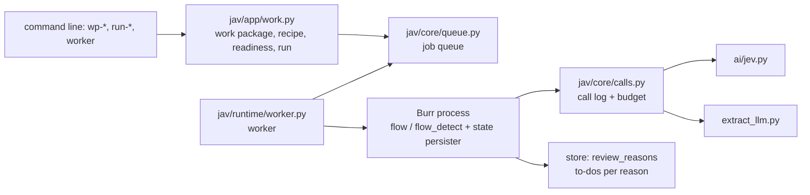
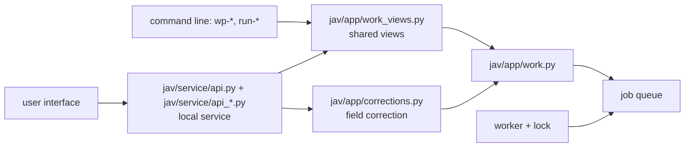
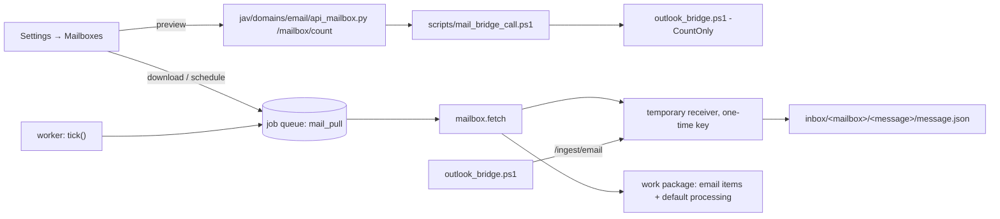

# Architecture — the end-to-end process and the five planes

**Date:** 2026-09-27, reviewed 2026-09-30 · **Status:** describes the structure that actually works. The guarantees of section 6 apply to the path that runs through the worker; the command-line measurement paths are outside them.

**Plain-language summary.** The system is a general framework for processing documents and emails with AI. Each flow
reads a document or an email, lets code, JEV and OpenAI each make the decisions they are suited to, and stores the
result, together with its to-dos, in a local database. Three reference flows show how it works: document type
recognition, invoice data extraction and email intent. Documents and emails go into work packages, whose runs a
background worker processes, reserving the cost before every paid call; a local service and a browser interface give
access to all of this. This page describes the process end to end, the five planes the flows share and the layers built
on top of them.

**What this is:** a general, multilingual document- and email-processing **AI-flow framework**
(Burr + Pydantic + sidecar + JEV) in which the flows are instances and the framework layer (adapter, registry schema,
call-site schema, policy schema, eval, store, contract, input adapters) is shared. The process below shows the three
reference flows (M1 document type recognition, M2 Hungarian invoice with two paths, M3 email intent); a new flow sits on the same
planes. The reference flows are the yardstick for the efficiency and reliability of the framework and of the
JEV–Pydantic AI–Burr combination. Teachable document processing is a complementary goal: a versioned processing recipe
for a known type, general data-point proposals with source checking for an unknown one. The shared source- and
structure-checking capabilities serve both. OpenAI and JEV can both be used, for documents and emails alike; the division of labour between them is
decided per task by measurement (section 3).

**Package layout (208, plan G-process-core R2).** The code is in one folder per layer, lowest first:
`jav/core/` (the store, the settings, the registries, the decisions log, the call log, the job queue and, since 213,
the process core `jav/core/process/`, section 16),
`jav/documents/` (reading, OCR and the native readers), `jav/ai/` (JEV, GPT, the candidates, the decision rules and the
type packs), `jav/flows/` (the Burr graphs and their registry), `jav/app/` (work packages, runs, results, outputs and
workflows), `jav/runtime/` (the worker), `jav/domains/<domain>/` (a domain's own modules), `jav/service/` (the local
service) and `jav/cli/` (the command line); beside them `jav/evals/` (measurement, with the three stand-alone tools of
section 13), `jav/devtools/` (the preflight, the guards, the generated documents) and `jav/legacy/` (the port of the
legacy project). A layer may import its own and the layers below it, never the ones above; a domain never imports
another domain; only the command line (and a domain's golden sets) imports the measurement. A domain's addresses of the
local service (`api_*`), its commands (`*_cli`) and its golden sets follow the rules of the service, the command line
and the measurement. `tests/test_dependency_direction.py` reads every module's imports, inside functions too: it fails
on a module outside the layers' folders and on a new import against the direction, and lists the ones that exist
today, each with the step that takes it away (the list can only shrink; 227, plan R3c: 15 → 7, the reading's own
rules and input kinds in the documents layer, the conflict error and the secrets of `.env` in the core, the worker's
state read by the service and the command line, the quote's golden set passed to its measurements; 229, plan structure
stage 1, MD1: 7 → 0, the value checks `fact_checks` and the source instances `source_instances` in the documents layer,
the JEV check of the native facts in the AI layer, `jav/ai/native_verification.py`). Since 229 a lower layer does not
name a higher layer's module as text either (an import by name, a registry entry naming the module that owes it):
what it needs from above is handed over when the higher layer is loaded. The application hands the shared registries
its registrations' call (`jav/core/completion.py`; the log events and decisions, the checks and the flows complete
themselves through it, and reading one in a process without the application is `RegistrationsMissing`), the item kinds
tell the native result whether an item is read as a document (`native_results.set_document_check`) and the package
result hands the role-swap check its counted results (`party_history.set_results`). A domain registers its own flows
(the email's intent, the bank table's statement) and claims the item and source kinds it owns (`item_kinds.claim`,
`claim_source`). A module that
moved keeps a saved flow state readable: the state persister reads its classes at their new place
(`jav/flows/persistence.py` `MOVED_MODULES`; 209: a class that left its module, `MOVED_CLASSES`; 227: a renamed class
under its new name, `RENAMED_CLASSES`, so the 2 774 states saved before 188 with the record's old name `InvoiceHU` load
as `DocumentRecord`). The data model is the AI layer's general one (`jav/ai/models.py`); the Hungarian invoice's own field lists and G-path output model are beside it (`jav/ai/invoice_models.py`), and the page
layout that reading makes is the documents layer's (`jav/documents/layout.py`, 209). The
instructions and output schemas sent to the models are config data in `configs/prompts/` (209), not code. A domain's
tables are its own (209: the email tables left the shared store, `jav/domains/email/email_store.py`): a shared module or
another domain reaches them through the domain's registrations, and the same test fails on a module outside a domain
that names one of its tables in its SQL (the measurement and the developer tools excepted). The legacy project's
database is not a runtime dependency.

**Native document path.** Work packages also accept DOCX, XLSX, TXT and CSV. The worker dispatches these to
`jav/flows/flow_native.py`; the readers preserve structured source elements, and `jav/documents/native_results.py` stores immutable
readings and interpretation publications. Model calls use the existing provider adapters, receipts and budget ledger.
The API exposes complete source elements and source-linked facts to the native review views. Corrections retain the
original proposals, approval is bound to the displayed review version, and the shared result datasets include native
facts and reading status. PDF and email items keep their existing flows. A PDF whose recognised type has no fitting
type pack (a scan with the reader's local OCR) continues from detection into the native flow when the recipe's
`unknown_documents` setting is
`facts` (the default, 120); its result is then chosen by its native publication (`native_results.native_item`), not
by its suffix. The storage boundaries, failure states and
source-location contract are described in [Native document processing](guides/NATIVE_PROCESSING.md).

This page is written by hand. The generated parts are the graphs' `docs/flows/<flow>/FLOW.md` (in the repository), and
the JEV call-site catalogue and the state snapshot (local, generated from the store: `python -m jav.cli docs`,
`admin --write`). Rules: `CLAUDE.md` and the [development guide](guides/DEVELOPMENT.md); JEV capabilities:
`docs/JEV_PLAYBOOK.md`; security: `docs/SECURITY.md`; config files: `docs/guides/CONFIGS.md`.

## 1. The process from an email to a decision

```
 Settings → Mailboxes: download now, or a schedule (section 11)
        │
        ▼
 worker: jav/domains/email/mailbox_bridge.py fetch (starts the temporary receiver below)
        │
        ▼
 scripts/mail_bridge_call.ps1
        │
        ▼
 scripts/outlook_bridge.ps1 (148: ported from 10_AIFLOW_V4; the Inbox, its direct subfolders and Sent Items; reads desktop Outlook, read-only; -RepoRoot inbox/.bridge)
        │
        ├─► attachment files: inbox/.bridge/data/inbox/email/<acct>/<eid>/
        │
        │ POST /ingest/email
        ▼
 jav/domains/email/ingest_server.py: temporary receiver on a free port, one-time key (the bridge protocol)
        │
        ▼
 inbox/<mailbox>/<msgid>/message.json (points to the attachment files)
        │
        ▼
 work package with the default processing (a person starts the paid run; the worker runs it)
        │
        ▼
 M3 email_intent graph (jav/domains/email/flow_email.py)
 load_message → classify_attachments → intent → route → tasks → save
                         │                        │              │
                         │                        │              └─► store.emails + email_results + review_queue
                         │                        ▼
                         │            email_rules.email_next_flow (code) ──► m2:<type> · m1:detect · human:* · archive*
                         ▼
 M1 graph for each PDF (jav/flows/flow_detect.py)
 load_pdf [→ ocr_pdf] → detect → save ──► store.documents
                        JEV: doc_type + issuer_hu + language (+ the detailed type)

 folder corpus (PDFs) ──► detect-corpus ──► M1 graph per document ──► store.documents (type × year report)

 store.documents (a type with a type pack; the detailed type) ──► M2 invoice graph (jav/flows/flow.py; the type pack
 configs/types/<type>.json supplies the fields, questions, prompt and validators), two paths in one graph:
     load_pdf [→ ocr_pdf], then
     S: find_candidates (code) → jev_select (JEV Choice, 3 batched requests) → normalize_picks
     G: extract_llm (gpt, Pydantic AI) → jev_verify (code evidence + JEV Noul fan-out) → normalize_llm
        without JEV: extract_llm → code_verify (code evidence only, the word layer too; a value printed nowhere → source:not_found)
        (extract_llm also keeps the token probabilities of the answer's values: llm_token_p)
        (extract_llm's instructions: the pack's prompt, its prompt_note, then the shared block of configs/gpt_extract.json)
        → normalize_llm; when JEV is unavailable, jev_verify keeps the code evidence and the required-field check
     both → validate (code) → decide_route (policy) → ground (code) → save → done | needs_review
```

Each PDF attachment is also an item of the email's work package and gets the full document processing
(M1 + M2, section 10). The email input can still be driven by hand: an old bridge started without `-RepoRoot` posts to
`python -m jav.cli email-ingest-server` and keeps its attachments under the legacy project's `data/inbox/email/<acct>/<eid>/`;
the receiver resolves both attachment roots (`jav/domains/email/ingest_server.py` `host_path`), and `email-inbox inbox/` then runs M3.

The **golden loop** is the same for every flow: golden set (referenced from the legacy project; the PII stays there) → run
with the cache ($0 thanks to the request hash) → report (`runs/*.jsonl` + Markdown) → discrepancy analysis from the raw
run → general rule (config change with a version bump) → rerun → determinism measurement without the cache. From live
data: a manual labelling list (`*_manual_sample.md`) → our own golden set (`golden_labels`). Situations the legacy sets do
not cover (credit notes, receipts without an invoice number; 151: the outgoing invoice) have invented cases in
`configs/golden_synthetic.json` (`golden --synthetic`), run and reported apart, so the legacy results stay comparable.
151: a local case list outside git (`golden --cases <file>`, `evals.load_case_file`) measures a path on real documents
against reference values, such as the other path's results; its run file is `<type>_local_<arm>` and its score is an
agreement, not an accuracy.
188: every golden set is in one registry (`jav/evals/goldens.py`) and one command measures them
(`python -m jav.cli measure [<golden set> ...]`, `--list` names them): the data points of each type pack with golden
cases on each of its paths (legacy and synthetic cases apart), the type recognition, the email intent, and the logic
packs' golden sets (the reconciliation's pairs and incoming money kinds; since 231 A3d the quote's lines, matches and
reply letters are the IT quote process pack's).
204: a logic pack's golden sets are described in its domain's measurement module (`jav/domains/finance/goldens.py`,
`jav/domains/quotes/goldens.py`), which the domain module names (`GOLDENS`) and the registry imports by name
(`goldens.logic_pack_goldens`), in the packs' registration order; until 204 the pack named them in its registration
(`LogicPack.goldens`), so its own module imported the measurement layer. A business module of a domain imports no
measurement code (`tests/test_golden_owners_204.py`).
Each set is measured by its own command's function with the same arguments, so the raw run files stay as they were;
without a budget only earlier answers count, and a paid round names one set. A round writes its sets' reports into
`runs/<stamp>_measure.log` and a receipt with the commit and one line per set into `runs/<stamp>_measure.jsonl`.
189: the coming quote request logic pack's golden set is invented (`configs/golden_quotes.json`, read and laid out
as mailbox folders by `jav/domains/quotes/invented_golden.py`); it joined the shared command with the quote package (191), and since
231 A3d the IT quote process pack owns it.
197: the packs converted from legacy types count with their flat expected records (the ticket's 11 cases, the general
terms' 10), and `facts:<family>` measures the general facts (the native path's source-bound facts, no type pack) on a
type pack's legacy golden documents with the pack withheld (`configs/golden_facts.json`, `jav/evals/evals_facts.py`): the
pack's scored fields are looked for among the facts by value, a repeated file is one document, and the documents are
split into a development and an evaluation half fixed before any measurement; the documents take the native graph's
reading and interpretation, are not published and open no to-do.
Teaching a type (197) starts from such a family: `python -m jav.cli type-propose <family>`
(`jav/evals/type_teaching.py`) reads the development half's measured facts (read only, no AI call) and proposes the names
that recur in at least three of its documents as fields, with their counts and a kind (a date when every value is
exactly one date); code joins only one name's spellings and a bilingual label's first part, never synonyms, and no
value is printed or kept (`--shapes`: the written forms of the development half's labels, letters and digits masked).
A person writes the draft (`configs/type_drafts/<key>.json`); `type-candidate <key>` makes its candidate pack the way
the legacy converter made the converted packs (pack, prompt, schema, a verification site that inherits `verify`),
never picked by detection, and lists the shared registries' entries still missing; `measure taught:<key>:evaluation` measures
the candidate on the family's evaluation half, on the G path (`taught:<key>:development`: on its own development half,
an in-sample check before the evaluation; a draft is corrected from that half only).
Detection picks a pack only by a person's command (199): `type-activate <key> [--replace <pack>]` and
`type-withdraw <key> [--restore]` turn the pack's own detection switch (`auto_detect`) as a new version with a
changelog line, and the files stay for the earlier results. A taught pack is turned on only with the latest shared
measurement of its evaluation half on a clean working tree, every case answered, on the files it has now (the legacy
activation gate); the result is shown and no threshold decides. `--replace` turns the family's pack it takes over off
in the same step, and `--restore` turns that one back on. A pack without detection anchors is turned on only as its
family's one pack, because next to another the anchor score would pick it without a question. The capability
catalog reads whether a type is active from the same switch.

## 2. The five planes

| Plane | What | Where | Control |
|---|---|---|---|
| **Flow** (Burr) | five graphs: the three reference flows, native reading (non-PDF inputs) and the bank table flow; `@action.pydantic` typed state, `run_id` = app_id, local tracker | `jav/flows/flow.py`, `flow_detect.py`, `flow_email.py`, `flow_native.py`, `flow_statement_table.py`; a `CONTRACT` at the end of each | `python -m jav.cli flows` lint + FLOW.md; tracker UI `burr` |
| **Decision** (JEV + GPT) | the families of JEV call sites: detect and detect_detail, email_intent, select (Hungarian, foreign, utility), verify (per type) — one file each under `configs/callsites/`; two generative steps: the G path's extractor (extract_llm) and the email task proposals (`configs/email_tasks.json`); the adapter (`jav/ai/jev.py`) puts the concrete model version into the cache key, calls with a RetryPolicy and passes SDK errors on as `JevUnavailableError` | question sets `configs/callsites/*.json`, registries `configs/doc_types.json`, `intents.json`; code: `jav/ai/detect.py`, `intent.py`, `jev_select.py`, `jev_verify.py`, `extract_llm.py` | `configs` (version, hash), the call-site catalogue (local, generated by `python -m jav.cli docs`), bands and routes in `configs/policy.json` (`bands` / `band_for`, `jav/ai/policy.py`) |
| **Data** (SQLite) | documents · datapoints · emails · review_queue · ledger · golden_labels; also the tables for work packages, runs, the job queue, to-do reasons, the call log, email results, mailboxes and watched folders (full list: the `CREATE TABLE` statements in `jav/core/store.py`, `jav/domains/email/email_store.py`, `jav/app/work.py`, `jav/core/queue.py`, `jav/core/calls.py`, `jav/domains/email/mailbox.py`, `jav/app/app_settings.py`, `jav/app/corrections.py`, `jav/documents/source_layer.py`, `jav/legacy/legacy_import.py` and `jav/app/parties.py`); the process state lives in a separate store (`store/burr_state.sqlite`) | `store/jav.sqlite`, `jav/core/store.py` (additive migration; 204: a module adds the columns an older store lacks with `add_columns`, never by hand; 187: `read_only`, a read-only look that runs neither the schema nor the migrations and creates no store, used by the state snapshot and, since 231, the generated call-site pages; 231 D-d4: a connection a migration opens while the store is set up does not set it up again) | `store` statistics (row counts of the core tables; 209: a module adds its own lines in their place, `register_summary`, the email domain its emails and their intents); the ledger records every AI call with its `config_hash` and, on failure, an `error` |
| **Measurement** (eval) | flow-independent list of judgements from the raw runs: accuracy and band per question, calibration (ECE), top-prob vs. conf, policy re-evaluation without calls, determinism; the measurements without JEV (`*_gpt`, `*_G_nojev`) are flows of their own with the GPT call sites, a GPT field's confidence calibrated against its score, and the silent errors (wrong, no to-do in the recorded run) per flow | `jav/evals/eval_report.py` (input `runs/*.jsonl`), the flow-specific runners `jav/evals*.py`; the golden sets' registry `jav/evals/goldens.py` (188), with the domains' measurement modules (204: `jav/domains/finance/goldens.py`, `jav/domains/quotes/goldens.py`) | `eval-report` → `runs/<time>_eval_report.md`; `measure` for every golden set (188); golden / determinism commands per flow |
| **Administration** | config versions and hashes, models and prices, lint, golden results, review queue; session rules and hooks | `jav/core/cfg.py`, `configs/models.json`, `jav/devtools/admin.py`, `CLAUDE.md`, `.claude/settings.json`, `scripts/hooks/` | `admin` on one screen; hooks at session start, before compacting and at stop (a non-blocking reminder), plus a review agent; see the [development guide](guides/DEVELOPMENT.md) |

## 3. Where each decision is made — the decision hierarchy in practice

1. **Code** (deterministic, tested): candidate finders, validators, body cleaning, anchor features, evidence matching,
   `next_flow`, the review latch. This is the mechanism.
2. **JEV** (judgement over a finite set of options): one of the tools for selection, presence and verification steps. One call site = one JSON config
   + one `build_state` + one `build_questions` + one `jev.ask(...)` through the adapter. Raw probability goes into the state,
   thresholds only into versioned rule files (the shared bands in `policy.json`; 224: a domain's own rules in its own
   file, such as `email.json`): a named band set per call site (`band_for`), Noul no / uncertain / yes,
   Choice auto / uncertain / human (confidence threshold + gap to the second option); the `uncertain` band triggers review only
   with `uncertain_review: true`. Because of the request-hash cache, the same (concrete model version, state, questions) gives the same answer
   for $0; since 200 the configured model is a concrete version (`configs/models.json` `jev.model`, `jev-1.14.0`), so
   the answers do not change by themselves; the provider's moving name (`jev.watch_alias`, `jev-latest`) is only resolved
   with a probe by the daily backup (`runs/cache/_model_versions.json`, 24 h TTL; `jav/ai/jev_version.py`), and the
   start-up check and the System page say when it points to a newer version (switching is a decision with a
   measurement). An alias still works as the model and is resolved the same way. If JEV still
   does not answer after the SDK retries, the adapter writes a ledger entry (`error`) and raises `JevUnavailableError`; the flows turn this
   into a `jev_unavailable:<reason>` review (M1/M3 `final_status = jev_unavailable`) instead of crashing. A request refused
   for the token limit (`max_tokens_exceeded`) is remembered under its key and the concrete version that refused it
   (`runs/cache/too_large/`, 200); it is refused again without a call, with the same reason, so the request-size frame
   (`jav/ai/jev_budget.py`) goes on to its tighter request at once and a free round can answer it. Processing without JEV
   is a guarantee (160, `jav/ai/engine.py`): a flow application built with `jev=False` runs every step inside `jev.disabled()`, so a
   JEV question asked anyway is refused before the model probe, the cache and the call log (`JevUnavailableError("disabled")`,
   the `jev_unavailable:disabled` to-do; `get_adapter()` refuses too, whatever adapter a run installed). In the tests the refusal
   fails the test (`tests/conftest.py`); a test of the refusal itself is marked `jev_refusal` (`tests/test_jev_safety_net_160.py`).
   The engine matrix (`configs/engine_matrix.json`, checked by `jav/devtools/engine_matrix.py` in the preflight) lists every JEV call
   site with its counterpart without JEV or a stated exception, and the tests that cover it; the paired tests
   (`tests/test_paired_*_160.py`) run each flow with both engines. Which engine a run uses: the application's AI engine
   (`app_settings.engine_default`, an `app_options` row; JEV and GPT unless someone changes it) is the default of every new
   processing setting that does not name one (`work_recipes.default_params`, `engine_params`): a package without saved settings, a
   mailbox download's package, a watched folder's package, an assignment without `jev`. Saved settings and started runs keep
   their own (a run freezes its settings when it starts); an assignment saved before the engine setting existed (recipes 1.9.0, 2026-10-02) has no `jev` and stays JEV and GPT.
3. **OpenAI, through Pydantic AI**: the existing G path and the general data proposal produce structured proposals and then apply source checking. The graphs described here neither restrict OpenAI to generating extracts nor make JEV the only tool for every interpretive decision: further interpreting, classifying and verifying roles are also permitted, for documents and emails alike. Any new division of labour must be built in on the basis of targeted measurement; source checking, separate cost accounting and manual activation apply to every role. The Burr states are plain Pydantic models, not Pydantic AI.
4. **OCR pipeline**: `jav/documents/ocr.py` + `configs/ocr.json` — PDF without text → page image (pypdfium2,
   300 dpi) → tesseract word boxes (native tesseract on the machine; the Hungarian + English language packs taken from the old sidecar's Docker image
   into `tools/tessdata`; fallback: the old sidecar image via `docker run`) → the same line/cell builder as for the text layer
   (`jav/documents/pdf.py: build_layout`). A separate graph step (`ocr_pdf`) in the M1 and M2 graphs, a disk cache in `runs/ocr/`,
   raw quality signals in the state, thresholds in the `ocr` block of `policy.json`. The rest of the old sidecar (torch, the matcher)
   has not been ported. When local OCR is weak, `ocr_with_escalation` asks Azure DI (paid): since 121 directly over its REST API
   (`jav/documents/azure_di.py`, standard-library HTTP, ported from the old sidecar's provider) when `AZURE_DI_ENDPOINT` and
   `AZURE_DI_KEY` are set, otherwise through the old sidecar, which sees only the legacy data folder. The call goes through the
   call log (`azure_recognise`): in a worker run the page count is reserved from the run's Azure budget (recipe switch
   `azure_ocr`); an analysis Azure accepted but whose result was lost is an uncertain call. A blocked or failed escalation leaves
   the local text and, unless the recipe switch is off, a to-do (`ocr:escalation_blocked:*`: budget, uncertain earlier attempt,
   no route to Azure, failed call). Since 123 the original Azure recognition (word polygons, page size, unit, angle)
   is kept once in the store, under the sha256 of its canonical JSON (`ocr.save_recognition`, artifact kind
   `azure_recognition`), and the digest travels with the recognition signals (`recognition_sha256`); the text, the
   OCR cache key and the call's request hash are unchanged. Since 124 detection names the recognition whose text
   went on (`ocr_recognition`; an Azure text cached before 123 has no kept original and names nothing), and a scan
   continuing into general facts takes it over in the native reader (`jav/documents/readers/external_recognition.py`, see
   `docs/guides/NATIVE_READERS.md`). Heavy dependencies may only go behind a sidecar.
5. **Isolated PDF reading**: `jav/documents/isolated_pdf.py` + `configs/service.json` `pdf_reader` — the third-party PDF parsers
   (pdfplumber for the text layer, PDFium for the OCR page images, the page sizes and the review page images) run in one
   long-lived helper process per calling process (worker, local service), one request at a time, with a time limit per
   request and a memory limit (on Windows a job object). Our own processing (words → lines and cells) stays in the
   calling process. Over a limit the helper is stopped and replaced; text extraction fails the item with a named error
   (`PdfReaderLimit`, no retry), the OCR page images give a to-do (`ocr:unavailable:PdfRenderLimit`), and a review page
   image is answered with 422. `isolated: false` runs the same functions in-process. 138: the same helper parses a
   tabular statement export (`statement_table.parse_rows`: openpyxl, defusedxml, the CSV reader) within the read time
   limit; a parser error keeps its message and a limit is a named refusal (`StatementTableError`, 422).

## 4. Tuning and changes — the procedure

| Change | Where | What follows |
|---|---|---|
| type or intent description (`what`), boundary (`not_for`), example (`examples`), family (`parent`) | `configs/doc_types.json` / `intents.json` (schema v2), bump `meta.version` + changelog | `detect-golden` / `email-golden` (new hash → live calls), `detect-determinism` / `email-determinism`; `eval-report` (parent-label section); regenerate `docs` |
| JEV instruction, Noul question | `configs/callsites/<callsite>.json` | the same; the local, generated call-site catalogue shows the statistics per version |
| band, threshold, route | `configs/policy.json` (`bands`, `band_for`, routes) | no rerun needed: `eval-report` shows from the raw runs (`runs/*.jsonl`) how many cases would change band |
| model, price, timeout, retry, cache version, alias TTL | `configs/models.json` | bumping `cache_version` invalidates every cache key; a model-version change (detected by the probe) produces a new key by itself |
| graph step | flow module + `CONTRACT` | `flows` lint + FLOW.md |
| code (regex, cleaner, validator) | `jav/<layer>/*.py` + test (TDD) | `pytest`, `recall`, golden |

Pitfalls: a `use_cache=False` run **updates** the cache file (it refreshes the reference), except for the determinism measurement,
which runs under `JevAdapter.no_cache_write()`: no reads and no writes, so the reference answer stays untouched.
The old inbox folders contain attachments only; any change to a Choice criterion means a new cache key. The cache
key contains the concrete model version (introduced with `cache_version` 2): even a fully cached golden run
needs one probe a day (an API key is required; offline, the resolution stored in the file is used, with a warning).

## 5. What Claude needs to know to develop efficiently

- Session protocol: `CLAUDE.md` §2 and the [development guide](guides/DEVELOPMENT.md) §4; the hooks back it up
  (SessionStart / PreCompact / Stop / review). Session start: `python -m jav.cli preflight` (pytest + UI checks +
  contract lint + engine matrix + configs + git state + data guard + language guard + Ruff ratchet + the local state snapshot, among
  others). Never copy state numbers anywhere by hand: refer to the generated state snapshot.
- Designing a JEV question: `docs/JEV_PLAYBOOK.md` (facts from the docs, gap analysis per call site, checklist).
- A new JEV question: config JSON + `build_questions` (registry reference `registry:<name>`), the `docs.typesafe.ai` cookbook, a test
  modelled on `tests/test_cfg.py`, a golden run before and after.
- A new flow: module + `CONTRACT` + `TERMINALS` + `build_app` (tracker project in `models.json`) + lint + a golden runner
  modelled on `evals_*.py`; a flow never imports an SDK, only the adapter.
- Search the legacy project first (`CLAUDE.md` §3).

## 6. Execution layer: work package → run → worker

**Plain-language summary.** Documents go into a work package, the package gets its processing settings (or runs with
the default ones), and the run goes through a
durable job queue in the background. Before every paid call, an entry is written and the cost is reserved. After a stop,
the run resumes from the saved step, and a call that has already been paid for is not repeated. To-dos can be resolved
reason by reason, and a live run can only be approved when it has no open to-dos.



| Layer | File | Guarantee | Test |
|---|---|---|---|
| Work package, recipe, run | `jav/app/work.py`, `configs/recipes.json` | version conflict → `RevisionConflict`; readiness blockers; fixed input; idempotent start; approval only in live mode and with no open to-dos. A recipe has a `status`: `active` (offered in the UI; one since 1.8.0: `processing`), `internal` (`invoice-extraction`: a given document type, no recognition; command line and tests), `retired` (`document-processing`, `email-intent`: kept for old runs' titles and old assignments; `assign_recipe` raises `RetiredRecipe`). Without an assignment, readiness uses the default processing with its defaults (`assignment_default`) and `start_run` saves them in the same transaction; `migrate_assignments` / `processing-migrate` moves old assignments onto `processing`, keeping the settings (`carried_params`). 151: a finished live run that is not approved (its reasons pinned until it is approved) can be superseded by a person once a later finished live run of the package has all its items (`supersede_info`, `supersede_run`, `/runs/{id}/supersede`): in one transaction the run becomes `cancelled`, its own open reasons `superseded` (`store.close_run_reasons`), and the package's events get `run_supersede` with the later run; the run view carries `supersede` (the offer, with the human work left on the run) and `superseded` (`work_runs.superseded`). 152: the package view carries `supersedable` (`work_runs.supersedable_runs`: every such run of the package, oldest first, with its offer), so the Processing section offers them too; 153: the package list counts them (`older_runs`). 153: the package's next step, its Review and Result tabs and the list's open to-dos follow the current run (`work_views.current_run`: the newest run, passing over runs a person stopped after it), so a later stopped run hides neither the to-dos nor the approval of an earlier finished run; the view carries `current_run` beside `last_run`, and a workflow step stays done when a later live run was stopped. 153: the package's view, its readiness check, the run's view and the run list read through one connection (`store.session`; a package of 468 documents opened in 4 s with 944 connections, now 0.3 s on a copy of the store), and a run's open to-dos are counted by a range on its item flow ids, served by the index `ix_review_reasons_status_run`. 204 (R1i): leaving out a removed item's to-dos reads only the package's removed items (`ix_workpackage_items_removed`; before, every item of the package for each open to-do: the run list took 10.4 s for one run of 10,000 items with 1,000 open to-dos, now 0.014 s; at 100,000 items more than 300 s, now 0.09 s). 153 (review): a package's to-do counts (the list's "incl. earlier runs" column, the package's to-dos, its items table) leave out the reasons another package's runs raised (`work_views.own_reasons`; a measurement's or the command line's still show): a to-do belongs to the document's content, so the same file in another package carried that package's to-dos in. No run closes another's reasons by itself. 160-C S1 (decisions 163 D2, D3): removing an item is virtual and needs a person and a reason (`remove_item(actor=, reason=)`, `/workpackages/{id}/items/{item}/remove` with `reason`, 422 without one); the item keeps `removed_at`, `removed_by` and `removed_reason`, the package's events get `item_remove`, and `restore_item` (`/items/{item}/restore`, event `item_restore`) brings it back. A removed item stays out of readiness and the next run; a run already started keeps it in its frozen input. The `workpackage_items` dataset shows removed items with the `removed` scope (`_removed` per row). 160-C (decision 163 D7): items removed from the package since a run started are left out of that run's release (`work_runs.excluded_items`, `work_runs.released_items`): their to-dos block neither its status nor its approval, the run list does not count them, and the downloads (tables, JSON, Excel, named copies) and the statement package's approval rule leave them out. The approval then needs the count the approver saw (`confirm_removed`; otherwise 409 `not_ready` with the `removed_items` blocker) and records the items left out (`runs.excluded_items`), so a later removal or restore does not change a released result (decision 160 D1); the run view carries `removed_items`. 160-C S2: a person adds documents to an existing package with `add_to_package` (`POST /workpackages/{id}/items`, the response's `added`: added, already in the package, restored, and the names a live run of another package processed): by content, a document already in use changes nothing (no revision step), a removed one is restored, and an actual change is logged (`items_add`) in the same transaction (`add_entries(event=)`); a statement or reconciliation package refuses it (`SURVEYED_KINDS`, 422). `pending_items(wp, mode)`: the items in use that no non-cancelled run of that mode has finished; after a run they are the package's next step (`pending`). 160-C S3: readiness carries `supplement` per mode when a run of that mode finished some of the items in use and others are pending: the pending items' count, their own blockers and warnings (an earlier item's changed source does not hold it up), budget, plan and input hash. `start_run(scope="pending")` (`StartRun.scope`, `run-start --pending`) freezes only those items (`runs.scope = 'pending'`, the runs dataset's Run scope column); it does not start while another run of the package is queued or running (`run_active`), and its idempotency key counts the package's stopped and failed runs of that mode, so a double click gets the same run and a stopped one can be started again. `work_runs.open_live_runs`: finished, unapproved, not stopped live runs no later finished live run repeated on all their items, oldest first. `work_views.current_run` is now a queued or running run, else the oldest open live run, else the 153 rule, so a later run over the pending items or a later trial hides neither the to-dos nor the approval of an earlier live run; the package view carries `open_runs`, Review opens on the current run and names the other open runs with to-dos, and a workflow step is done only with an approved live run and no other live run still going or open (`workflows._live_run_approved`). 168 (plan F-item-list-and-adding): adding is previewed first. `preview_additions` (`POST /workpackages/{id}/items/preview`, the given files or a folder's documents, with `recursive` its subfolders' too, without the output folder of the named copies; `folder_contents` also names the other files it leaves out) marks each document `new`, `already`, `removed` or `repeated`, and `elsewhere` when a live run of another package processed it, without writing anything; the add request takes the same sources and leaves out what the person unticked (`exclude`: new documents; `restore`, when given: the only removed ones to bring back), counted as `left_out`. `remove_items` / `restore_items` (`POST /workpackages/{id}/items/remove|restore`): several items in one revision step and one log event (`items_remove`, `items_restore`), all or nothing. `item_states(wp, items)`: per item the run whose result counts now (approved live > live > trial, a stopped or superseded run does not count) and the state `approved` / `live` / `trial` / `running` / `failed` / `pending`; the `workpackage_items` dataset shows them (State, Counted run, Run started, Result; a removed item reads `removed`). A statement package's survey and add take `recursive` too (`statement_package.expand_folders`: each subfolder read as a folder of its own, a companion PDF folder left to its parent). | `tests/test_work.py`, `tests/test_flexible_package_160c.py`, `tests/test_package_items_168.py`, `tests/test_work_cli.py`, `ui/src/pendingRun160c.test.tsx`, `tests/test_processing_080.py`, `tests/test_supersede_runs_151.py`, `ui/src/supersedeRuns151.test.tsx`, `tests/test_supersede_package_152.py`, `ui/src/supersedePackage152.test.tsx` |
| Package's current result | `jav/app/package_result.py` | 171: per item of a package, the result that counts now, decided in one window query (`counted_results`): the latest finished one of an approved live run, else of a live run, else of a trial run; a stopped or superseded run and an unfinished item do not count. The item list's state (`work_runs.item_states`) and its name (`naming.package_item_names`) both come from that run. `effective_values` is the one merge of a machine result and the latest correction, used by the item result and the correction check (`corrections`), the run export, the reconciliation's and the duplicate search's document readers. 172: `in_use` gives the same for the items in use, in the package's item order. A result table (`emails`, `email_tasks`, `documents`, `datapoints`, `native_facts`, `line_items`, `utility_cost`, `utility_sources`) takes exactly one of a `run_id` or a `workpackage_id` scope (`Dataset.one_of`): a run's table is the run's, as before; the package's current result reads each item in use from its counted run (`datasets.result_parts`), each row's link naming that run, and is cached by the package's fingerprint (the items in use and their order, each item's counted run and tier, each counted run's own fingerprint). A page of the package's table carries the result's mark (`result_mark`), which Approve and release sends back. `/workpackages/{id}/result` carries the views with data (`tables`, `work_views.result_tables(workpackage_id=)`; the file names only when one run gives every item's result, as the named copies are made per run), `/result/export.xlsx` the current result as a workbook (`package_release.current_workbook`) and `/result/utility-cost` its utility report. 174: `counted_documents` gives each document's counted result row across every package it is in use in, in the same order, with a command-line result (a measurement) below a trial and counting only when no run has finished the document; a run that ended without a result row (a to-do before the data points) gives way to an earlier one that left one, and a document removed from every package it was in has none (decision 160 D3). The reconciliation (`reconcile.snapshot`, `statements`), the duplicate search and through it the own-tax scan, the role history (`party_history`) and a statement's relations (`statement_months.item_view`) read these rows (`result_rows`, with `latest_corrections`); before, each read the store's latest result row, a later trial's too. A statement package's rule after an approval reads the approved run's own statements (`run_documents`, `reconcile.run_statements`). The reconciliation workspace's mark includes each run's mode and whether it was stopped, and the removed package items | `tests/test_package_result_171.py`, `tests/test_package_result_names_171.py`, `tests/test_package_result_tables_172.py`, `tests/test_document_result_174.py` |
| Approve and release | `jav/app/package_release.py` (`package_versions`, `package_version_files`), `/api/workpackages/{id}/result`, `/release`, `/versions/{n}/files/{name}`, `python -m jav.cli package-versions-backfill` | 171: one step approves every open live run of a package (`work_runs.approve_run`, each with the reviewed version the person saw) and records a released package version: the approved items, each from its run, and their downloads (workbook, JSON, the CSV tables) stored as files, so a released version's download never changes. 178: the workbook is made with the package's chosen template, a package with utility bills also stores the utility cost's workbook (`utility_cost.xlsx`), and each workbook's file records the template and its version (`template`, `template_version`; empty for a version released before 178: the built-in template). The person's `expected_mark` (the package result's mark) must still hold, and again after the files are made; open to-dos block it before any approval. The view reads `not_released`, `released`, `partly_released` (an item in use without a released result) or `changed_since_release` (a released item removed or replaced). A package approved before gets its first version recorded afterwards (`backfill`, `backfilled_at`). A reconciliation package is approved in its own statement. 186 (plan G-full-move T2d): a logic pack without runs keeps its own approved versions in the same tables: the content the person approved (`content`; NULL for a package's release), its fingerprint (`mark`), who approved it and when, what it locks while it holds (`locks`) and its reopening (`reopened_by`, `reopened_at`, `reopen_note`); each file is stored in the state it was made in (`state`: `released`; a logic pack's own version: `approved`, `earlier` once reopened; part of the file's key, so an older store's files table is rebuilt once with its rows as released files). The logic pack decides what it approves, what blocks it and what its lock refuses; `record_own`, `reopen_own` and `store_own_files` number and store inside its write transaction, `own_versions`, `own_version`, `active_own`, `own_files`, `own_file` and `own_missing_files` read them back. 224 (plan G-process-core P3c): a logic pack approves and reopens through the shared steps, in one order and its write transaction: `approve_own` (the version, the kind's files, the log's `<kind>_approve` entry with the version, the fingerprint and the kind's details) and `reopen_logged` (the reopening, the kind's files of the earlier version, the `<kind>_reopen` entry); the kind checks its blockers and the fingerprint the person saw before, in its own words. `record_own` refuses a second own version while one holds (`OwnVersionHolds`, a revision conflict), so two approvals in a race cannot both hold, whatever the kind (`tests/test_own_approval_224.py`). The release view and the stage bar list a package's released results only. An older store's own version tables of a logic pack are copied in once by its migration (`copy_older_own`, a `meta` mark per table); the older tables keep their rows, read by nothing, for one release. 172 (DECISIONS 172): the interface approves only here, on the package's result (a run's own result can still be viewed); the package's next step is `release` (Approve and release) for a finished live run and also while an approved live run is newer than the latest version (`unreleased_approval`: an approval the way before v1.20.0, or a release stopped after its approvals); the package list's fingerprint includes `package_versions` | `tests/test_package_release_171.py`, `tests/test_package_result_tables_172.py`, `tests/test_package_release_186.py`, `ui/src/resultRelease156.test.tsx` |
| Job queue | `jav/core/queue.py` | dedup key, claiming, attempts + back-off → `dead`, release, stop, handling of orphaned claims at start-up (modelled on the V4 `jobq.py`) | `tests/test_runtime_queue.py` |
| Call log, budget | `jav/core/calls.py` | reservation of an upper bound before the network call (UTF-8 bytes + a fixed overhead per request, growing conversation retries, transport retries; a call above its reservation stops the run's further calls with that provider); 149: a GPT call whose full bound no longer fits the budget left is sent with its lean bound (`invoke(lean=…)`: one request, no validation retry, still a true bound; the call log notes `lean_bound`), so a tight budget is not left unused; failed calls are logged too; an unknown cost stays reserved; 202 (the owner's decision): a definite failure whose cost is certain is settled at it (`known_outcome`): a JEV request refused as too large (`max_tokens_exceeded`) at 0, a GPT answer cut off at its output cap at the tokens of every request of its run; a timeout or a broken connection keeps its maximum (`tests/test_known_failed_cost_202.py`); an uncertain attempt is not repeated; a GPT question (`reusable`, its `request_hash` an `answer_key` of the model, instructions, schema, settings and text: only what GPT is sent, so a change only JEV reads keeps the answer reusable, and the settings fingerprint stays in the ledger, 128) gets an earlier answer to the same question when the run's earlier-answers setting allows it (`use_run(reuse=…)`, `worker.reuse_answers`): cost 0, noted `reused_answer:<id>`, a cached ledger row (`tests/test_gpt_reuse_090.py`); 160-D: a command-line measurement reuses too (`measurement(reuse=…)`): a golden measurement and a processing command follow their cache setting (`--no-cache` asks again), a determinism measurement never reuses, a reused answer needs no budget, and the measurement prints its live calls and reused answers (`scope_calls`, `tests/test_measurement_reuse_160d.py`); only an uncertain attempt can be settled by hand (one conditional write; a reserved one may still be running), and a late answer does not overwrite a settlement; a successful step is replayed; every reservation names its holder, a lock file next to the store (`call-holders/`) that the reserving process keeps locked for its lifetime, and a worker start makes uncertain only the reservations of holders that have stopped (or of reservations without a holder), so a command-line measurement waiting for its answer keeps its reservation (`holder`, `recover_uncertain`); 204 (R1i): the look for an earlier overrun in a budget is one index lookup (`ix_invocations_scope_note`); the budget sum stays exact (`Decimal`), a running total is left to the budget redesign; 231 (C2a): a `repeatable` call (`invoke(repeatable=True)`: free and without effect, a connector's lookup; noted `repeatable`) is never uncertain: an answer lost after sending, or a reservation its stopped process left open, makes it failed | `tests/test_runtime_calls.py`, `tests/test_connectors_231.py`, `tests/test_runtime_adapters.py`, `tests/test_reservation_holder_092.py`, `tests/test_gpt_reuse_key_128.py`, `tests/test_lean_reservation_149.py`, `tests/test_run_scaling_204.py` |
| Connectors | `jav/core/connectors.py` (`ask`, `of`, `catalogue`, `use_transport`, `ConnectorUnavailable`, `ConnectorError`), `configs/connectors.json` | 231 (plan stage C, C2a; glossary: Connector): each external service described once as data: its address, the fixed headers of its requests, what leaves the machine (`sends`), the price of one question, the timeout, the retries of an unreached service (`retry_wait_s` apart), the questions a minute it may get and the largest answer read; `ask` keeps to the description and writes every attempt into the call log under the connector's name (run `connector:<name>`, step `<purpose>:<random>`, the answer's size and digest as its receipt, not its content); its failure is named (`unreachable` with the transport's error class, `too_large`, `busy`: over the rate limit, nothing sent). Only lookups so far (`kind: lookup`, asking without changing the other system): a free one is a repeatable call, a priced one reserves its price from the running work's budget and is refused outside one; a message that changes another system goes through the process core's handover record instead. A test never reaches the network: the test setup installs a refusing transport for every connector. The first connector is the MNB exchange rate service (`mnb_rates`); 231 D-d5: two invented lookups on this machine for the tests and the trial (`invented_company_register`, `invented_sanctions_list`, answered by `jav/devtools/invented_services.py` from `configs/golden_registers.json`, as a local web service with `invented-services` or inside the process with its `transport`) | `tests/test_connectors_231.py` |
| Worker | `jav/runtime/worker.py` | stable identifier + Burr state persistence (`burr_state.sqlite` next to the store); resumption from the next step; stop at a step boundary; a changed source is rejected. 204 (R1i): the run's status after each item (`work_runs.refresh_run_status`) is read from which states the run's jobs are in (`queue.states`, one index lookup each) and through the run's state index (`ix_runs_state`, as its row holds the frozen input before those columns), and an unchanged status is not written again, so it no longer reads every item of the run (31 ms per refresh at 10,000 items; now about 0.1-0.3 ms at any size); the run's size counts only once none of its jobs is queued or claimed (an item without a job, the run's own open to-dos) | `tests/test_runtime_worker.py`, `tests/test_work_cli.py`, `tests/test_run_scaling_204.py` |
| Flow registry | `jav/flows/__init__.py` (`FlowSpec`, `get`, `specs`), `jav/runtime/worker.py`, `jav/devtools/admin.py` (`flow_lint_targets`), `jav/app/work_readiness.py` (`native_flow`, `_item_arm`) | 173: one entry per flow under the name stored in every run's frozen recipe (`invoice`, `doc_detect`, `email`, `native`, `statement_table`; `document` is the recipe flow made of the stages `doc_detect` and `invoice`; the two learning flows have a lint graph only). An entry names the flow's module, how the worker builds its graph for one item, how the contract lint builds one, whether the flow takes its budget and path from the native reader's estimate, and where an item's document type is known before the run (the recipe's settings or an earlier detection). The worker's flow map and building, the contract lint's targets and the run plan's and budget's native branches read it instead of their own lists; an unknown name is `UnknownFlow` | `tests/test_flow_registry_173.py`, `tests/test_characterisation_171.py` |
| To-dos | `jav/core/store.py` `review_reasons` | each reason is opened and closed by the step that raised it; human decisions carry an author | `tests/test_review_reasons.py` |
| One connection per operation | `jav/core/store.py` (`session`, `one_connection`); marked operations: the worker's item (`jav/runtime/worker.py` `process`), a run's start, state, open to-dos, resolution and approval (`jav/app/work_runs.py`), a package's read, creation and creation from a folder (`jav/app/work.py`), the reconciliation's snapshot (`jav/domains/finance/reconcile_store.py`), its package's workspace, context, accounts, creation, allocation and marks (`jav/domains/finance/reconcile_package.py`), its statement (`jav/domains/finance/reconcile_statement.py`) and AI proposals (`jav/domains/finance/reconcile_ai.py`), an item's result (`jav/app/corrections.py`), a workflow's creation, view and step (`jav/app/workflows.py`), the quote draft's view (`jav/domains/quotes/quote_draft.py`) | The list views read through one connection (`session`). 203: an operation marked `one_connection` runs in one session (an item in the worker opened 35-37 connections, each open and close a few milliseconds on Windows; the test suite opened about 74 000). Each `connect()` block entered outside a transaction still commits at its end, or rolls back on error, so what a failed operation's finished steps wrote stays, as before. 207 (plan G-process-core R1k): a block entered inside an enclosing block's transaction is a savepoint of it (`_shared_block`): it neither commits nor ends the write lock, and its error undoes only its own part; `begin_immediate` does nothing there. Before, it committed the enclosing work: the run start released its lock right after reading the package. A module registered inside a transaction gets its tables as part of it; the full set-up, which commits, waits for the next block outside one. A session's connection is used only on the thread that opened it: a library that copies the caller's context into its own thread gets a connection of its own (before, it got the session's and failed). In read-only mode a session opens nothing (a read-only connection is never shared) | `tests/test_store_session_203.py`, `tests/test_store_transactions_207.py`, `tests/test_view_speed_153.py` |
| Partial OCR | `jav/ai/policy.py` `ocr_coverage_reasons` | a skipped page is always a to-do | `tests/test_ocr_coverage.py` |
| Email receiver | `jav/domains/email/ingest_server.py`, `jav/domains/email/emails.py`, `jav/core/path_text.py` | paths stay inside the root (153, 167: a network path, a drive-relative one or, from the bridge, anything but a plain relative path after `/data/` is refused by its text before it is resolved), size and structure limits, mandatory key (without one it prints a one-time key at start-up), requests from a browser are rejected, replay protection by content hash | `tests/test_ingest_security.py`, `tests/test_container_path_167.py` |
| Cost view | `jav/app/costs.py`, datasets `run_items` (cost columns), `runs` (`cost_usd`) and `package_costs`, the run view (`costs`), `ui/src/views/Runs.tsx` (`PlanVsActual`), `ui/src/views/PackageCosts.tsx` | the cost per item, run and package is read from what is already recorded, nothing is stored twice: the call log (a flow's call by the item's flow identifier, an Azure recognition by the document's fingerprint in its step) and the ledger (questions answered from an earlier JEV answer or an earlier Azure recognition, 0 USD); per provider and model: paid calls, failed and open among them, the known cost, and apart the reserved maximum of the calls without a known cost (not added to the cost); the pre-start overview is saved with the run (`runs.plan`) and each provider is shown as expected / possible / not expected next to the actual calls, with a warning when a provider was called against the overview | `tests/test_cost_view_082.py`, `ui/src/costView082.test.tsx` |
| Operational safety net | `jav/runtime/worker.py`, `jav/core/queue.py`, `jav/domains/email/mailbox.py`, `jav/app/app_settings.py`, `jav/app/work.py` | the worker loop does not stop on an unexpected error (the job is closed and the error logged); an orphaned job is restarted at most 3 times and then marked dead; a stop requested while the worker was down is completed at start-up; a stop cancels the run's queued jobs and asks the running one to stop in one transaction (so the worker cannot finish the running item and refresh the run, or claim the next item, half-way through the stop), and a job that fails or is released after a stop request is cancelled instead of going back to the queue, so a stopped run always ends as stopped; an interrupted run start is completed on retry and is not "done" until then; emails that arrived before a download was interrupted still go into a package; a watched folder marks a file as seen only after it has been added successfully, and only one process scans a folder at a time; PDFium calls run under a lock | `tests/test_stability_063.py`, `tests/test_cancel_status_082.py` |
| Log, backup | `jav/core/applog.py`, `jav/runtime/backup.py` | permanent, rotating log (`runs/logs/`); store backup even while runs are in progress, with an integrity check (`python -m jav.cli backup`) | `tests/test_stability_063.py` |
| Daily backup, store thinning | `jav/runtime/backup.py`, `jav/flows/persistence.py`, `jav/runtime/worker.py`, `scripts/backup-task.ps1`, `configs/service.json` `backup` | scheduled daily backup, verified copy to a second location, status file and UI warning; the internal working documents (`internal-docs.zip`) and, since 231, the machine's local settings with the keys (`local-env.zip`, `with_env`) in the backup too; of a closed item's process states only the last one is kept (Burr `load` also reads only that one); `burr-prune` for a one-off thinning and compaction of the old store | `tests/test_ops_064.py`, `tests/test_backup_env_231.py`, `ui/src/ops064.test.tsx` |

**Limits.** The call log and the budget only apply on the path that runs through the worker (`calls.use_run`). The
command-line measurements (`golden`, `determinism`, `run` …) make their calls outside it, so that measurements stay
comparable with earlier ones; they do log failed GPT calls. As many workers run as `configs/service.json` `workers` allows (one by default),
each in a slot guarded by a lock (section 7; several workers: stage E). The email process is part of the same processing (the `processing` recipe chooses the flow per item kind, section 11), and it includes the attachments.

## 7. Local service

**Plain-language summary.** The user interface and the command line use the same gateway: a service that can only be
reached from the local machine. It does not run anything itself; it only queues work and reads from the store. The
separate worker does the processing, so closing the browser or the service does not stop a run. A request that comes
from another machine or a web page, is too large, is not JSON or contains unknown fields never reaches the business
operation. Documents can be added from any existing local folder; a setting can restrict this to permitted
folders. Field corrections are versioned: a save based on an outdated version is rejected.



| Layer | File | Guarantee | Test |
|---|---|---|---|
| Gateway | `jav/service/api.py`, `jav/service/service_shared.py` (204: the input types, the actor and path checks), `configs/service.json` | loopback address only; `Host` and `Origin` checks; write requests must be JSON; body size limit, also for chunked transfer; Pydantic schemas that reject unknown fields; identifier patterns; folders and files: an existing path (links resolved), anywhere — with the `restrict_paths: true` setting, only under a permitted root | `tests/test_api.py` |
| Shared entrance (229, plan structure stage 1, SZ2b) | `jav/service/service_shared.py` (`access_guard`, `action_of`, `acting`), the app's dependency in `jav/service/api.py` (`_new_app`), `jav/core/access.py`, `jav/core/identity.py` (`anonymous`) | every address, the service's and every domain's, goes through one entrance: it names the operation (its theme and function, e.g. `workpackages.approve_run`, `finance.reconcile.<function>`, `service.health`; one name per operation), knows who acts (the person `X-Actor` names, or nobody: `anonymous:request`), keeps it on the request and asks the authorisation check, which allows everything today; a refusal is 403 `not_authorised`. It reads the header itself, so the service's description is unchanged; an operation that needs a person still refuses a request without one (`human_actor`), and (SZ2c-3) gets the actor the entrance knows, whose stable id it records | `tests/test_service_access_229.py`, `tests/test_actor_ids_229.py` |
| Browser security headers | `jav/service/api.py` (`_SecurityHeaders`, the outermost layer) | on every response, including the gateway's rejections: framing forbidden (`X-Frame-Options: DENY`, `frame-ancestors 'none'`), `nosniff`, `Referrer-Policy: no-referrer`, COOP/CORP `same-origin`; on the UI's HTML a content security policy that allows only the app's own origin (`data:` for the embedded font and the favicon, `blob:` for downloads); `/api/` responses are `no-store` (page images included), with a locked-down policy; on the source PDF the policy only forbids framing (because of the browser's PDF viewer) | `tests/test_security_headers_071.py` |
| Version | `jav/core/version.py`, `pyproject.toml` | a single version source; `/api/health` returns the version and the commit recorded at start-up (`dirty`: uncommitted changes); the **System** (*Rendszer*) page shows it; `ui_build` (`version.ui_build`) fingerprints the UI build served now, and a tab whose commit or UI build differs from those at page load shows a reload banner (`ui/src/components/UpdateBanner.tsx`) | `tests/test_version_071.py`, `ui/src/version071.test.tsx`, `tests/test_version_banner_091.py`, `ui/src/versionBanner091.test.tsx` |
| Shared views | `jav/app/work_views.py` | the command line's `--json` output and the service's response are identical; money as text, not floating point | `tests/test_api.py::test_cli_and_service_give_the_same_answer` |
| Field correction | `jav/app/corrections.py` | version + 409 on conflict; only fields of the type pack; money and dates checked in code; forbidden on an approved run; the machine data is kept | `tests/test_api.py::test_correction_is_versioned_and_conflict_is_refused` |
| Verified fields | `jav/app/corrections.py` (`save(confirm=…)`, `reason_field`), `ui/src/review/FieldPanel.tsx`, `ui/src/review/fieldFilter.ts` | the ✓ next to a field saves that field, records it in the version (`confirmed`: field → value, kept while the value does not change) and resolves the document's to-dos on the field (the run's own and the earlier runs'); each to-do of a document item carries its field (`field`: the code's third or first part when it is a simple field of the pack); the panel filter To fix / Uncertain / All | `tests/test_field_verdict_083.py`, `ui/src/fieldVerdict083.test.tsx` |
| Worker lock, stop | `jav/core/lock.py`, `jav/runtime/worker.py` | operating-system lock (released automatically on a crash); a stop request takes effect after the item in progress | `tests/test_api.py` |
| Activity registry | `jav/core/activity_kinds.py` (`register_events`, `check_event`, `events`, `Source`, `register_source`, `sources`, `DecisionKind`, `register_decision`, `decisions`, `task_kinds`), the writers `jav/app/work.py` (`_event`) and `jav/app/workflows.py` (`_event`), `jav/app/activity.py`, `jav/app/corrections.py` (`review_version`), `jav/app/datasets.py` (`_run_fingerprint`), `jav/domains/email/email_tasks.py`, `jav/domains/email/email_store.py` (`TASK_DECISIONS`; 209: `task_rows`, `task_fingerprint`), `jav/domains/email/__init__.py` (209: `SOURCES`), `jav/domains/finance/__init__.py` (185: `DECISIONS`; 209: `SOURCES`) | 175: the kinds of what people do and what the logs record, in one place. 185 (plan G-full-move T1d): the shared modules register the shared parts of a run's reviewed version (corrections, task decisions, native publications); the finance domain registers its own (duplicate, reconciliation and statement decisions), each placed after the part it follows (`register_decision(..., after=)`), so the parts nest in their earlier order and the stored approvals' versions are unchanged; the registry loads the shared modules and calls `registrations.load_all`; the run's dataset fingerprint reads every part beyond the shared ones through the registry (its form changed once on purpose; it is an in-memory key only). Each module names the actions it records in a package's or a workflow's log, and the log refuses an action no module named (`UnknownEvent`), so every action has its label (the package log's in `configs/datasets.json` `activity_action`, the workflow log's in the interface). "My work today" reads its registered sources in their order; since 175 (the owner's decision) they include a person's duplicate decisions, statement choices and own workflow steps (a log's own actions are labelled by action, `workflow_<action>`; a step the workflow starts by itself is recorded for "<maker> (auto)" and is not the person's); 231 (stage U, U2d; the owner's decisions of 2026-10-28: one work list, the cases) and a person's own steps and decisions on the cases, read from the process core's history (`case_<kind>`: a case started, a task decided, a step started again or out of order, a case closed, held, resumed or reopened, a follow-up started, a task assigned or given a deadline; the machine's work is nobody's day; `activity.CASE_ACTIONS`), each named by its case, as the before/after snapshot reads their days too. A run's reviewed version is made of the registered decision kinds (corrections, task-proposal decisions, a native result's publication, duplicate, reconciliation and statement decisions), each part present wrapping the earlier ones; a kind a logic pack adds joins the reviewed version and the run's dataset fingerprint, and a run without it keeps both. The task kinds of an email's task proposal come from the settings only, and the decisions on a proposal and on a duplicate pair are one list each. 209 (plan G-process-core R2c): a source or a decision kind that reads a domain's tables is the domain's: the email domain registers the task decisions, done marks and mailbox downloads of "My work today" right after the closed to-dos, and the task decisions of the reviewed version after the corrections, with their own part of the run's dataset fingerprint (`DecisionKind.fingerprint`, the form it always had); the finance domain registers its duplicate decisions and statement choices right before the workflows (`register_source(..., after=, before=)`), so the order is the one the shared module had, whichever domain registers first | `tests/test_activity_kinds_175.py`, `tests/test_characterisation_171.py`, `tests/test_activity_labels_171.py` |
| Shared decision handler | `jav/core/decisions.py` (`Kind`, `register`, `kinds`, `record`, `state`, `states`, `check` (227: its `RevisionConflict` is the work package's `work.RevisionConflict`), `run_state`, `package_state`, `check_package`, `history`, `run_approved`, `decided_in_approved_run`, `one_at_a_time`; table `decision_journal`); the kinds registered by `jav/domains/email/email_items.py` (`email_task`; until 231 C3h `mailbox.py`), `jav/domains/finance/duplicates.py` (`duplicate`), `jav/domains/finance/statement_months.py` (`statement_choice`), `jav/domains/email/email_routing.py` (`email_routing`), `jav/app/outputs/templates.py` (`output_template`), `jav/domains/finance/reconcile_package.py` (`reconcile_allocation`, `reconcile_mark`, `reconcile_pair`, `reconcile_source`, `reconcile_exclusion`; `DECISION_KINDS`, `journal_state`, `page`); `DecisionState` in `jav/service/api.py`, `Decided` in `jav/domains/finance/api_reconcile.py` | 187 (plan G-full-move T2c): what every kind of a person's decision shares. Each kind keeps its current decisions in its own table with its structure unchanged, so a run's reviewed version and every stored approval stay the same. Every change also goes into one journal (`decision_journal`: kind, key, action, value, package, run, who, when, why), written by the owner inside its write transaction, so no earlier decision is lost (before 187 a changed task decision or duplicate decision overwrote the earlier one). A decision's state is its latest journal row (0 before any): a view gives it as `decision_state`, the interface sends it back as `expected_state`, and a different one is `work.RevisionConflict` (409); a request without one is not compared. The checks inside the transaction are shared: an approved run's decisions are frozen (`run_approved`), and so is a pair decided in another run that is approved by now (`decided_in_approved_run`; 187: a statement choice too, which before could change that run's reviewed version). A run's dataset fingerprint adds its latest journal row (a task's done mark was not part of it), and a run without one keeps its fingerprint. `one_at_a_time` makes the service run one change of a scope at a time, for a kind whose change does part of its work in transactions of its own: the email routing adds a document to a package or makes a new package before it records the decision, so a routing package's changes run one after the other, and the decision's write refuses an attachment decided meanwhile (187: before, two acceptances at once could make two packages and the later one overwrote the first one's decision). A reconciliation's page changes many decisions of one package, so its state is the package's: the latest journal row of its five kinds (`package_state`), given with every workspace and the statement (`journal_state`, read fresh beside the kept workspace; the workspace's `decision_state` still says what its decisions read) and compared inside the write transaction beside the reconciliation's own check of what the request read (`_write`); revoking a pair decision checks its run's approval inside that transaction (before, outside it). An accepted source is journaled when it is new. 215 (plan G-process-core P2c): a decision that settles to-dos closes them in its own transaction (a duplicate pair's decision, a statement pair's choice, an email's task decisions, an email's corrected intent, a document's confirmed field; before, a second transaction, so a stop between the two left the decision with its to-dos open); the operation runs on one connection, so the to-do's own blocks are savepoints of it | `tests/test_decisions_187.py`, `tests/test_decision_todo_one_transaction_215.py` |
| Registrations | `jav/app/registrations.py` (`load_all`; 191: `order`), the domain modules' `register()` (`jav/domains/finance/__init__.py`, `jav/domains/email/__init__.py`, `jav/domains/quotes/__init__.py`) and `jav/app/workflows.py` (`register`), `jav/cli/__init__.py` (`main`), `jav/service/api.py` (`create_app`), `jav/evals/before_after_replay.py`; the check registry and the output parts registry call it the first time they are read | 173: what a module adds to the shared code (a package kind's rule the worker asks, a delete guard, a party reference) is added by one explicit call, not on import, so a process that does not happen to import a module still has its rules. The command line (every command, the worker included), the local service and the before/after replay call it at start; a repeated call adds nothing. The tables a module needs are still registered on import (`store.register_schema`). 176: the statement package and the reconciliation package register as logic packs (next row). 177: the email domain registers its rule after every item and the mailbox package's page part (`jav/app/item_kinds.py`, two rows below). 180: a domain's registrations are made by its domain module (next row); a nested call adds nothing. 181: the workflow step kinds (Workflow step kinds). 191: any number of domains register (`order`): the first domain, the shared registrations (the workflows, the package scopes), then each further domain in `DOMAINS` order, which keeps the order of 180 | `tests/test_registrations_173.py`, `tests/test_domains_180.py`, `tests/test_domains_191.py` |
| Domain modules | `jav/domains/__init__.py` (`DOMAINS`), `jav/domains/finance/__init__.py` (`register`, `CHECKS`, the check adapters `duplicate_check`, `own_tax_check`, `statement_overlap_check`, `duplicate_scan`, `own_tax_scan`; `DUPLICATE_COLUMNS`, `DIRECTION_COLUMNS`), `jav/domains/email/__init__.py` (`register`), `jav/domains/quotes/__init__.py` (191, `register`); 185: each one's `SERVICE`; 191: each one's `MODULES`; 204: each one's `GOLDENS` | 180: what a domain adds to the shared code, in one module each, holding only registrations that point at the code doing the work in its own module. Finance: the cross-document checks (a duplicate invoice, an own tax number as the supplier's, a statement overlap) and the two scans after saving, in their order (until 180 in `jav/ai/policy.py`); the statement package and the reconciliation package as logic packs with their party references (`count_party`, `repoint_party`; until 180 each module's `register()`); its parts of the downloads (Output parts). Email: the rule that marks a suspicious email's attachments and the mailbox package's page part (`jav/domains/email/mailbox.py` `mark_suspicious_source`, `page_part`; until 180 `mailbox.register()`). 181: the finance domain also registers the statements and reconciliation steps of a workflow, the email domain its emails step (Workflow step kinds). 185 (plan G-full-move T1b): a domain module registers its tables of the data view too (`jav/domains/finance/finance_datasets.py`, `jav/domains/email/email_datasets.py`; Unified data view). 185 (T1a): a domain module also names the modules of its addresses of the local service beyond its logic packs' own (`SERVICE`: finance `jav/domains/finance/api_parties.py`, `jav/domains/finance/api_finance.py`; email `jav/domains/email/api_mailbox.py`), which `jav.service.api.service_modules` adds; the shared service module names no domain, and a test lists which shared module still imports a domain's (it may only shrink). Importing a domain module registers nothing; `registrations.load_all` calls the finance domain, the workflows and the email domain in that order. 191 (plan F-quote-package B1): the quotes domain is the third (quote requests and quotes; nothing registered yet, its modules are the invented golden set's); a domain module names the modules it is made of (`MODULES`), and the boundary test reads them from there instead of keeping its own lists. 204 (plan G-process-core R1h): a domain module names the modules that describe its golden sets (`GOLDENS`: finance `jav/domains/finance/goldens.py`, quotes `jav/domains/quotes/goldens.py`, email none), which the shared measurement command imports by name, as the service does a domain's `SERVICE`; they are the domain's own modules and import its business modules, never the other way round. 204 (R1j): no domain imports another domain's module either (`tests/test_domain_edges_204.py`, inside functions too): the suspicious-attachment to-do code is a shared to-do kind (`jav/core/todo_kinds.py`), and the email routing adds to or makes a statement package through its logic pack entry (`take_files`, `create_with_files`). 208 (plan G-process-core R2): the boundary test and the cross-domain test became part of the dependency rules (`tests/test_dependency_direction.py`). | `tests/test_domains_180.py`, `tests/test_domains_191.py`, `tests/test_domain_edges_204.py`, `tests/test_dependency_direction.py` |
| Logic packs | `jav/app/logic_packs.py` (`LogicPack`, `InputRole`, `register`, `of`, `has_runs`, `packs`, `kinds_without_runs`, `outputs_of`, `processing_outputs`, `UnknownKind`), described by `jav/domains/finance/statement_package.py` and `jav/domains/finance/reconcile_package.py` (`LOGIC`) and registered by `jav/domains/finance/__init__.py` (180); asked by `jav/app/work.py` (adding, the rule in a run, deletion), `jav/app/work_views.py` (the package's page and list row), `jav/app/package_release.py`, `jav/app/datasets.py` (the list's cache mark, the item count), `jav/app/workflows.py` (a step's state); the addresses in `jav/domains/finance/api_reconcile.py`, `jav/domains/finance/api_statement_package.py` and `jav/domains/email/api_email_routing.py`, named by the pack (185: `LogicPack.service`, added by `jav/service/api.py` `service_modules`); the interface's `ui/src/logic/registry.tsx` (`LOGIC`, `logicOf`) | 176: a logic pack is a kind of work package that does a piece of work of its own on processed results, the pair of a type pack. Each one is described once, by its own module: its input roles (its own items, a linked package, a period of the store's results or master data), whether its items are processed by runs, how documents are added to it, its rule in a run, its delete guard (asked only for its own packages; a workflow's guard is asked for every package), its part of the package's page and, without runs, its own approval and next steps. The shared modules, the service and the interface ask the registry instead of naming the kind; a kind that is neither a plain processing kind nor a registered logic pack is refused (`UnknownKind`), so a process that missed `load_all` stops instead of treating a reconciliation as an ordinary package. 181: a workflow step's kind comes from its own registry (next row); the email routing is the third logic pack (Email routing) | `tests/test_logic_packs_176.py`, `tests/test_characterisation_176.py` |
| Workflow step kinds | `jav/app/workflow_steps.py` (`StepKind`, `StepStart`, `register`, `of`, `kinds`, `described`, `paths_of`, `folder_source`, `UnknownStepKind`; 185: `SourceKind`, `register_source`, `source_kind`, `own_sources`), described by `jav/app/workflows.py` (`DOCUMENTS_STEP`), `jav/domains/email/mailbox.py`, `jav/domains/finance/statement_package.py` and `jav/domains/finance/reconcile_package.py` (`STEP`), registered by `jav/app/workflows.py` (`register`) and the domain modules; asked by `jav/app/workflows.py` (making, starting, the fetch check, the engine, the repeat source, the estimate, a step's status, `templates_view`); the interface's one-step form was `ui/src/logic/steps.tsx` (`SingleForm`) until 231 stage U, when the wizard went | 185 (plan G-full-move T1c): a step's source is a folder, files, an existing package or none, or a source kind a domain registers (`SourceKind`: its check, what the workflow's view shows, its source for the next period, its count for the estimate, whether a step makes its own package from it); the email domain's mailbox download is one (`jav/domains/email/mailbox.py` `SOURCE`), so the workflow names no domain's source. 181: each kind of a workflow step is described once, by the code it belongs to: the work package kinds an existing package of the step may have, how it starts (through `StepStart`, the workflow's shared operations: note the package, start its live run within the step's budget, mark it started, nothing new, fetching, failed, an event), whether its source is fetched first (a mailbox download, `poll`), whether it is paid and may have its own AI engine, whether it may leave out processed documents or take the subfolders, where a repeated step takes its source, its own estimate, the parts of the scope it needs and what its package's own next steps mean for the step. The workflow's code names no kind; the documents step is registered by the workflows, the emails step by the email domain, the statements and reconciliation steps by the finance domain. The templates the wizard reads carry each kind's registration, so the interface names no kind either (only the form a one-step template opens with is the interface's own). An unknown kind is refused (`UnknownStepKind`); its step fails with the reason | `tests/test_workflow_steps_181.py`, `ui/src/views/workflows/stepKinds181.test.tsx` |
| Email routing | `jav/domains/email/email_routing.py` (`create`, `view`, `accept`, `accept_clear`, `reject`, `undo`, `offer`, `LOGIC`, `STEP`, `RoutingError`; table `email_routing_decisions`; 186: its email packages are its scope's part `emails` in `workpackage_scopes`), registered by `jav/domains/email/__init__.py` (the logic pack, the workflow step, the mailbox page's offer `mailbox_page`); the placement of a document by `jav/domains/finance/__init__.py` (`place_document`, `package_scope.register_reader`); `jav/domains/email/api_email_routing.py` (`/email-routing/packages`, `/workpackages/{id}/routing/accept`, `accept-clear`, `reject`, `undo`); the interface's `ui/src/views/routing/Routing.tsx` (`RoutingStages`, `RoutingCreate`, `RoutingOffer`) and its entries in `ui/src/logic/registry.tsx` (and until 231 stage U `ui/src/logic/steps.tsx`) | 181 (the owner's request): a logic pack without runs over one or more email packages. Each attachment of their emails is placed by its counted result (`package_result`), or, read without data points, by its recognised type (183; the facts way of an unknown kind leaves none): an invoice by its two sides (`parties.direction`), dated by its fulfilment day, else its issue day; a bank statement by its account's own party, dated by its period's end; another kind is only listed. The proposal is the open package whose scope fits (Scopes and package scopes), else a new package for the party, the day's calendar month and the role. A blocker keeps an attachment from a proposal: not read yet, read but without data (183), no own party, an unclear direction, an invoice between two own parties, no date, a suspicious email (the attachment's to-do, 154). An incoming invoice in a sent email (a forwarded one) is proposed with a note (183). A person accepts (one, several, every clear one: one new package per party, month and role), puts an attachment into a package of a role it fits, leaves it unrouted, or takes a decision back (recorded in the package's log, `routing_*`). Accepting adds the document to the package (`work.add_to_package`, a statement package by its own survey) and starts no run. The package is done when every attachment it can route is decided; it has no release and no download. An email package's page offers it (the email intent's proposal: a person starts it); the template `mailbox_routing` runs it after a mailbox download, the routing step taking the email packages of the steps it waits for (`StepStart.packages`); neither needs a party or a period. Code only, no AI call | `tests/test_email_routing_181.py`, `tests/test_email_routing_183.py`, `ui/src/views/routing/routing181.test.tsx`, `ui/src/views/routing/routing183.test.tsx` |
| Scopes and package scopes | `jav/app/scopes.py` (`Part`, `register`, `of`, `parts`, `check`, `label`, `period`, `ScopeError`), `jav/app/package_scope.py` (`Role`, `register_role`, `role`, `roles`, `register_source`, `collects`, `scope_of`, `set_scope`, `clear_scope`, `fitting`, `ScopeRefused`; 186: `stored`, `save`, `remove`, `copy_older`, `ScopeCopyError`; table `workpackage_scopes`), the roles registered by `jav/domains/finance/__init__.py`, the workflow step's scope by `jav/app/workflows.py` (`step_scope`), a statement package's own by `jav/domains/finance/statement_package.py` (`own_scope`, `LogicPack.scope`); `jav/app/work_views.py` (`scope` in a package's view), `jav/service/api.py` (`/package-roles`, `/workpackages/{id}/scope`, `/scope/clear`); the interface's `ui/src/views/PackageScope.tsx` | 181: what a workflow or a work package belongs to. A workflow's scope is made of registered parts (the own party and the period); a template asks for the parts its steps' kinds need (`workflows.template_needs`), so the three reconciliation templates need a party and a period as before, and a template whose steps need neither makes a workflow without them (its name then the template's title, its repeat the same scope). An older store's workflows table is rebuilt once with the party and the period optional and a `scope` column for further parts, its rows kept. A package that can collect documents for a role has a scope: a person's (any processing package; recorded in its log), else its logic pack's (a statement package: its party, its period, bank statements), else its workflow step's (the workflow's party and period, the step's `role` in the template). The roles (incoming invoices, outgoing invoices, bank statements) are the finance domain's, each with the documents that fit it by type and direction and the package kinds that hold it. `fitting` gives the open packages whose scope fits a document (the email routing's targets). A party merge moves a package's scope; a deleted package's scope goes with it. 186 (plan G-full-move T2b): one store for every package's scope, a person's and a logic pack's alike (`workpackage_scopes`): the party, the period and the role in their columns, a logic pack's further parts beside them as JSON (a reconciliation's `accounts`, a routing package's `emails`), and a revision that steps with each change. A logic pack writes its package's scope with `save` inside its own write transaction, with its own checks and log entry (a reconciliation passes the person's `expected_revision`; a different one is `work.RevisionConflict`), and reads it with `stored`; a logic pack's own scope comes first in `scope_of`, and a person can neither give nor take one. The one party reference, the deletion with the package and the cache marks therefore cover every logic pack. An older store's own scope table of a logic pack (`statement_scopes`, `reconcile_scopes`, `email_routing_scopes`) is copied in once by the logic pack's own migration (`copy_older`, a `meta` mark per table, in one write transaction checked again inside it); the older table keeps its rows, read by nothing, for one release; a package found in two places stops the copy (`ScopeCopyError`) instead of losing one | `tests/test_scopes_181.py`, `tests/test_package_scope_186.py`, `ui/src/views/packageScope181.test.tsx` |
| Item and source kinds | `jav/app/item_kinds.py` (`ItemKind`, `SourceKind`, `ItemRule`, `of`, `check`, `source`, `register_rule`, `rules`, `register_page`, `page`, `UnknownItemKind`, `UnknownSourceKind`, `NotRegistered`; 185: `ItemHandler`, `register_handler`, `handler`, `RecordPart`, `register_record_part`, `record_parts`), registered by `jav/domains/email/__init__.py` (180; until then `jav/domains/email/mailbox.py`); asked by `jav/app/work.py` (adding), `jav/app/work_readiness.py` (the pre-start overview, flow routing), `jav/app/work_runs.py` (a to-do's subject), `jav/runtime/worker.py`, `jav/app/work_views.py`, `jav/app/corrections.py`, `jav/domains/finance/duplicates.py`, `jav/app/export.py`, `jav/app/naming.py`, `jav/documents/native_results.py`, `jav/domains/finance/statement_package.py`; `jav/app/logic_packs.py` (`DATA_KINDS`) | 185 (plan G-full-move T1e): the email kind names the module that shows and corrects one of its items (`handler_from`; the email domain registers `mailbox.email_item_result` and `correct_email`, until then `jav/app/corrections.py`), and the finance domain adds the duplicate pairs and the statement replacements to a record item's result (`RecordPart`), so the shared review code names neither; 209 (plan G-process-core R2c): the handler also gives what another domain reads of an item's stored result (`reading`: what it was read as, its title, sender and arrival; `found_as`: the items read as a value), so the quote request names none of the email tables. 177: what each kind of item (a document, an email, a statement read from a bank's table) and each kind of package source (a folder, an upload, a mailbox, files chosen by hand, a watched folder) means to the shared code, written once: whether an item is copied when added, whether its result is a document record (data points, a unified name, the documents export, the duplicate search), whether its type is recognised from its content (suffix routing, native reading, the general facts), whether it has a page image, whether its attachments are items of the same run, whose to-dos its to-dos are and how the pre-start overview counts it; whether a package was read from a folder, and what its page adds. Code that handles an email itself (its view, its intent correction, its export sheet, its title, the mailbox) names the kind by `EMAIL`. The email domain registers the rule run after every item (an attachment of a suspicious email gets a to-do, 154) and the mailbox package's missing attachments; asking for either before it registered is an error (`NotRegistered`), so a process that missed `load_all` stops instead of skipping a safety rule. An unknown item or source kind is refused | `tests/test_item_kinds_177.py`, `tests/test_characterisation_177.py` |
| To-do kinds | `configs/todo_kinds.json`, `jav/core/todo_kinds.py` (`TodoKind`, `kinds`, `code_of`, `of`, `unregistered`); checked by `tests/conftest.py` (`_registered_todo_kinds`), `jav/evals/before_after_replay.py` (`unregistered_todos`) and the interface's `ui/src/todoKinds177.test.ts` against `ui/src/labels.ts` (`reasonText`) | 177: every kind of to-do a processing step raises, listed once: its code (the reason's first two parts, as the label reads it; `<prefix>:*` and `*:<name>` for a family), the whole reason's shape, the modules that raise it (none for the kinds only earlier runs have), its meaning and an example. Every to-do a step raises in a test must be of a registered kind (a test fails otherwise; a reason a test writes itself is not checked), the before/after replay names the unregistered kinds it meets, and the interface's test checks that every kind's example gets a label, not its raw code. The store accepts any reason, as before (the owner's decision of 2026-10-19) | `tests/test_todo_kinds_177.py`, `ui/src/todoKinds177.test.ts` |
| Excel writer | `jav/app/outputs/xlsx.py` (`write_table`, `safe_sheet`, `cell_value`, `cell_text`), used by `jav/app/export.py` (the result workbook), `jav/domains/finance/reconcile_statement.py` (the statement) and `jav/app/datasets.py` (a dataset download) | 178: one writer for every downloaded table instead of two copies. A text cell is never a formula, a control character from a PDF's text layer becomes a space, a money or number column holds a `Decimal` shown with two decimals; the header row is bold on a light grey fill, frozen and filtered; a column is as wide as its longest value among the first 200 rows (at most 60 characters). An optional heading block of label and value rows stands above the table (the statement's) | `tests/test_characterisation_178.py` (each workbook pinned part by part), `tests/test_export_guards_153.py`, `tests/test_outputs_178.py` |
| Output contract, built-in template | `configs/outputs.json`, `jav/app/outputs/contract.py` (`OutputData`, `Value`, `Table`, `check`, `spec`, `writer_kind`, `ContractError`), `jav/app/outputs/builtin.py` (`render`); the builders `jav/app/export.py` (`result_data`) and `jav/domains/finance/reconcile_statement.py` (`statement_data`) | 178: an output is built as data first (its values and its tables, each column with a key and a kind) and laid out only then. The contract lists, per output, the names a layout may use; a table per document type takes its own type pack's fields, the line items the lists' columns, the utility cost one column per month. `render` refuses data that names anything else or gives a listed column another kind, and writes the built-in template: each table on its own sheet, the values as a heading block where the output has one, a marked cell (a missing, overlapping or partly covered utility month) with its fill, a table's footer rows (the utility cost's grand total) below it. The downloads are the same files as before. Three outputs: the package result (also a run's), the utility cost (its own download, DECISIONS 178) and the reconciliation statement; a logic pack names its packages' outputs (`LogicPack.outputs`, `logic_packs.outputs_of`; a processing package's are its result and the domains' own outputs, `processing_outputs`, 180). `contract.table` builds a table from its keys, headers, rows and kinds | `tests/test_outputs_178.py`, `tests/test_characterisation_178.py` |
| Output parts | `jav/app/outputs/parts.py` (`RecordMark`, `Column`, `DocumentColumns`, `ResultPart`, `OwnOutput`, `register_*`, `record_marks`, `document_columns`, `result_parts`, `own_outputs`, `own_output`, `UnknownOutput`; 185: `ItemPart`, `item_parts`, `OutputLabels`, `output_labels`, `ResultPart.view`/`shown`), `jav/domains/email/email_export.py` (185: `email_records`, `task_rows`, `emails_table`, `result_tables`, `shown_tables`, `HEADS`), registered by `jav/domains/finance/__init__.py`; asked by `jav/app/export.py` (`run_records`, `document_head`, `document_columns`, `documents_table`, `result_data`, `json_parts`), `jav/app/datasets.py` (the documents view), `jav/app/package_release.py` (`_files`, `media`, `current_output_workbook`), `jav/app/outputs/samples.py`, `jav/app/logic_packs.py`; the work in `jav/domains/finance/duplicates.py` (`mark_records`, `duplicate_status`, `column_values`), `jav/app/parties.py` (`direction_values`) and `jav/domains/finance/report_utility.py` (`tables`, `grand_total`, `result_part`, `output_data`, `has_rows`, the headers and labels) | 185 (plan G-full-move T1e): the emails and their tasks are the email kind's part of a result (`ItemPart`: its rows of a run, its two sheets before the documents, its JSON section and the result views it adds; `jav/domains/email/email_export.py`, until then in `jav/app/export.py`); `export.result_data` and a release take each part's rows by its name; the utility cost's result part names its result view (`view`, `shown`); the reconciliation statement's built-in labels for a template's preview are its `OutputLabels` (`reconcile_statement.sample_heads`, `sample_values`); an email's and an attachment's titles and the documents' source email are the email kind's handler's (`item_kinds.ItemHandler.titles`, `parent_labels`). 180: the parts a domain adds to the shared downloads, so the shared code names no domain: a mark on each document record of a run's result before any table is built (the duplicate mark); columns of the documents table after its general ones (the duplicate mark and the other document's file, an invoice's direction), each with its built-in header and its kind and label set in the data view, which shows a part's columns only when a row has a value in its first one; tables, values and a JSON section of the package's result (the utility cost's two sheets, its grand total, `utility_cost`); an own output of a processing package (the utility cost's workbook: its download `GET /api/workpackages/{id}/result/utility-cost.xlsx`, and a release stores `utility_cost.xlsx` only when it has rows). Each kind is listed in the order registered, which is the order the downloads show them; a column added by two parts, or a part registered twice differently, is refused. The downloads are the files they were; free before/after comparisons on a copy of the store showed no difference | `tests/test_domains_180.py`, `tests/test_characterisation_178.py` |
| Shared versions | `jav/core/versions.py` (`VersionTable`: `row`, `latest`, `active`, `activate`, `retire`, `grouped`; `STATES`, `VersionNotFound`, `VersionStateError`), `ui/src/components/VersionState.tsx` | 224 (plan G-process-core P3c, from the R1f of 204): the versions of something a person edits - a draft, the active one, superseded and retired ones - in one module. The price lists (`price_lists.VERSIONS`) and the own output templates (`templates.VERSIONS`) keep their versions on their own tables with their own data, and raise their own errors (subclasses of the shared ones): making a version active supersedes the active one and brings a retired thing back, retiring needs an active version, a stored version never changes. The interface shows a version's state with one mark (`VersionState`) on both settings pages. No data moved; the views are the same. | `tests/test_versions_224.py`, `ui/src/views/settings/versionState224.test.tsx`, `tests/test_price_lists_191.py`, `tests/test_output_templates_178.py` |
| Own output templates | `jav/app/outputs/markers.py` (`resolve`, `find`, `column_kind`, `Marker`, `MarkerError`), `jav/app/outputs/fill.py` (`check`, `fill`, `TemplateCheck`, `TemplateError`), `jav/app/outputs/samples.py` (`labels`, `markers`, `doc_type_label`, `data`), `jav/app/outputs/templates.py` (`output_templates`, `output_template_choices`; `add`, `get`, `content`, `listing`, `activate`, `retire`, `preview`, `choices`, `choose`, `render`, `render_with`, `TemplateRefused`, `TemplateNotFound`, `TemplateStateError`) | 178 (DECISIONS 178): a person's own Excel file with markers - `{{value}}`, `{{table.column}}` (the row holding it repeats per row with its formatting; a table per document type is named by the type), `{{table.column:sum}}`, `{{table:count}}`, `{{table.months}}` and `{{table.months:names}}` (spreading to the right) - named by the contract's English keys. The upload's check refuses a file that is not a workbook, too large, with macros or embedded programs, a link to another file or a data connection, a formula, an unknown marker, two tables in one row, a table in two rows of a sheet, a value marker in a table's row, months not last in their row, a merged cell in a table's row, or no marker; conditional formatting and data validation are a warning (they do not spread). A refused file is not stored. A stored file is a version (draft, active, superseded, retired; its bytes never change); a draft can be previewed with made-up data. Each package chooses per output the built-in or an active own template (a retired one falls back to the built-in); filling keeps the workbook's look (fonts, fills, merged cells and pictures move with the rows), writes text as text and never reads a value as a marker, money with two decimals where the cell has no format of its own, an ISO date as a date. The service's addresses (`jav/service/api_outputs.py`): `GET/POST /api/output-templates` (an upload names a file the operating system's picker chose; the service reads it, as adding documents does; 422 `template_refused` with the check), `POST .../{template}/versions/{n}/activate`, `POST .../{template}/retire` (409 `template_state`), `GET .../versions/{n}/file` and `/preview.xlsx`, `GET/PUT /api/workpackages/{id}/output-templates[/{output}]` (the choice, logged as `output_template_choose`), `GET /api/workpackages/{id}/result/utility-cost.xlsx` (229, MD2: the finance domain's address, `jav/domains/finance/api_finance.py`, the same path). The package's current result, its utility cost, a release, the reconciliation's draft and its approval use the choice; a reopened statement keeps its approval's template version. Command line: `output-templates`, `output-template-add <file> --output --name [--template] --actor`, `output-template-activate`, `output-template-retire`, `output-template-preview --out`, `output-template-choose <wp> <output> [<template> | --builtin]`. 179: the listing also gives each output's markers ready to copy (`samples.markers`: the values, then every table - a table per document type once per type pack, with its fields; the line items with every list's columns - each column with its label, kind and its total's marker, and a table's row count and months; every listed marker resolves). The interface: Settings › Output templates (`ui/src/views/settings/OutputTemplatesPanel.tsx`: upload with the system's file picker, the check's problems by cell with an unknown marker's reason in words, each version's state, activation, retirement, preview and file, the markers to copy) and the chooser beside each download (`ui/src/components/TemplateChoice.tsx`: the full Excel package, the utility cost's own download, the reconciliation's draft; shown only when an own template can be chosen, a retired choice said) | `tests/test_output_templates_178.py`, `tests/test_output_wiring_178.py`, `tests/test_output_markers_179.py`, `ui/src/views/settings/outputTemplates179.test.tsx` |
| Own Word templates | `jav/app/outputs/docx.py` (`check`, `fill`, `shown`, `field_name`, `MEDIA`), `jav/app/outputs/templates.py` (`engine`, `media`, `extension`), `jav/app/outputs/builtin.py` (`register_word`), `jav/app/outputs/fill.py` (`Lookup`, `as_decimal`, shared) | 196 (plan F-Word-output W1, DECISIONS 196): an output whose contract says `format: docx` is a Word document. A Word template uses the markers of an Excel one and is uploaded, versioned, previewed and chosen the same way; the store checks and fills it by the output's format. Filling works on the package's XML: the body, the headers and footers, the text boxes and the notes; a table row holding a table's markers repeats per row with its formatting, so does a paragraph outside a table (a list); without rows it goes, and a table left without rows goes too. Only the text nodes a marker spans change, so the text around a marker keeps its formatting; the value takes its first character's. Values are text formatted by code (a non-breaking space between thousands and a decimal comma, a date as 2026. 10. 22.; with the output's `language` value `en`, 1,234.50 and 22 October 2026), a line break becomes a break, a character XML cannot hold is left out, and a value is never read as a marker. The check refuses a file that is not a Word document or too large, macros, embedded objects, imported content (`altChunk`), an external relationship other than a web link or the attached template, a field not listed in `configs/outputs.json` `templates.word_fields` (a calculation above all), an unknown marker, two tables' markers in one row, a value marker in a table's row, the months, a vertical merge in a table's row, a repeated row inside another, or no marker; the attached template is a warning and is removed when filled. A Word output's built-in template is registered by its domain and filled like an own one. Ported from the legacy `sidecar/app/render/docx_render.py` | `tests/test_word_output_196.py` |
| Code loaded at start | `jav/runtime/preload.py`, `jav/runtime/worker.py`, `jav/service/api.py` (`serve`) | the worker and the local service import every module of the application (not the three stand-alone measurement tools, `preload.EXCLUDED`) when they start, so a running process is one consistent state of the code it started from: a module changed on disk later (development in the same working tree) cannot mix in through a deferred import; a module that cannot be imported stops the start (`PreloadError`); 231 (an incident of 2026-10-25): the configs are frozen then too (`cfg.freeze`: their list and contents), so a config that appears, changes or goes in the folder later, or a cleared cache, changes nothing in the process, and `/api/health` names what the folder holds differently (`config_drift`, `cfg.drift`; None in a command or a test, which read the folder) | `tests/test_preload_091.py`, `tests/test_config_freeze_231.py` |
| Start-up | `scripts/dev.ps1 start/status/stop` | service + the configured workers (one by default) in the background, logs under `runs/dev/` | manual test |
| Folder and file picker | `jav/service/local_picker.py`, `jav/service/picker_dialog.py`, `configs/service.json` `picker` | `POST /api/local/pick-folder` and `/api/local/pick-files` open the operating system's own picker on the service's machine (the browser is on the same machine). The dialog runs in a separate process, one at a time (409 `picker_busy`); one left open past `timeout_s` counts as cancelled; no window possible → 503 `picker_unavailable`. The chosen path is checked like a typed one (403 `forbidden_path` under `restrict_paths`) | `tests/test_folder_browse_081.py`, `ui/src/folderBrowse081.test.tsx` |
| Package from a folder | `jav/app/work.py` `create_from_folder` | the folder's direct PDFs, or with `recursive` those of every subfolder; the output folder of the named copies is left out, and so is a link pointing outside the folder; in the views a subfolder document is titled with its path below the folder | `tests/test_folder_browse_081.py` |

**Error codes:** 404 unknown identifier · 409 version conflict, cannot be started or cannot be approved · 413 body too large ·
415 not JSON · 422 invalid input or missing author · 403 another machine, foreign origin or forbidden folder. Human
operations require the `X-Actor` header: decisions (approval, correction, closing a to-do) and also creating
and changing a package, the recipe, and starting or stopping a run or the worker. The machine-readable list of endpoints
on a running service: `/api/openapi.json` (the clickable `/api/docs` is switched off because it would load
program code from an external host).

**Limits.** There is no login and no permission system (a single-user local tool). We follow the V4 endpoint names
(`workflow`, `readiness`, `start`, `runs`); the work package resource is called `workpackages` instead of the V4 `intake-batches`. The report
endpoint returns the run's per-item result (machine data, correction, merged value); the export and the utility-cost report
are described in section 10 (Reports row).

## 8. User interface

**Plain-language summary.** The browser UI opens at the local service's address (`http://127.0.0.1:8930/`), with no
separate server. The main menu is **Work packages** (*Munkacsomagok*) + **Settings** (*Beállítások*) (section 10, UI structure row).
The UI contains no business rules. The service makes every decision (version, readiness, approval); the UI only displays
and forwards. Corrections are made next to the source document and are not lost when a save fails.

| Part | File | What it does | Behavioural guarantee (test) |
|---|---|---|---|
| App shell | `ui/src/App.tsx`, `ui/src/styles.css` | sidebar (two menu items), worker status, **Who is working?** (*Ki dolgozik?*) (with a non-empty name list, choosing from the list is mandatory; a **My work today** (*Mai munkám*) link; 216: before it **Waiting for me** (*Rám vár*) with the person's count of open live tasks and anyone's, an attention count above zero, refreshed every 30 s) | `ui/src/users.test.tsx`, `ui/src/waiting216.test.tsx` |
| Routing | `ui/src/route.ts`, `ui/src/hooks.ts` | the selected package, run and item are in the URL (bookmarkable) | a package that has disappeared is not replaced by another one; an old response does not overwrite a newer one |
| Work packages | `ui/src/views/Workpackages.tsx`, `WorkpackageDetail.tsx` | list, creation from a folder or from files, **Items** (*Tételek*), Processing (processing settings, readiness with the pre-start overview, trial or live start) | on a version conflict the view reloads and the settings are kept |
| To-dos | `ui/src/views/ReviewWorkspace.tsx`, `ui/src/review/FieldPanel.tsx` | item list, source PDF, own and earlier to-dos (a field's to-dos at the field, the document's at the top), resolution per reason, ✓ / ✗ per field, field correction; 150: an earlier reason carries `trial` (`work_runs.items_reasons`: raised by a trial run, `work_runs.trial_runs`), and the review page leaves those out unless the person's switch is on (`ui/src/review/trialReasons.ts`; the run items' hidden earlier count leaves them out too) | the working copy survives network errors and conflicts |
| Run | `ui/src/views/Runs.tsx` | list, detail view with live updates during a run, budget bar, job queue, call log expanded, stop, approval | – |

**Technology.** React 19, Vite 8, TypeScript 5.9; tests: Vitest 4 + Testing Library (jsdom). 137 npm packages in total (2026-09-30),
no component library. The font (Geist) comes from a local package, so no internet access is needed. The build goes into `ui/dist/`
(git-ignored), and the service serves it at the root. The browser always re-requests the entry HTML. For development,
`npm run dev` (port 5173) forwards `/api` calls to the service. Preflight runs the UI's type check and tests if
`ui/node_modules` is installed.

**Limits.** The **Who is working?** name is not a login (there is no password) but the active user: with a non-empty name list, the service accepts only a name on the list for human operations. The Hungarian
field names are in a shared label configuration; a test checks that every field of every type pack has one. Section 9
describes how the source is displayed; the browser's PDF viewer has been retired.

## 9. Source-grounded review

**Plain-language summary.** When a run reads the text, it also saves where each word is (the word layer), and for every
extracted field it computes where the field is on the document (the source location). The review UI draws a box around
the selected field on the document's page image. It also shows the other candidates, and a field can be filled from words
selected on the image. All of this happens in code, without AI calls. If the location is ambiguous, there is no box,
only an explanation: no box is better than a wrong box.


| Part | File | What it does | Test |
|---|---|---|---|
| Word layer | `jav/documents/source_layer.py`, `jav/documents/pdf.py`, `jav/documents/ocr.py` | page-relative boxes from the reader's set of words (text layer, local OCR, Azure), with a content-based identifier; the lines and the JEV requests are unchanged | `tests/test_source_layer.py` |
| Source location | `jav/ai/grounding.py`, `configs/grounding.json` | S path: the selected candidate in its own line (text wrapped onto the following lines is followed in the same column) + the other candidates with their probabilities; if it cannot be found anywhere, an approximate box on the chosen line (`approximate`); search: comparison by kind, label context (V4 dictionary), part of a larger number excluded, names, addresses and texts over up to `multi_line_max_lines` lines of one column; an address also with its words in another order inside one column block (`address_unordered`) and without regard to punctuation; an identifier glued to a label word (never inside a longer number); several identifiers listed in one field found part by part (`search_parts`); a currency sign glued to an amount; a country's code against its printed name (`countries`); a label belongs to the first value after it, so a label with its own value beside it labels neither the lines below it nor the words beyond its value (for words, not for amounts and dates); a party heading (seller, buyer) also supports that party's address, tax number and country; several positions → no box, the positions become alternatives. The code's own source check of the G path without JEV (`code_verify`, also the fallback when JEV is unavailable) asks the same search (`printed`) when its line search finds nothing, so a field with a box is never reported as not printed; since 160 the JEV verification asks the same search before it reports a field unsupported (`jev:unsupported`), its evidence lines and questions unchanged (`tests/test_verify_word_layer_160.py`) | `tests/test_grounding.py`, `tests/test_grounding_frames_092.py` |
| Process step | `jav/flows/flow.py` `ground` | `decide_route → ground → save`; on an error the run continues without a source location | contract lint, `test_flow_run_saves_provenance` |
| Correction with a location | `jav/app/corrections.py` | selected words (`sources`) with a version; the valid location: manual > search for the corrected value > machine; the old box of a corrected field is only an alternative | `tests/test_api.py` |
| Endpoints | `jav/service/api.py` (normalisation, display settings), `jav/service/api_workpackages.py` (page image), `jav/service/api_items.py` (word layer), `jav/service/api_settings.py` (settings), `jav/documents/page_image.py` | page image (PNG, 72–200 dpi, hash-protected), word layer, normalisation, settings | `tests/test_api.py` |
| UI | `ui/src/review/` | page image, box in the band's colour, clicking on the image, alternatives, selection (word, rectangle), working-copy store, splitter, keyboard shortcuts | `ui/src/behaviour.test.tsx` |

**Limits.** Old runs and documents read from the old OCR cache have no word layer (the layer is built during the
run). Line-item positions on the image: section 10, Boxes and line-item positions row. A correct box does not mean accuracy: the
box shows where the value comes from, not that the value is correct.

## 10. Unified document types

**Plain-language summary.** All 23 document types of the legacy project are complete type packs. After the broad category,
recognition picks the detailed type, extraction runs with that type's pack, and old results can be imported for
comparison.

| Element | File | What it does |
|---|---|---|
| Pack format | `jav/ai/typepack.py`, `jav/ai/models.py` | `list` field with an item description (`list_fields`), `boolean`, enumerated values (`enums`; a violation is a to-do); `arms`, `parent`, `auto_detect`, `detect` (old keywords) |
| Work packages, recipes, readiness, runs | `jav/app/work.py` (sources, packages and their items, hiding, renaming, deleting), `jav/app/work_recipes.py` (recipes and their assignment), `jav/app/work_readiness.py` (readiness, the run's plan, budget, engine and flow per item), `jav/app/work_runs.py` (start, item states and results, to-dos, cancellation, approval, superseding) | 202 (plan G-core-generalisation M3b): the 1 858-line `jav/app/work.py` split by its sections; each moved name is called through its new module (no re-export, so a test's stand-in acts where the code runs). The four modules import each other as modules and resolve names at call time. Every view, item and request is unchanged (before/after comparison and replay) | the work package tests, `tests/test_users.py` (the three modules' clocks) |
| The interface's service client | `ui/src/api/`: `client.ts` (`request`, `ApiError`, the person working), `types.ts` and `work.ts` (the shared records and calls: packages, items, runs, the review, results), `workflows.ts`, `outputs.ts`, `datasets.ts`, `system.ts`, and the domains' `finance.ts`, `quotes.ts`, `email.ts`; `index.ts` puts every theme's calls together as `api` | 202 (plan G-core-generalisation M3c): the 1 622-line `ui/src/api.ts` split by theme, as the service's own modules are. A caller keeps importing from `./api` and calling `api.<call>`; every line of the old file is in one of the new ones. Type check, the interface tests and the main bundle's size (505.69 kB before and after) are unchanged; no screen changed | the interface tests |
| Command line | `jav/cli/__init__.py` (`main`, `command_modules`, `SHARED_COMMANDS`), `jav/cli/cli_options.py` (`under_budget`, `budget_args`, `engine_args`, `jev_on`, `s_without_jev`, `type_pack_help`, `REFERENCE_TYPE`), the shared command modules `jav/cli/work_cli.py`, `jav/cli/measure_cli.py`, `jav/cli/maintenance_cli.py`, `jav/cli/outputs_cli.py`, `jav/cli/type_teaching_cli.py`, the domains' `jav/domains/finance/finance_cli.py` and `jav/domains/email/email_cli.py` (`COMMANDS` in `jav/domains/finance/__init__.py` and `jav/domains/email/__init__.py`) | 202 (plan G-core-generalisation M3a): each command module registers its commands (`register(sub)`); `jav.cli` puts the shared ones together, then each domain's in `DOMAINS` order, and imports no domain's code (it left the boundary test's lasting exceptions). The generated bank files document is written through `jav/devtools/docsgen.py` (`write_bank_files_doc`). The 83 commands, their arguments, defaults and help are the same as before the split (checked against a dump of the old parser); `jav --help` lists them in the new modules' order | `tests/test_cli_commands_202.py`, `tests/test_dependency_direction.py` |
| The type is always named | `jav/ai/typepack.py` (`get(key)`), `jav/evals/eval_report.py` (`LEGACY_DOC_TYPE`; 229, MD2: the measurement's, which alone reads old rows), `jav/ai/invoice_models.py` (`HAND_WRITTEN_OUTPUT`; until 209 in `jav/ai/models.py`), `jav/cli/cli_options.py` (`REFERENCE_TYPE`) | 202 (plan G-core-generalisation M1a): the shared code has no default type. The loader, the M2 flow, the GPT extraction, the S path's selection, the G path's verification, the validators, the policy's required and high-stakes lists, the flow state and the measurement take the type pack explicitly; the Hungarian invoice's module-level call sites are gone. Old rows, raw runs and file names saved before the type was recorded are read as `LEGACY_DOC_TYPE`, never as a processing default; 229 (MD2): a template preview's made-up rows are of the type a domain registers (`parts.register_sample_type`, the finance domain's invoice), and a logic pack names what its own approval is about in the "Waiting for me" list (`LogicPack.approval_what`). The Hungarian invoice's hand-written G output model (`InvoiceLLM`) is named in a table, because its schema is part of the GPT request. The command line's `--type` defaults to the reference flow, named in one place. `tests/test_core_type_explicit_202.py` keeps a type default from coming back |
| Text as a document | `jav/documents/text_document.py`, `jav/flows/flow.py` (`load_text`), the pack's `inputs` | 190: a pack that reads `text` or `table` also extracts from an email's own text (`source_text`, identified by the text's digest) or a text or table file (a table through the isolated native reader, one line per row); the text is laid out by the PDF reader's line and cell builder on a character grid (three spaces or a tab = a column), the run enters at `load_text` and continues on the same graph; no word layer; an empty text is the `text:empty` to-do. A PDF's run is unchanged |
| Any list's rows | `jav/ai/validators.py` (`list_rows`, `list_values`, `list_positive`), the pack's `plain_list_items` | 190: a pack checks any list field by its name: the number of rows, the named columns filled in every row, a quantity above zero; a failure is a `validator:lines.*:<list>` to-do with its rows named (`line N`). A pack's list of plain values is a list of such values in the output model only with `plain_list_items` (off for the existing packs, whose requests stay the same) |
| A part's gaps as notes | `jav/ai/typepack.py` (`required_review`), `jav/ai/policy.py` (`apply_verdict_policy`: an advisory `required_missing` check), `configs/types/quote_request.json` 1.1.0 | 192 (plan F-quote-package B6b, the owner's decision, DECISIONS 192): a quote request arrives in parts, each read on its own, and one part often lacks what another has. Its gaps (no customer, no item, a row without a quantity) are notes: they show as advisory checks and hold back no package; the quote package judges the gaps on the whole request. A doubt about a value that is there (the tax number's check, a JEV flag) stays a to-do. Every other pack keeps its to-dos; the requests sent to the models are unchanged (`tests/test_request_keys_190.py`) | `tests/test_quote_part_notes_192.py`, `tests/test_email_text_follow_up_190.py` |
| What an email may start (until 231 C1a: the quote request under its email) | `jav/app/intake.py` (`offers`), `jav/app/capabilities.py` (`Capability.preview`), `jav/app/package_scope.py` (`holding`), `jav/app/corrections.py` (`item_result`: an email item's `intake`), `jav/domains/quotes/capabilities.py` (`_record_preview`), `jav/app/item_kinds.py` (`ItemPart`: none registered now), `jav/domains/email/mailbox.py` (`reads_text`, `next_flow_labels`, `effective_email_result` `next_flow_reads_text`), `ui/src/elements/IntakeOffers.tsx`, `ui/src/elements/RecordData.tsx`, `ui/src/review/EmailReview.tsx` | 192 (plan F-quote-package B6a) the quote request under its email; 231 (plan stage C, C1a; DECISIONS 231) general: an email's page offers the case of every process pack whose intake takes emails (`intake` `on: email_intent`) and whose record step finds its record in the email: the step's capability reads it as at the case's start (`preview`: the record, what it lacks, its list field and type), the offer names the case by the value its first partner link's name field reads, and lists the cases already started from the record (`package_scope.holding`). "Start a case from this email" starts it (`POST /api/cases`). The page names no process; the record shows the same way for every process (`RecordData`, also on the IT quote's Request tab). The next step of a type that reads the email's own text too is named so: the service says it per email and per row of the emails table (`next_flow_reads_text`) | `tests/test_email_intake_231.py`, `ui/src/elements/intake231.test.tsx` |
| A request list attached to a quote request | `jav/domains/email/flow_email.py` (`table_follow_ups`, `EmailState.attachment_follow_ups`), `jav/runtime/worker.py` (`_attachment_follow_ups`), `jav/domains/quotes/quote_request.py` (`_table_parts`), `jav/app/item_kinds.py` (`ItemExtra`, `register_item_extra`, `item_extras`), `jav/app/work_readiness.py` (`_item_extras`, `_extra_counts`, `_extras`), `jav/domains/email/mailbox.py` (`table_attachments`), `configs/recipes.json` 1.15.0 (`email_table` extra) | 192 (plan F-quote-package B6c, the owner's decision, DECISIONS 192): an Excel or CSV attachment of an email routed to a type pack that reads tables (the quote request) is read in the email's follow-up, like its own text (stages `invoice-a<n>` after `invoice`), and put together with the text and the attachment items into one request (named by its file); it is no item of its own, so the folder and mailbox packages, the recipes' file types and the detection are unchanged. Its to-dos are raised on the email (a doubt holds back the approval, a gap is only a note). Each table attachment reserves one extraction (0.03 USD OpenAI) in the run's budget: the email domain counts them (`ItemExtra`, cached by the message file and its time), the recipe prices them, and the plan names them while there are any (`text_tables`) | `tests/test_quote_table_part_192.py` |
| Price lists | `jav/domains/quotes/price_lists.py` (table `price_lists`; `read`, `add`, `change_settings`, `get`, `detail`, `version`, `active`, `content`, `listing`, `activate`, `retire`, `Item`, `Discount`, `PriceList`, `PriceListRefused`, `PriceListNotFound`, `PriceListStateError`), `jav/domains/quotes/api_price_lists.py`, `configs/price_lists.json`, `ui/src/domains/quotes/PriceListsPanel.tsx` | 191 (plan F-quote-package B2, DECISIONS 191): the seller's price lists a quote is priced from, in the quotes domain. An upload (Excel through the isolated native reader, or CSV with its separator found from its first line) is checked: the header row is the first within 20 rows that names the item code, name, unit and net unit price (the category optional; Hungarian or English headers, `configs/price_lists.json`); each row's problems are named with the row (a missing code, name, unit or price, an item code an earlier row has, a price that is no number, negative or readable two ways by the shared number reader); a refused file is not stored. A stored list is a version (draft, active, superseded, retired) that never changes, with the file it was read from. The rules that lower a price (a category's line from a quantity on costs a percent less), the currency and the VAT rate are set on the settings page, not in the file (the owner's decision): saving them makes a new draft version with the same items, and a new upload of a list keeps the latest version's rules whose category it still has (a dropped one is a warning). A version's fingerprint covers its items, rules, currency and VAT rate, so a quote can name the one it was priced from. The service's addresses: `GET/POST /api/price-lists` (an upload names a file the system's picker chose; 422 `price_list_refused` with the check), `GET /api/price-lists/{id}/versions/{n}` (with its items and categories), `POST .../versions/{n}/settings` (a new draft; 409 `price_list_state` when nothing changes), `POST .../versions/{n}/activate`, `POST .../{id}/retire`, `GET .../versions/{n}/file`. The interface: Settings › Price lists (the upload with each problem by row, a list's versions with their state and what made them, a version's rules to change and its items, searchable) | `tests/test_price_lists_191.py`, `ui/src/domains/quotes/priceLists191.test.tsx` |
| Quote package | `jav/domains/quotes/quote_request.py` (`read`, `found`, `merge`, `merged`, `Part`, `Request`, `RequestNotFound`), `jav/domains/quotes/quote_package.py` (`candidates`, `request_of`, `view`, `_next_of`, `STEP`), `jav/domains/quotes/api_quote_package.py`, `configs/workflows.json` (group `quotes`, kind and template `quote`), `ui/src/domains/quotes/Quote.tsx` | 191 (plan F-quote-package B3, DECISIONS 191): the owner asked that the quote can be chosen as a kind of work, as the reconciliation and the data extraction can. **231 (A3d): the quote package described here is gone — its logic pack, `create`, `next_step`, `POST /api/quote-packages` and its stages; a quote is a case of the IT quote's process pack (part 16), which the wizard's group Quotes and its form start, and the request's reading, its gaps, `candidates`, `view` and its next step stay.** A quote package (a logic pack without runs, in the quotes domain) starts from one quote request already processed in another package: an email whose intent is a quote request (a person's correction counts) or that has an attachment read as one, or a document read as one that came on its own (`found`; an attachment stands for its email). The request is read from the counted results (`jav/app/package_result.py`; a document's latest correction over it): the email's own text (its follow-up stage's result row, 190) and its attachments are put together field by field, a header field's first value with the email's text first, the items of the first attachment that has rows, else the text's; each value names the part it came from (`merge`; the measurement's `merged` is the same rule). The package names its request in the shared package scope (`request` part); its gaps are judged on the whole request (no customer, no item, a request that can no longer be read) and on the price lists (none active). Its next step: the request cannot be read, check the request, or compose the quote; it is not approved yet (the proposal and the editor come in B4 and B5). The service's addresses: `GET /api/quote-requests?q=` (newest first, each with the quotes already made from it), `POST /api/quote-packages` (422 when the item is no quote request); the page's own part comes with the work package's view (`quote`). The interface: the new work wizard's group Quotes with its form (a request chosen from the service's search, the quotes made from it, a default name from its customer) and the package's stages Request, Quote and Approval; the Request stage shows the fields with the part each came from, the requested items, the gaps and the active price list | `tests/test_quote_package_191.py`, `ui/src/domains/quotes/quote191.test.tsx` |
| Quote pricing | `jav/domains/quotes/quote_pricing.py` (`price`, `LineInput`, `PricedLine`, `PricedQuote`, `PricingError`, `rule_discount`, `rounding_unit`, `golden_price_list`), `configs/price_lists.json` (`rounding`), `jav/domains/quotes/goldens.py` (`GOLDENS`, `lines_outcome`: `quote:lines`; until 204 `jav/domains/quotes/quote_package.py` and `quote_pricing.measure_golden`) | 191 (plan F-quote-package B4a; the 189 A1 judgement): a quote's amounts are computed by code from one price list version, never by a model. A line names a price list item (or is a line outside the list with a price of its own) and a quantity; its unit price is the list's, its discount the largest percent of its category's rules whose quantity it reaches, its net amount rounded on each line; the VAT is the list's rate on the net total, rounded once; in forints to whole forints, in another currency to cents (half up). A person's own unit price or discount (B5, with a note) is marked on the line. The invented golden set's ten quotes are its code-only golden set `quote:lines` in the shared measurement command | `tests/test_quote_pricing_191.py` |
| Quote match | `jav/domains/quotes/quote_match.py` (`match`, `code_match`, `options`, `option_keys`, `build_state`, `build_questions`, `ask_jev`, `ask_gpt`, `golden`, `print_golden`), `configs/callsites/quote_match.json`, `configs/gpt_quote_match.json`, `jav/domains/quotes/goldens.py` (`GOLDENS`: `quote:matches`) | 191 (plan F-quote-package B4b): which item of the seller's price list a requested item is. Code first takes an item code written in the request (a whole word, one code only). Otherwise one request per requested item asks three questions together, written from the TypeSafe Choice guidance: a Choice over the list's items (by name, code, unit and group; the code is the option's name when it can be one) plus none, a companion yes/no whether the list sells such a thing at all, and a yes/no whether the request says enough to tell one item. The state is the requested item as written, the request's other items as context and the list as lines; no price goes to the model. JEV answers, or GPT with the same texts when the application runs without JEV (with JEV switched off, so it cannot ask it). The answer keeps its raw distribution and gets a mark from the default policy bands (`quote.match`): sure, to check (naming the likely candidates), or not listed; a person reviews every line. The invented golden set's 37 requested items are its golden set `quote:matches` (right, flagged for a person, missed, silently wrong) | `tests/test_quote_match_191.py` |
| Priced document (D0-c) | `jav/app/approved_document.py` (`CAPABILITY` `priced_document@1`, `PricedDocument`, `DocumentResult`), `jav/app/outputs/parts.py` (`VersionDocument`, `register_version_document`, `version_document`) | Stage D0 (D0-c): the shared capability that fills an output template from an approved own version of the step it names (`from_step`, reading its `version` through the step's result form); the output's domain registers how a version's content becomes the output's data (the quote: `quote_document.data` for `quote`), so another process prints its own approved versions with its own output. Until D0-c the quote's, reading its own draft. Tests: `tests/test_approved_document_231.py`. |
| Quote steps (D0-b) | `jav/domains/quotes/quote_steps.py` (`of`, `Steps`, `key`, `rebuild`) | Stage D0 (D0-b; the reassessment of 2026-10-26, F04): a quote's proposal, draft, approval and letter are the case's step's that makes them, so the same capability may stand twice in a case. The proposal, draft and letter tables are keyed by the case and its step (`step_id`, an older store's rebuilt once with the step of its case that used the capability); the decisions by `<case>:<step>`; each operation and address takes `step` (none: the case's first such step), the case's view says which steps it shows (`steps`), and a composition names the match it starts from, a letter the composition it answers (`from_step`). Tests: `tests/test_quote_twin_231.py` (an invented pack with two matches and two compositions). |
| Quote proposal | `jav/domains/quotes/quote_proposal.py` (table `quote_proposals`; `request`, `process_job`, `abandon`, `current`, `cap`, `mark`, `JOB`, `ProposalRefused`), `configs/quotes.json`, `jav/domains/quotes/api_quote_package.py` (`POST /workpackages/{id}/quote/proposal`), `ui/src/domains/quotes/Quote.tsx` (`ProposalPanel`) | 191 (plan F-quote-package B4c, DECISIONS 191): the owner asked that the system proposes the quote's content. On the quote's Quote tab (231: a case's) a person asks for the proposal; the button shows its cost cap (`configs/quotes.json`: a budget per requested item and provider, times the items; with the application's engine). The local service only queues it (job kind `quote_propose`, registered by the quotes domain); the worker matches each requested item with the price list version the case's match step keeps from its start (stage D0, D0-e; the newest active one only for a package that is no case's; `jav/domains/quotes/quote_match.py`) under that budget and through the call log, and stores each item's answer and mark; an item that fails is recorded and the rest go on, a job that ends unprocessed shows as failed. One proposal per case's match step (the latest; one at a time; D0-b); it names the request items and the price list version it was made for, so the page says when the request changed since, or the list the step prices from (a newer version of a list a case keeps does not make it stale, D0-e). The page asks again every two seconds while it is queued or being made. The package's next step: ask for the proposal, the proposal is being made, compose the quote | `tests/test_quote_proposal_191.py`, `ui/src/domains/quotes/quote191.test.tsx` |
| Quote draft and approval | `jav/domains/quotes/quote_draft.py` (table `quote_drafts`; `start`, `save`, `view`, `approve`, `reopen`, `approved_version`, `mark`, `DraftIn`, `LineIn`, `EDITABLE`, `CHECK_MARKS`, `QuoteDraftError`; decision kind `quote_draft`; package events `quote_approve`, `quote_reopen`), `jav/domains/quotes/quote_pricing.py` (`price_line`, `totals`), `jav/app/package_release.py` (`own_approval`, shared with the reconciliation), `configs/quotes.json` (`draft.max_lines`), `jav/domains/quotes/api_quote_package.py` (`POST /workpackages/{id}/quote/draft/start`, `PUT /workpackages/{id}/quote/draft`, `POST .../quote/approve`, `POST .../quote/reopen`, `GET .../quote/versions/{n}`), `ui/src/domains/quotes/QuoteEditor.tsx` (`QuoteCompose`, `QuoteApprovalStage`, `QuoteDocument`), `ui/src/components/ApprovalPanel.tsx` (`ApprovalPanel`, `EarlierVersions`, shared with the reconciliation's result) | 192 (plan F-quote-package B5, DECISIONS 191, 192): the owner asked for a page where the request and its data can be seen and the quote changed on their basis. A person starts the draft from the proposal (priced from the price list version the proposal used) or from the requested items alone; the header comes from the request's fields (the type pack's header fields) and a note of the quote's own. Every change is saved at once: the page sends the whole draft with the decision journal state it read (a stale page is a version conflict, 409); the service reads the typed numbers the Hungarian way (`jav/core/numbers.py`; a value sent back unchanged is kept as stored), keeps its own parts of each line (the requested item, the proposal's mark and candidates, who confirmed it), refuses a number it cannot read, an item the list version does not have, a switch to a version that is not active and a line it does not know (422), and records the draft in the journal. Each line is priced on its own by code; the totals come when every line is priced. What holds the approval, per line: no item and no price, no description of a line of its own, an item the version does not have, no quantity, a line outside the list or with a price or discount of its own without a note, and (the owner's choice, DECISIONS 192) a line the proposal marked to check, or whose match failed, with an item no person confirmed or chose; and no customer, no line. Warnings: the price list version is no longer active (the draft can switch to the active one), the request changed or can no longer be read. The approval records the priced quote, its price list version and its request as the own version of the case's composition step, with its basis, the result versions of the steps it builds on (stage D0, D0-b, D0-d; fingerprint = its sorted JSON; the decision journal state is checked again in the writing transaction); while it stands the draft is not changed; reopening needs a reason. A quote with a version can only be hidden; one without is deleted with its draft and proposal (231 A3d: a case's quote is not deleted while its case exists). The package's next step: compose the quote, approve it, approved | `tests/test_quote_draft_192.py`, `ui/src/domains/quotes/quote192.test.tsx` |
| Quote's Word document | `jav/domains/quotes/quote_document.py` (`data`, `builtin_template`, `language_of`, `request_texts`, `file_name`, `store`, `version_file`, `draft_file`, `sample_heads`, `sample_values`, `QuoteDocumentError`), `configs/quote_documents.json`, the `quote` output in `configs/outputs.json`; `jav/domains/quotes/quote_draft.py` (`version_docx`, `draft_docx`, the draft's `language`); `jav/domains/quotes/api_quote_package.py` (`GET .../quote/versions/{n}/quote.docx`, `GET .../quote/draft/quote.docx`) | 196 (plan F-Word-output W2, DECISIONS 196): an approved quote becomes a Word document. Its data is the output contract's `quote` (the heading, the lines priced by code, the totals; no number is computed here), laid out with the package's chosen own Word template or the built-in one, which the quotes domain registers (`builtin.register_word`) and builds with python-docx in Hungarian or English (A4, its texts in `configs/quote_documents.json`; a heading line whose value is empty is left out; the page number is a field). The language is estimated by code at the draft's start from the request's subject and items (Hungarian letters and listed words against listed English words; nothing to go by is Hungarian), sent with every save and recorded by the approval; a draft started before 196 takes the estimate. The approval stores the document with its version and the template that made it (`package_release.store_own_files`, state approved); the version's download is always that file, a reopened version keeps it, and a version approved before 196 is made with the built-in template on download. The draft downloads too, marked as a draft (422 while a line is not priced). The quote package's output is `quote`, so its template is chosen beside the download (`ui/src/domains/quotes/QuoteEditor.tsx`) and uploaded in Settings › Output templates as a .docx | `tests/test_quote_document_196.py`, `ui/src/domains/quotes/quoteWord196.test.tsx` |
| Quote's reply letter | Stage D0 (D0-c): the letter reads the approved version it answers as an offer (`OfferContent`: a header, lines, totals, a language, the request), fills its frame's values with the builder of the output its step names (`LetterDraft.output`, the quote's by default; kept with the letter, `quote_letters.output`) and attaches that output's stored document (`VersionDocument.file`), so any process whose approved version is an offer has its letter written the same way; the module stays with the quote's frames and model instructions (`tests/test_offer_letter_231.py`). `jav/domains/quotes/quote_letter.py` (table `quote_letters`; `view`, `request`, `process_job`, `abandon`, `accept`, `eml`, `compose`, `subject`, `recipient`, `check_paragraph`, `ask`, `use_agent_factory`, `JOB`, `LetterError`, `LetterNotReady`), `configs/gpt_quote_letter.json`, `configs/quote_documents.json` `letter`, `configs/quotes.json` `letter`; `jav/domains/quotes/api_quote_package.py` (`GET/PUT .../quote/letter`, `POST .../quote/letter/paragraph`, `GET .../quote/versions/{n}/letter.eml`); `ui/src/domains/quotes/QuoteLetter.tsx` | 196 (plan F-Word-output W3, DECISIONS 196): the reply letter of the approved version that holds, a draft only: the system never sends it and never touches the mailbox. Its frame (the greeting with or without the contact's name, the totals line, the closing, the subject `Re: <the request's subject>`) is configuration in the quote's language; every number in it is written by code from the `quote` output's values. The paragraph after the greeting is the frame's own until a person asks GPT for one (a worker job under the letter's budget, through the call log; the request and the quote's lines by name go to GPT, no price or quantity); the code refuses a paragraph with a digit, a web or email address, a marker, or longer than `max_chars`, and the frame's own stays with the reason. A person reads and changes the whole body and accepts it (the decision journal, `quote_letter`); only an accepted body downloads, as an email file (`X-Unsent: 1`: Outlook opens it as a message to send) addressed to the request's contact or the request email's sender, with the version's stored Word document attached. The mailbox bridge keeps Outlook's own id of an email, not its internet message id, so the file names no email it answers. A reopened quote has no letter until it is approved again; an earlier version's accepted letter still downloads. GPT only: JEV writes no text. The golden set `quote:letters` (`golden`, `golden_cases`, `INJECTION_PROBE`; the shared `measure` command, GPT only): each invented request with an expected quote and an injection probe, right when GPT's paragraph passes the code's check in the request's language (the code's estimate); free from earlier answers, a live round under a sub-budget | `tests/test_quote_letter_196.py`, `ui/src/domains/quotes/quoteWord196.test.tsx` |
| Quote request | `configs/types/quote_request.json`, `configs/prompts/quote_request_*`, `configs/callsites/verify_quote_request.json`, `configs/doc_types.json`, `configs/intents.json`, `policy.json` `email` | 190: a customer's request for a price quote, G path, from an email's own text, a request form or a request list (`inputs`): the customer, its tax number, the contact, the deadline, the customer's reference and the requested items (description, quantity, unit; checked by the list checks). Its verification call site asks no invoice question and asks the items list about missing and extra rows. A detection type of its own family (`request_like`) with this one pack (the detailed type needs no question) and an email intent `quote_request` (document-bearing) whose route is `m2:quote_request`. The fields belong to any trade; the price list and the quote are the logic pack's (plan A3, A4) |
| Insurance application | `configs/types/insurance_request.json`, `property_schedule.json`, `claims_history.json`, `configs/prompts/<pack>_*`, `configs/callsites/verify_<pack>.json`, `configs/doc_types.json` | 231 (stage D, D-e1; the owner's decision of 2026-10-26: a new main type): the documents of a business's request for insurance cover, a detection type of its own (`insurance_application`, in the request family) with three G-path packs that keywords tell apart: the quote request form (the policyholder, its tax number and activity code, the contact, the day cover starts, the payment frequency, the business interruption's accounting method and sum insured, the covers wanted and the sites), the property schedule of one site (its address, floor area, flood zone, alarm, surge protection, basement storage, protection class and its asset groups with their sums insured, valuation and wear) and the claims history statement (the policyholder, the period, each claim with its date, cause and amount paid, and the printed totals). Coded values (a flood zone, a yes or no) are read as printed, so the source check finds them; a field check turns them into facts. Each verification call site asks no invoice question and asks its lists about missing and extra rows. A claim notification stays `other` (`insurance_claim_form`) |
| Converter | `jav/legacy/typepack_convert.py` | old type copy (`configs/legacy_types/`) → pack + G-path verification call site; schema and prompt verbatim, provenance with the manifest's sha256 hashes |
| Statement rules | `jav/ai/validators.py` → `jav/ai/legacy_validation.py` | running balance, closing balance, totals, period — as record checks (an unchanged port of the old validator) |
| Detailed type | `jav/ai/detect_detail.py`, `configs/callsites/detect_detail.json`, `policy.json detect_detail` | a receipt whose issuer the recogniser judged foreign (the `no` band of its own issuer question) → the foreign invoice pack (`detect_detail.foreign_issuer_pack`, method `issuer`); the category's own pack as the only candidate → that one; a single pack narrower than its category (receipt → the tax authority's receipt, ticket, contract, tax return) → the question below with `none`, so it is never taken blind (`tests/test_detect_single_pack_122.py`); the old anchor score at the start of the document (V4 `anchor_check`), code decides when the lead is clear; otherwise JEV Choice with `none` (without JEV: the same question to GPT, method `gpt`); a type left open = to-do. 149: an uncertain choice between an outgoing and an incoming invoice pack (`detect_detail.direction_sides`, the runner-up on the other side) is settled after the extraction by the direction the own parties alone give (`flow.confirm_detail_by_direction`, `policy.detail_direction`; the worker passes the detection's probabilities on): a match closes the uncertainty to-do, a contradiction is a `detect_detail:direction_mismatch` to-do (`tests/test_detail_direction_149.py`) |
| Recognition without JEV | `jav/ai/gpt_choice.py` (the shared call and probability arithmetic), `jav/ai/detect_gpt.py`, `configs/gpt_detect.json`, `policy.json` `detect.doc_type.gpt` / `detect.detail_type.gpt` | the three questions of the JEV recognition (type, issuer's nationality, language) and the detailed type asked of GPT in one structured request each, with the JEV call site's document excerpt and question texts; each option offered with the first clause of its description; confidence from the answer's token log-probabilities (the product over the chosen value's tokens; an alternative token's branch credited to the one option it leads to); without log-probabilities the confidence is unknown and the type is a `detect:confidence_unavailable` to-do; a failed call (no budget, provider error) is a `detect:gpt_failed` to-do; a type or detailed type that presumes a Hungarian issuer while GPT's own issuer answer is in the `no` band is a `detect:issuer_mismatch` to-do, the type kept (a cross-check in code, `policy.issuer_mismatch_reason`, `policy.json` `detect_issuer`: GPT's type errors are confident, so its confidence cannot flag them); every call through the call log and the OpenAI budget (`tests/test_gpt_detect_086.py`, `tests/test_gpt_type_check_090.py`) |
| Field confidence without JEV | `jav/ai/extract_llm.py` (`extract_scored`), `jav/ai/token_confidence.py`, `jav/flows/flow.py` (`_gpt_confidence` in `ground`), `policy.json` `gpt_field_confidence` | the extraction is a native structured answer with token log-probabilities (the saved answer carries a format mark; an answer saved before has none and is read without probabilities, and the reuse key includes the format); each top-level value is measured on the tokens that print it, quotes included (`joint` = product, `min`, `first`); on the G path without a JEV verification a field's confidence is the configured measure, capped by a failed field check (the source location does not cap it: GPT rewrites values, and in the measurement that cap flagged many right fields for few wrong ones), with its basis (`confidence_basis`) in the source location; without a token probability only a cap below 1 is shown; its own display band (`gpt_field_confidence.bands`, sent with `/api/settings` as `confidence_bands.gpt`; the review picks it by the basis, `bandsFor`); below `review_below` an accounting field (the pack's scored, not informational, and high-stakes fields, less its `info_only` fields: an outgoing invoice's buyer address, 164) with a value and no failed check is a `gpt:low_conf:<field>:<p>` to-do, raised in `decide_route` from the same token probability (`policy.apply_gpt_confidence_policy`), and such a field without a token probability is a `gpt:confidence_unavailable:<field>` to-do (160; on the golden measurement of 2026-10-02 every accounting field with a value had one); a run with JEV never gets it, not even on the code's fallback when JEV does not answer; the JEV path keeps 1 − the strongest flag (`tests/test_token_confidence_091.py`, `tests/test_gpt_extract_logprobs_091.py`, `tests/test_gpt_field_confidence_091.py`, `tests/test_gpt_todo_092.py`, `tests/test_gpt_confidence_unavailable_160.py`) |
| Email intent without JEV | `jav/domains/email/intent_gpt.py`, `configs/gpt_intent.json`, `policy.json` `email.intent.gpt` | the questions of the JEV email-intent call site (the intent among the registered intents, the yes/no signals, the urgency level) asked of GPT in one structured request, with the same email excerpt; each intent offered with its registry description and what it is not for; confidence and P(yes) from the answer's token log-probabilities, as above; the signals route and flag as with JEV (`email.signal`); an unmeasurable confidence is an `intent:confidence_unavailable` to-do, a failed call an `intent:gpt_failed` to-do; a test never sends such a question to OpenAI (the suite's guard in `tests/conftest.py`; `tests/test_gpt_intent_089.py`) |
| Follow-up stage | `jav/runtime/worker.py` (`_follow_up`, `_after_follow_up`), `jav/domains/email/flow_email.py` (`text_follow_up`), `jav/domains/email/emails.py` (`document_text`), recipe setting `email_text` | 190: a stage's final state may name a follow-up (`follow_up`: a flow and its parameters); the worker runs it as the item's next stage under `<identifier>-<flow>`, with the run's settings (a setting missing from an older assignment counts with the frozen recipe's default, as the budget counts it), and raises its to-dos on the item, so they show with it and hold back the approval (`follow_up:<status>` when it ended without a to-do of its own but not cleanly). The email flow names one when its route is a data extraction whose type pack reads text and `email_text` is on: the extraction flow on the email's own text (its From, Date and Subject lines, then its text without the quoted messages), tied to the email (`documents.source_email`). The extracted data is stored under the follow-up's identifier; showing it under the email in the interface is the quote's logic pack's (plan A4) |
| Recipe | `configs/recipes.json` `processing` (flows per item kind; before recipes 1.8.0 `document-processing`), `jav/runtime/worker.py` | a document: recognition → extraction with the detailed type's pack, the path is the one requested if the pack supports it; an email: intent + attachments (section 11). The `jev` setting off: no JEV budget for the run (`param_item_usd` `drop`), GPT recognition, every document on the G path with `code_verify`, GPT recognises an email's intent (0.07 USD OpenAI per email; before recipes 1.10.0 an `intent:jev_off` to-do) and its attachments are recognised only as items of their own. The interface shows `arm` and `jev` as one setting, the processing path (`path`: auto / S / G / gpt; jev / gpt for a package of emails only; `ui/src/labels.ts` `shownParams`, `pathValue`, `applyPath`); the saved settings keep the two values (`tests/test_no_jev_switch_086.py`, `tests/test_gpt_intent_089.py`, `ui/src/pathPicker090.test.tsx`) |
| Invoice line items | `configs/types/{invoice_hu,*_szamla}.json`, `jav/ai/validators.py`, `jav/ai/policy.py` | `line_items` list with the item fields of the GPT schema; `line_items_total` (sum of the items = invoice total; it is enough if one side, net or gross, is complete) and `line_items_arithmetic` (arithmetic per line; not on MOHU invoices); `"review": false` = flag only (`CheckResult.advisory`; the to-do rule skips it); `default_arm` + recipe `arm=auto` (utilities: G) |
| Boxes and line-item positions | `jav/ai/grounding.py` (`locate_value`, `locate_rows`, `ground_lists`), `jav/app/reground.py`, CLI `reground`, `ui/src/review/PageViewer.tsx` | a value that appears in several places: box at the most probable position (`multiple`, alternatives); currency signs ("Ft"); table columns are not merged into one number; the list's rows in `provenance[<list>].rows` (138: a row's amount is found with either sign, as a statement prints a debit "-44.970,00" whose extracted amount is unsigned; the reconciliation package places its lines with the same locator); recomputing an existing run (the position chosen during the run is kept); on the image every box is drawn faintly and the selected one strongly |
| Reports | `jav/app/export.py`, `jav/domains/finance/report_utility.py`, `configs/reports.json`, API `/runs/{id}/export`, `/runs/{id}/reports/utility-cost` (185: `jav/domains/finance/api_finance.py`), `ui/src/domains/finance/UtilityReport.tsx` (in the package's **Result** (*Eredmény*) stage) | export from the run's valid data (`run_records`: machine + correction, valid source location, open to-dos); CSV with `;` + BOM + formula protection, XLSX text is never a formula; utility grid: daily pro-rating with Decimal, duplicate (type + invoice number) and settlement invoices, the water summary is informational only; the old `tabular.py` and `csv.ts` helpers ported |
| Unified data view | `jav/app/tablequery.py`, `jav/app/datasets.py` (185: `register`, `register_labels`, `LabelSet`; the helpers a domain's table uses: `col`, `merged`, `linker`, `linked_records`, `run_wp`, `label_set`, `result_fingerprint`), `jav/domains/finance/finance_datasets.py`, `jav/domains/email/email_datasets.py`, `configs/datasets.json`, `configs/field_labels.json` (`jav/core/field_names.py`, 197: a type's own name for a shared field), API `GET /datasets`, `POST /datasets/{name}/query`, `POST /datasets/{name}/export`, `ui/src/components/` (DataTable, Picker, DatasetPicker, DownloadPanel, Popover), `ui/src/views/ResultStage.tsx` (the package's Result stage) | datasets with column descriptions; 185 (plan G-full-move T1b): the shared tables are the data view's own, a domain's are registered by its domain module, each after the table it follows in the catalogue, so the order stays (finance: a reconciliation's inputs, the utility cost's grid and sources; email: the emails, their task proposals, the mailbox downloads, and the label sets of the intents, the task actions and the next steps); the registry completes itself the first time it is read (`registrations.load_all`); search (accent-insensitive), column filters, Hungarian collation (ö/ő and ü/ű as separate letters; in a mixed text column, pure numbers sort as numbers), paging in the service; the run's data (`datasets.run_records`) is cached per fingerprint and shared by the tables, the utility report and the full export (153, review B3: building it reads the run's to-dos in one query and keeps each item's source locations by the version of its result and correction, `export._item_provenance`, so a finished item no longer rebuilds every document's: 0.83-0.90 -> 0.15 s for 468 documents on a copy of the store); 140: the work package list has a fingerprint too (`LIST_INPUTS` and the reconciliation's `inputs_mark`, by `store.table_marks`: per table the row count, the largest rowid and what changes in place), so a filter on unchanged data no longer builds it again (measured on a copy of the store: 1.5-3.1 s before, 14-17 ms after); 153: the list is a `refresh_behind` dataset: when its fingerprint has changed (an input, or the reconciliation's 120 s time slot) it answers with its last rows at once, marked `refreshing`, and rebuilds them in one background thread on the request's store (measured live: 5.2 s once every two minutes before); the UI says ‘Updating…’ and asks again after 2 s; a download and a run's tables are never served outdated; 158: the service builds the list in the background when it starts (`datasets.warm_up`, called by `api.serve`), a request for rows still being built waits for that build instead of starting a second one, and the cache pushes out a run's tables before a refresh-behind dataset (reported: the list was slow the first time it was opened after a start, 5-8 s while the six reconciliation workspaces were built); 159: the list's fingerprint and its reconciliation packages' next step use their own 15-minute time slot (`reconcile_package.LIST_KEEP_SECONDS`), so the list no longer builds every reconciliation workspace again every two minutes when nothing has changed (5-6 s on one core, slowing every other request); a change the marks see still shows at once, and the pairing page keeps 120 s; download of all / filtered / selected rows with chosen columns (using the CSV and XLSX writers of `jav/app/export.py`); UI: TanStack Table 8 + Virtual (above 80 rows only the visible rows are rendered, measured, as a wrapped row is taller); column widths by dragging (`ColumnResize.tsx`: automatic layout until the first change, then fixed widths kept per table in local storage; the line list of Review uses it too) |
| UI structure | `ui/src/App.tsx`, `ui/src/route.ts`, `ui/src/views/WorkpackageDetail.tsx` (+ `ProcessStage`, `ResultStage`, `PackageItems` and `PackageAdd`: 168, the package's item list, the same in Processing and Review, and adding in three steps; 169: `reconcile/ReconcileInputs`, a reconciliation package's inputs in the same card), `ui/src/views/Settings.tsx` (+ `settings/`), `jav/app/work_views.py` `next_step`, `jav/app/work_runs.py` `start_run(rerun_of=)` | main menu: Work packages + Settings; package stages process / review / result (**Processing** (*Feldolgozás*) / **Review** (*Ellenőrzés*) / **Result**), old URLs redirected; the next step is computed in the service, as a code + parameters, and the UI translates it; 150: after a trial run with to-dos the step is `go_live` with `trial_reasons` (a trial cannot be approved), only a live run's to-dos make it `review` |
| Settings | `jav/app/app_settings.py`, API `/settings/users`, `/settings/folders`, `/settings/folders/{id}/scan`, `app_settings.tick()` in the worker loop | user name list (local store); watched work folders the V4 way (one shared / daily package, recipe, frequency), any existing folder (with the restriction on, only under a permitted root), read-only, a file already seen (path + size + mtime) is not hashed again, a removed document does not come back, no run starts by itself |
| AI engine | `jav/app/app_settings.py` (`engine_setting`, `save_engine_default`; `app_options` row `engine`), `jav/app/work_recipes.py` (`engine_params`, `default_params`), API `GET/PUT /settings/engine`, `ui/src/views/settings/EnginePanel.tsx` (Settings › Processing), the wizard's step choice (until 231 stage U, when the wizard went; an earlier workflow's control view still names a step's engine) | JEV and GPT (the default) or GPT only for the application; every new processing setting that does not name the engine takes it (a package without saved settings, a mailbox or watched-folder package, an assignment without `jev`), and the catalogue shows it as the default; saved settings and runs keep their own (`tests/test_engine_default_160.py`, `ui/src/engine160.test.tsx`); Sz6: a run's engine from its frozen settings (`work_readiness.run_engine`) is in the run view and in an item's result (none for a statement read by code or an email intent taken from another run), shown as a neutral mark on the release line, the review bar and beside an email's intent (`ui/src/components/EngineMark.tsx`; `tests/test_engine_mark_160d.py`, `ui/src/engineMark160d.test.tsx`) |
| Users and assignment | `jav/app/app_settings.py` (`canonical_user`), `jav/service/service_shared.py` (`human_actor` → `UnknownUser` 403 `unknown_user`; creating a package, its items, the recipe and starting a run are human operations too), `jav/app/work.py` (`workpackages.owner`, `set_owner`), API `/workpackages/{id}/owner`, `jav/app/activity.py`, `jav/app/datasets.py` (`workpackages` `owner` scope, `activity`, 216: `waiting`), `jav/app/waiting.py` (216), `ui/src/views/Activity.tsx`, `ui/src/views/Waiting.tsx` (216), `ui/src/hooks.ts` (`useActor`, `useEvent`) | no password; with an empty name list any name is accepted (first setup); the name is stored in the spelling used in the list; the **Assignee** (*Felelős*) is not a permission; the activity log is built from the existing rows that carry an author (package events, recipe, run start / approval, correction, closing a to-do, task decision, mailbox download); a day is the local calendar day |
| Run start with confirmation | `ui/src/views/StartConfirm.tsx`, `ui/src/route.ts` (`#/workpackages/{id}/process/start?mode=…&rerun=1`) | the run buttons lead to the confirmation page; it shows a summary (mode, package, processing settings, number of items, maximum cost per provider), the pre-start overview (`work_readiness.run_plan` → `readiness.plan`, `labels.ts` `planLines`: per service the budget and what it is for, and the services that will not be called) and the only start button |
| Package management, status, fingerprint | `jav/app/work.py` (`archive_/restore_/rename_/delete_workpackage`, `workpackage_events`, `work_runs.resolve_reason`, `fingerprint` + `file_fingerprints`), API `/workpackages/{id}/archive|restore|rename|delete`, `jav/app/work_views.py` `result_tables`, `ui/src/views/WorkpackageActions.tsx` | hiding = `workpackages.status='archived'` (the list asks for hidden packages with the `include_archived` scope); deletion only when there are no runs, with an event log; closing a to-do updates the state of the run it belongs to; readiness and the page image use a hash remembered by size + mtime, the start and the worker a full one; the Result views come from the run's data (`tables`) |
| Emails in the processing | `jav/domains/email/email_store.py` (`email_results`; until 209 in `jav/core/store.py`), `jav/domains/email/emails.py` (`body_coverage`), `jav/domains/email/flow_email.py` `save`, `jav/domains/email/mailbox.py` (`email_result_for`, `effective_email_result`, `add_attachments`), `jav/app/corrections.py` (`_save_email`), `jav/app/export.py` (`email_records`, `emails_table`), `jav/app/datasets.py` (`emails`), `jav/app/work.py` (`parent_item_id`), `jav/app/work_readiness.py` (`flow_for`, `run_budget`), `configs/recipes.json` `processing` (before recipes 1.8.0 `email-intent`) | the email result is stored per run; the share of the text that was seen is computed in code; intent correction is versioned, the next step is derived in code from the corrected intent, and the intent to-do closes with the decision; a PDF attachment becomes a document of the package that points to its email, and the recipe chooses the flow (`flows`) and the budget (`max_item_usd_by_kind`) per item kind; a sent message (`folder: sent`) is not asked about its intent, because the question reads the sender's aim: its attachments decide the next step (`email_rules.email_sent_route`, else `archive:sent`), no task proposal is made, a missing intent is no to-do, and `email_results.folder` keeps the reason for the review page (`tests/test_sent_mail_intent_149.py`, `ui/src/review/sentMail149.test.tsx`); 154 (DECISIONS 154): the attachments of an email routed by a signal (`email.json` `signal_routes`, an injected instruction -> `human:suspicious`) are processed but marked: `work.mark_suspicious_source`, called by the worker after every item (so the order of the email and its attachments does not matter), gives each an `attachment:suspicious_email` to-do in the run, which keeps the run from approval until a person has looked at it, and the reconciliation's snapshot marks a statement from one (`suspicious_source`), which never replaces another statement by rule (`tests/test_suspicious_attachment_154.py`, `ui/src/suspiciousAttachment154.test.ts`) |
| Task proposals | `jav/domains/email/email_tasks.py` (proposals from GPT through the call log and the budget, `gate`), `jav/domains/email/flow_email.py` `tasks` step (route → tasks → save), `configs/email_tasks.json`, `configs/prompts/email_tasks_prompt.md` (the old v1.3.0 verbatim), `store.email_results.tasks` + `email_task_decisions`, `jav/domains/email/mailbox.py` (`task_view`, `decide_task`), API `/runs/{id}/items/{item}/tasks/{n}/decision` and `/tasks/{n}/done` (manual **Done** (*Elvégezve*), `email_task_decisions.done_by` / `done_at`), `jav/app/datasets.py` `email_tasks` | the recipe's `tasks` parameter (off by default); no call on the archive route (code); the gate applies the old rules (verbatim quotations only from the subject / body, a YYYY-MM-DD deadline, a verbatim assignee), and an invalid proposal drops out with a reason code, together with its content, the part that failed (`failed_parts`) and a check per quotation (`quotes`); identical proposals within one email are merged (`merged`); a proposal becomes a to-do that closes after the human decisions |
| Language and appearance | `ui/src/i18n/` (t, useLocale, en-*.json), `ui/scripts/check-i18n.mjs` (+ `--audit`, part of preflight), `ui/src/appearance.ts` | the V4 i18n pattern ported: Hungarian keys, and the English dictionary is loaded only when switching to English; labels that come from the service (dataset columns, enumerated values, field, type and recipe texts) must be translated too; an error a person sees is raised with `jav/core/user_messages.py` `explained()`: an English template with `{{name}}` slots and its parameters, which the service sends next to the message and the interface translates like its own labels (`tests/test_user_messages_167.py` checks that every template has a Hungarian translation); theme (light / dark / system) and density per viewer |
| Old results | `jav/legacy/legacy_import.py`, CLI `legacy-import` / `legacy-compare` | the old batch exports are only read, by sha256, into a separate table (`legacy_results`); comparison = agreement, not accuracy |
| Capability catalogue | `configs/capability_catalog.json`, `jav/devtools/capability_catalog.py` (`python -m jav.devtools.capability_catalog`) | links the type and intent registries, the type packs and the legacy packs; builds a deterministic catalogue without any calls, using the existing loaders, with the effective schema, nested field paths, the recognition description, status and source hashes; the existence of a pack is not automatic evidence for routing; the config appears in the usual `cfg` version / hash report |

**Line lists in the UI.** Correcting a `list` field replaces the whole list, and each cell is
checked against the item field's kind and enumerated values (`jav/app/corrections.py` `list_columns`, `_check_list`). The item
result (`item_result`) also returns the list's columns (`lists`) and the pack's checks on the corrected data (`checks`, with `rows` for
errors that point at rows). In the UI the right panel's tabs are **Fields** (*Mezők*) / one tab per list (`ui/src/review/ListTable.tsx`); a
list tab keeps its own image-to-panel ratio. List rows have boxes on the image (the Boxes and line-item positions row). Tests: `tests/test_list_corrections.py`,
the line-list block of `ui/src/behaviour.test.tsx`.

`documents.doc_type` is the broad category and `documents.detail_type` the detailed type; `datapoints.doc_type` is the
pack used for extraction. The old type copies remain as sources (hash-checked); the separate old runner was retired in 204, and every
catalogued type runs from its converted type pack.

## 11. Mailbox reading and scheduling

**Plain-language summary.** In the **Mailboxes** (*Postafiókok*) section of Settings you choose which mailbox to read
and for which period. First you can ask for a free preview of the message count, then start a one-off download or a schedule (default: hourly). The worker does the download with the old Outlook script. New
emails become a work package with the default processing; a person starts the paid processing. Outlook must be running
on the machine.



| Element | File | What it does | Test |
|---|---|---|---|
| Preview, download | `jav/domains/email/mailbox.py` `count`, `fetch` | the script ported from the legacy project (148: it reads the Sent Items folder too, by the sent time, and a sent message's `message.json` has `folder: sent`; a folder name it cannot find is an error, not an empty folder); its project root is `inbox/.bridge` (attachments, "already read" list), not the legacy project; all messages (`-AllEmails`); a work package from the new / changed messages | `tests/test_mailbox.py`, `tests/test_mail_sent_items_148.py` |
| Temporary receiver | `jav/domains/email/ingest_server.py` `make_server(0, token=…, on_ingest=…)` | free port, one-time key; the existing replay protection (identical content = replay) | `tests/test_mailbox.py`, `tests/test_ingest_security.py` |
| Download log, schedule | `jav/domains/email/mailbox.py` (`mailbox_pulls`, `mailbox_schedules`; 185: `JOB`, `TICK`), `jav/runtime/job_kinds.py` (`JobKind`, `Tick`, `register`, `register_tick`, `of`, `kinds`, `ticks`), `jav/runtime/worker.py` | every download is a job-queue task; the worker calls `tick()` on every loop; an error goes to the log and is not retried. 185 (plan G-full-move T1c): the download's kind of job (what processes it, what settles it when it ends without being processed) and the schedules' tick are the email domain's, registered in the worker's registry (`jav/runtime/job_kinds.py`), so the worker names only its own run items | `tests/test_mailbox.py` |
| Email item | `jav/app/work.py` `add_items(kind="email")`, `jav/app/work_runs.py` `review_subject`; `configs/recipes.json` `processing`; `jav/domains/email/flow_email.py` (`run_id`, state persistence) | item = the email's `message.json`; the subject of the to-dos is the email's identifier | `tests/test_mailbox.py` |
| UI | `ui/src/domains/email/Mailbox.tsx` (231 C3e), `ui/src/review/EmailReview.tsx` | form, preview, download, schedules, log; in the review workspace, the email and its intent | `ui/src/behaviour.test.tsx` |

Limitation: the download runs in the worker's thread (possibly for minutes), and document items make no progress in the
meantime. Manual intent correction and attachment processing are described in section 10 (Emails in the processing
row): a PDF attachment runs in its email's package with the same processing, not in a separate document work package.

## 12. Data checks, limits and safeguards

**Plain-language summary.** The system is deliberately strict in several places. It checks tax numbers against
recognised formats and the check digit, it does not claim false certainty for a field with no candidates, a damaged
glyph does not turn into a negative amount, and a document without a type pack gets a to-do. The
input limit stops documents that are too large, and the PDF parsers run in a separate helper process with a time and
memory limit, so a broken PDF cannot hang the worker or the service. On the code side the data guard protects what goes to GitHub, on the
browser side the security headers protect the UI, and the running version is visible. The full security picture:
[security notes](SECURITY.md).

| Element | File | Guarantee | Test |
|---|---|---|---|
| Tax number | `jav/core/taxid.py`, `jav/ai/validators.py` `tax_id` | recognised format (Hungarian domestic, Hungarian EU VAT (*közösségi adószám*), other EU and some non-EU); the label is stripped; for Hungarian numbers the check digit, VAT code and county code are checked; anything unrecognisable is a to-do, which names the field (`validator:<code>:<field>`, as every failed field check does, so it stands at that field in Review) | `tests/test_taxid_069.py`, `tests/test_properties_067.py`, `tests/test_validator_field_090.py` |
| Field without candidates | `jav/ai/jev_select.py` | a "no estimate" flag and a presence question; an empty field never gets 100% | `tests/test_no_candidate_field_069.py` |
| Party name tail | `jav/ai/candidates.py` `trim_after_legal_form`, used by `jav/ai/jev_select.py` (S path, after the choice) and `jav/ai/models.py` `normalize_value` (G path, field kind `name`) | the text after a party name's last legal form is cut when it is clearly not part of a registered name: it has a digit (an address, a tax or registration number), it follows a separator (a remark), or it is a phrase of two or more words with a lower-case word (a shop's tagline); another legal form, a partner ("& Co."), a branch, a winding-up state ("f.a."), a trading name ("dba") and a single capitalised word are kept; the candidates sent to JEV are unchanged, so saved JEV answers stay valid | `tests/test_name_tail_129.py` |
| Lost glyph | `jav/documents/pdf.py` `fix_lost_glyphs` | a damaged currency sign does not produce a hyphen (a negative amount) | `tests/test_lost_glyph_069.py` |
| Document without a type pack | `jav/flows/flow_detect.py` | a recognised type that has no pack gets a to-do | `tests/test_no_type_pack_069.py` |
| Check registry | `jav/ai/checks.py` (`Check`, `Subject`, `register`, `get`, `stage`, `store_readable`, `runs`, `cross_document`; 185: `saved`), the record checks in `jav/ai/validators.py`, the decision checks in `jav/ai/policy.py` (`decide`, `apply_cross_document_checks`), the cross-document and after-save checks in `jav/domains/finance/__init__.py` (180), `jav/domains/finance/flow_statement_table.py`, `jav/domains/finance/finance_cli.py` (`duplicates`, `own-tax`) | 185 (plan G-full-move T1f): a fifth stage, `saved`, looks at a document's flow state once its record is saved; the finance domain's direction check is its one entry (149: the own parties' direction settles an uncertain detailed type between an outgoing and an incoming invoice; `parties.confirm_detail_by_direction`, until then in `jav/flows/flow.py`), and, as before, it runs in every flow; the flow's steps and its map are unchanged. 175: the checks a result goes through, in four stages. Record: the checks a type pack's `validators` list names, each with what its entry names (the whole record, one field, two fields); an unknown name or a check of another stage is an error. Decision: the S path's picks, the G path's verdicts and GPT confidence, the failed record checks, each on its paths. Cross-document: the duplicate invoice, the own tax number as the supplier's and the statement overlap, on the document being processed (`Subject`: its id, type, record and check results); the statement table flow runs the same stage. After-save: the duplicate and own-tax scans of the stored results, each naming its producer and the cross-document check whose to-do it opens. A check that reads other documents (`reads_store`: the party orientation and the cross-document checks) runs only in a worker run, through one gate (`store_readable`; before, three modules wrote it out), so a measurement's and the command line's results do not depend on what the store holds. The checks of a stage run in the order they are registered, which keeps the stored order of to-dos; the modules that register the built-in checks are loaded, and `registrations.load_all` called (180: the finance domain's checks), the first time the registry is read | `tests/test_checks_175.py`, `tests/test_characterisation_171.py`, `tests/test_measurement_reads_no_store_127.py` |
| Type roles | `jav/core/type_roles.py` (`types`, `has`, `roles`, `duplicate_family`, `table`), read by `jav/domains/finance/duplicates.py`, `jav/app/parties.py`, `jav/domains/finance/party_views.py`, `jav/app/export.py`, `jav/domains/finance/reconcile_signals.py`, `jav/domains/finance/reconcile_store.py`, `jav/domains/finance/statement_months.py`, `jav/domains/finance/report_utility.py`, `jav/ai/policy.py`, `jav/domains/email/email_rules.py` | 175: the role a document type plays, read from the lists that name it, unchanged: incoming and outgoing invoice and statement (`configs/reconcile.json`), the own-tax check (`configs/parties.json` `supplier_check`), utility (`configs/reports.json` `utility_cost`), Hungarian issuer and direction side (`configs/policy.json` `detect_issuer`, `detect_detail`), the email flow's extraction types (`configs/email.json` `m2_types`; until 224 `policy.json` `email.m2_types`) and one role per duplicate family (`duplicate:<family>`, `configs/finance.json` `duplicates.families`); a role keeps its list's order and an unknown one is `UnknownRole`. The code that read its own list asks here. A test checks that the lists agree: an incoming invoice is in the own-tax check and in exactly one duplicate family, every family member is an invoice, a utility pack is a utility and an incoming invoice, a bank statement pack is a statement, every invoice pack is an incoming or an outgoing invoice, a direction side is an invoice of that direction, and every type a role names exists | `tests/test_type_roles_175.py` |
| Duplicate invoice | `jav/domains/finance/duplicates.py`, `configs/finance.json` `duplicates` (until 224 in `policy.json`), `jav/domains/finance/__init__.py` `duplicate_check` | in a worker run, an invoice-like document whose normalised invoice number (letters and digits, at least one digit) and supplier (tax-number key, otherwise the significant words of the name) match an earlier document of the same family gets a `duplicate:<copy\|variant\|undecidable>:<other id prefix>` to-do; the compared values are the effective ones (machine value + correction, the latest result of each document); a pro forma invoice is its own family; a person's decision (`duplicate_decisions`, one per pair, frozen on an approved run) closes the pair's to-dos on both documents, is part of the reviewed version, and the pair never comes up again; nothing is deleted: the documents table and the export mark the repeat, the utility report counts the pair once unless a person found them different; `python -m jav.cli duplicates [--write]` lists the pairs already in the store and opens the same to-do once on runs not yet approved | `tests/test_duplicates_126.py`, `ui/src/domains/finance/duplicates126.test.tsx` |
| Invoice–bank reconciliation | `jav/domains/finance/reconcile.py` (231, C2b: the engine; its rule readers `reconcile_rules.py`, the normalisation and signals `reconcile_signals.py`, the windows and amounts `reconcile_amounts.py`, the store adapter with the decision tables `reconcile_store.py`; the shared names re-exported from the engine as a fixed list, the rules read only through `reconcile_rules._conf`; the engine's whole answer on the golden cases is pinned, `tests/test_pairing_fingerprint_231.py`), `configs/reconcile.json`, `configs/golden_reconcile.json`, `python -m jav.cli reconcile [--golden]` | pairs a statement line with an incoming invoice only with the same currency, an exactly equal amount and at least one signal (invoice number in the memo, the supplier's account with the IBAN and the domestic number as one, the supplier's name); an equal amount alone is no pair, a signal with another amount is listed but not proposed; the line must fall in the invoice's window; every excluded invoice and line has a reason code; own accounts are the statements' accounts (a line to one is a transfer); coverage only from statements verified by their balance checks, and an invoice is never "unpaid" (`no_payment_found` only when every own account of its currency covers its whole window); stable line ids from the line's content; the store's effective values (latest result + latest correction; a confirmed duplicate copy drops out, an undecided duplicate waits). Ported selectively from the legacy `payables.py` 0.1.1. A person's decision (`reconcile_decisions`, one per pair): confirmed (`paid_by`) or rejected with a reason (`not_this`); a rejected pair is never proposed again, and a confirmed pair takes its line and invoice out of every other proposal (one line pays one invoice). 137 (DECISIONS 137): the decisions are made in the reconciliation package; the processing opens no pair to-do on the documents, and the review page's pair panel, the run's Reconciliation view and the command line's `--write` are retired. The panel's decisions of 129–136 stay valid and part of the reviewed version of their run (`decisions_for`, `corrections.review_version`). **Card payments in another currency:** a forint line of a credit card statement (`fx.statement_types`) and an invoice of another currency form a candidate with a signal and a line within the card window around the issue date (`fx.window`, -3 ... +10 days); the invoice amount is converted at the MNB rate of the issue date (`jav/domains/finance/fx.py`), and the pair is proposed when the line is within `finance.json` `reconcile.fx_tolerance` (-2% ... +5%; until 224 in `policy.json`) of it (`fx_within`), listed but not proposed outside it (`fx_outside`, `amount_differs`) or without a known rate (`no_rate`, status `rate_missing`); the card accounts count in a foreign-currency invoice's coverage too; the rates come in the snapshot, so the core stays pure; the command line and the reconciliation package's recomputation fetch a missing rate, a view only reads the stored ones. **Bank lines in forints and another currency (149):** a forint line of a bank account (`fx.bank.statement_types`) meets an invoice of another currency (`meets` → `fx_bank`; not a card purchase printed with its original currency) in the invoice's payment window; it is compared at the MNB rate of each day of `fx.bank.rate_days` in turn (`bank_rate_days`: the invoice's fulfilment day, else its issue day, then the line's booking day), each with its own band (`finance.json` `reconcile.fx_bank_tolerance`, ±0.5% and ±2%), the first within giving `fx_within` and the conversion's `basis`; outside every band (or without a rate) the pair is listed only when the line names the invoice (`named`), and the amounts are compared before the name signals. The snapshot asks for the fulfilment days and every forint bank booking day per foreign currency (`bank_rate_needs`); CHF is a handled currency; the forint bank accounts count in the coverage of an outgoing invoice of another currency (`tests/test_reconcile_fx_bank_149.py`). 151 (engine 1.16.0): a forint bank line naming two or more invoices of one other currency, none proposed alone, is compared with their sum (`convert_combined`: each invoice at its own fulfilment day's rate, then all at the booking day's, each with its band) and within it they are proposed together (`combined`, each pair's `fx` at the deciding day and the group's `combined_fx`); the package allocates such a group in whole, the line split in the ratio of the converted amounts (`split_line`, `reconcile_package._converted_groups`), with a reason outside the band and refused without a rate for every invoice (`tests/test_reconcile_fx_combined_151.py`, `ui/src/domains/finance/reconcile/fxCombined151.test.ts`). **Payment method, equal amounts, learnt names:** the invoice's payment method fitting a configured channel and the line naming its payment app is a signal (`payment_channel`, `payment_channels`: the postal cheque); alone it ties no other amount; a line with exactly an invoice's amount in one currency, in its window, without a signal, is listed for a person (`amount_only`, status `amount_only`, never proposed, not for a converted amount and not beside a proposed pair of its line or invoice); a confirmed pair ties the line's counterparty name without reference numbers (`name_key`) to the supplier's tax number and name (`supplier_keys`), a signal for later pairs (`learned_name`, from `learning.min_confirmations` confirmations; a payment app line teaches nothing). **Looser names, reference numbers, strength (134):** the supplier's name is compared without an address printed after its legal form (`name_words`); a distinctive word of it glued to a suffix on the line, cut short (holding `fuzzy_name.min_prefix_share` of it) or one letter off, or the same whole word leading the name (its brand), is the weak `supplier_name_fuzzy` signal, which alone ties only an equal amount; a word in the names of many suppliers or many lines (a city) ties nothing (`common_words`, computed per snapshot; `signal_context` gives it and the learnt names to every caller); the invoice's customer id, customer code, order or contract number (`invoice_fields.references`) in the memo is the `reference` signal; a utility bill's `supplier_bank_account` is the supplier's account too; every candidate carries a 0-100 `strength` with `days_after_issue` and `by_due` (`strength` weights), which orders the candidates on the pairing page and is no threshold. **A card purchase's original amount (137, engine 1.6.0):** a bank account line that carries `original_amount` and `original_currency` (the Erste export completed from its PDF statement) meets an invoice of that currency (`meets`: `same`, `original`, `fx`; `pair_window`) in the card window and is compared on the original amount exactly (`equal` / `different`, the candidate's `original`), without the MNB rate; it is allocated only in whole, and such an account counts in the coverage of a foreign-currency invoice's card window; the package's invoice list, its allocation check and the AI's preselection and amount facts use the same rule. **Accounts registered in advance (138, engine 1.7.0):** a reconciliation package's snapshot carries its scope's registered accounts (`own_accounts`: key, kind, currencies, the days it was open, from `jav/app/parties.py`); each has to be covered like an account with statements, only for the part of a window it was open, and a registered forint card counts in a foreign-currency invoice's card window, so a missing statement keeps an invoice from `no_payment_found`; without a package (the command line) nothing is registered and the result is unchanged. **141 (DECISIONS 141, the sports club's trial; engine 1.9.0):** a line whose memo names two or more invoices whose amounts left add up to it exactly proposes them together (`amount_relation` `combined`, `combined`: the group in the order of issue, at most `combined.max_invoices`; one proposal of its line, so accepting the unambiguous proposals allocates it whole); a credit note that cancels exactly one eligible invoice of its supplier (supplier, currency and exact amount, issued on or before it, nothing allocated, no line naming the invoice proposed) settles it (status `credited`, `credited_by`; the credit note excluded as `credit_note`, `credits`); a line booked more than `proposal.unnamed_days_before_issue` days before the issue date is a candidate only with the invoice's number or a reference in its memo; a line naming an invoice proposes no other, and a named invoice is proposed on no other line (they stay listed); golden 76/76. 147 (engine 1.12.0, golden 1.10.0): every invoice of the snapshot carries its `direction` (`parties.direction`), and one whose direction is outgoing is left out as `outgoing_invoice` like an `outgoing_types` type: an own party's invoice to a customer is never a payment's candidate; one between own parties stays the buyer's incoming invoice; 148 (engine 1.13.0, golden 1.11.0): a known direction decides over the type; 148 (engine 1.14.0, golden 1.12.0): incoming money pays an outgoing invoice (`pays`: a debit pays an incoming invoice, a credit an outgoing one), the signals compare the invoice's partner (`partner_view`: the buyer of an outgoing invoice, whose own bank account ties nothing), credit notes cancel within the buyer, a credit without a candidate stays `not_outgoing_payment`, and a package's party owns an outgoing invoice by its supplier (`reconcile_package._Parties`); the workspace and the quick review name an invoice by its partner (`partner_name`, `outgoing`; the cards show the buyer and an "Outgoing invoice" tag) | `tests/test_invoice_direction_147.py`, `tests/test_invoice_direction_148.py`, `tests/test_reconcile_outgoing_148.py`, `tests/test_reconcile_128.py`, `tests/test_reconcile_k2_129.py`, `tests/test_reconcile_fx_130.py`, `tests/test_reconcile_channel_131.py`, `tests/test_reconcile_prematch_134.py`, `tests/test_party_accounts_138.py`, `ui/src/review/reconcileRetired137.test.tsx`, `tests/test_reconcile_141.py`, `ui/src/domains/finance/reconcile/combined141.test.tsx` |
| MNB exchange rates | `jav/domains/finance/fx.py`, `configs/fx.json`, `python -m jav.cli fx-rates [--fetch FROM TO] [--currency C]` | the official daily rates of the Hungarian central bank for the days a reconciliation needs, in one `GetExchangeRates` call per gap, kept in the store (`fx_rates`, every attempt in `fx_fetches`); only dates and currency codes leave the machine; the service answers over plain HTTP only, so a response is refused as a whole when a rate is not positive, is outside the request or changes by more than `max_day_change` from the previous published day or (174, review 160 M-11) drifts from the first known rate (the stored day before, else the response's first day) by more than `max_day_change` times the square root of the days since, and a failed or refused attempt is not repeated within `retry_after_minutes`; a day without a publication takes the latest published day within `lookback_days`, but only when every day in between was fetched (a never-fetched day is unknown, not a holiday), and a fetch does not vouch for its own day; rates stored as published (forints per `unit`, 100 for JPY); a test never reaches the network (the test setup installs a refusing transport); 231 (C2a): the service is asked through its connector (`mnb_rates`, see Connectors; `configs/fx.json` names it in `source.connector`): its address, request headers, timeout and answer limit are the connector's, every question also goes into the call log, and the fetch log keeps its texts | `tests/test_fx_130.py`, `tests/test_connectors_231.py` |
| Reconciliation package | `jav/domains/finance/reconcile_package.py`, `jav/domains/finance/statement_original.py`, `jav/domains/finance/reconcile_store.py` (`reconcile_allocations`, `reconcile_line_marks`, `active_allocations`, `active_marks`), `jav/app/work.py` (`record_event`, `register_delete_guard`), `jav/app/work_views.py`, `jav/service/api.py` (`/reconcile/accounts`, `/workpackages/{id}/reconcile[/scope|refresh|allocate|accept-proposed|reject|mark|unmark|revoke|matches]`; 231 C3e: `/reconcile/packages` and its form went, a reconciliation is its pack's case) | a work package of its own kind (`source_kind = 'reconcile'`) whose input is a scope, not files: own accounts or cards (the statements' account keys) and a period (186: the shared scope's part `accounts`, with its revision; `jav/app/package_scope.py`); no run and no worker. The workspace lists the scope's lines booked in the period and the invoices they may pay (candidates, allocations, and every invoice whose window meets the period), each with its state, the amount allocated and left; the coverage per account and month; and the approval's blockers (a source from an unapproved run or from an evaluation on the command line; 145: an unverified statement is a warning, `warnings`). Decisions belong to the pair, not to the package: an allocation of an amount (split and combined payments; a line's and an invoice's allocations never exceed its amount; a converted card pair only in whole; 151: only a line on the invoice's side, `reconcile.pays`: incoming money for an outgoing invoice, a payment for an incoming one), 'not this one' with a reason, 'needs no invoice' with a reason (`configs/reconcile.json` `line_marks`), each revocable; a step that leaves a rest on a side it touches (a split), or a converted pair outside the card band or without a rate, needs a reason; the unambiguous proposals can be accepted at once. The core compares what is left after the allocations (a `paid_by` decision counts as both whole amounts), takes only the scope's lines and coverage (`scope_statements`), and the amounts allocated so far from every statement; status `partly_paid`. A decision is written only if no other one was recorded since the state was read (`work.RevisionConflict`; 153: nor a scope changed). 153 (decision of 2026-10-13, review A4): a payment is a transfer between own accounts (`own_account_transfer`) only to an account an own party holds (`parties.registered_accounts`, carried by the snapshot as `registered_accounts`); a payment to an account that only a stored statement prints stays in the pairing, flagged (`unregistered_own`, the workspace line's `own_account_unregistered`); a snapshot without registrations (a measurement case) keeps the statements' accounts. 153 (review A3): an allocation that no longer fits its line or invoice (an amount corrected or read again since, `reconcile._settled` returns it as `unfit`) is listed in the workspace (`unfit`, `unfit_rows`), blocks the approval (`allocation_no_longer_fits`) and is revoked from the Preparation stage; 160 (review M-1): so is an allocation whose invoice left the pairing (`reason` `invoice_left_out`, blocker `allocation_invoice_left_out`) and an allocation or a mark whose line is no longer on its statement (`line_gone`, blocker `decision_line_gone`; the engine returns the marks as `unfit_marks`); before, it vanished from every view while it stayed recorded. A package with decisions can only be hidden. Its decisions are logged in the package's events. 132 (E2): 'needs no invoice' for several lines in one step (all or none); a step that settles every side it touches needs no reason (instalments, a combined payment); the workspace says where each document opens (`open`: package, run, item, pages); `locate` finds a line on its statement page in the word layer by its amount and booking date (`/workpackages/{id}/reconcile/locate`); 138: through the review page's row locator (`place` → `grounding.locate_rows`, the statement's lines together in document order, a sure place only), so one locator serves both pages. The interface: `ui/src/domains/finance/reconcile/` (create form, Preparation, the two-list Pairing page with the selection bar, amounts and reasons, keys and the documents side by side; `pairing.ts` mirrors the service's rules, `money.ts` adds amounts exactly). 133: a package is one own party's (the scope's party, optional on the create and scope requests): its invoices and the unassigned ones are its own; another party's invoice is listed with its party (`party`, `own`), its candidate does not set the line's state and is shown apart (`other_candidates`), and the bulk acceptance leaves it to a person; a package without a party takes every invoice as its own; the accounts list names each account's party. 135: each line has its partner (`reconcile.name_key` of its counterparty name) and the reasons a person gave the partner's other lines in any package, the most frequent first (`earlier_marks`; 140: the workspace is kept per package until an input changes (`WORKSPACE_INPUTS`: the documents' data and corrections, the runs' approvals, the duplicate, pair and statement decisions, allocations, marks, scopes, AI answers, rates and parties; the configurations and the day), and the caller gets its own copy (153, review B5: a caller that only reads it - the next step, the quick review, the sure pairs, the service's JSON answers - takes the kept one, `kept_workspace`, without the copy that was 85-93 % of their time) (about 1 s to build, 16-24 ms when kept; 151: the first quick review after a restart 1.8-1.9 s instead of 6-7 s on the largest package: the GPT module is loaded with the first GPT question, `reconcile_ai._gpt`, the pairing passes over a line booked outside both of an invoice's windows before the costlier checks, and the name words are memoised); an AI answer, replaced in place, counts by its content, and a time slot (`KEEP_SECONDS`, 120 s; for the package list's next step `LIST_KEEP_SECONDS`, 15 min, 159) bounds how long anything is kept; 140: `category_mark`, the reason the line's own category suggests by `reconcile.json` `category_marks`, after the earlier ones and before the AI's, a suggestion only; a line through a payment app teaches nothing); `unmark` (`/workpackages/{id}/reconcile/unmark`) revokes several lines' marks in one step; the pairing page groups the lines by partner, marks or unmarks a group in one step, chooses the suggested reason in advance (the earlier one, else the AI's kind when the engines agree; `ui/src/domains/finance/reconcile/partners.ts`), filters the lines whose kind expects an invoice that has no candidate, and shows a candidate's strength and the engines that chose it; both lists have filters (`filters.ts`, `FilterRows.tsx`: the lines by partner, kind, direction and amount; the other invoices by supplier, party, currency, state, issue date, amount or nearness to the selected line's amount, and having a candidate). 142 (DECISIONS 142): the workspace's `overview` (`jav/domains/finance/reconcile_overview.py`, code only, it decides nothing): the lines and invoices joined by their allocated and proposed pairs into groups (a transfer with the invoices it pays, an invoice with its lines; a line of a possible double payment joins the invoice it may repeat, the nearest when several), each with its kind, flags and lists; every pair's days from the invoice's due date to the booking day (every day after it is a delay); per invoice its last payment day, its days late, and the days it is overdue with nothing paid or proposed by the engine's `checked_until`; the count of groups per list. The workspace also carries each line's value day and balance and each invoice's tax number, payment account, references, buyer, fulfilment date, net and VAT. The pairing page opens on the cards (`ReconcileCards.tsx`: the groups with every fact, the pairs against the due date, the lists as chips, the documents of the selected card, by themselves when it asks for a look); the two lists stay for pairing by hand, a card's line arriving there selected. 143 (DECISIONS 143): `matches` (`/workpackages/{id}/reconcile/matches?line_id=`) compares one line with every invoice of the page by `reconcile.compare` (the signals, a line paid to another account than the invoice's, the amounts and their difference on what is left of both sides, a paid invoice on its whole amount, whether the line is in the invoice's payment window, the strength with no timing weight outside it), with how each fits (`_fit`: the engine's proposal or candidate, its number or reference named in the line, a signal that is not weak or the same amount within its window) and its days against the due date: the engine's proposals first, the other fitting ones by strength, then the rest by the nearest amount; the store-wide inputs (learnt names, common words, rates) are kept until the workspace's inputs change. The two lists' invoice pane is the finder (`ReconcileFinder.tsx`, `finder.ts`): the line pinned with a bar of how much the ticked invoices cover, the fitting invoices, the rest by amount only, the bound or settled ones closed, and per row a column for the name, the number and the account. 144 (DECISIONS 144): `locate` returns the statement as read (`statement`: heading facts and every line in its order) and the page image to show (`image`: `item`, the statement's own document; `original`, the bank's PDF behind a statement read by code, `jav/domains/finance/statement_original.py`: the statement file's `source` or its ledger export's `companion`, found among the store's fingerprinted paths or by name under the folders of the packages holding the statement, used only while its content hash is the recorded one, its word layer read from a temporary copy of the verified bytes and kept in memory; `original.state` `found`, `missing` or `export`); `/workpackages/{id}/reconcile/original/pages/{n}.png?line_id=` serves its pages from the verified bytes; the scope check no longer computes the proposals, and a statement's line places are kept in memory (`_placed`). The interface shares a line's facts (`LineFacts.tsx`: the card, the finder's pinned line, the documents' statement pane), without the statement's file name, which stands in the documents only 174 (review 160): the sure pairs (`sure_pairs`) take a combined payment's invoices all or none (M-5); the page lets a person pair by hand a line set aside for its wording (`payment_kind_review`, M-3) and a card purchase compared on its original amount, in whole (M-4), as the service allows A scope change checks for an approved version inside its write transaction (M-13); the finder, the AI answers' evaluation and the source acceptance read the kept workspace without copying it (M-15); the filters' amount fields mark an amount they cannot read (M-17). | `tests/test_reconcile_package_131.py`, `tests/test_reconcile_ui_132.py`, `tests/test_parties_package_133.py`, `tests/test_reconcile_partners_135.py`, `tests/test_reconcile_overview_142.py`, `ui/src/domains/finance/reconcile/reconcile132.test.tsx`, `ui/src/domains/finance/reconcile/partners135.test.tsx`, `ui/src/domains/finance/reconcile/cards142.test.tsx`, `tests/test_reconcile_finder_143.py`, `ui/src/domains/finance/reconcile/finder143.test.tsx`, `tests/test_statement_original_144.py`, `ui/src/domains/finance/reconcile/lineFacts144.test.tsx` |
| Reconciliation package's inputs | `jav/domains/finance/reconcile_package.py` (`reconcile_exclusions`, `left_out`, `leave_out`, `restore_left_out`, `targets`, the workspace's `statements` and `left_out`), `jav/domains/finance/reconcile.py` (`prepare`: `left_out_by_person`), `jav/domains/finance/finance_datasets.py` (`reconcile_inputs`), `jav/app/work.py` (`run_briefs`), `jav/domains/finance/api_reconcile.py` (`/workpackages/{id}/reconcile/leave-out`, `/restore-left-out`, `/targets`), `ui/src/domains/finance/reconcile/ReconcileInputs.tsx` | 169 (DECISIONS 169): a reconciliation package's item list, the same card as every package's (168), in Preparation and behind a fold in Pairing. Its rows are the scope's statements and the invoices the pairing may take (another party's on request), each with the package and the run its result comes from (`_open_refs`, `run_briefs`: approved, live, trial, accepted, command line), whether it blocks the approval and its state in the pairing; read from the kept workspace. A person leaves documents out of this package only, with a reason, all or none (`leave_out`; the owner's choice: they stay in their own packages and in every other reconciliation) and restores them (`restore_left_out`; a restoration keeps the row, as a revoked allocation does). A left-out statement leaves the scope (`scoped_snapshot`); a left-out invoice goes into the package's snapshot as `left_out`, which `reconcile.prepare` excludes as `left_out_by_person` (not proposed, not counted as paid; an allocation on it shows as `invoice_left_out`, and `allocate` refuses it); the store-wide snapshot has none, so the golden set does not change. Refused while the package is approved (`Locked`) and for a document a pairing or a mark on a line of the package rests on; the decisions' optimistic check and the workspace's marks cover the table. An approved version records what was left out (`left_out`, only when there is any, so other fingerprints stay). Files are added to an existing documents package (those giving the package documents first) or a statement package of its party (`targets`, DECISIONS 168) with that package's three steps, and processed there | `tests/test_reconcile_inputs_169.py`, `ui/src/reconcileInputs169.test.tsx` |
| Reconciliation result | `jav/domains/finance/reconcile_statement.py`, `jav/domains/finance/reconcile_package.py` (`reconcile_source_acceptances`, `Locked`, `active_versions`, `approval`, `locks`, `accepted_sources`), `configs/reports.json` `reconcile_statement`, `configs/field_labels.json`, `jav/service/api.py` (`/workpackages/{id}/reconcile/statement[?version=]`, `/statement.xlsx[?version=]`, `/approve`, `/reopen`, `/accept-sources`) | 145 (DECISIONS 131, 132, 133, 145): the statement of a reconciliation package, computed in code from its workspace (`build`): every own invoice of the page with its result (`paid`, `partly_paid`, `credited`, `undecided` - a proposal is no decision -, `no_payment_found` in the covered period, `not_covered`), the lines that paid it and its payment timing from the overview; another party's invoice only when a line of the scope paid it, named with its party; every line of the scope in the period with its result (`paired`, `partly_paired`, `needs_no_invoice` with the person's reason, `left_out` with the code's reason, `open`) and the invoices it paid; the warnings (a statement whose balances do not check out, a scope account's month without a statement: warnings, not blockers); the counts; its fingerprint is the sha256 of the content. The approval (`approve`) needs no blocker (a source from an unapproved run, a command-line source not accepted, a decision left on a replaced statement; an invoice's source counts when a line of this package paid it, and for the package party's own invoice also when it has a candidate or a payment elsewhere, so an unassigned invoice or another party's one paid in another package does not block) and the fingerprint the person saw (else `work.RevisionConflict`; the decisions' optimistic check covers the approvals too); it stores the content as the package's next version (186: the package's own version in the shared version store, `package_release.record_own`) with the lines it locks. While a version is not reopened, its package takes no decision and keeps its scope, and its lines take no decision and lose none in any package (`reconcile_package.Locked`, 422 `reconcile_locked`; the bulk acceptance of another package skips them; a line of a statement that replaced a locked one is locked too); an invoice is not locked. `reopen` needs a reason and keeps the version as an earlier one. `accept_sources` records a person's acceptance of a command-line result as a source (the document and its flow run: a later result needs a new one). Open lines do not block the approval; the statement lists them. The download (`xlsx`) is an Excel workbook with two sheets, invoices and lines, each under a heading block (package, party, period, accounts, the draft or the version with who approved or reopened it), the header frozen and filtered, money as numbers, a text never a formula, and a control character from a PDF text layer a space (`jav/app/outputs/xlsx.py`, in every Excel download: such a character failed the whole file); the file name folds the package name's accents (`naming.safe_part`); the labels are data (`reports.json` `reconcile_statement`, the field names of `field_labels.json`). 178: the statement is the output contract's data (`statement_data`) laid out by the built-in template; an approved version's file is stored when it is approved and again when it is reopened (186: the shared version store's files, `package_release.store_own_files`: its state, name, template and template version, sha256), and its download returns the stored bytes, so a later change of a label or the layout never changes an approved file; a version approved before 178 is made from its stored statement until `python -m jav.cli reconcile-versions-backfill` records its file (`backfill_files`, marked `backfilled_at`, idempotent). A package with a version can only be hidden. The package's next step is `reconcile_approved` while a version is active | `tests/test_reconcile_statement_145.py`, `tests/test_reconcile_files_178.py` |
| Reconciliation AI proposals | `jav/domains/finance/reconcile_ai.py`, `configs/callsites/reconcile_line.json`, `configs/gpt_reconcile.json`, `jav/domains/finance/reconcile_package.py` (`workspace`: the line's `ai`), `python -m jav.cli reconcile-ai <package> [--engine jev\|gpt\|both] [--jev-budget-usd X] [--budget-usd Y] [--redo] [--stale]` | 134: for the lines a package still has to decide, code preselects the invoices a line may pay (own and unclaimed, something left to pay, in the payment window, within `amount_share` or a code candidate, at most `max_options`) and computes the facts of each option (the amounts compared, the booking against the issue and due dates, the payment method), as JEV does no arithmetic; JEV (one request per line, `JevAdapter.ask`) and GPT (`gpt_choice.ask`, the same texts) answer which invoice it pays or none (`pays`) and what kind of payment it is (`line_kind`); the raw answers (choice, probability, distribution) are kept per line and engine in `reconcile_ai_proposals`, with the needs-no-invoice reason a kind suggests; nothing is decided or applied; without a budget only the free estimate, with one the measurement runs under `calls.measurement` (a provider without a limit is never called) and writes `runs/<stamp>_reconcile_ai.jsonl`; a failure on a line is recorded and the run goes on. 135: `evaluate` (`reconcile-ai <package> --evaluate`, free, read only) measures the stored answers per engine against a person's decisions on the package's lines: the invoice choice against the invoices paired (none for a line marked as needing no invoice; `right`, `missed`, `wrong`, `not_offered` when the preselection missed the paired invoice), the kind's suggested reason against the person's reason, and whether the kind expected an invoice for a paired line; open lines do not count. 136: a run asks only about the lines without an engine's answer (`--redo`: all), and the kind once per partner (`partner`: `reconcile.name_key` of the counterparty name, as on the pairing page): a line without preselected invoices takes over the answer a line of its partner already has, from an earlier run or this one, without a call, and its row names the line that was asked (`asked_line_id`); a line with preselected invoices is still asked on its own, a line through a payment app or without a name alone; a failed answer is never lent; the free estimate plans the requests per engine. 147: the kind of payment gains `salary` (call site 1.1.0, `kind_marks` salary); `--stale` asks again only the lines whose answer came from an older version of the question (another `config_hash`, now in the workspace's `ai` and in its cache mark), and such an answer is never lent. 158: incoming money (a credit) is asked its own kind question (call site 1.2.0, `credit_kind`: `customer_payment`, `own_transfer`, `income`, `interest`, `refund`, `owner_contribution`, `other`) under the same answer key, and its request says the money came in; a line going out keeps its request byte for byte (and so its JEV cache key, which is made of the model, the state and the questions); the lines code left out as not an outgoing payment (`preselect.excluded_reasons`) are asked the kind only (`--incoming`: the incoming money alone, for a package whose lines going out were never asked); the partner key carries the direction and an answer of the other direction's question (`kind_question`, a new column; empty = `line_kind`) counts as none; `income` suggests the salary reason, `interest` the fee reason, and a customer's payment expects an invoice, so the quick review lists such left-out lines under ‘an invoice is expected’ (`reconcile_review`; for information: each group also says how many of its lines a person decides, `to_decide`, and the page counts only those); the preselection offers only the invoices on the line's side (`reconcile.pays`); `golden` (`reconcile-ai --golden`) measures the incoming question per engine on the invented lines of `configs/golden_credit_kinds.json`, under the sub-budget, storing nothing. 160-D: without `--engine` the command follows the application's AI engine (JEV and GPT: both engines; GPT only: GPT alone), `--golden` asks both unless told; with GPT alone the quick review has no "AI sure" group, since a sure proposal needs both engines to agree (decision 163) 174 (review 160 M-14): the preselection checks a forint bank line against an invoice of another currency in the invoice's payment window at the line's booking day (`reconcile.pair_window`), as the engine does since 149. | `tests/test_reconcile_ai_134.py`, `tests/test_reconcile_ai_evaluate_135.py`, `tests/test_reconcile_ai_partner_136.py`, `tests/test_incoming_kinds_158.py`, `tests/test_engine_cli_160.py` |
| Reconciliation quick review | `jav/domains/finance/reconcile_review.py`, `jav/domains/finance/reconcile_package.py` (`proposed_pairs`, `mark_each`), `jav/domains/finance/reconcile_signals.py` (`salary_mark`), `jav/domains/finance/reconcile_store.py` (`reconcile_line_marks.basis`), `configs/finance.json` (`reconcile.ai_sure`, until 224 in `policy.json`), `configs/reconcile.json` (`salary_marks`), `jav/service/api.py` (`/workpackages/{id}/reconcile/quick-review`, `/quick-review/accept`), `ui/src/domains/finance/reconcile/ReconcileQuickReview.tsx` | 147 (DECISIONS 147): the first view of the pairing. `review` puts each line a person still decides (not locked) in the first group that fits: `sure_pairs` (`proposed_pairs`, the conditions of `accept_proposed`; 149: read from the kept workspace, so a request pairs the scope at most once), `earlier` (the partner's most frequent earlier reason), `bank_category` (`category_mark`), `salary_rule` (`salary_mark`: `salary_marks` patterns on the normalised memo and description), `ai_sure` (both engines' usable answers give the same kind, it suggests a reason, JEV's `kind_probability` ≥ `reconcile.ai_sure_probability()` (`finance.json` `reconcile.ai_sure.min_jev_probability`); GPT's probability is not used), `ai_review` (below it, or one engine only), `expects_invoice` and `rest` (no action); a line with a candidate or an allocated amount is never in a reason group. Each group has its action (`pair`, `mark`, `none`), lines (with the suggestion, the invoices of a pair, the AI's kinds), count and totals per currency; the excluded lines are counted by reason. `accept` re-reads the review and takes only the lines still in the group (`work.RevisionConflict`, 409, otherwise), all or none: `allocate` for the sure pairs, `mark_each` (several reasons in one write) with the group as `basis` for the rest. No AI call 174 (review 160 M-16): a line whose candidate is another own party's invoice stays with the rest, never in a group that marks it. | `tests/test_reconcile_review_147.py`, `tests/test_quick_review_speed_149.py`, `ui/src/domains/finance/reconcile/quickReview147.test.tsx` |
| Tabular bank statements | `jav/domains/finance/statement_table.py` (231 C3g: the entry; its readers `statement_tabular.py`, `statement_ledger.py`, `statement_text.py`, `statement_camt.py` and what they share `statement_common.py`), `configs/statement_tables.json`, `python -m jav.cli statement-table <file>` | 136 (E4): a bank's statement exported as a table (a workbook or a CSV file) is read by code, without AI. A profile names the transaction table by its column headers, an account by its title with the currency, and the labels of the account number and the opening and closing balances in the summary; the n-th summary of a title belongs to its n-th table. Reading stays within the configured limits (the workbook archive is inspected first, `readers.limits.inspect_package`) and records its repairs (CSV records in the first cells, UTF-8 read as cp1250, HTML entities). Each account becomes a statement with the fields of the bank statement type packs (the counterparty's name from the description column, the category as the description, a positive amount with its direction); code checks the running balance line by line, the total row and the closing balance, and reports a line it cannot read. The account's key is its number with the currency (one number may hold several currencies) or its title with the occurrence. A work package gets the chosen accounts only (`work.create_from_statement_table`, `work.add_statement_tables`; `POST /statement-tables/survey`, `/statement-tables/workpackage`, `/workpackages/{id}/statement-tables`; since 140 the UI makes such items through the statement package, `jav/domains/finance/statement_package.py`): each account becomes a canonical statement file (`statement_table.derive`, next to the store) and an item of the `statement_table` kind, which the processing recipe routes to `jav/domains/finance/flow_statement_table.py` (verify the frozen file, the type pack's checks, save as the item's document and data points with `doc_type` `statement_table` and `arm` `code`, to-dos for failed checks and unreadable lines) with an empty item budget; the reconciliation reads it like an extracted statement (`configs/reconcile.json` `statement_types`). The type pack `configs/types/statement_table.json` (fields and checks of the bank statement packs, `arms` `code`, `auto_detect` false) is not offered to detection or as a type to extract (`typepack.extractable_keys`). **137 (DECISIONS 137): a ledger export and its PDF companion.** A profile with `layout: ledger` reads an export that lists every line with its own account and statement number (the Erste Excel 2003 XML export, SpreadsheetML read with defusedxml; amounts as machine numbers): one statement per account and statement number, the period from the file name's month. Such an export has no balance and a card line names no merchant, so the profile's `companion` finds the same month's PDF statement next to the export or in a `pdf` subfolder and reads its text layer (the isolated PDF reader) with the profile's patterns, without the repeated page footer and header: the period, the account, the opening and closing balances and every line with its running balance, the merchant and a foreign purchase's original amount and currency. The export's lines are matched to the PDF's by booking date and amount, in order; the export stays the list of lines (partner, partner account, memo, transaction type), the PDF adds the balances, the merchant of a card line and `original_amount` / `original_currency` (type pack 1.1.0); a line on one side only, or a PDF of another account, is a finding (`companion_mismatch` to-do). Without a PDF the balances cannot be checked: one `statement_table:balance_unchecked` to-do, and the statement stays unverified for the reconciliation. A folder is read as a whole (`read` on a folder, at most `limits.max_files` exports; the files no profile reads are listed); the statement file keeps its own export and companion with their fingerprints. The key of a ledger statement is its account digits, the currency and the period's start. **141 (DECISIONS 141): a statement printed as text.** A profile with `layout: text` reads a statement from a PDF's text layer (the isolated PDF reader) or from the bank's fixed-width text export (`.txt`, in one of the profile's `encodings`): the CIB current account and investment client account statement. The profile knows its statement by `signature`; `header` gives the statement number, period, currency, giro and IBAN numbers, the opening and closing balances and the printed totals; the lines between `lines_start` and `lines_end`, without the page breaks, are a first row (booking date, kind, signed amount, running balance), a value date row (the counterparty's account, then the next unlabelled row is the name; a foreign transfer's original amount; or the bank's description of a fee, kept as the memo when no memo is printed) and labelled rows (the counterparty's name and account, the memo). Texts keep single spaces, so the PDF and the text export of a month give the same statement. Code checks the running balance, the printed totals and the closing balance (`parse_text_statement`, `_text_account`); the key is the account digits, the currency and the period's start. A folder's PDF or text file no profile reads is not listed as skipped: a PDF may be a companion or a statement to extract. A second text profile reads the CIB credit card statement: a row with the booking and purchase days and the amount, no running balance (`checks_ok` then takes the closing balance), the merchant the first unlabelled row after it (`name_from: first_unlabelled`), a purchase's own-currency amount its own row (`original_row`), and `drop_rows`; a number the PDF prints with every character twice (the first row after a page break) is read once (`_undoubled`). **141: a bank's ISO 20022 camt.053 statement** (`layout: camt053`, `parse_camt` in the isolated reader's helper with defusedxml, `_camt_account`): the IBAN, currency, number, period, booked opening and closing balances and printed totals of each statement, and every entry's dates, signed amount, running balance (`POSTBALANCE`), counterparty (the creditor of a debit, the debtor of a credit) with its account, and memo; a bank known by its BIC (`banks`) adds the texts of its transaction codes (`kinds`) and its card details (`details`: merchant, original amount), another bank's statement keeps its codes; the key is the account digits, currency and period start, as for the Excel export of the same month. **144 (DECISIONS 144): a line's facts beyond the money** (type pack 1.2.0, `LINE_DETAILS`; a line keeps only the ones its statement prints): the bank's reference (the CIB kind cell after its semicolon in the profile's `reference` shape; the camt.053 `TxId`, else `AcctSvcrRef`), the order id and the parties' end-to-end id (CIB labels; camt `EndToEndId`), a card purchase's card number, day and time (the CIB detail row `card_row`, kept even where a digits-only drop would remove it; the credit card's card number head (`card_section`) names the card of the purchases below it; the camt and Erste PDF card block, `details.card`), the terminal and the authorisation code, the exchange rate, the fee (the bank's text, else the camt charges; the Revolut fee column) and a transfer's acceptance time (camt `AccptncDtTm`). A full card number never leaves a reader (`read` masks the texts with `jav/core/card_numbers.py`: sixteen digits in one run or in four groups not inside a longer grouped number, with a right Luhn check digit, kept as the first six and last four digits; 167: the groups may be separated by spaces, hyphens or dots, a 15-digit American Express number (34/37) counts too, and the data guard uses the same pattern, `card_numbers.CARD`); the reconciliation masks the texts of a statement extracted by AI after taking the line's id (`reconcile._masked`). The camt reader is chosen by the root element (`_is_camt`), not by a namespace the head merely declares: the Erste Excel export declares a `camt` prefix on its `Workbook` root. **153 (review C1, C3): bounded input.** The size limit is checked before a file is read (`_within_size`; also a companion PDF), a CSV stops at `max_cells` while it is read, a text statement's lines (and a companion PDF's) pass `_bounded` (space runs of three or more become two, a line still over `LINE_MAX` = 2,000 characters is left out with a repair), a camt.053 entry's additional information is cut to `LINE_MAX`, `_xml_amount` reads at most 40 characters by a pattern that does not backtrack, and the Erste `rate` pattern reads a bounded number (`statement_tables.json` 1.5.1) 174 (review 160): a folder's monthly exports of one account are each kept (another month's key gets its period; the statement file keeps the key without it, so its id is the one it has read alone, M-7); a cell longer than a title (`TITLE_MAX`) is never tried as an account's title, whose pattern takes quadratic time on a long cell (M-8); a statement whose balances come from its own lines, with no total row, carries `balances` `lines`: the flow opens a `statement_table:balance_from_lines` to-do, records its closing check as a notice (`closing.from_lines`), and it stays unverified (M-12) | `tests/test_statement_table_136.py`, `tests/test_flow_statement_table_136.py`, `tests/test_statement_erste_137.py`, `tests/test_statement_cib_141.py`, `tests/test_statement_camt_141.py`, `tests/test_statement_fields_144.py` |
| Valid statement per account and day | `jav/domains/finance/statement_months.py`, `configs/reconcile.json` `replacement`, `jav/domains/finance/reconcile_store.py` (`snapshot`, `statements`), `jav/ai/policy.py` `apply_statement_policy`, `jav/domains/finance/flow_statement_table.py`, `jav/domains/finance/api_finance.py` (`/runs/{run}/items/{item}/statements/{other}/choice`), `ui/src/domains/finance/StatementPanel.tsx` | 139 (DECISIONS 139): two files can bring the same account's same days into the store (the Erste export without its PDF and later with it; a PDF extracted by AI and the same month read by code), and each was a statement of its own, so the reconciliation saw the lines twice. Of two statements of one account and currency that book the same days (a card cycle starting on the previous closing day is adjacent), the better source by `replacement.ranks` (read by code and checked by its balances, extracted and checked, unchecked) replaces the other when it covers the other's whole period; an equal rank or a partial cover is a conflict, and the later processed statement gets a `statement:overlap:<other>` to-do in a worker run. A person's choice (`statement_choices`, the latest per pair counts, until the run is approved; part of the reviewed version) wins over the rule and can keep either, or hand it back to the rule; it closes the pair's to-dos on both documents. Nothing is deleted: the snapshot leaves a replaced statement out (`replaced`, `conflicts`), moves the allocations, marks and pair decisions made on its lines to the same lines of the valid one (`carry`: the same booking day, amount and direction, repeated lines (the same day, amount and direction) by their partner and memo, the closest first, interchangeable ones in order, and (174, review 160 M-6) one whose texts tell nothing clear is left over rather than guessed; `line_map`, the AI's answers follow) and lists the rest (`left_over`): the reconciliation package shows them with a `decision_not_carried` blocker, to be revoked and made again; the month view counts the valid statements and names the replaced ones (`replaced`); engine 1.8.0. 144 (`replacement.reread`, engine 1.11.0): two statements of the same rank and period whose lines are the same lines are one statement read twice; the later processed reading replaces the earlier (`how: reread`) without a to-do, so a newer reader is applied by reading the sources again. 154 (`replacement.keep_every_line`, engine 1.17.0): the rule replaces only when every line of the other statement has its same line on the better one, or when the better one comes from an approved live run (`work.approved_runs`; its lacking lines are left over as before); otherwise the pair is a conflict a person decides, so a file nobody approved cannot hide real lines. A statement that came as an attachment of a suspicious email (`suspicious_source`) never replaces another by rule, and a clean reading of the same lines replaces it. No AI call | `tests/test_statement_months_139.py`, `tests/test_statement_months_store_139.py`, `tests/test_statement_replacement_154.py`, `ui/src/domains/finance/statements139.test.tsx` |
| Statement package | `jav/domains/finance/statement_package.py`, `configs/statement_tables.json` `package`, `jav/app/work.py` (`PackageRule`, `add_entries`, `create_with_items`, `fill_new`), `jav/runtime/worker.py`, `jav/domains/finance/api_statement_package.py` (`/workpackages/{id}/statements/survey`, `/add`; 231 C3b5a: the new package's survey and creation went with its form) | 140 (DECISIONS 137, 139, 140): a work package for one own party and a period (231 C3b5a: until then a kind of its own, `source_kind = 'statements'`; now a plain package, `manual`, whose scope names the statements rule, and a bank statements case's step package) (186: its scope in the shared store, `jav/app/package_scope.py`). Its items are the bank statements of a folder or of the given files: an export read by code becomes one `statement_table` item per account and month (a ledger export with its companion PDF; 141: a PDF or text statement a text profile reads, such as the CIB statement), and a PDF no export uses as its companion and no text profile reads becomes a `document` item, processed as any PDF. Before anything is written, `survey` lists every statement with its account's last four characters, month, checks and source rank, whether the store already has it (its id is the statement file's fingerprint, `statement_table.derived_id`), what it would replace or be replaced by (`statement_months.resolve` with the store's statements) and whose account it is, and the PDFs with what the store knows of them; `create` takes the ticked ids, so a file changed in between is refused. A package kind may register a `work.PackageRule` the worker asks (the runtime never imports an application module): for this kind, a PDF recognised as anything but an accepted coarse category (`package.accepted_parents`: `bank_statement`) stops after detection with a `statements:not_a_statement:<type>` to-do, without extraction or general facts; when a statement is saved, another party's account is a `statements:other_party:<party>` to-do; 153 (decision of 2026-10-13): an account no party holds (or one dismissed as no own party's) goes to the package's party when the live run is approved (`PackageRule.after_approval`, called by `work_runs.approve_run` after the approval; a failure is logged and never undoes it), with a `statement_account` event naming the approver. The package view (`workpackage_view` `statements`) shows the scope and each item's statement: valid, replaced, in a conflict, or pending. The UI (`ui/src/views/Workpackages.tsx` `CreateForm`: the goal first - documents, emails, bank statements, reconciliation - then the source; `StatementPackageCreate.tsx`, `StatementPackagePanel.tsx` in the Result stage) replaces the earlier ‘Bank statement from a table’. No AI call in the package itself. 160-C S2: an existing statement package grows only through its own survey (`survey_for`: the package's party and period, `in_package` on what it holds, which is not proposed again; `/workpackages/{id}/statements/survey`), and `add` (`/workpackages/{id}/statements/add`) takes the ticked statements and PDFs in one revision step, logs `statement_add` and refuses one the package already holds; the UI's `SurveyChoices` is shared by the creation and the addition (`ui/src/views/PackageAdd.tsx`) | `tests/test_statement_package_140.py`, `tests/test_statement_package_add_160c.py`, `ui/src/domains/finance/statementPackage140.test.tsx` |
| Bank files catalogue | `jav/domains/finance/bank_files.py`, `configs/bank_files.json`, `jav/domains/finance/api_finance.py` (`/bank-files`), `docs/BANK_FILES.md` (`python -m jav.cli docs`), `ui/src/domains/finance/BankFiles.tsx` | 146 (backlog D-bank-files, the owner's request of 2026-10-11): which bank files the system processes, as data. Each entry of `configs/bank_files.json` names its reader - a profile of `configs/statement_tables.json` (read by code) or a bank statement type pack (`parent` `bank_statement`, extracted by AI) - with the bank, the statement, the files, the statement's and each line's facts it reads (field names), its checks and notes. `catalogue()` adds what the readers' own configuration says: a profile's kind, the file types of its layout and the readers' version; an AI type's fields (`fields`, `list_fields`), checks (`validators`) and version; for both the line facts not read (the `statement_table` type pack's line fields it lacks; a line's direction and the original amount's currency go with the amount). A reader without an entry is listed from its configuration alone (`described` false) and named by `problems()`; an entry naming an unknown reader, field or check raises `BankFilesError`. The same catalogue is served with the field labels (`labels()`, `configs/field_labels.json`) and written as `docs/BANK_FILES.md`; the interface shows it in Settings › Processing and, folded and fetched on opening, on the statement package's form. Read only: no store, no AI call | `tests/test_bank_files_146.py` (every reader one entry; a code profile's facts are exactly what its reader gives on the readers' synthetic test files), `ui/src/domains/finance/bankFiles146.test.tsx` |
| Workflows | `jav/app/workflows.py` (making and repeating one; 231 C3i: its records and tables `workflows`, `workflow_steps`, `workflow_events` in `jav/app/workflow_records.py`, how one moves on in `jav/app/workflow_advance.py`), `configs/workflows.json`, `jav/service/api_workflows.py` (195; `/workflow-templates`, `/workflows`, `/workflows/estimate`, `/workflows/{id}`, `/workflows/{id}/repeat`, `/workflows/{id}/steps/{step}/start`, `/link`), `jav/runtime/worker.py` (`workflows.tick` in the loop), `jav/app/work_views.py` (`workflow` in a package's view), `ui/src/views/workflows/` (`Workflows.tsx`) | 231 (stage U, U2c; the owner's decision of 2026-10-28): a new workflow is a case of a multi-step process (New case); the interface keeps the workflows made before readable under Settings › System (no new one, no repeat; `#/workflows/new` opens New case, a repeat's address the earlier workflow, an archived one is not restored), and the new work wizard (`NewWork.tsx`) is gone. 146 (DECISIONS 146): the kinds of work package and their templates as data; a one-step template is a single package (the wizard shows its own form), a template of several steps makes a workflow of one own party and a period that keeps the template as made (`definition`). A step's source (folder, files, mailbox request, existing package, none) and budget ({provider: usd}) are checked when it is made (the service checks the paths like typed ones). `advance` moves the chain: a step whose `after` steps are satisfied (the package's latest live run approved, a reconciliation's version approved, or nothing new) is claimed (`waiting` → `starting`, a guarded update) and started: documents from the folder or files (an empty one is deleted and the step is `nothing_new`), the statements of its survey's proposed ticks, a mailbox download (`pulling`, then its package), the reconciliation for the party's accounts with statements and the period. A run starts as a live run only when its readiness estimate fits the step's budget, otherwise `needs_budget` with the estimate; the budget changes only by a person's `start_step` (recorded). A failure stays on the step (`failed`, its reason) for a person to retry. The worker calls `tick` in its loop (at most every 10 s, the open automatic workflows with a step to move); creation and a person's start advance at once. `view` gives the control view (each step's status from its state and its package's next step, what needs a person first, the events); `workflow_of` names a package's workflow. 147 (DECISIONS 147): `repeat_draft` gives the workflow for the next period without writing (`next_period`: whole calendar months by as many months, otherwise as long right after; the sources and budgets carried, a documents step with `only_new`, a mailbox's own date range moved; a linked package's step takes the package's folder or no source), served at `/workflows/{id}/repeat`; `create(previous=…)` links the two (`previous_id`; `view` gives `repeat_of` and `repeated_as`). A documents step's `only_new` leaves out the documents a live run has processed (`work.unprocessed`: by content hash, an item done in an `apply` run; a trial or a failed item does not count) and records how many (`left_out` event); a folder of processed documents only is `nothing_new`. No AI call here: the runs it starts call them within their budgets 153 (review D1): a workflow is a reference of its party (`parties.register_reference`: a merge moves it to the party merged into, and a party a workflow names cannot be deleted), and the package of an open workflow's step cannot be deleted (`work.register_delete_guard`, `workflow_step`; it can be hidden, or the workflow archived first, after which the step lets its package go). 153 (review D2): a start interrupted after its claim (the process stopped) releases the claim to `failed`, and the worker's turn releases a claim older than `STALE_START_S` (`release_stale_starts`), so a person can start the step again; before, it stayed "starting" for good. 154: the wizard's and a step's package picker read the brief package list (`GET /workpackages?brief=true`: the packages as stored, without their to-dos and next step), so a picker no longer waits for every reconciliation workspace to be built. 160-D: a step that makes and runs its own package (a folder, files or a mailbox) may name its AI engine (`workflow_steps.engine`: jev | gpt); `_give_engine` puts it on the package (keeping its other settings) before the readiness check sizes the budget, the wizard's estimate and the repeat follow it, and a step without one follows the application's engine when it starts. 181: what each step kind does is asked from the step kinds' registry (Workflow step kinds); the templates the wizard reads (`/workflow-templates`, `templates_view`) carry each kind's registration. 181: a workflow has a party and a period only when its steps need them (Scopes and package scopes). 213 (plan G-process-core P1b-1): a step's change and its event are written in one transaction (`_set_logged`; before, the event was a second transaction). 214 (P1b-2): every workflow is a case of the process core (`jav/app/workflow_cases.py`, section 16), started in the transaction that makes it, adopted when made before, held while archived. 214 (P1b-3): the core moves the steps on (the step kind `workflow_step`; `advance` and `tick` are the case's turns, a person's start, link and the chain switched on reach the case in the workflow's own transaction; section 16). 215 (P2b): a step over its budget asks a person as a human task in its case, decided by the person's start; the approval of a run of a step's package sends the case an event, which the worker takes at each of its rounds (`take_events`), so the chain moves on at once; the check timer stays as the safety net (section 16). 227 (R3d): a step's phase is in its core row, not in `workflow_steps` (section 16). | `tests/test_workflows_146.py`, `tests/test_workflow_one_transaction_213.py`, `tests/test_workflow_phase_227.py`, `tests/test_workflow_case_214.py`, `tests/test_workflow_core_steps_214.py`, `tests/test_workflow_tasks_215.py`, `tests/test_workflow_steps_181.py`, `tests/test_workflow_repeat_147.py`, `tests/test_workflow_engine_160.py`, `tests/test_package_picker_154.py`, `ui/src/views/workflows/workflows146.test.tsx`, `ui/src/views/workflows/repeat147.test.tsx` |
| Own parties | `jav/app/parties.py` (the shared own organisation: the parties, their identities, merging, references, the reader; 229, plan structure stage 1, MD2), `jav/domains/finance/own_parties.py` (the finance domain's part: the accounts' details, an invoice's direction, the own tax check and the detailed type's direction with their decision points, the proposal; until 229 in `jav/app/parties.py`, the decision points' codes and the to-dos' reasons unchanged), `jav/domains/finance/party_views.py`, `configs/parties.json`, `jav/documents/fact_checks.py` `significant_words`, `jav/domains/finance/api_parties.py` (185; `/parties`, `/parties/accept`, `/parties/identities`, `/parties/{id}/rename\|merge\|delete`, 138: `/parties/{id}/accounts`, `/parties/accounts/details`, `/parties/{id}/months`) | the companies, associations and people whose money is reconciled (`own_parties`), each with identities (`own_party_identities`): tax numbers by their party key, buyer name variants by their significant words (legal forms, numbers and single letters left out, order ignored) and accounts by the statements' account key; an identity belongs to one party at most or is dismissed as no own party's. An invoice's party is read at read time: the buyer's tax number first, then a known variant, then a name holding every word of exactly one party's variant with a misread letter allowed (`similar`; two parties' variants decide nothing, `ambiguous`). The proposal (`suggest`) works on the store's effective documents (`party_views.observations`: the buyer side of every incoming invoice, `reconcile.json` `invoice_fields.buyer_name`/`buyer_tax_id`; for every account the words at the top of a statement's first page, `holder_zone`): a tax number on enough invoices is a party, the numbers printed under one name are one party's, a name printed only with a party's numbers is its variant, a name holding one party's variant or own name joins it, the other names group by their words (a shorter variant of two words at least found in a longer one), an account goes to the one party whose variant stands at its top; a buyer equal to the invoice's own supplier is a misreading and left out; 134: a buyer tax number read from the supplier's side teaches nothing (`_supplier_tax_numbers`: swapped with the supplier's, whose side holds a number printed as the buyer's more often, or printed as a supplier's more often than as a buyer's); the stored identities stay as they are. **The supplier tax check** (134, `review_reasons`, through `policy.apply_party_policy` in a worker run only): an incoming invoice (`supplier_check.doc_types`) whose supplier tax number is an own party's while the buyer's is another or missing gets the `parties:own_tax_as_supplier` to-do (swapped numbers, or an outgoing invoice); 157: `own_tax_reasons` is the check itself, shared with `scan_own_tax` (185: `jav/domains/finance/party_views.py`, the finance domain's), and `python -m jav.cli own-tax [--write]` lists the invoices already in the store that it flags (counts only) and opens the same to-do once on runs not yet approved, as the duplicates' scan does (`duplicates.documents` takes the fields and types to read). Acceptance recomputes the proposal and refuses a changed one (409). A merge moves the users of the merged party (`register_reference`), a party in use cannot be deleted. No AI call. The interface: **Settings › Own parties** (`ui/src/domains/finance/PartiesPanel.tsx`: the suggestions with an editable name, the parties with their identities to move, merge, rename or delete, the unassigned and the dismissed ones); the reconciliation package's create form starts from the party (`PartyChoice`: its accounts ticked, the period set to its statements' span), Preparation can change it, and the pairing page shows the other parties' invoices with a switch or a search  **Accounts registered in advance and the monthly data status (138, DECISIONS 137):** an account or card is registered with its party by its number (`party_views.register_account`: the statement's key, an IBAN and its domestic number being one) with its details (`own_accounts`: kind `account`/`card`, bank, currencies, the days it was opened and closed); whose it is stays an `account` identity, so moving and merging are unchanged; another party's account is refused, a dismissed one is taken; `set_account` edits the details of any account a party holds. The overview lists a party's registered accounts without a statement too (`statements: 0`, `registered`), and the reconciliation package can take them into its scope (`reconcile_package.accounts`). `party_views.months` gives a party's data month by month (default: this year to the last closed month, at most 120 months): per account and currency (`_column`) a state (`ok`, `unapproved`, `unverified`, `partial`, `missing`, `none`: not expected before the account was opened (registered, else its first statement), after it was closed, or in the running month) and the flags `overlap` (two statements book the same days) and `break` (an opening balance that is not the adjacent previous statement's closing one; a card cycle starting on the previous cycle's closing day, as a credit card statement prints it, is adjacent, not an overlap), from the store's effective statements and `work.approved_runs`; and the party's incoming invoices per issue month by the state of their run (`approved`, `not_approved`, `no_run`; a confirmed duplicate copy left out). The settings page folds it open per party (`ui/src/domains/finance/MonthStatus.tsx`), and the reconciliation package's create form shows it for the chosen accounts and period with its gaps as warnings, never a block. 147: `direction` tells an invoice's direction from the identities on its two sides (the supplier resolved as the buyer is, by the reconciliation's field names): `incoming`, `outgoing` (or an `outgoing_types` type), `internal`, `not_own`, `unclear` (the same party twice, or an ambiguous name); 148: each side is weighed for a party (`_Side`: its tax number counts two, its name one, for or against; another number counts against only a party with one registered; the same other number on both sides is a copy), outgoing only on consistent evidence, the same party on both sides incoming only when the supplier side alone has evidence against it, else unclear; an `outgoing_types` type decides unless an own buyer faces a supplier no own party is tied to; the reconciliation's snapshot and the run's documents table (`export.documents_table` `Direction`, the data view's `direction` column, shown only for invoices) use it | `tests/test_invoice_direction_147.py`, `tests/test_invoice_direction_148.py`, `tests/test_parties_133.py`, `tests/test_parties_package_133.py`, `tests/test_parties_supplier_tax_134.py`, `tests/test_parties_own_tax_scan_157.py`, `tests/test_party_accounts_138.py`, `ui/src/domains/finance/reconcile/parties133.test.tsx`, `ui/src/domains/finance/accounts138.test.tsx` |
| Input limit | `configs/service.json` `input_limits`, `jav/documents/pdf.py`, `jav/documents/ocr.py`, `jav/documents/page_image.py` | file size, page count, page-image pixels; above them a named error or a to-do | `tests/test_input_limits_067.py` |
| Number reading | `jav/core/numbers.py` (used by `jav/ai/candidates.py`, `jav/ai/models.py`, `jav/ai/jev_verify.py`, `jav/app/corrections.py`, `/api/normalize`) | one reader for every path: a number is matched and read whole, never cut apart; both a dot and a comma: the last one is the decimal separator; money never has three decimals, so "28.000" and "28,000" are 28 000; a quantity follows the document's own notation (`document_convention`: decisive numbers such as "1 234,56" or "28,000.00", dates left out), and is flagged when that is unknown; a flagged reading becomes a `money:separator_ambiguous` to-do, except a zero ("0.00" is zero either way; the flag itself stays in the JEV option text) and, on the S path, an amount the pack's own sum check confirms (`validators.confirmed_by_sum`: net + VAT = gross exactly, with at least one other term read unambiguously and not zero, such as "486.00" between "1,800.00" and "2,286.00"); a GPT value in the contract form (a dot decimal with one or two decimals, or with four or more, such as a unit price "37.4510" per kWh) is taken as it is, and a value GPT copied in the document's notation is read the same way as printed text; on the S path a picked number that is only a piece of a longer printed number gives `money:token_cut`; manual input follows the Hungarian habit and an ambiguous form is refused (422 `ambiguous_number`), a typed zero is not; the stored form is canonical ("28000") | `tests/test_number_reading_081.py`, `ui/src/numberEdit081.test.tsx`, `tests/test_normalize.py`, `tests/test_properties_067.py`, `tests/test_zero_separator_152.py`, `tests/test_totals_confirm_154.py` |
| Shared clock, file digest and PDF input | `jav/core/clock.py` (`utc_now`, `utc_stamp`), `jav/core/digest.py` (`file_sha256`); a module keeps its own name for them (`_now`, `sha256_file` ...); `jav/documents/pdf_input.py` (`read_source`, `recognise`, `Recognised`), used by the `load_pdf` and `ocr_pdf` steps of `jav/flows/flow.py` and `jav/flows/flow_detect.py` | 194 (plan G-tidy R2, R3): every stored time is written in UTC to the second in one form (`2026-10-21T18:09:02+00:00`) by one clock instead of a copy in each module, and a module can still have its clock stopped in a test; the backup's folders and times, a measurement's file names and the email receiver's download time stay in local time. Every file fingerprint (a document, a source instance, a backup file, an OCR cache entry) is one chunked SHA-256. Both flows read a PDF the same way: the text layer of the frozen copy, the document's identity from its bytes, the to-dos of pages without their own text layer, and OCR with escalation and the Azure alias; each step keeps what it does differently (the extraction saves the source layer and judges the OCR quality, the recognition keeps the Azure reading's fingerprint). No two modules name an error class the same (the statement package's refusal is `StatementPackageError`, the source contract's `SourceContractError`) | `tests/test_shared_helpers_194.py` |
| Stored-value readers | `jav/core/values.py` (`stored_day`, `iso_day`, `stored_decimal`, `json_lines`) | 204 (R1d): a stored ISO day or date-time is read by one function (eight modules had their own copy); a module that needs its own error wraps `iso_day`. A stored amount is a plain decimal text or a finite number, never "NaN", "Infinity" or an exponent: the reconciliation views, the utility cost report, the output templates and the Excel cells read it the same way (the last three still took "NaN" before). JSON-lines files (raw runs, receipts) are read by one function | `tests/test_values_204.py`, `tests/test_money_readers_153.py` |
| Service modules by theme | `jav/service/api.py` (`route_modules`, `SHARED_BEFORE`, `SHARED_AFTER`, `service_modules`), `jav/service/service_shared.py`, `jav/service/api_workpackages.py`, `jav/service/api_runs.py`, `jav/service/api_results.py`, `jav/service/api_items.py`, `jav/service/api_workflows.py`, `jav/service/api_system.py`, `jav/service/api_settings.py` | 195 (plan G-tidy R4): `jav/service/api.py` holds the gateway (the request checks, the shared input types, the actor rules, the error translation) and `create_app`, which answers the display settings, the normalisation and the health check itself and adds every other address from a module with a `routes(app, prefix)`: the work packages and their documents, the runs, the results (a package's result and release, the datasets, a run's downloads), one item's result and correction, then each logic pack's and domain's own modules, then the output layer, the workflows, the to-dos and the system page, and the settings. This order is the routing order and the order of the endpoint list; it is the order the addresses had inside `create_app`, so the split changed no path, request model or answer (the endpoint list is byte-identical). Every `jav/service/api_*.py` module is added exactly once, and no address twice. 203: the modules' routes and error answers are built once per process, on a throwaway app of the same settings, and every app gets the same route objects (`_add_theme_routes`); FastAPI analyses each endpoint when it is added (about 4 ms each), and the test suite built a service about 450 times. An endpoint never refers to the app it was added to (a test checks); each app keeps its own store, settings and start-up state, and `app.dependency_overrides` does not reach the shared routes (nothing uses it). The endpoint list, the routes' order and the error answers are byte-identical to before. 204 (R1g): the request handling the modules share moved, as it was, out of the gateway into `jav/service/service_shared.py`: the request body's base model (`In`, which refuses an unknown field; `Empty`, `Revision`), the id and text types, the actor rules (`human_actor`, `actor_unless_first_users`), the path check (`checked_path`, `allowed_roots`, `paths_restricted`), the download header, the error answer's shape (`error`, `JavJSONResponse`), the two errors (`UnknownUser`, `ForbiddenPath`) and the service settings. The names other modules use lost their leading underscore (`_In` is `In`, `_error` is `error`). Every `jav/service/api_*.py` module imports them from there, none imports `jav/service/api.py` (before, the gateway loaded the modules that imported it: a hidden loop), and the shared module imports no service module, not even indirectly (a test checks). The endpoint list and the routes with their order are byte-identical to before | `tests/test_service_modules_195.py`, `tests/test_service_build_203.py`, `tests/test_service_shared_204.py` |
| Pages loaded on first use | `ui/src/components/LazyPage.tsx` (`lazyPage`), `ui/src/App.tsx`, `ui/src/logic/registry.tsx`, `ui/src/views/Workpackages.tsx`, `ui/src/views/WorkpackageDetail.tsx`, `ui/src/views/PackageAdd.tsx`, `ui/src/domains/quotes/quoteStatus.ts`, `ui/src/views/routing/routingStatus.ts` | 195 (plan G-tidy R5): the settings, the workflows, a person's day, the old result addresses, the new work wizard with its forms, and each logic pack's own pages (the reconciliation, the routing, the quote, the statement package's panel and survey, the quote request under its email) load their code when first shown, with the shared loading line until it arrives; a page whose code cannot be loaded fails into the view's error boundary. The status lines and summaries the package list shows for every logic pack are small modules of their own, so the list does not load the pages. The JavaScript read at start went from 1,123,412 to 799,831 bytes and the main stylesheet from 93,699 to 76,610 bytes; the page images before and after are the same | `ui/src/lazyPage195.test.tsx` |
| Shared blocker list and page action | `ui/src/components/BlockerList.tsx` (`BlockerList`, `groupedBlockers`), `ui/src/hooks.ts` (`useAction`, `errorText`) | 195 (plan G-tidy R6, DECISIONS 195): one list of what holds a step back (a blocker with a red cross, a warning with an amber mark, a reason of several lines grouped under its count) for the readiness of a run, the start's confirmation, the quote's gaps, the reconciliation's approval and the template and price list checks, with the markup each had; and one action behind a page's buttons (one at a time, busy, then the page's follow-up and a notice, or the error in the page's own words) for the routing, the reconciliation's pages and the quote's editor. A suggestion list with one look for the routing's table and the reconciliation's cards is not built: it waits until a step needs it | `ui/src/blockerList195.test.tsx`, `ui/src/useAction195.test.tsx`, `ui/src/domains/finance/reconcile/blockers153.test.tsx` |
| Date reading | `jav/core/dates.py` (used by `jav/ai/candidates.py`, `jav/ai/models.py`, `jav/ai/jev_select.py`, `jav/ai/jev_verify.py`, `jav/app/corrections.py`, `/api/normalize`) | one reader for every path and every candidate profile: a date is read whole, never cut out of a longer number; year first, month names and abbreviations in six languages (any case, with or without accents, ordinal endings), two-digit years by a fixed rule, a time or weekday beside it; a four-digit year is 1900–2099; in an all-number date a number above 12 decides the order of day and month, then the document's own order (`document_date_order`: its hyphen and slash dates with a four-digit year that a number above 12 decides); a dot date is day first; without the document's order a hyphen date stays day first and a slash date, or an all-number date with a two-digit year (it may be the Hungarian short form with the year first), is flagged (on the Hungarian and utility profiles such a date is a candidate only when the document's order resolves it, as elsewhere it is mostly a code): picked on the S path or returned by GPT it gives a `date:order_ambiguous` to-do, and the JEV option text does not change; manual input takes every unambiguous form and refuses an ambiguous one (422 `ambiguous_date`); the stored form is ISO. The two Hungarian patterns of `jav/ai/models.py` stay unchanged, because the type recognition request counts their matches. 141 (DECISIONS 141): a document's two-digit-year dates are read year first (`document_short_order` "ymd", used by the S path's date candidates) only when that reading makes every one of them a date from `SHORT_RECENT_YEARS` years ago to the end of next year and the day-first and month-first readings each leave one out; of the store's 1034 PDFs one document reads so, of the 57 golden PDFs none | `tests/test_date_reading_084.py`, `tests/test_reconcile_141.py`, `ui/src/dateReading084.test.tsx`, `tests/test_normalize.py`, `tests/test_properties_067.py` |
| Isolated PDF reading | `jav/documents/isolated_pdf.py`, `configs/service.json` `pdf_reader` | a PDF that hangs a parser or exhausts memory stops only the helper process: a named error, a to-do or a 422, and the next document gets a new helper; a document over a limit is not retried; an email's unreadable PDF attachment is marked `unreadable` and gives the email a to-do, while its intent still runs | `tests/test_isolated_pdf_077.py`, `tests/test_runtime_worker.py`, `tests/test_attachment_unreadable_078.py` |
| Data guard | `jav/devtools/data_guard.py`, `scripts/githooks/`, `configs/data_guard.json` | before a commit and a push: real-looking data, keys, internal working documents, documents and binary files stop it; a push is also refused when it would carry a commit listed as forbidden in the configuration | `tests/test_data_guard_071.py` |
| Security headers | `jav/service/api.py` `_SecurityHeaders` | see the table in section 7 | `tests/test_security_headers_071.py` |
| Version | `jav/core/version.py` | see the table in section 7 | `tests/test_version_071.py` |

## 13. Measurement tools outside the command line

**Plain-language summary.** Three measurement tools run on their own, outside the command line: a free estimate of a
paid JEV measurement, a data-extraction measurement on a local case list, and a probe for instructions hidden in
documents. They measure the production flows and change nothing in them. The September experiments and learning
branches (document and email learning, claim assessment, matter review, the legacy-pack runner and the stack trials)
were removed in 204; the git history keeps them. Teaching a new document type is a production feature
(`jav/evals/type_teaching.py`, section 10).

The worker and the local service never import these tools (the start-up preload skips them, `jav/runtime/preload.py` `EXCLUDED`). 208: they moved from `jav/experiments/` into the measurement package, `jav/evals/`.

| Tool | File | What it does |
|---|---|---|
| Free JEV estimate | `jav/evals/jev_estimate.py` | runs a measurement's own commands with JEV as a stand-in: a cached question gets its saved answer, a new one is only counted with its size; nothing is written to the JEV cache, and the results go into a temporary store |
| Extraction on a case list | `jav/evals/extract_cases.py` | data extraction on a local case list with each document's expected type pack, as a paid measurement under a hard budget (`calls.measurement`); nothing is approved or corrected |
| Injected-instruction probe | `jav/evals/document_injection_probe.py` | made-up invoices in a clean and an injected variant, through type detection and both paths in a temporary store; the key number is a wrong value without a to-do (`configs/experiments/document_injection.json`) |

## 14. Content-based file names

**Plain-language summary.** After a run, the system can make copies of the processed documents under uniform names built
from their content, for example `2026-09-12_SZAMLA_Minta-Kft_SZ-2026-001234.pdf`. The original files are only read,
never renamed or changed. The name comes from the run's valid data (the machine value with any human correction), in
code, with no AI call. A copy whose name rests on something uncertain goes into a separate review subfolder, and a
manifest lists which original became which name.

| Part | File | What it does | Guarantee (test) |
|---|---|---|---|
| Naming rules | `configs/naming.json`, `jav/app/naming.py` (`name_for`, `review_reasons`) | one pattern per type (date first, then the type's token, the partner and the identifier; the first non-empty of several fields; modifiers for a date inside text, the last eight digits of an account and the street part of an address); the default pattern (first date, type, original name) for types without one; ASCII only, `_` separates the parts; a name's long legal form is shortened, an address keeps its street (without a comma: without the postcode and town) in one letter case; length limits with a cut at a word boundary; `__2`, `__3` on a collision | every type pack and detection type has a token; a pattern names only fields of its type pack; a broken pattern is rejected on load (`tests/test_naming_078.py`) |
| Review rule | `jav/app/naming.py` (`review_reasons`) | review subfolder when the item did not finish, the type is unknown or uncertain, a name field is empty, or an open to-do concerns a field the name was built from and no person corrected it; a to-do about the whole document (failed model call, weak OCR, hidden instruction) counts even after corrections; which to-do prefixes reach which parts is configuration (`reason_scope`) | a to-do on a fallback field that was not used does not count |
| A run's copies | `jav/app/naming.py` (`plan`, `write_zip`, `write_to_folder`) | the run's document items (the emails' PDF attachments included, the emails themselves not); a document without extracted data is named by its recognised category; the bytes come from the document's source instance (section 15) with the same full content check as the source view (`work.read_verified`); a copy whose bytes no longer match is skipped and listed; the manifest follows the download rules (BOM, `;`, formula guard) | the copy is byte for byte the processed document; the originals keep their bytes and modification time |
| Output folder | `jav/app/app_settings.py` (`app_options` table), `/api/settings/output-folder` | set in Settings › Work folders; it may not overlap a watched folder in either direction or the application's own data folders (`store`, `inbox`, `runs`); every write makes a new subfolder `<package>_<run>` (`__2` if it exists) and opens files exclusively, so nothing is ever overwritten or deleted; the full path is kept within 250 characters by shortening the names | overlap in both directions is refused (`folder_overlap`) |
| Access | `/api/runs/{run}/named-copies.zip`, `POST /api/runs/{run}/named-copies`, dataset `file_names`, `python -m jav.cli run-names`, UI Result › File names | the ZIP is built in a temporary file and streamed; writing to the output folder needs a named person; the result view shows the new name, the folder and the reason in words | `ui/src/naming078.test.tsx` |
| Unified names in the item lists | `jav/app/naming.py` (`run_item_names`, `package_item_names`), datasets `workpackage_items` and `run_items` (optional scope `names`), `GET /api/runs/{run}?names=unified`, `ui/src/names.ts`, `ui/src/components/NameCell.tsx` | the same names as the copies (`plan`), shown as the file name without the review folder; an item that has not finished has none (`pending`), an email never (`none`); a package's item takes its name from the latest run that finished it (newer runs first, a run's names are computed only when needed; the run's records come from the dataset cache); the service puts the chosen name into the `name` column, so search, sort, filter and download follow it; the choice is kept per person in the browser, unified by default | `tests/test_unified_names_082.py`, `ui/src/unifiedNames082.test.tsx` |

A partner's name is the extracted name with its legal form shortened and cut to 40 characters; there is no partner register.

## 15. Source instances

**Plain-language summary.** When a document is added to a work package, the system keeps an unchanging copy of it, and
everything afterwards works from that copy: processing, the document shown in review, its page images and the named
copies. What a person checks is therefore exactly what the result was made from, even if the original file is later
changed, moved or deleted. A change to the original is shown as a warning, not treated as an error. The copies go into
the daily backup once each.

| Part | File | What it does | Guarantee (test) |
|---|---|---|---|
| Store | `jav/documents/source_instances.py` (229: the documents layer's; until then the application's) | a content-addressed folder next to the store, `store/sources/<first two hex digits>/<sha256><suffix>`; one copy per content, however many packages hold it; `freeze` copies with a single read and takes the fingerprint from the copied bytes, then moves the file into place atomically; a damaged copy with the same fingerprint is replaced | the copy is byte for byte the original; the same content in two packages is kept once (`tests/test_source_instances_079.py`) |
| Intake | `jav/app/work.py` (`add_items`, the `instance` column of `workpackage_items`) | every document item gets an instance when it is added (an email attachment too), unless it is over the input limit: such a document is not copied (the size is checked before the copy, and the copy stops at the limit should the file grow meanwhile), it is added with the original's fingerprint and stopped by the named size error when processed; an email (`message.json` under `inbox/`) does not, because it is already the system's own copy and the email flow reads its whole folder; items added before source instances existed keep working from their original file, as before; a failed intake releases the copies it made | the recorded fingerprint is the copied bytes'; nothing is left behind by a failed intake; a document over the input limit fills no disk (`tests/test_audit_fixes_085.py`) |
| Reading | `work.source_file`, `jav/runtime/worker.py`, the `read_path` of the document flows (`jav/flows/flow.py`, `jav/flows/flow_detect.py`) | the worker checks the full content hash of the instance and the flows read their bytes from it; the file name (part of the type-recognition request), the year hint and the stored document path still come from the original path, so the model requests stay byte-identical; Azure recognition, which can only read files under the legacy sidecar's data folder, gets the original instead when it lies there and is unchanged (`ocr.azure_alias`); the email flow's own detection of a PDF attachment reads the attachment item's instance too (`attachment_reads`, supplied by the worker) | a run finishes with the original changed or deleted, with the same requests (all answered from the cache) and the same document identifier |
| Readiness and review | `work_readiness.readiness`, `work.original_state`, `corrections.item_result` (`source_file`) | only a missing or damaged instance blocks a start (`instance_damaged`); a changed or missing original is a warning (`original_changed`, `original_missing`); the review view says when the original is no longer what was added; the source view, the page images and the named copies are served from the instance | a swapped original does not change what is shown (`tests/test_source_identity_075.py`, `ui/src/sourceInstance079.test.ts`) |
| Release | `source_instances.release`, `work.delete_workpackage`, `work.add_entries` | deleting a package without runs releases each of its instances that no other item (in any package, removed items included) refers to; a package with runs can only be hidden, so its instances stay. 167 (review R-7): a copy made for a document being added has no item yet, so a deletion (or another failed intake) may release it in between; the intake checks its copies inside the transaction that records the items (release deletes only under the same write lock) and makes a released one again from the original, refusing an original whose content changed meanwhile (`work.SourceChanged`) | a shared instance survives the deletion; `tests/test_instance_race_167.py` |
| Backup | `jav/runtime/backup.py` (`_sync_sources`) | a shared `sources/` folder beside the timestamped backups, locally and in the second location; each instance is copied once and checked against the hash in its name, never pruned (instances never change); a copy already there is checked by its content hash on every backup, and a damaged one is replaced from the intact instance (`repaired`); a damaged instance is not copied and is named in the manifest (`damaged`); a damaged copy with no intact instance to replace it fails the backup; the check starts from the instances the saved store copy refers to (`_referenced_instances`, `_check_required`): one intact only in the backup is `preserved`, one intact nowhere is `missing`, which fails the backup and stops pruning in both locations, while the store copy still goes to the second location | a second backup adds nothing; pruning leaves the folder alone; a same-size corruption is found and repaired (`tests/test_audit_fixes_085.py`); a missing referenced instance fails the backup, and a restore from the backup alone opens every referenced document (`tests/test_audit_fixes_1002_n05_n03.py`) |

Retention of the instances beyond package deletion (how long a hidden package's documents are kept) is not decided yet.

## 16. The process core (213, plan G-process-core P1a)

**Plain-language summary.** A case is one business matter followed from start to finish, possibly over days. Its
process definition names its steps; the core keeps the case's steps, its history, the events it receives, the
handovers it sends and its timers in the store, each change with its history row in one transaction, and workers move
cases on under claims that no live process takes over. Its own tests are the engine trial's failure tests (212) and a
second invented case. Since 214 every workflow (section 6) is a case under its own id, started with the workflow or
adopted from the state an earlier workflow reached, and the core moves its steps on. Since 215 the core has human
tasks: work waiting for a person, with its assignee, deadline, reason rule and the result version it is about; in a
case a task is a running step's wait, and its closing moves the step on. The core knows no domain: step kinds and
task kinds are registered by the layers above it.

The last column names the process core's ten operating rules (written down before the engine was chosen): 1 a case
runs on the definition version it started with; 2 a person may override the order, never a gate; 3 a step builds on a
named result version; 4 a change, its history and its outgoing handover in one transaction; 5 every incoming event has
a stable id; 6 a paid call keeps its id and an unknown outcome is not repeated; 7 an event and a deadline never both
win; 8 who acts is recorded; 9 authorisation at the moment of the operation; 10 one owner for every task, timer and
recovery.

| part | module | rule |
|---|---|---|
| Process definition | `jav/core/process/definition.py`: steps in order; a step names earlier steps by order (`after`, a person may override it, recorded) or by gate (`gates`, nobody may); a canonical form and its fingerprint | 1, 2 |
| Who acts | `jav/core/identity.py` (229: the shared core's; before, the process core's `actor.py`): a stable id (`local:<name>` today), the name shown, human or machine, the organisation, the request; a machine names whom it acts for | 8 |
| Authorisation and observability | `jav/core/access.py`, `jav/core/observability.py` (229: the shared core's; before, the process core's `hooks.py`): one check per operation (allows everything today); one sink for duration, outcome category and attempts, off by default; a failing sink never stops work | 9 |
| Step kinds | `kinds.py`: `run(ctx)` returns `Done(result)`, `WAIT`, `Close(outcome)` or `Fail(note)`, outside any transaction and repeatable; `events` + `on_event` (applied or refused) and `on_timer` inside the engine's transaction | — |
| Case, steps, history, inbox | `cases.py`: tables `process_cases` (a copy of the definition the case started with), `process_steps` (waiting, ready, running, done, failed, stale; the result and its version; 227: the step kind's own phase, `set_phase`, which the core keeps through its own changes and never reads), `process_history`, `process_inbox` (an event's id and content fingerprint: a repeat is a duplicate, other content a conflict, a closed case's event is ignored); reopening a done step makes the steps built on it stale; 214: `start_in` starts a case inside the caller's transaction, `adopt` makes one from a state reached outside the core (each step's state, a running step's wait and timer; one history row), `hold` and `resume` put a whole case aside and take it up again; `override_order_in`, `retry_in` and `reopen_in` write a person's action in the caller's transaction, and reopening a step of a case closed as done opens the case again; 215: `send_event_in` receives an event in the caller's transaction, and `on_leave` runs what else must change when a step stops running or the case closes | 1, 3, 4, 5 |
| Human tasks | `tasks.py` (215): `process_tasks` and `process_task_history`; a task's id is its kind and subject, so opening it again while open changes nothing and opening a closed one starts a new round; an assignee (a person's or group's id, or anyone), a deadline, whether a decision needs a reason (fixed when it opens), the result version it is about; it ends decided (once, by a person; `StaleResult` for another result version), expired or withdrawn; every change with its history row in the caller's transaction, and the authorisation check before anyone acts. In a case a task is a running step's wait (the step's kind takes its closing event, `task_closed` unless the opener names another), its deadline is the case's timer (expired when due, never by a woken turn), its closing sends the case the event in the same transaction, and when the step stops running or the case closes its open tasks are withdrawn without an event | 3, 4, 5, 7, 8, 9 |
| Timers | `timers.py`: `process_timers`, a stable id per case, step and name; armed with the wait, cancelled when the wait ends (in the event's transaction), fired once; a timer on a step that moved on only leaves a history row; a timer without `on_timer` is a retry that keeps the wait | 7 |
| Handovers | `outbox.py`: `process_outbox`, recorded with the case, then sent under the same id; a handover found sent without an answer, or whose answer was lost, is uncertain, never sent again by itself, and settled by a person | 4 |
| Engine | `engine.py`: `process_claims` (a claim names the process's call-log holder; a stopped process's claim is free at once); a turn fires due timers, takes the events steps wait for, then runs the runnable steps in order; a step's kind the running code lacks makes the case wait for a migration; `start`, `send_event`, `state` and `cancel` are the durable workflow engine's plug-in point; 214: `turn` moves one named case on now under its claim (`claim_case`), a woken turn fires its waiting steps' retry timers at once (a deadline only when due), `due_cases` lists the cases with something to do, and a claim is exclusive between the threads of one process too; 229: `turn_due` is the worker's round, a turn for every case with something to do of any process definition (a case whose turn raises is left to the next round) | 6, 10 |

The engine does not use the job queue (since stage E the queue, too, ties a claim to the process holding it). New SQL is portable (`ON CONFLICT`;
the write lock only through `store.begin_immediate`). Tests: `tests/test_process_core_213.py` (each rule on its own,
with a Hypothesis test of an event racing its deadline), `tests/test_process_trial_213.py` (T01 x3, T02, T03, T04, T06,
T07 x2, T08 with separate worker processes over `tests/process_quote.py` and `tests/process_worker.py`),
`tests/test_process_claim_case_213.py` (parallel checks, a reminder and a deadline; 215: a sign-off that goes to the
team lead when the clerk's deadline passes), `tests/test_process_adopt_214.py` (adoption, hold and resume) and
`tests/test_process_tasks_215.py` (human tasks, with a Hypothesis test of a decision racing its deadline).

**The core's boundary (229, plan structure stage 1, SZ1a–SZ1b).** The worker's round turns every case with something
to do, of any process definition (`engine.turn_due`); before, it looked only at the workflows' cases. Each module of
the core lists what code outside it may use (`__all__`): the operations a caller makes in its own transaction, the
reads (229: `find_case_in`, `find_step_in`, `without_case_in`, `steps_in_phase_in`, `tasks.of_kind_in`,
`tasks.ids_of_kind_in`), the step and task kinds' registries and the plug-in point's four operations. Code outside the
core uses only these and never names the core's tables in SQL; it reads them through the core, as the domains' tables
are read through their registrations (211). The two tools that read a store copy of any version
(`jav/devtools/admin.py`, `jav/evals/before_after.py`) are the stated exceptions. Tests:
`tests/test_process_worker_229.py`, `tests/test_process_boundary_229.py`.

**Who acted, by a stable id (229, plan structure stage 1, SZ2c).** Every column of the store that names who acted (a
decision, an approval, a correction, a closed to-do, a setting changed) has the actor's stable id beside it
(`<column>_id`). A business operation takes who acts as `identity.Who`: the actor the shared entrance knows, or a name,
which is the local person of that name; it writes the name and the id (`identity.name_of`, `identity.id_of`). Code that
acts again as someone a row recorded (a version backfilled with its runs' approver, a workflow's packages owned by its
maker) takes both back (`identity.recorded`). When an id column is added to an older store, its earlier rows get
`local:<name>` from their names once (`store.add_actor_ids`); a row written afterwards keeps its own id. The process
core keeps the whole actor already, and a worker's claim names a process, not a person. A human task's assignee is the
package owner's stored id. The service hands every operation the actor its shared entrance knows (`human_actor` returns
`identity.Actor`; SZ2c-3), so the company sign-in will change only the entrance (`service_shared.acting`). The machine
acting for a person has the machine's id, the name the lists always showed and the person's id
(`identity.acting_for`): a workflow's automatic step (`workflow-chain`, "<maker> (auto)") and a scheduled mailbox
download (`mailbox-schedule`, whose package the schedule's saver owns, by the saver's stored id); a person's start of a
workflow step keeps the person's id with the mark. Printed in a log line or a note, an actor is its name. Guard tests
(`tests/test_actor_ids_229.py`): every such column (47 in 33 tables) has its id column, every statement that writes one
writes the id too, and an insert into such a table names its columns.

**Workflows as cases (214).** `jav/app/workflow_cases.py`: a workflow's case has the workflow's id; its process
definition is the workflow's saved template (one step per template step, all of the core step kind `workflow_step`
with the template's step kind as its parameter, the template's `after` as the order), versioned by the saved
template's fingerprint. The case starts in the transaction that writes the workflow. A workflow without a case is
adopted by the store's schema change helper (`adopt_missing`, a savepoint per workflow, so one it cannot read never
stops the store from opening): waiting → waiting; starting → running; pulling → running, waiting for its fetch with a
check timer; started or linked → running, waiting for its package's approval with a check timer; needs_budget →
running, waiting for a budget; nothing_new → done; failed → failed. An archived workflow's case is on hold
(`archived`), held and resumed in the transaction that archives or restores the workflow.

The core moves the steps on: `jav/app/workflow_advance.py` (until 231 C3i `workflows.py`) registers the step kind `workflow_step` on import (a process that
turns a workflow's case must know it, or the case would wait for a migration for good). Under the case's claim it does
what the step's phase (227: the core step's own `phase`, see below) asks for: nothing
new is done; started or linked is done once its package's latest live run (a reconciliation's version) is approved,
otherwise it waits for that with a check timer (`TICK_EVERY_S`); pulling checks its download, otherwise it waits with
a check timer; a `starting` it finds was left by a stopped process (nobody else holds the claim) and fails at once;
waiting for a budget waits for a person; failed fails with its note; waiting starts when the chain is automatic,
otherwise it waits for a person. `advance` is one woken turn of the case; `tick` advances the automatic workflows with
a step to move as before (a woken turn each) and then turns the other workflow cases the core has something for (a
check timer that came due). A person's action reaches the case in the transaction of the workflow's own change:
`start_step` (`person_starts`: the order overridden and recorded, a failed step retried, a wait ended, a done step
reopened; the start is marked on the step's result and its next run takes it once, in the person's name), `link`
(`person_links`), `update(auto=True)` (`chain_on`: the steps waiting for a person go on); then the case's turn runs.
Two behaviours differ on purpose: a start left by a stopped process fails at the next turn (before: after
`STALE_START_S`), and a download a person started finishes its step while the chain is off (before: only once the
chain was switched on). Tests: `tests/test_workflow_case_214.py`, `tests/test_workflow_core_steps_214.py`,
`tests/test_process_turn_214.py`.

**A step's state in one place (227, plan R3 R3d).** A workflow step's whole state is its row in the case: the core's
state and wait, and where its start stands (waiting, starting, pulling, started, linked, needs_budget, nothing_new,
failed) as the core step's `phase`. The core's state alone cannot take the phase's place: a step that went out of
date loses its wait, and a fresh start, a start a stopped process left and a step woken by its package's approval are
all "running, waiting for nothing"; the phase tells the step how to go on. `workflows._update_step` writes the phase
(a claim with `expect`) with the step's own data in the same transaction; `workflow_steps` keeps only that own data
(source, budget, name, engine, package, download, run, note), and the control view's `state` is the phase. A case
starts with each step's first phase (`linked` or `waiting`); an adopted step's state of before becomes its phase. A
store of before moves the column `workflow_steps.state` into the core rows and drops it in one write transaction
(`workflow_cases.move_phases`, after `adopt_missing`), only once every workflow has its case. Two changes made outside
a turn fail the step in its case too (`workflow_cases.fail_outside`; a done step is reopened first): a deleted
package's step (its open budget task is withdrawn), and a start left by a stopped process that `release_stale_starts`
releases, now under the case's claim. Tests: `tests/test_workflow_phase_227.py`.

**A step built on a reopened step (218, plan P3 P3l).** Rule 3 reaches the application: a done step's result names
the approval its package was done with (`ref`: a logic pack's own version and fingerprint, a processing package's
approved live runs; none for a step that found nothing new or a package done without an approval of its own, the email
routing) and the approvals its earlier steps were done with (`built_on`); the core's `step_done` history row names
their result versions. When the package of a done step is reopened, `workflow_cases.package_reopened` reopens the step
in the transaction of that change (a new live run of the package, `work_runs.start_run`; its approved own version
reopened, `package_release.reopen_own`), so the steps built on it go stale. The control view shows such a step as out of
date (`stale`, with `stale_of`: the earlier steps whose result changed) and does not count it as done. The owner's
decisions of 2026-10-23: the later step's approved version and its lock stay while the earlier step is open; once the
earlier step is approved again, the step's first look keeps the approvals that no longer count (`old_approval`: the one
it was done with and the one its package has then) and counts only another, so an approval given while the earlier step
was open does not count either: a logic pack approved as its own version is reopened with a reason through its
registered `LogicPack.reopen` (its approval task opens again), a processing package needs a new live run a person
starts. A step that goes out of date before it was ever done keeps what its earlier steps had then (`built_on`, written
by the core's `on_leave` in the transaction that marks it). A stopped new run leaves the earlier result, so the approval
built on it counts again. Nothing runs by itself. Tests: `tests/test_workflow_reopen_chain_218.py`, `ui/src/views/workflows/staleChain218.test.tsx`.

**Today's work as human tasks (215, P2b).** `jav/app/human_tasks.py` names whom a task is for (the owner's rule: the
package's responsible person; without one, its creator when on the Users list; otherwise anyone) and keeps the run
approval task `run_approval:<run>`: opened in the transaction in which a live run's status changes to a finished one
unapproved (`work_runs.refresh_run_status`), decided in the approval's transaction (`approve_run`), withdrawn when the
run is superseded or stopped. It belongs to the run, not to a workflow step (a run waiting to be superseded outlives its
step); when the run's package is a workflow step's and the step waits for its package's approval, its approval or
withdrawal sends the case an `approval` event in the same transaction (`workflow_cases.package_settled`). A step over
its budget asks a person with `workflow_budget:<workflow>:<step>`, a task in the case opened with the wait
(`workflow_cases.ask_budget`) and decided by the person's start, whose closing event ends the wait. The step kind takes
both events and refuses one of an earlier round of its task (`task_event`). The worker turns the cases with such an
event at each of its rounds (229: the core's own round, `engine.turn_due`, which turns every case with something to do,
of any process definition; before, `workflows.take_events` looked at the workflows' cases only), not only when
`tick`'s throttle allows; the check timer stays as the safety net (a run approved without its task, as by an earlier version).
No task has a deadline (the owner's decision). Tests: `tests/test_workflow_tasks_215.py`.

**To-dos and a logic pack's own approval as human tasks (215, P2d).** Every open to-do item is a task,
`review:<item>`, its mirror: the store calls the hook the application registers (`store.set_review_item_hook`,
`human_tasks.review_item_changed`) in the transaction that raises an item (`review_enqueue`) or closes it
(`_sync_review_item`, from `review_close`, `close_run_reasons` and `review_resolve`), so an item and its task are
written together or not at all, and `review_enqueue` keeps its signature. The task is for the package of the run that
raised the item last (`store.run_of` of the item's run; a measurement's item has no package and is anyone's) and keeps
what it is about and the kind of run that opened it (live, trial, measurement); when another package's run raises the
item, the task goes to that package's person. It is decided when a person resolves the item's last reason (the
outcome lists the reasons people resolved) and withdrawn when a machine closes it. An item never reopens (the next
to-do of its subject is a new item), so its task stays in its first round. A logic pack a person approves as its
own version (`LogicPack.own_approval`: a reconciliation; 231 A3d: a case's quote opens it from its draft step; the email routing is done when every attachment is
decided and has none) waits for that approval as `own_approval:<package>` from when the package is made
(`work.create_workpackage`, by the pack's kind), and again when its approved version is reopened
(`package_release.reopen_own`); the approval decides it on the fingerprint the person approved
(`package_release.record_own`) and, for a workflow step's package, sends the case the same `approval` event as a run's
approval; deleting the package withdraws it, archiving it does not (restoring it needs the same approval). Since
stage D0 (D0-b) a case's approval is its approving step's: `own_approval:<case>:<step>` (`human_tasks.own_subject`), and
an own version records its step (`package_versions.step_id`): each approving step of a case waits, is decided, holds a
version and is reopened on its own (`package_release.record_own`, `reopen_own`, `own_approval` with `step=`), while the
version numbers stay one sequence per package (a version's files keep their names). The case's steps that approve are
`process_runtime.own_version_steps` (those it waits for from its start: `approval_steps`); the reconciliation's
statement is its `pair` step's, the quote its `compose` step's (`process_runtime.step_using`). A task written for the
whole case before moves to its case's one approving step when the store opens (`human_tasks.own_approvals_per_step`,
through the core's `tasks.resubject_in`: its rounds, assignee, opening time and history stay) or when its package is
taken over as a case (`human_tasks.case_adopted`); a version recorded before has no step and counts as its case's
single approving step's (`tests/test_own_approval_steps_231.py`). D0-d: an own version records its basis, the result
versions of the steps its step builds on (`package_versions.basis`, `process_runtime.basis_of`); when one changes the
approval is out of date (`process_runtime.outdated`) and the approving capability reopens it by itself with that reason
(the quote's composition, the reconciliation's pairing), so a person approves it again - until D0-d the step went on with
its old approval. A person may return a step's result with a reason instead of approving it (`package_release.reject_own`,
table `own_rejections`; `POST /api/cases/{id}/steps/{step}/approval/return`); the approval's state of a step - missing,
approved, out of date, returned - is one view (`package_release.approval_state`, `GET .../approval`), which the shared
`approval` element shows (`case_views`: data only for steps that approve, `ElementData.applies`;
`tests/test_approval_subject_231.py`, `ui/src/elements/approval231.test.tsx`). A package's
new responsible person takes its open tasks (`work.set_owner` → `human_tasks.package_owner_changed`: its runs'
approvals, the items its runs raised last, its own approval, its workflow step's budget), each move with its history
row. The work made before has its tasks opened by the store's schema change helper (`human_tasks.adopt_missing`,
registered after the version columns it reads by `jav/app/package_release.py`; opened by the machine
`human-task-adoption`, by the same rule), and a task left open while a version that keeps none settled its subject (an
item closed, a run approved or stopped, a package approved or deleted) is withdrawn by it; so a store that the code
before 215 and this code both use comes back into step at the next start. The state page counts the open tasks by
kind. Tests: `tests/test_review_tasks_215.py` (with a Hypothesis test that the open items and the open to-do tasks are
always the same).

**Waiting for me (216, P2e).** The interface's list of what waits for a person (`#/waiting`, `ui/src/views/Waiting.tsx`;
the header's link counts it) is the dataset `waiting` (`jav/app/datasets.py`), whose rows `jav/app/waiting.py` reads
from the open tasks for the person and anyone's (`tasks.open_for_in`): the kind, what it is about (a to-do's item title
in the package of the run that raised it last, its first open reason and how many are open; a run's approval; a logic
pack's approval; a step's budget), the package, since when it waits, its origin (live, trial, measurement; an approval
and a budget are live) and whether it is the person's own or anyone's. Each row's `_wp` and `_stage` lead to where it
is done (a to-do's review page, a run approval's package result, the package page). By default only live work shows;
the scope's `all` adds the to-dos of trial runs and measurements (the owner's decisions of 2026-10-23). The list reads
only. Tests: `tests/test_waiting_list_216.py`, `ui/src/waiting216.test.tsx`.

**Calculation snapshots (218, P3a).** `jav/core/rulebook.py`: every process takes one snapshot at start-up
(`jav.runtime.preload`): the application's version, the commit and whether the working tree had uncommitted changes,
and the content fingerprint of every file under `configs/` with each JSON config's `meta.version`; every JSON config is
loaded through `cfg.load` at that moment, so the rules the process reads afterwards are the ones it names
(`cfg.reload` takes a new one). Tables: `rule_files` (each distinct content once, by its sha256, with where and when it
was first seen), `calc_snapshots` (the snapshot's id is the fingerprint of its version, commit, dirty flag and files) and
`snapshot_links` (a subject's latest snapshot). Linked in the subject's own transaction: a run when it starts
(`work_runs.start_run`, the service's snapshot), each finished item when the worker records it
(`work_runs.record_item_result`), a case when it starts (`cases.start_in`), a package version when a person approves a
logic pack's own version or releases a package (`package_release`). When some items of a run were processed with
another snapshot than the run started with (a release during the run), `work_runs.rule_changes` says how many and which
files changed with their versions, and the run's view carries it as `rule_changes` (only then, so other views are as
before); the package's Approve and release and the run's own line show it, and nothing stops the approval (the owner's
decision of 2026-10-23). `python -m jav.cli snapshot` reads them: this process's, `--id`, `--run`, `--diff A B`,
`--restore <sha256> --out <file>`. Tests: `tests/test_rulebook_218.py`, `tests/test_calc_snapshot_links_218.py`,
`ui/src/ruleChanges218.test.tsx`.

**Decision trace (218, P3b).** `jav/core/trace.py`: a machine decision point is registered by its owner module
(`trace.register(Point)`: its code, what it decides, what it is not for, the rule files under `configs/` it reads, and
its rule: a pure function whose value for the stored inputs is the stored outcome). A decision writes one row of
`decision_trace` in the transaction that records its result (`trace.record_in`): the point, its subject (kind and id),
the run and the case, the inputs the rule read and their fingerprint, the outcome, the rule files and keys it used with
each file's version and content fingerprint, and the process's calculation snapshot. When the row cannot be written,
the decision is not written either. `trace.replay(row)` runs the rule again on a row's inputs (the basis of the planned
preview of a changed rule, P3d). A person's decision has its own journal (`jav.core.decisions`), whose state the pages
send back against stale edits, so the machine's trace is a table of its own. The modules that register points on import
are listed in `registrations.DECISION_POINT_MODULES`, so the registry is complete in every process. Points so far:
`workflow.budget_gate` (a workflow step's estimate per provider against its approved budget, `workflows.budget_gate`;
traced with the step's wait for a budget, or with its start and the run it started); `detect.doc_type` and
`detect.detail_type` (M1: whether the recognised type waits for a person, and the detailed type's to-dos including the
issuer cross-check, `flow_detect.doc_type_rule` and `detail_type_rule`; the recognition's save, its document row, its
to-dos and both traces, is one write transaction, the store's own writes joining it as savepoints in `store.session`);
`email.intent` and `email.next_flow` (M3: whether the recognised intent waits for a person with its signals' to-dos,
and the email's next step, `flow_email.intent_rule` and `next_flow_rule`; the email's save, its row, its run's result
row, its to-dos and the traces, is one write transaction too); `extract.route` (M2, one row per document and run:
whether the extracted record is accepted or waits for a person, and the to-dos its decision raised;
`policy.decision_inputs` keeps what the decision read in the flow state, `policy.route_rule` replays the decision checks
of the check registry in its order, each through the pure rule it applies to the flow state (`Check.rule`: the picks,
the verification, the GPT confidence, the failed record checks), with the cross-document checks' to-dos and the to-dos
raised before the decision as inputs; the rule files are `policy.json` and the type pack, named by a pattern,
`types/*.json`; the extraction's save, its document row, its record, its to-dos and the trace, is one write transaction,
before four to six); `ocr.escalation` (whether a document's weak local OCR text is asked of the paid engine and which
text goes on, `ocr.escalation_rule`: the escalation keeps what it read beside the text's signals, the attempt's outcome,
blocked or read, as an input; traced by the recognition's and the extraction's save, and by their `needs_ocr` step,
now one write transaction too); `finance.duplicate` and `parties.own_tax_as_supplier` (the cross-document checks: the
same invoice as another document of the store, by family, number and supplier, with its kind; an own party's tax
number as the supplier's; `duplicates.duplicate_rule` and `parties.own_tax_rule`, their inputs the document's key
fields with the other documents of its family and number, and the two tax keys with the own party the supplier's key
names; a cross-document check gives its trace as a `checks.Traced`, which the extraction keeps in its state,
`check_traces`, and records in its save; the store scans of the command line, `duplicates --write` and
`own-tax --write`, record it with each to-do they open, in one write); `parties.detail_direction` (whether the
direction the own parties give an extracted invoice settles its detailed type's uncertainty between an outgoing and an
incoming pack, `parties.direction_rule`, the direction found an input; traced with the to-dos it closes or opens,
inside the extraction's save). The rule keys of a band decision come from `policy.band_keys`. `python -m jav.cli trace` reads it (`--points`, `--point`,
`--subject KIND:ID`, `--run`, `--case`, `--last`; each row with `same`: its rule gives the stored outcome again); the
status page counts it by point. Tests: `tests/test_decision_trace_218.py` (a new point must be listed there with its
test).

**The rules' read-only view (218, P3e).** Settings › Rules shows, per registered decision point, what it decides and
what it is not for, the rule values it decides with, the version of each rule file it reads and since when that
content is in use here, and how many decisions the trace holds (all, those made with the rule files in use now, the
latest). `jav/app/rules_view.py` builds the `rules` dataset (`jav/app/datasets.py`): the plain texts and which keys
to show come from `configs/rule_help.json` (English source, translated by the interface); each value is read from
the rule file the process loaded (`rules_view.resolve`, a key as the trace names it, `recipes[processing]` naming a
list's item by its id), a code given by the interface's own labels (a document type, a field, an intent) or, for an
email's next step, by its code; a file's version from the process's calculation snapshot and its date from the
file's changelog, the time it came into use from `rule_files.first_seen_at`; the counts from one grouped query of
`decision_trace` (a row counts as made with the rules in use now when each file it names has the content in use now).
It only reads; price lists and output templates keep their own pages. In the interface
(`ui/src/views/settings/RulesPanel.tsx`) each decision is a table row of at most four lines, and its title opens the
whole rule below the table. Tests: `tests/test_rules_view_218.py`, `ui/src/views/settings/rules218.test.tsx`.

**The rule files by domain (224, P3c).** `configs/policy.json` (1.26.0) keeps what every flow shares: the bands
(`bands`, `band_for`), the "none of these" label, the OCR thresholds, the type details and a GPT field's confidence,
read by `jav/ai/policy.py`. A domain's own rules are in its own file, read by its own module: the email flow's routes
and signals in `configs/email.json` (`jav/domains/email/email_rules.py`: `email_next_flow`, `email_sent_route`,
`email_signal_reasons`, `email_signal_route`), the duplicate search and the reconciliation's currency bands and sure AI
threshold in the finance domain's `configs/finance.json` (`duplicates`: `jav/domains/finance/duplicates.py`;
`reconcile`: `jav/domains/finance/reconcile_rules.py` `fx_tolerance`, `fx_bank_tolerance`, `ai_sure_probability`). They
judge with the shared bands; the type roles read their lists where they are. So a domain's rule change does not change
another's fingerprint (a data point's `config_hash` names `policy.json` only), and the shared AI layer imports no
domain. The bands are not in `configs/reconcile.json`, whose fingerprint a reconciliation's statement prints: the
interface then showed an approved statement whose fingerprint differs from the current one as changed since its
approval, so moving them there would have marked every approved statement; the reconciliation's workspace counts
`finance.json` among its inputs. Since 227 (DECISIONS 224) the statement's answer says what changed since the
approval (`reconcile_statement.since_approval`): its content without the rule fingerprint and the engine's version
(`content_fingerprint`; a warning), or only those (a note); the approved fingerprint itself is formed as before
(`tests/test_reconcile_rule_change_227.py`). The decision points name
the files they read (`email.intent`, `email.next_flow`: `policy.json` and `email.json`; `finance.duplicate`:
`finance.json` and `fact_checks.json`). Tests: `tests/test_rule_files_split_224.py`.

**The rules read when they apply (227, plan R3b).** A decision point's rule file is read through the config loader
whenever its rule applies, never copied when a module is loaded: a module's rule table is a read-through view
(`jav/core/cfg.py` `Section`: `policy.BANDS`, `BAND_FOR`, `DETECT_DETAIL`, `DETECT_ISSUER`, `GPT_FIELD_CONFIDENCE`;
`email_rules.INTENT_ROUTE`, `EMAIL_SIGNAL_ROUTES`; `ocr.ESCALATION`), and a single value or a fingerprint is a
function (`policy.config_hash`, `human_max_conf`, `auto_min_conf_high_stakes`, `review_flag_p`,
`detect_low_confidence`, `intent_human_max_conf`; `email_rules.config_hash`, `m2_types`, `jev_unavailable_route`,
`sent_route`, `signal_review`; `ocr.config_hash`, `quality_limits`). So a reload (`cfg.reload`) reaches every decision
without a restart. The loader rereads no changed file by itself: the service runs from the working folder, and a
half-edited rule must not reach it; where a released or edited version comes from is the rule editing's to decide.
Two reads stay as loaded, by design: the none option's key (part of every S-path request) and the OCR engine's own
settings (they change the text and its cache key); the registries, the call sites and the prompts stay as loaded too
(a change is a new AI request). Tests: `tests/test_rule_reader_227.py` (no module copies a decision point's rule file
at import; a reloaded copy of `configs/` reaches the bands, the email routes and the OCR escalation).

**The rule preview (224, P3d).** `jav/evals/rules_preview.py` tries a rule file's proposed version on the decisions
the trace holds, for free (`python -m jav.cli rules-preview <file> --candidate F | --ref REF`). It takes every decision
point whose files match the rule file (`trace.Point.files`), reads its rows read-only (the active store or `--store`),
and runs each row's rule (`trace.replay`) twice, each time in a process of its own: with the rule files in use now, and
with a copy of `configs/` in which the candidate takes the file's place (the child sets the config loader's folders
before any rule module is loaded, because the modules read their rules when they are loaded). It reports per point the
decisions, how many would change, how many were made with other rules or code than today's (the stored outcome differs
from today's rule, `differs_from_stored`), the to-dos that would open or close by kind (`todo_kinds.code_of` of an
outcome's `reasons`) and a few examples (each differing part of the outcome). A rule that raises is reported per row.
Nothing is written and no AI is asked; a decision the trace does not hold is not counted. `--replay` shows a whole
item's effect: the replay of a sample of a backup (`before_after_replay.running_snapshot`, earlier answers only) twice
on the same fresh copy, with the rules now and with the candidate, each in its own process, and the views that differ
(`before_after.diff`). Only JSON rule files read through the config loader are honoured, which is what the decision
points read. Tests: `tests/test_rules_preview_224.py`.

**The capability registry (231, plan stage A, A2).** The owner's rule of 2026-10-24: every process is built only from
general capabilities, described as data in a process pack (planned for the next slices). A capability
(`jav/app/capabilities.py` `Capability`) is one registered building block: its general name and version, the module
that owns it, its kind (`machine`, `human`, `wait`), a one-line summary, the pydantic model of what a process sets for
it (it forbids other fields), the paid services it may call, the rule files it reads and its effect (`pure`, `store`,
`external`; an external effect only through the handover record). One that can run gets its own step kind in the
process core, `cap.<name>.v<version>`, which checks the step's parameters before the capability runs, so a case that
started on one version keeps running on it; a capability only described has no step kind yet. A paid step outside a
work run spends from its own budget scope per case, step and round (`step_budget`, `case:<case>:<step>:<round>`), as
business work through the call log, not as a measurement. Before the process core calls a step kind unknown
(`kinds.unknown`), it makes the application's registrations (`jav.core.completion`), since the capabilities register
there. Today's process-specific parts are a frozen list that may only shrink (`tests/test_process_strictness_231.py`).
The first six are the quote's back half (231 A3c, `jav/domains/quotes/capabilities.py`): `record_assembly`,
`catalogue_match`, `line_pricing`, `line_draft`, `priced_document`, `letter_draft`; their fixed values became parameters
with today's values as the defaults (A3b: the request's type and list field, `price_lists.chosen`, the output, the
letter frame). Five of them run as the IT quote's steps since A5; `line_pricing` is described only (no runner), and a
pack cannot use it (D0-a). Since stage D0 (D0-c) `priced_document` is the shared layer's (`jav/app/approved_document.py`:
it prints the approved version of the step it names with the builder its output's domain registers), so the quotes
domain holds five, four of which run. Since stage D0 (D0-b) a capability that can run says what its state belongs to
(`Capability.state`): `step` (its proposal, draft, approval, task and budget are the step's, so it may stand twice in a
case; the rule) or `case` (one for the whole case, as the reconciliation's pairing and the email routing; a pack uses
such a capability once). D0-c: it names the form of its result (`Capability.output`, a `Result` model, with `output_version`); a step reference says which fields of the other step's result it reads and which versions of its form it takes (`step_ref(reads=, versions=)`), which the pack check compares with the other capability's form; the step kind checks a step's result against its form before it is kept, and `read_result` checks the result a step reads before it uses it (`ResultMismatch` stops the step before any effect); `DatasetRef` is the form a large list is handed on in, without its rows. Tests: `tests/test_capabilities_231.py`, `tests/test_step_state_231.py`, `tests/test_result_contract_231.py`.

**Process packs (231, plan stage A, A4).** A process pack (`configs/processes/<id>.json`, read and checked by
`jav/app/process_packs.py`) is one kind of business process described as data: its scope parts (231 adds `record`, the
package item a case starts from), its intake (an email intent that offers to start a case, or a person), its resources
(plain values for now), its steps (each a capability `name@version` with its parameters; a paid step starts with a
person), its tabs built from `configs/screen_elements.json`, its outputs and golden sets. The check refuses an unknown
capability, parameters that do not fit, a paid step without a person's start, an unknown element, scope part or
output, a dangling reference and any string naming a Python module. Since stage D0 (D0-a) it also refuses a step whose
capability cannot run (it is only described, as the line pricing), a step parameter declared as naming another step
(`capabilities.step_ref`: the send step's, the printed document's, the line composition's and the letter's `from_step`) that names no step or one the step
does not wait for, directly or through another, an element the catalogue lists as planned, and an element that would
show nothing: no data registered for its type and its step's capability, or for its type alone (`case_views.gives`).
Stage D (D-a; the reassessment after D0, P02): a step reference names the kind of step it reads
(`step_ref(of=)`: the line composition a match, the letter a composition); the check refuses a reference to a step of
another kind, and one left out where the pack has several such steps (it would have read the first while its
approval's basis named the one it waits for) or where the step does not wait for the only one
(`tests/test_step_source_231.py`). D-b2 (P05, T03): a reference may name the form it expects (`step_ref(expects=)`,
the printed document's: a version number); the check refuses a field the giver does not give, gives as another type (a
text where a number is expected, a bare number where money is) or may leave empty where the reader needs a value (a
subclass fits), and `read_result` checks the result against that form before any effect (`expected_result`;
`tests/test_step_types_231.py`). `process_runtime.start_case` reads the pack first, so a refused pack starts no case; a case page that still meets an
element it has no component for names it (`tests/test_pack_gate_231.py`, `ui/src/elements/elementCatalogue231.test.tsx`
compares the interface's components with the catalogue). `definition(pack)` is the process core's
definition of the pack's version (`pack_<id>`), each step's kind its capability's step kind, the pack's own settings
as `_`-prefixed parameters the capability does not see. The first pack is the IT quote (`it_quote.json`); its cases
start in A5. Tests: `tests/test_process_packs_231.py`.

**Starting a case by hand, and a process's example material (231, stage U, U0).** The processes list
(`GET /processes`) says for each pack whether a person may start a case by hand (an intake `manual`), what it is for
(the pack's `summary`, shown on the case list's New case page), what a case of it cannot start without now
(`process_settings.missing_at_start`: each resource of `needs_at_start` with no active version, without trying a start)
and whether it has example material. A pack's `examples` names that material as data: the sets of versioned things it
installs, each of a kind a module registers (`jav/app/examples.py` `register`; `jav/app/product_sets.py` registers
`product_set`, the invented product set), and a file of invented documents in packets (`configs/examples_<name>.json`:
each document's printed pages, made from a golden set by `python -m jav.cli examples --write`; a test keeps them equal to
what the measurement prints). Installing makes the examples' machine (`machine:examples`) each thing's maker and the
person its approver, so a product's four eyes hold; a thing the machine made reads as an example in the registry
(`example`). Removing takes the set out in one transaction, and is refused while any case keeps one of its things (the
core's `cases.holding_in`) or a rule proposal run names one, and for a thing a person made. A packet's documents are
written beside the store (`<store folder>/examples/<pack>/<packet>/`) and a case starts on those files. The product and
tariff parameters offer the registry's active things as choices, so a process's own value is picked, not typed.
(U1e) Two more kinds of sets: the invented price list of the quotes' golden set (`jav/domains/quotes/price_list_examples.py`,
`price_list`) and the invented own parties with their accounts (`jav/domains/finance/party_examples.py`, `own_party`; a
party goes only while no case and no record names it). A packet's document is either printed pages, written as a PDF,
or a text written as it is (the invented party's camt.053 statements), and a pack may add a sentence on how its material
is tried (`examples.note`: the reconciliation pairs what the documents and the bank statements processes read). An invented
mailbox (`configs/example_mailboxes.json`, `jav/domains/email/mailbox_examples.py`) is read by the runner its module
registers with the mailbox bridge (`mailbox_bridge.register_invented`) instead of the Outlook script: it sends each
message to the temporary email receiver as the Outlook bridge does, so the package is made as for a real download.
`scripts/dev.ps1 start` also starts the invented registers (`invented-services`, 127.0.0.1:8941) the insurance case's
lookups ask.

**A condition document read from its PDF (231, stage U, U-A2).** `jav/app/condition_import.py` reads an insurer's
condition document into the product registry's form by code alone (nothing goes to a model): its pages as a rule
proposal reads them (`jav/documents/page_text.py`: the text layer, else local text recognition; a page set in two
columns is read column by column, its left column's lines then its right one's, decided from where the text's pieces
stand: none across the middle but a few, the right ones starting at one place), the clause headings at the start of a
line (`3.1. Title`, `3.1.`; a table of contents' dot-leader lines are none), of which the longest run whose numbers rise
in the order printed counts (a stray number, a numbered item or a table of contents falls out), and the day it is in
force, the first date after "hatályos" on its first page. `python -m jav.cli condition-import <pdf> --id --kind --title
[--install]`: the machine (`machine:condition import`) adds it as a draft; a person makes it active.
A real product's source (`jav/app/product_sources.py`, `configs/product_source_<name>.json`: its documents by file
name and fingerprint, its frame and, U-A4, its tariff): `python -m jav.cli product-source <name> --folder <dir>
--install` reads the files and the machine (`machine:product assembly`) adds the documents and the product's frame as
drafts; once a person decided on the rules proposed from those documents, `--assemble` drafts the product's next
version naming the latest version of each document, every rule a person accepted or corrected (a rejected one never)
and the tariff (no new decision: nothing new). A person makes the documents, the rules and the product active, the
product by another person than its maker.

**A process pack's cases (231, plan stage A, A5).** `jav/app/process_runtime.py` `start_case(pack_id, scope, name,
actor)` makes the case's container (a general work package of kind `case`, so every table keyed by a package keeps
working) and, in one write transaction, its scope and the process core's case of the pack's version under the same id.
The core moves the case on through the capabilities' step kinds. A step the pack marks `start: person` waits for a
`step_start` human task; the decided task starts it, and the step then runs for that person (the machine acting for
them, `identity.acting_for`, as an automatic workflow step does). The quote's capabilities run on the container
(`jav/domains/quotes/capabilities.py` `run`): the request read with the pack's record type, the proposal job queued and
waited for with a retry timer, the draft started from the proposal and waited for until a person approves it (since
stage D0 the composition step's own approval task, `own_approval:<case>:<step>`), the priced document from the approved version the pack names (`from_step`), the letter
job queued and waited for. The IT quote's cases give the results the quote package's path recorded before stage A
(`tests/test_quote_case_231.py`, `tests/fixtures/quote_path_231.json`).

**A case's page as data (231, plan stage A, A6a).** `jav/app/case_views.py` `view(case_id)` is a case's page: the case,
its steps (state, phase, whether it waits for a person's start) and its pack's tabs, each element with its data. An
element's data is registered once for the pair (element type, capability), or for the type alone (`ElementData`), so
the element a step shows comes from the step's capability: the quote's capabilities register the quote view the quote
package's page had for their elements, and any pack whose step uses them gets it. `start_step` decides a step's start
task; the worker moves the case on. The service: `POST /api/cases` (pack, record, name), `GET /api/cases/{id}`, `POST
/api/cases/{id}/steps/{step}/start` (`jav/service/api_cases.py`); the quote's endpoints accept a case's container.
Tests: `tests/test_case_service_231.py`.

**A case's page in the interface (231, plan stage A, A6b).** `#/cases/<id>/<tab>` (`ui/src/views/CasePage.tsx`) shows a
case with the work package page's header and numbered tabs; the tabs are the pack's, each element rendered by its type
from `ui/src/elements/registry.tsx`, which may also give the tab's status line and the page's summary. The quote's
elements (`ui/src/domains/quotes/QuoteElements.tsx`) render the quote's parts from the quote view their data
carries, with the quote's status lines; asking for the proposal or the letter starts the case's step. The
email's "Start a quote from this email" starts an IT quote case (231 C1a: "Start a case from this email", the general intake), and the quotes made from a request list its cases too.
The interface's translation check reads the packs' title, tab labels and step titles. Tests: `ui/src/views/case231.test.tsx`.

**Older pack versions and the accepted letter (231, plan stage A, A7a, A7b).** A case keeps the version of its pack it
started on, its screens and outputs too: `process_runtime.pack_for(case_id)` reads the pack's file as it was from the
calculation snapshot the case was linked to when it started, so a case of 1.0.0 shows its own tabs after 1.1.0. The
`letter_draft` step is done once a person accepted the letter, not when the paragraph is written. Tests:
`tests/test_case_versions_231.py`, `tests/test_quote_case_231.py`.

**Sending (231, plan stage A, A7c).** The general `send@1` capability (`jav/app/sending.py`) sends what a step made by
the mode its pack names (the owner's decision of 2026-10-24: each process chooses): `output_folder` (a file under
`<output folder>/<pack>/<case name>_<case id>/`, never overwriting another file), `outlook_draft` and `outlook_send`
(their sender comes with the Outlook bridge, A8; until then such a step fails as not available). A message builder
(`MessageBuilder`, registered by its capability's domain: the quote's accepted letter with its Word document,
`quote_letter`) makes the message from the result of the step the pack names (`from_step`). The message is recorded
with the case first (the process core's handover record, the file's bytes with it) and handed over once under its id
(`<case>:<step>:<attempt>`). A refused handover fails the step, and a person's retry sends it again as a new attempt; a
handover whose outcome is unknown opens a `handover_settle` task the step waits for, and the person's answer
(`settle`) settles it as arrived or not. The real send reaches only the recipients on the allowlist of
`configs/send.json`, which is empty; only an owner's decision adds one. Tests: `tests/test_send_231.py`.

**Waiting for a reply and a person's actions (231, plan stage A, A7d).** The general `wait_reply@1` capability
(`jav/app/replies.py`) waits for the other side's answer: the `reply` event (`replied` or `not_needed`), sent today by
a person and later by the email intake (stage C). The step arms its `remind` timer for the days its pack sets (the
owner's decision of 2026-10-24: 5 for the IT quote); when it fires, a `follow_up` task opens once, without a deadline,
and the step waits for it: the person records the reply, or that they reminded the other side (`keep_waiting`), after
which the step waits on with no further reminder. A capability may offer a person's actions on its step
(`capabilities.Action`: a name, an English label, whether the step waits for it now, and what it does): the send step's
"it arrived" / "it did not arrive", the reply step's "a reply arrived", "no reply is needed" and "I reminded them".
A case's page lists each running step's available actions, and `POST /api/cases/{case_id}/steps/{step_id}/actions/{name}`
(`case_views.act`) takes one. The "Waiting for me" list opens a case's page for a task of a process pack's case (a
step's start, an uncertain handover, a follow-up), named by its step. Tests: `tests/test_replies_231.py`.

**The IT quote's send and follow-up, and the case lists (231, plan stage A, A7e).** The IT quote's pack 1.1.0 adds the
send step (`send@1`, a person starts it, the accepted letter with the approved version's Word document into the output
folder, the mode a resource of the pack) and the follow-up (`wait_reply@1`, 5 days), and three tabs: Sent
(`handover_view`: the mode, the output folder, each attempt), Follow-up (`reply_wait`: since when, when the follow-up
opens, the reply) and History (`timeline`: the case's events without the core's own bookkeeping; `cost`: what each
step spent, from its own rounds' budget scopes or the ones its capability names, `Capability.spent`, as the quote's
proposal and letter jobs keep theirs). A case of 1.0.0 keeps its three tabs (A7a). The case's next step comes from the
first step that is not done, through the elements that show it. A failed step offers its retry (`retry`) among its
actions. Two datasets (`jav/app/case_lists.py`): `cases` (every open case, the closed ones on request: its process,
the step it is at and what that step waits for) and `handovers` (the open cases whose step's last handover failed or
has an unknown outcome). The interface: a "Cases" entry in the side rail (`#/cases`, `ui/src/views/CaseList.tsx`, the
handovers to check above the cases while there are some), and the general elements (`ui/src/elements/CaseElements.tsx`,
their status lines in `caseStatus.ts`). Tests: `tests/test_case_send_231.py`, `tests/test_quote_case_231.py`,
`ui/src/views/case231e.test.tsx`.

**The send's Outlook ways (231, plan stage A, A8).** The email domain registers the senders of the `outlook_draft` and
`outlook_send` modes (`jav/domains/email/outlook_drafts.py`): the recorded email file is unpacked into a temporary
folder (its attachments by name only) and handed to `scripts/outlook_draft.ps1`, which puts it into the desktop
Outlook already running as a draft in the Drafts folder, or with `-Send` sends it (the sender asks for that only on the
real send's mode and checks the allowlist again). Outlook not running: nothing is written, exit code 3, the handover is
refused. A script that stopped midway or did not answer in 90 s leaves the outcome unknown, and a person checks the
Drafts folder. The mailbox download (`outlook_bridge.ps1`, `mail_bridge_call.ps1`) stays read-only, which a test checks
in their text. Tests: `tests/test_outlook_draft_231.py`.

**Golden sets and the package list without the quote package (231, plan stage A, A3d).** A golden set may be a process
pack's: layer `process_pack`, owned by a pack that names it among its golden sets (`jav/evals/goldens.py`
`logic_pack_goldens`, after the logic packs'); the quote's three (`quote:lines`, `quote:matches`, `quote:letters`) are
the IT quote pack's, under their keys of before. A container kind gives the package list's cache mark too
(`LogicPack.list_mark`, `logic_packs.containers`): a case's row reads the process core's cases, steps and tasks
(`cases.marks`) and the marks of its page's element data (`case_views.ElementData.mark`, `case_views.marks`; the
quote's are its price lists', proposal's, draft's and letter's). Tests: `tests/test_golden_owners_204.py`,
`tests/test_case_send_231.py`.

**The quote package retired (231, plan stage A, A3d).** The quote package's logic pack, its page and its creation are
gone: a quote is a case of the IT quote's process pack. The quote's own addresses (`jav/domains/quotes/api_quote_package.py`,
which a case's page uses) are the quotes domain's (`SERVICE`), and accept a case's container only; the draft's, the
proposal's and the letter's operations work on it as before. The wizard's group Quotes and its kind of work `quote`
stay (`quote_package.STEP`; its form starts a case, and its package is a case's container) until the wizard lists the
process packs themselves. The quote's
status lines read the quote view (`ui/src/domains/quotes/quoteStatus.ts`). The recorded path of stage A runs on a case's
container now, with the same record (`tests/test_quote_path_231.py`). The frozen list of process-specific parts lost
the logic pack `quote` and its interface entry (`tests/test_process_strictness_231.py`).

**A pack's parameters reach the code (231, plan stage B, B0).** The draft step's catalogue and the letter step's frame
were declared in the IT quote's pack but not passed on (the defaults happened to be the same): `quote_draft.start`
takes `catalogue` (a draft from the request is priced from the list it names) and `quote_letter.request` takes
`frame`, kept with the letter (`quote_letters.frame`, an additive column) and used for its body, subject and file
name; an unknown frame is refused. Tests: `tests/test_quote_draft_192.py`, `tests/test_quote_letter_196.py`.

**The partner register (231, plan stage B, B1).** The shared register of the outside parties the processes deal with
(`jav/app/partners.py`; tables `partners`, `partner_versions`): each partner with the roles it plays
(`configs/partners.json`: customer, supplier, insured, broker), every change a version through the shared versioning
(`jav/core/versions.py`: a save inserts a draft and makes it active, the one before is superseded; retired rather than
deleted, restored with the version it was retired with). The same tax number (its party key) or, without one, the same
name (its significant words, the own parties' rule) as another active partner is a `PartnerConflict` naming it; a save
from a page that shows an older version is one too. The register starts empty (the owner's decision of 2026-10-24);
a domain proposes partners through a registered suggestion source (`SuggestionSource`): the finance domain gives an
incoming invoice's supplier and an outgoing invoice's buyer, never an own party (`party_views.partner_suggestions`),
and the register leaves out the parties already recorded. The service: `GET/POST /api/partners`, `GET
/api/partners/suggestions`, `GET/PUT /api/partners/{id}`, `POST /api/partners/{id}/retire|restore`
(`jav/service/api_partners.py`; a conflict is 409 with the other partner's id). Tests: `tests/test_partners_231.py`.

**A case's partners and the register's page (231, plan stage B, B1).** A process pack names the partners its cases are
about (`ProcessPack.partners`, `PartnerLink`: a role, the step whose result holds the record's fields, and which fields
give the partner's name, tax number, email, phone or address; the pack check refuses an unknown role, a missing step
or a link without a name). The IT quote's pack 1.2.0: the request's customer in the customer role, from the request
step, whose result now carries the record's own fields. The shared element `partner_link` (`case_views._partner_link`)
shows each link: the linked partner, or the values the record gives with the active partner they seem to be
(`partners.match`); a person links one (`case_views.link_partner`, `POST /api/cases/{case_id}/partners`), which the
case's scope names in the general part `partners` (`scopes.PARTNERS`, {role: partner id}). The interface: Settings ›
Partners (`ui/src/views/settings/PartnersPanel.tsx`: the list with search and a role filter, a partner's values saved
as a new version, its versions, retire and restore, a conflict leading to the other partner, the domains' proposals
on request) and the case page's partner card (`ui/src/elements/CaseElements.tsx` `PartnerLink`: link the partner it
seems to be, or record the values as a partner and link it). The client reads a conflict's `other_id`
(`ApiError.detail.other`). Tests: `tests/test_case_partners_231.py`, `ui/src/views/settings/partners231.test.tsx`.

**A process's own values (231, plan stage B, B2).** A process pack names its resources in its file (which price list,
the letter frame, the output, the send mode, and `template:<output>`, the output template its cases use); a process
may set its own value over any of them, kept in the store (`jav/app/process_settings.py`, table
`process_setting_versions`, keyed `<pack>/<kind>/<key>`, every change a version through the shared versioning). A
person saves a value as a draft (`propose`), checked as the pack would be with it: the pack check runs with the value
over the resources, so the capabilities' own checks refuse a price list with no active version, an unknown letter frame
or an unknown output (their parameter validators, `jav/domains/quotes/capabilities.py`); a template must be an active
own template of that output or the built-in one. A draft changes nothing until it is made active (`activate`, checked
again); retiring the process's value brings the file's back. Who may make a value active is a rule
(`configs/process_settings.json`: `editor` by default, the owner's decision of 2026-10-24; `owner`, the listed owners;
`second_person`, anyone but the one who saved the draft), refused with `SettingRefused` (403). A case takes the values
active when it starts (`process_runtime.start_case` builds its definition from `effective_resources`, and keeps them in
its data, `resource_of`), so a change reaches the cases started after it; an output with no template chosen on the
package takes the one the process set (`outputs.templates._chosen`). The service: `GET /api/processes`, `GET
/api/processes/{pack_id}/settings`, `POST /api/processes/{pack_id}/settings/{key}`, `POST
.../{key}/versions/{version}/activate`, `POST .../{key}/retire` (`jav/service/api_processes.py`; an unknown pack is 404).
Stage B3 adds a rule's values under the same table (kind `rule`). Tests: `tests/test_process_settings_231.py`.

**A process's own rule values (231, plan stage B, B3).** A capability names the keys of its rule files a process may
set for its own cases (`Capability.rule_keys`, `capabilities.RuleKey`: the config name among its `rule_files`, the
dotted key, a whole number between bounds or one of some options, and one English line); the registry refuses a key the
file does not hold or whose file value does not fit. A key that would change what is asked from a paid service, or a
budget, is never one: those stay changes of the file. The IT quote's: how many requested items one proposal matches
(fewer only), how many lines a quote holds, the unit a forint and another currency's amounts are rounded to, and how
long the model's letter paragraph may be. A person saves a value (`process_settings.propose(..., kind="rule")`, the
same versions, activation rule and service addresses as a resource's, under `/api/processes/{pack_id}/rules/{key}`,
the key `<config name>.<dotted key>`). A case keeps the values active when it started (its data: `rules`, and
`rule_settings`, each value's stored setting and version). While code works on a case, its values lie over the rule
files: `cfg.overlay` is a context of the call, and `cfg.load` returns the file with them in place (a key the file no
longer holds is left out with a warning), while `config_hash` and `version` stay the file's. The context is set by the
capability's step kind (its run, events and timers, from the case's data), by the worker for a job whose payload names
a case's package (`worker.handle`), and by the service for a request whose address names a case or a package
(`api.CaseRoute`, the parts `case_id` and `wp_id`; `capabilities.case_rules`). A decision traced meanwhile records the
values beside the file it read (`process_values`: key, value, setting, version), and `trace.replay` runs the rule with
them again (or with other values, `over`). The quotes' two decision points read such keys: an approved quote's totals
(`quote.amounts`, recorded at approval, its rule `quote_pricing.amounts` computing them again with the currency's
rounding unit) and the check of the model's letter paragraph (`quote.letter_check`, its length and the patterns found,
never the text, against `letter.max_chars`). `process_settings.preview(pack_id, key, value)` (`POST
/api/processes/{pack_id}/rules/{key}/preview`) tries a value on the process's traced decisions that read the key
(`trace.reading`): each rule run again with the values it was made with and with the value in place, the decisions,
the changed ones with examples and the failed ones counted; nothing is written and no AI is asked. A key no traced
decision reads yet (a quote's lines, a proposal's items) previews as no decision. Tests:
`tests/test_process_rules_231.py`.

**A case keeps the versions of its start (231, stage D0, D0-e; the owner's decision of 2026-10-26).** A case runs to
its end with the price list, template and rule files it started with; a newer one reaches only the cases started after
it. At its start (`process_runtime.start_case`, and a case taken over or wrapped likewise) each resource naming a
versioned thing is resolved to its version then (`process_settings.kept_resources`): a parameter whose capability keeps
it (`Capability.at_start`, `capabilities.AtStart`: the quote's `catalogue`, `newest_active` or a named list becoming
`<list>@<version>`) and an output's template (`template:<output>`, an own template's active version; the built-in one
is the code's). A version reference is the shared versions' (`versions.split`, `ref`, `VersionTable.at`, `kept`), so
`price_lists.chosen` and `templates._chosen` read the version named, whatever its state now; the quote's steps and its
service addresses price from the step's own list (`quote_steps.catalogue`: a person asking again, a draft started from
the request, the proposal's staleness and the price list the quote page shows). The case names in its data the rule
files its steps' capabilities read (`capabilities.KEPT_RULES`); where one changed since, its work reads the copy its
start's calculation snapshot holds (`capabilities.case_overlay` with the case: `cfg.Overlay.base`, `cfg.Kept`, built
once per pair of snapshots), with a key added to the file since taken from the file (`cfg.filled`), so newer code reads
what it expects; `config_hash` and `version` name that copy, and a traced decision records it (`kept: true`, its
version and fingerprint) and replays with it. A kept copy of another main version is not read differently: reading it
raises `cfg.RulesUnfit` with the file and both versions, which stops the step that reads it (`kinds.Fail`), and the
command `cases-kept` lists, before a release, the open cases it would stop (`process_runtime.unfit_cases`; on a copy of
the live store, `--store`). The case's history names on its start what it keeps (`process_runtime.kept_of`, the
timeline element). A case started before D0-e keeps nothing and reads the files and the active versions, as before.
Stage D (D-a; the reassessment after D0, P04): a step parameter naming a versioned thing itself (a price list's id or
`newest_active`, not a resource) is kept at its version too (`process_settings.at_start`, which the start, the taking
over and the wrapping of a case use); a pack names the resources a case cannot start without (`needs_at_start`), and
with none of them to keep (no active version) the case does not start (`MissingAtStart`, before anything is made),
rather than read another version later (`tests/test_case_tariff_at_start_231.py`). D-a (P03): a key added to a kept
file since takes the value of the first later version that had it (`rulebook.later_in`; a service or worker stores its
configs when it starts, `jav.runtime.preload`), so a later change of that value does not reach an old case; a decision
traced meanwhile stores the content it read (`effective_sha256`, `rulebook.store_content_in` under
`<path>#effective`), which its replay reads again (`tests/test_case_rules_over_time_231.py`). A new key that changes the
business meaning is a new main version (`docs/guides/CONFIGS.md`).
Limits: only the rule files the capabilities declare are kept (a non-JSON file, a module's copy taken when it loaded,
and the process pack itself, which a case keeps by its version, are not). Tests: `tests/test_case_keeps_versions_231.py`,
`ui/src/elements/caseKept231.test.tsx`.

**Typed values (231, stage D, D-b1; the reassessment after D0, P05).** `jav/core/measures.py`: an amount of money
carries its currency (`Money`: sums and comparisons in one currency only, `CurrencyMismatch` otherwise; rounded by a
named `Rounding` unit and mode), a quantity its unit (`Quantity`), a rate whether it is per hundred or per thousand
(`Percentage`, `PerMille`, which never mix), a version its days (`Validity`); each round-trips through JSON exactly
(an amount as text), and a float, NaN or infinity is refused. A result hands such values on instead of bare numbers
(`tests/test_measures_231.py`). D-b3 (P06): `jav/app/facts.py`: a fact catalogue (`configs/facts_<id>.json`,
a rule file a case keeps) names the levels of what is assessed and each fact a rule may read, typed; an assessed unit
(`Unit`: durable id, level, parent, typed facts, each with its `SourceClaim`: value, original form, source, how sure,
which reading or correction made it) and the checked input a person accepted (`CheckedInput`: the units, a concrete
product version, the day cover starts) are typed by it, and a wrong unit, currency, level, code or parent is refused
with what is wrong (`tests/test_facts_231.py`). No process or business is named in the code: the catalogue is data.
D-b4 (P06, P10): `jav/app/assessed_units.py`: a step keeps its assessed units (table `assessed_units`, keyed by case,
step and a durable unit id); every change is a decision journal row (kind `assessed_unit`: add, save, remove) with the
facts and their sources, a change on an older state is refused (`RevisionConflict`), a removed unit stays visible and
takes no correction, and a fact that does not fit writes nothing; the units list page by page (dataset
`assessed_units`), a result names them by a `DatasetRef` (`reference`), and the checked input frozen from them does not
follow a later correction (`tests/test_assessed_units_231.py`).

**Products, condition documents and rules (231, stage D, D-c1).** `jav/app/product_rules.py`: a product (its cover
modules, the condition documents and rules it is offered under), each condition document (kind, days it applies,
clauses and pages) and each rule (a decision table over a catalogue's facts on one level, giving catalogue outcomes,
with its source: document version, page, clause) is a versioned thing on the shared versions (tables
`condition_documents`, `product_rules`, `products`). A rule's own activation checks it against its catalogue (facts it
reads exist on its level or above, comparisons typed with the right unit and currency, known outcomes); a product
version is the release manifest naming exact versions, made active only by another person than its maker
(`SecondPersonNeeded`) and only when no rule is a draft or missing, each cites a document of the product and a clause it
has, and the modules a module requires are there (`ManifestRefused` with every problem). A superseded or retired
version stays readable by its reference; a case keeps the product version of its start (`kept`, `named`)
(`tests/test_product_rules_231.py`). D-c2: `jav/app/rule_evaluation.py` evaluates the rules that apply at quoting to
a requested module on every unit of their level; a unit sees its own and its ancestors' facts; a decision table gives
the first or every matching row's outcomes; a row a missing fact leaves undecided makes the rule's outcome unknown and
names the fact (one false whatever it is, is skipped); a unit's outcomes combine by the catalogue's rule (worst
verdict, largest or smallest, union, exactly one: two different are a blocker), and the assessment's verdict is the
worst of its units'. Each rule's outcome on a unit is a trace row (point `rules.outcome`: the rule, its table and the
facts it read, typed), whose replay gives the same outcome (`tests/test_rule_evaluation_231.py`). D-c3: a tariff
is a versioned thing of the registry too (kind `tariff`, table `tariffs`; the owner's decision of 2026-10-26: its own
store), and `jav/app/rating.py` prices the requested modules in a fixed order: the basis (a money fact) times the
module's rate per thousand, its factors in their order (each from a fact the unit sees or an outcome of the rules on it
or its ancestors, through the factor's table), rounded once per line, the module minimum, the modules summed in the
tariff's currency, the total factors (read from the top unit), rounded again, the policy minimum; every step
itemised. A missing factor, a value no row takes, a cover start out of force or another currency gives no total but a
blocker. The calculation is a trace row (point `rating.premium`, the tariff inline) that replays the same
(`tests/test_rating_231.py`). D-c4: a capability's parameter naming a product or a tariff keeps the version active at
the case's start like a price list (`product_rules.keeper(kind)`, its `at_start`), so a newer version reaches only the
cases started after it; a pack refuses a `needs_at_start` resource that no step keeps at a version (a plain value has
none, and the check would pass silently) (`tests/test_product_at_start_231.py`). D-c5: a product set is kept as data
(`jav/app/product_sets.py`; the invented insurer: `configs/golden_products.json`): condition documents with each
clause's text, rules, tariffs and products, checked to hold together (every rule against its catalogue and the cited
page and clause, its quote found in the clause's text, every reference within the set), installed into a store as first
versions, drafts by one person and made active by another (a store holding another content of one of its things refuses
the whole set before writing), with reference cases whose hand-worked verdict, outcomes, lines and total are compared
with the evaluation and the rating (`product-set` command; `tests/test_product_set_231.py`). A tariff module may price
only the units whose facts fit its `only` (burglary does not price a building); a unit without such a fact is a
blocker. D-c6: the registry on the local service (`jav/service/api_products.py`: the products, documents, rules,
tariffs and catalogues, `product_rules.overview()`; a version made active, a thing retired) and in Settings (Products,
Tariffs: `ui/src/views/settings/ProductsPanel.tsx`, `TariffsPanel.tsx`, their shared parts `RegistryParts.tsx`). A
draft lists what keeps it from being made active (`product_rules.problems_of`); the registry's and the fact catalogue's
problems are sentences a person reads in the interface's language (`jav/core/user_messages.said`: a `str` with its
template, parameters and where it applies, the counterpart of `explained` for an error; the interface's `saidText`), and
a refused activation sends every one (422 `manifest_refused`). The fact catalogue names how its levels and codes read
(`labels`), and a tariff has a title (`tests/test_product_registry_service_231.py`,
`ui/src/views/settings/productRegistry231.test.tsx`). D-c7a: a set's condition documents are written as PDFs, every
clause on the page it says (`product_sets.write_documents`, `product-set --write-pdfs DIR`; the invented PDF writer
writes several pages, `synthetic_pdf.write_unicode_pdf_pages`, and one page byte for byte as before), so a rule
proposal reads the invented documents as it will read a real file; read back, each rule finds its quote on the page it
cites (`tests/test_product_set_pdfs_231.py`). D-c7b: a document's text by page (`jav/documents/page_text.py`: the text
layer, else local text recognition, never the paid one; a page carrying a marking line, "Internal", is left out whole and
never sent to a model) and the code's checks of a proposed rule before any model judges it (`jav/app/rule_checks.py`,
`configs/rule_proposals.json`): it fits its catalogue; it cites the document it was read from, a page that was read and
(for a registered document) a clause on that page; its quote is on the cited page; and each number of its decision table
stands in the document (in the quote, on the page, elsewhere, as a word, derived from a stated percentage or a boundary
one away from a stated count, a factor of 1) or is listed for a person to confirm (not found, or read by text
recognition). A clause's own number at the start of its heading, a page number and either side of a slash are not
read as a rule's value; a thousands group the line broke is joined first. Every finding is a translated sentence;
a blocking one keeps the proposal from being accepted as it is (`tests/test_rule_checks_231.py`). D-c7c: one structured
answer from GPT through the call log and a budget, for a new call site (`jav/ai/gpt_answer.py`: the model from the
shared settings, the call reserved, a repeated question answered from the saved one, every attempt in the ledger, a
stand-in model for a block; nothing asked without a budget; D-h: an answer cut off at its output cap ends the call at
once, and a call that failed after an answer came back is settled at that answer's cost with why it was not taken,
through `jav/ai/output_cap.py`, which the extraction shares; the answer's form is strict, so the provider holds the
model to it, every field required), and the rule proposer (`jav/app/rule_proposals.py`,
`configs/gpt_rule_proposal.json`): a document's pages a few at a time (never a page its marking keeps out), after the
fact catalogue and the cover modules, answered with rule records (each value as JSON text of the catalogue's type, the
page, clause and quoted words), each turned into a registry rule (or kept with why it is none) and checked by code. A
stand-in proposer answers with a product set's rules for the pages asked, free (`tests/test_rule_proposals_231.py`).
D-c7d: JEV's judgement of how far the cited page supports a proposal code found nothing blocking in
(`jav/app/rule_support.py`, `configs/callsites/rule_proposal.json`): one request asks which kind of rule the page states
there (or none), whether it states each row of the decision table and whether it names something the rule leaves out,
with the page verbatim and the rule written out by code in English; the answer is a mark (supported, to check,
contradicted) on the default bands, never an acceptance. Without JEV the proposal is not asked and keeps the code's
checks (the engine matrix's `skipped`: GPT judging its own proposal would be no independent check)
(`tests/test_rule_support_231.py`). D-c7e: proposal runs (`jav/app/rule_proposal_runs.py`, tables `rule_proposal_runs`,
`rule_proposals`; the worker's job `rule_propose`, which the worker's layer names for the application,
`jav/runtime/app_jobs.py`): a file read page by page under the run's budget, every proposal kept
with what was answered, its rule or why none, the code's findings, where each number stands and JEV's mark (and the
pages as read, so a correction is checked again on the same text). A person accepts a proposal (nothing blocking, every
number the document does not print confirmed), corrects it (checked again) or rejects it with a reason; an accepted or
corrected one becomes a draft rule of the registry in the same transaction (`product_rules.add_in`), its origin naming
the run and the proposal; each decision is in the decision journal (kind `rule_proposal`), and one on a stale page is
refused. Commands: `rule-propose` (GPT within `--budget-usd`, JEV with `--verify`, or `--stand-in SET`, free),
`rule-proposals`, `rule-proposal-decide` (`tests/test_rule_proposal_runs_231.py`). D-c7g: Settings › Products ›
Proposals (`ui/src/views/settings/ProposalsView.tsx`): a run started (the stand-in, free, or GPT within a budget its
button shows), its proposals with the code's check, JEV's mark and the decision, a proposal's decision table, findings
and numbers (each with its kind, so a code is shown as written), and a person's accept, correct or reject
(`ui/src/views/settings/ruleProposals231.test.tsx`); the service names the stand-in sets (`product_sets.SETS`). D-c7h: the
golden set `rules:proposals` (`jav/evals/rule_proposal_golden.py`, layer `rules` of `jav/evals/goldens.py`): the invented
documents written as PDFs and proposed from within the round's budget (JEV judging each with the JEV engine), every
proposal matched to the 16 expected rules by its clause and kind, exact, differing (in kind, level, facts, modules, way
of deciding, rows or page), missed or extra, with what code blocked and JEV's false acceptances (a "supported" on a
differing proposal); the stand-in scores 16 of 16 (`tests/test_rule_proposal_golden_231.py`). D-c7f: the same on the
local service (`jav/service/api_products.py`: `/rule-proposals`; a refused decision answers 422 `proposal_refused` with
every problem, a stale page 409).

**The case steps of stage D (231, D-d).** D-d1: a step whose parameters name a rule file (a fact catalogue) keeps it as
the case started (`Capability.reads`, gathered by `process_runtime._kept_rule_files`), so a catalogue changed later
reaches only the cases started after it; a step reference marked optional (`step_ref(optional=True)`), left out, names
no step rather than the pack's only one of its kind; the assessed units are read in the caller's transaction
(`assessed_units.units_in`, `state_in`, `checked_input_in`); an approval task may go to anyone
(`human_tasks.own_approval_waits(assignee=None)`) (`tests/test_kept_catalogue_231.py`). D-d2: the field check
(`jav/app/field_check.py`, `field_check@1`, tables `field_check_units`, `field_check_claims`): the facts the steps it
waits for offer (`claims`, each naming its unit by the offering step's key, level and parent's key) make the units, fill
the facts still missing or agree with them; a differing value is a conflict left to the person, never chosen; each claim
is placed once and traced (point `claims.offered`). The person corrects the units and freezes them with the day cover
starts: the checked input, for the product version the case kept, becomes the step's own approved version with the
result versions it built on (the owner's decision of 2026-10-26); a stale page is refused, and a reopened check waits for
a new freeze (`tests/test_field_check_231.py`). D-d3: the rules and the premium as steps (`jav/app/evaluation_steps.py`,
table `evaluation_records`): `rule_evaluation@1` evaluates the rules of the product version the frozen input names, for
the cover modules its top unit asks for (`requested_modules`; an input that does not say them has every module's rules
evaluated, is no better than unknown and names the missing fact), each rule's outcome on each unit traced
(`rules.outcome`); `rating@1` computes the premium from the tariff the case kept at its start (refused when it is not the
product's), itemised and traced (`rating.premium`), and a blocker of the rules or the tariff stops it with the record
kept, never a default. U-A8: a tariff's blocker is a sentence with its template (`user_messages.said`; its text, which
the trace keeps, as before); the record keeps it in a person's words too (`blockers_said`: the unit by its name, the
fact, factor and module by their titles, a code by its label, which the interface translates: `Said.labels`), and the
stopped step gives them as its reasons (`kinds.Fail.reasons`, kept in the failure's history row), shown by the
calculation's card and the case's Overview instead of the note. Each record belongs to the result version it was made from (`rule_evaluation.to_json`,
`from_json`: the evaluation read back as the same typed values), so a later turn makes nothing new and a new freeze
makes a new evaluation and premium; every reference case of the invented set runs as a case to the verdict, missing
facts, total and blockers it expects (`tests/test_evaluation_steps_231.py`). D-d4: a person's decision on another step's
result (`jav/app/case_decisions.py`, `decision@1`), one capability for each decision a case makes (risk, then premium: the
owner's decision of 2026-10-26): the pack names the step decided on and its choices (their titles, the values of the
result a choice needs, the outcome a choice closes the case with, which needs a reason); the decision is the step's own
approved version with the result version it was made on, so a stale page is refused, a changed result puts it out of
date and a person may return it (`case_views.return_step`). Above a limit of `configs/case_decisions.json` (kept as the
case started; the one limit there is invented), the decision is refused to the maker of the earlier decision the pack
names (`AnotherDeciderNeeded`), its task goes to anyone, and whether a second person was needed is traced
(`decision.second_person`); an amount in another currency is refused, never converted. An own version's record names
its approver's id too (`approved_by_id`) (`tests/test_case_decisions_231.py`). D-d5: an outside check
(`jav/app/lookups.py`, `lookup@1`): one register asked through its connector with facts another step offers (the
question's fields by fact; a missing required fact means nothing is asked), its answer's fields offered as facts of the
same unit (`claims`, each naming the register as its reading), which the field check places like a document's: a
differing value is a conflict left to the person. Two lookups of a case are independent branches: a register that
does not answer stops only its own step (busy: asked again in a minute), which a person retries. The fact catalogue
1.3.0 adds what they ask with and answer (company name, tax number, register status, on a sanctions list); no rule
reads them yet (`tests/test_lookups_231.py`). D-d6: waiting for the facts the rules miss
(`jav/app/missing_info.py`, `missing_info@1`): when the evaluation names missing facts, a person's task (`missing_info`)
opens with them and a deadline of the days the pack sets (the step's own deadline, the owner's decision of 2026-10-26 on
the D plan; a reply's follow-up keeps none); the person enters them in the field check and freezes it again, and once
the evaluation misses nothing the task is withdrawn and the step is done (nothing missing at all: done at once, no
task). The deadline passing, or a person saying with a reason that the facts will not come (the step's action), closes
the case with the pack's outcome (`tests/test_missing_info_231.py`). Stage U (the walkthrough): a missing fact is named on the unit that holds it at its own level (`rule_evaluation._holder`), so a site's fact a rule on its asset groups reads is asked for once, on the site. U-A8: given the case's kept tariff (`tariff`,
the premium step's), the step asks for the facts the premium reads that the input does not give too, each on the unit
that holds it at its level (`rating.missing_facts`), so a case no longer stops at the premium for a fact nobody was
asked for (both insurance offer packs). Stage U (the case page): a running step carries what its wait means as its capability says (`waits_on`: a person's start, the machine's work, a person), so the Overview names a live run's wait as the machine's and the page asks again while it works and for a while after a person's action; a step a closed case never reached shows as not run; a closed case offers its pack's follow-ups (`process_runtime.follow_ups`, `follow_up`: `POST /cases/{id}/follow-ups`). The data check lets a person keep the value shown in a disagreement (`field_check.keep`, the step's action `keep_value`, journaled as `field_check_claim`) and offers the day cover starts from a unit's fact or the last freeze (`cover_start_hint`). D-d7: the whole path from these capabilities
alone, in a test-only pack: an invented reading with two facts left out, the two outside checks, the field check, the
evaluation finding them missing and the task that waits for them, the facts entered and frozen again, the risk
decision, the premium from the kept tariff and the premium decision by another person above the limit; the case is done
and every decision on the way replays the same (`tests/test_assessment_path_231.py`). No step names insurance: the
product, its rules, its tariff, the registers and the limit are data.

**The insurance application's documents (231, stage D, D-e).** D-e1: a detection type of its own (the owner's decision
of 2026-10-26: a new main type) with three type packs (see the pack table). D-e2: a document's values become facts of
the assessed units by a rule file kept as a case started (`jav/app/fact_readings.py`,
`configs/fact_readings_property.json`): per type pack, the units its values describe (the policyholder, a site by its
number, an asset group by its row), each fact from a header field, a row's column or a list's column (the covers asked
for), through a code table where the document prints a word (compared without case, extra spaces or punctuation at its
ends), an amount with the currency the document states; what cannot be read is listed with why, never guessed (a word
no table knows, an amount without its currency, a count that is not whole, a unit the document does not name). The
invented documents (`jav/evals/property_documents.py`, `configs/golden_property_documents.json`): eight sets, 23
documents (a quote request form, a property schedule per site, a claims history statement), each kept as what a correct
reading gives; its printed page is made from those values in its layout (a schedule on two pages), so the code's own
source check finds every value on it. Each set records the facts its documents give (the units, what is not read, what
two documents give differently); the five sets of the product set's reference cases give that case's very facts and
covers (`tests/test_property_documents_231.py`, `tests/test_fact_readings_231.py`). The fact catalogue 1.4.0 adds the
site's address. `facts.plain`: a typed value as JSON (moved from the rule evaluation, which keeps the name). D-e3:
their golden set `insurance_application:documents` (`jav/evals/goldens.py`, measured by
`jav/evals/property_documents.py`): each document written as a PDF, recognised (its main and its detailed type) and read
with its own pack, judged field by field and row by row, and each set's facts read from what was read against the facts
it records; without a budget only earlier answers count, so its first round is the paid measurement of D-h. Stand-ins
test the scorer (`tests/test_property_documents_231.py`).

**The insurance quote's process (231, stage D, D-f).** D-f1: the facts a case's processed documents hold
(`jav/app/fact_claims.py`, `fact_claims@1`): what counts now for each document of a document processing step's package
(its latest result, a person's corrections over it, and where each value was printed after them) read by the fact
readings the case kept (`readings`), in the rule file's order of types (a parent first), each fact naming the document,
its file, page and words; a document no reading takes is listed, a value not read is listed with why
(`tests/test_fact_claims_231.py`). D-f2: a person's actions with values (`capabilities.Action.form`, `form_action`): the
case step's action endpoint takes `values`, the form checks them (422), and each such action carries the state of the
page it was made on, so an older one is refused (409); the page marks them (`form`), so its generic buttons leave them to
the step's own element, and an action may be offered on a done step too (`on_done`: a reopening). The field check's:
freeze, reopen (with a reason) and a unit added, saved or removed; the decision's: decide (`tests/test_case_actions_231.py`). D-f3: the process pack `configs/processes/insurance_offer.json` (shared capabilities only):
documents (`process_documents@1`) → facts from them (`fact_claims@1`) → the company register and the sanctions list
(`lookup@1`, two branches) → the data check (`field_check@1`) → the rules (`rule_evaluation@1`) → the missing facts
(`missing_info@1`) → the risk decision (`decision@1`) → the premium (`rating@1`) → the premium decision (`decision@1`,
another person above the invented limit); its five work views are filled by stage D-f's elements. A case runs from the
invented reference set's PDFs to the accepted premium, its processing run written as a correct reading gives it
(`tests/test_insurance_offer_path_231.py`). D-f4: the Data check view: the shared `field_review` element (built from
the planned list; its data the field check's: the units with their sources, the claims, the catalogue, the frozen
version and the page's next step `facts_check`), and two special elements, `document_facts` (`fact_claims@1`: each
document with how many facts it gave and what it could not read) and `lookup` (`lookup@1`: the register, what it was
asked with by fact, the facts it offers; the catalogue of the field check it offers them to); the interface's
`ui/src/elements/FactElements.tsx`. A reading's reason is one of a few sentences (the interface translates it), the
words no table knows in its value (`ui/src/elements/factElements231.test.tsx`). D-f5: the Calculation and versions
view: three special elements, `evaluation` (`rule_evaluation@1`: the latest evaluation in full, its units named by their
own level's facts, the rules' titles and citations, every version), `calculation` (`rating@1`: the latest premium's
lines, the modules' totals and minimums, the total, the tariff's and the factors' titles, the product's module names,
every version) and `missing_info` (`missing_info@1`: what is missing with its unit, the task's deadline or how it ended,
and the page's next step `missing_facts`); `evaluation_steps.records`, `unit_names`; the interface's
`ui/src/elements/AssessmentElements.tsx` (`ui/src/elements/assessmentElements231.test.tsx`). D-f6: the Decision and
release view: the special element `decision` (`decision@1`: what it decides on and its result versions, the choices with
whether the result allows each, the second person, the approval's state, the decision that holds, and the page's next
step `decision_make`), recorded through the step's form action with the page's result versions
(`ui/src/elements/DecisionElement.tsx`, `ui/src/elements/decisionElement231.test.tsx`). D-f7: the offer's Word
document. `jav/app/rated_offer.py` registers the output `rated_offer` (`configs/outputs.json` 1.4.0; its built-in
template's Hungarian texts in `configs/offer_documents.json`, document vocabulary) and how an accepted premium decision
becomes its data: the decision's approved version names the premium record it accepted, that record the evaluation it
was computed after, the evaluation the checked input and the product version; from these the policyholder, its tax
number, the product, the day cover starts, the verdict, each module's premium and their subtotal, each factor of the
tariff on the total (by the tariff's title), the total (marked rounded when it is not the last factor's amount, or the
policy's minimum) and the condition documents' titles, so a client sees how the total follows from the modules
(`RatedOfferError` when the decision names no premium the case kept). The
shared `priced_document@1` builds a `VersionDocument` with `build(content, case_id=...)` (`reads_case`: the builder reads
the case's other records) and, for a builder whose domain does not store its document at the approval (no `file`; the
quote's does), stores the file with the version it printed, once, with the case's chosen template (`templates.render`,
`package_release.store_own_files`): its result names the file and its sha256 (`StoredFile`), a rerun stores nothing new,
and `step_file` and `GET /api/cases/{case_id}/steps/{step_id}/file` give that file ever after (404: none). The shared
`document_view` element is built from the planned list for such a step (the file, its fingerprint, the version it
printed and from which step; `ui/src/elements/DocumentElement.tsx`). `insurance_offer.json` 1.4.0 adds the step
`document` after the premium decision and the element on the Decision and release view (`tests/test_rated_offer_231.py`,
`tests/test_insurance_offer_path_231.py`, `ui/src/elements/documentElement231.test.tsx`). D-f8: the covering letter,
a general capability (`jav/app/letters.py`, `letter@1`; the quote's reply letter stays the quote's, as it asks a model
for a paragraph). It goes with a priced document's step that stored its file (`from_step`, expecting its version, output
and file; the quote's result names none and does not fit). Its draft is written by code from a frame
(`configs/letter_frames.json`, kept at the case's start): the greeting with the addressee's name or without one, the
paragraphs and the closing, each marker a value of the printed document's output as its builder makes it, written as
the document writes it; the address is the value the step names (`to`, the contact's email: the fact catalogue 1.6.0 and
the readings 1.1.0 carry the request form's contact). A person changes the address, the subject and the text and
accepts it through the step's form action with the page's document version (refused: an older page, a marker left in
it, an address that is none, an empty or too long text); the letter is the step's own approved version, stored as an
email file (`X-Unsent: 1`) with the document's stored file attached, and a new document makes it out of date. The
message builder `letter` hands that file to the send step (`send@1`). `approved_document.step_file` and its route give
any done step's file its result names by version and sha256 (the letter's email file too). The special element
`letter` (`ui/src/elements/LetterElement.tsx`); `insurance_offer.json` 1.5.0 adds the letter and the send (a person
starts it) to the Decision and release view, and the case closes once the file is handed over
(`tests/test_letters_231.py`, `ui/src/elements/letterElement231.test.tsx`). D-f9: the shared `blockers` element is built
from the planned list (`case_views._blockers`, any pack's): what holds an open case, step by step in the pack's order,
from the process core's step states alone - a step that did not finish (its note says why) or must run again, one
waiting for a person's start, one waiting for a person's decision (a human capability's), one waiting for something
else (a task's deadline, a run, a handover) - each with the first tab whose element shows that step, where it is
resolved; a step not reached yet, or working by itself, holds nothing, and a closed case nothing at all
(`ui/src/elements/BlockersElement.tsx`). `insurance_offer.json` 1.6.0 opens its Overview with it, and the five work
views are complete: Overview (what holds the case, the documents' processing, the cost), Data check, Calculation and
versions, Decision and release (the two decisions, the offer document, the covering letter, the send) and History.
D-g, the second small composition (the owner's decision of 2026-10-26: a second composition uses the same new
capabilities without code): `configs/processes/insurance_renewal.json`, the renewal of an existing client's insurance,
composed only of the quote's capabilities in another structure - no company register, no wait for missing facts, a
stricter risk rule (only a risk the rules allow is renewed; one they refer, refuse or cannot decide goes to the full
quote and the case closes as referred), a lower limit above which another person decides the premium
(`case_decisions.json` 1.1.0) and the renewal's own letter frame (`letter_frames.json` 1.1.0). No module names it; its
test runs the reference set to the sent letter and the referred set to the full quote
(`tests/test_insurance_renewal_231.py`).
U-A6, the real corporate property product's quote (the owner's decisions of 2026-10-27):
`configs/processes/allianz_property_offer.json` is the invented insurer's quote with the same capabilities and screens
and the real product's data: its documents read into `facts_allianz_property.json` by
`fact_readings_allianz_property.json`, the product `az_corporate_property` (from its condition documents, made active by
a person) and its example tariff (`product_set_allianz_tariff.json`, invented rates). The rule evaluation names the
case's total sum insured (`sums`), and the premium decision compares it (`amount_step`, `amount_field`) with the
authority's plan value (`case_decisions.json` `az_authority_sum_insured_plan`): above it, another person than the risk's
decides the premium. Its example material is the tariff and three invented customers' documents
(`golden_allianz_property_documents.json` printed into `examples_allianz_property_documents.json`); the quote request
form states the chosen deductible, the contract term and the waiting days (`insurance_request` 1.1.0), and the schedule
its protection class as printed (`property_schedule` 1.2.0). Tests: `tests/test_allianz_tariff_231.py`,
`tests/test_allianz_documents_231.py`, `tests/test_allianz_offer_path_231.py`.

**An editor's save behaviour (231, stage D0, D0-g; the reassessment of 2026-10-26, F15, P12).** The interface's shared
save behaviour (`ui/src/components/editing.ts`, `SaveConflict.tsx`): an editor's save line names its state (no change,
changed, saving, saved, conflict, not known; `saveState`, `SaveLine`). Its unsaved work lives in the page's memory only,
by what it edits (`keepWork`, `useWork`, `updateWork`: a quote's by its case and step), so it survives switching to
another case and back and a save finishing after the editor closed still settles it; it never reaches the browser's
storage (business data is not kept on the machine, unlike the document review's per-tab drafts), and the browser warns
before the page is left with any. A save the service refuses as made on an older state (409) keeps the person's work:
their changes since the version they started from are shown beside the version saved now, field by field and row by row
(`compare`; a row with an `id` by its id, a row added or removed), marked where the other person changed it too; keeping
them applies only their changes over the version saved now (`merge`), so the other person's other changes stay; a save
whose outcome is not known (the connection broke) is kept and sent again, and one the version saved now already holds
(an earlier try went through, an added row with its new id) settles by itself. The quote editor uses it
(`QuoteEditor.tsx`), and its approval waits while the quote has unsaved work (`useHasWork`). Tests:
`ui/src/components/editing231.test.ts`, `ui/src/domains/quotes/quoteSave231.test.tsx`. Stage D (D-a; the reassessment
after D0, P01): the first typing records the version it starts from (`QuoteWork.base`); a newer version met before
the save (another person's, or the editor opened again) is compared with it: where that person changed a field the
person changed, the comparison opens and nothing is sent; elsewhere the typing goes on over the newer version. A change
to a row the other person removed is marked (`Change.gone`) and is never settled by itself; a row the person removed
that the other person changed is marked as changed by them too. While anything is not saved, the editor's head says
"save the changes first" instead of "ready to approve" (`ui/src/domains/quotes/quoteSaveEdges231.test.tsx`).

**A process's settings page (231, plan stage B, B4).** Settings › Processes (`ui/src/views/settings/ProcessSettingsPanel.tsx`,
`ui/src/api/processes.ts`) shows each process pack's resources and rule values, each with the value in use, the file's
value and whether it is the process's own, and the roles its partners play. A setting opens with a new value (a
resource's options, a rule's whole number within its bounds or its options), a note, the drafts' preview, making a
draft active and setting the own value aside, and its versions. The names and the values come from the capabilities:
a resource's name is the title of the parameter it sets (`"@<key>"` in a step's parameters) and the values it may take
are that parameter's `Capability.choices` (the active price lists, the letter frames, the Word outputs; the send step
offers the output folder and the Outlook draft only, the real send staying a change of the pack's file); an output's
template takes the built-in one or an active own template of that output (`process_settings.resource_info`). A
process's own value of a resource with known values is one of them. The view also names the steps that read a rule
value by their titles and each preview example's case by its name. Tests: `tests/test_process_settings_231.py`,
`ui/src/views/settings/processSettings231.test.tsx`.

**Taking a package over as a case (231, plan stage C, C0).** The owner's decision of 2026-10-25: the live packages of the
processes that move onto process packs (the email routing, the reconciliation) become cases under their own ids, so
the rows keyed by a package (decisions, versions, line locks, approved statements) stay where they are.
`process_runtime.adopt_case(pack_id, wp_id, scope, actor)` checks the scope by the pack's parts, makes the package the
container's kind (`work.retype_in`: its log records the kind it had, the activity log shows it as `retyped`; the case's
data keeps it as `adopted_from`), saves its scope, links the calculation snapshot, takes the process's active values as
a new case does, and starts the process core's case with `cases.adopt`: each step in the state its capability reads
from the work the package already holds (`Capability.adopt(wp_id, params)`; without one, or None, the step has not
run). A second take-over answers "exists" and changes nothing. The before/after snapshot reads the mailbox page, the
cases and handovers with each case's page, the partner register and each process's settings too
(`before_after._process_views`). Tests: `tests/test_process_adopt_231.py`, `tests/test_before_after_171.py`.

**A case an email starts by itself (231, plan stage C, C1b).** The owner's decision of 2026-10-25: a process pack's email
intake may start its case by itself (`intake` `starts: case`; the pack check refuses it without a record scope part
and a step whose capability reads the record, or on a person's intake). The worker's turn (`intake.tick`, at most once
a minute per store) asks `intake.start_due`: for every email a run read, or a person corrected, with the intake's intent
(the email kind's handler `found_as`, the intent corrections), the record step's capability previews the record, and a
case starts once (`process_runtime.start_case` as the machine `email intake`, named by the process and what its partner
link reads). Each email is remembered before its case starts (`intake_starts`: `starting`, `started` with the case,
`had_case` when a person started one first), so an interrupted start is never repeated; the emails already there when a
process's intake first starts cases are remembered as `before` without a case. Only the case's free steps run: a paid
step waits for a person's start, as its pack says. The IT quote's pack 1.3.0 starts its case by itself; the email's page
still offers another case. Tests: `tests/test_email_intake_231.py`, `tests/test_process_packs_231.py`.

**The email routing as a process pack (231, plan stage C, C1c).** `configs/processes/mail_routing.json`: a case reads
the work packages its scope names (the general scope part `sources`, `jav/app/scopes.py`: one to a hundred existing
packages) and has one step, `file_placement@1` (`jav/domains/email/capabilities.py`, human): the email routing's
proposals and a person's decisions (`jav/domains/email/email_routing.py`, unchanged; it reads a case's `sources` as a
routing package's `emails`), waiting while any attachment it can route is undecided, done once every one is; the case
then closes. A routing package made before is taken over with its decisions (`Capability.adopt`: done, or waiting).
Its tabs: Emails, Routing and Routed (the special element `file_placement` with `show: sources | decide | routed`,
`ui/src/elements/FilePlacement.tsx`, the routing package's three stages until now), Started cases (the shared element
`started_cases`: the cases started from an item of the packages the case reads, `package_scope.holders`) and History.
Tests: `tests/test_mail_routing_case_231.py`, `ui/src/elements/filePlacement231.test.tsx`.

**The routing's own kind of package gone (231, plan stage C, C1c).** The email routing has no logic pack and no workflow
step kind of its own any more; its addresses (accept, every clear one, reject, undo) are the email domain's
(`SERVICE`), on a routing case's id. A workflow step of a process pack's case is the general step kind `process`
(`process_runtime`, its template step names the `pack`): it starts a case that reads the packages of the steps it waits
for (scope part `sources`; the workflow's party and period when the pack needs them), and the step counts once the case's
result is approved or (`CONTAINER_PACK.approved`) its case closed as done. `configs/workflows.json` 1.3.0: the kind
`process` instead of `routing`, the "From the mailbox to the packages" template's routing step and the one-step template
`mail_routing` (the wizard's general form, `ui/src/elements/ProcessStart.tsx` `ProcessCreate`: the packages of the kinds
the pack's package intake takes, and a name). A pack's intake may take a work package (`on: package`, `package_kinds`):
the package's page offers a case that reads it, with the cases already reading it (`intake.package_offers`, the view's
`intake`; `PackageIntake`). A pack names the kinds of package made before it that it takes over (`adopts`: the kind and
which stored scope part gives each of its scope parts); `process_runtime.adopt_all` and the command `cases-adopt
[--write]` take them over (`adopt_case`), run once at the release that moves a process onto its pack, after the backup.
The strictness guard's lists lose the email routing (logic pack, step kind, interface folder, logic key, form).
Tests: `tests/test_email_routing_181.py`, `tests/test_mail_routing_case_231.py`, `tests/test_workflow_steps_181.py`.

**The pairing as a general capability (231, plan stage C, C2b).** `pairing@1` (`jav/domains/finance/capabilities.py`, human, effects on the store, reading `reconcile.json` and `finance.json`, no paid service): a step that proposes by code which item of one list settles which item of the other under the rules it names (`rules`; the only ones so far are `invoice_statement`: the invoices against the bank and card statement lines of the case's scope, the reconciliation engine), and waits for a person; it is done with the version a person approves as the case's own (`package_release.own_approval`), the same rule as a workflow's reconciliation step, so a reconciliation package taken over (`Capability.adopt`) keeps its state. No pack names it yet: the monthly reconciliation's pack (C2d) will, with the pairing cards as its screen element. A registry of rule sets is left until a second set exists (the repository's rule: a framework module only once two flows wrote the same thing). The reconciliation engine itself was split by what each part does (see Invoice–bank reconciliation), its whole answer pinned on the golden cases. Tests: `tests/test_pairing_capability_231.py`, `tests/test_pairing_fingerprint_231.py`.

**The reconciliation as a process pack (231, plan stage C, C2d).** `configs/processes/reconciliation.json`: a case belongs to an own party and a period (scope parts `party`, `period`) and reconciles `accounts`, a scope part of the finance domain (`reconcile_package.ACCOUNTS_PART`) whose default is the party's accounts and cards (a scope part may have a `default`, taken from the parts checked before it; `scopes.asks` names the parts a person gives, and the process list returns them). Its one step is `pairing@1`; the invoices and the statements are processed in their own packages, as before, and read by the scope. A case keeps its party and period in the shared scope's own columns too (`process_runtime._scope_columns`), so a party's merge reaches it and `reconcile_package` reads it as its own packages (`holds_reconciliation`: a reconciliation package, or a case container whose scope names accounts; its scope change keeps the case's party and period parts and its pack reference; the decisions' conflict check counts every scope that names accounts). Its tabs: Invoices, Bank statements, Pairing and Reconciliation statement, each the special element `pairing` (`ui/src/domains/finance/Pairing.tsx` over `ReconcileView`, the package's three stages until now: `show: invoices | lines | decide | result`; the package's own page maps its stages onto the same view, unchanged), and History. The element's data is the scope, the counts, the approval and the next step with the `show` it is done on; a next step naming a `show` opens on that tab (`case_views._next`). The wizard's one-step reconciliation template is the pack's (`configs/workflows.json` 1.4.0, id `reconciliation`; the general form asks the party and the period); the workflows' reconciliation steps keep their kind until the live workflow is taken over (C2e). Two general fixes came with it: a step of a human capability says so (`by_person`), so a case's page stops asking again by itself while it waits for a person; and reopening a case's approved own version reopens the step done with it (`Capability.own_version`: the pairing and the quote's composition; `process_runtime.own_version_reopened`, called by `package_release.reopen_own`), a case closed as done opening again. Tests: `tests/test_reconciliation_case_231.py`, `tests/test_scope_defaults_231.py`, `tests/test_case_page_231.py`, `ui/src/domains/finance/pairing231.test.tsx`.

**The reconciliation packages made before taken over (231, plan stage C, C2e).** The reconciliation pack takes over the packages of the old reconciliation kind (`adopts`: kind `reconcile`, the case's party, period and accounts from the package's stored scope), so `cases-adopt --write` at the release makes each of them a case under its own id. A needed scope part that is not given may take the value the given parts imply (`scopes.imply`, said by the domain that knows: the finance domain's `reconcile_package.party_of_accounts`, the one own party every account of the scope is registered to; none when an account belongs to no party or to another); since C3a-2 the reconciliation's party is optional, so a package made without one is taken over as it was (no party is filled in). A workflow step whose package is taken over reads the container (approved once its statement is). Tests: `tests/test_reconciliation_adopt_231.py`.

**A case that approves its own version (231, plan stage C, C3a-1).** A capability whose step is done with the case's own approved version may say how that version is reopened with a reason and what the approval is about (`Capability.reopen`, `approval_what`: the pairing's "Reconciliation statement"); a case of a pack with such a step owns its approval (`process_runtime.owns_approval`). The general container answers per package (`LogicPack.owns_approval`, `approval_what_of`; read through `logic_packs.has_own_approval` and `approval_label`), so such a case waits for its approval as a person's task from its start (and the repair at a store's schema change opens a missing one, on that change's own connection), "Waiting for me" names it as the package did, and a workflow's chain reopens its approved version when an earlier step is approved again (rule 218), as it reopened the reconciliation package's. `adopt_all` refuses a package whose scope its pack refuses (no party given or implied), names the reason and goes on; `cases-adopt` then ends with 1. The before/after comparison reads a case that shows the pairing under the reconciliation keys a package's views had. A workflow's process step takes its needs (the parts of the workflow's scope its pack takes) and the meaning of its case's next step codes from its pack (`StepKind.needs_of`, `statuses_of`; `workflow_steps.step_needs`, `step_statuses`; a capability's `statuses`: the pairing's `reconcile_pair` is "pairing"), so it speaks as the reconciliation step it replaces. Tests: `tests/test_case_own_approval_231.py`, `tests/test_before_after_cases_231.py`, `tests/test_workflow_process_step_231.py`.

**The reconciliation kind retired (231, plan stage C, C3a-2).** Every reconciliation is the reconciliation pack's case: `reconcile_package.create` starts it (its scope and its log as the package's were), the three monthly templates' reconciliation step is the pack's process step (`kind: process`, `pack: reconciliation`), and a workflow saved before reads its old step as that (`configs/workflows.json` `retired_kinds`, resolved by `workflows.resolved` where a saved template is read; the saved text and its case's fingerprint stay). The pack's party is optional (`Scope.optional`, `scopes.check(..., optional=)`): checked when given and left out when not (nothing fills it), so a reconciliation without one reconciles its accounts alone, every invoice its own, as a package could. A case's container refuses the shared adding of documents (its documents are in the packages its scope names), as a reconciliation package did. The reconciliation's addresses are the finance domain's (`SERVICE`); its logic pack, workflow step and the interface's package entry went. A package of the retired kind is unknown to the new code until `cases-adopt --write` takes it over at the release (the service and the worker stopped before); "Waiting for me" shows its approval under a general label meanwhile. A case's container is not deleted while its case exists, so an empty reconciliation is hidden, not deleted. The workflow's maker owns the case its process step starts, as they owned the package a retired step made. Tests: `tests/legacy_reconcile.py` makes a package of the retired kind for the takeover tests.

**A package rule by name (231, plan stage C, C3b1).** What a package adds to the processing of its items (`work.PackageRule`: the statement package's stop at a document that is no statement, its account check, its months read once its run is approved) was only its kind's, through its logic pack. A domain also registers it by name (`work.register_rule`; the finance domain: `statements`), and a plain processing package whose stored scope names one (the scope part `rule`, `work.RULE_PART`) runs by it (`work.package_rule`: the logic pack's rule first, then the named one; `rule_named` refuses an unknown name), so a process pack's step can own a package that reads statements without a kind of its own. Tests: `tests/test_package_rules_231.py`.

**Document processing as a capability (231, plan stage C, C3b2).** `process_documents@1` (`jav/app/document_processing.py`): a process pack's step makes its own processing package from the case's source (the scope part `source`: a folder, with its subfolders when asked, or chosen files) by the package maker its pack names (`Maker`, `register_maker`; `documents` by default, the finance domain's `statements` choosing the party's statements in the period as the workflow's statements step does), binds it to itself (the package's scope part `owner_step`, `package_of`) with the maker's package rule (C3b1) and the case's party and period, and is done without a package when the source holds nothing. The package's live run may call AI, so a person starts it (the step's action `start_run`, within the package's own estimate, as any live run); the step waits for it (`run_start`) and then for its approval (`run_approval`), and is done with the approved runs. The capability names no provider: making the package is free. Tests: `tests/test_document_processing_231.py`.

**The documents and the bank statements as process packs (231, plan stage C, C3b3).** `configs/processes/documents.json` (scope `source`) and `configs/processes/bank_statements.json` (scope `party`, `period`, `source`; the step's maker `statements`): one step, `process_documents@1`, and the tabs Documents (Statements) and History. The case page's special element `package_work` (`configs/screen_elements.json`; data `document_processing._package_view`; `ui/src/elements/PackageWork.tsx`, its tab line `packageWorkStatus.ts`) shows the package the step made (its name and documents), its live runs, the start of the live run with the package's estimate on the button (`start_run`), the blockers when it cannot start, and the links to the package's own Processing, Review and Result pages, which stay the package's. The owner's decision of 2026-10-25: the cases are the main list, so the work packages list leaves out a package a case's step owns (`document_processing.owned_packages`, asked by `datasets._workpackages`) and it opens from its case. The service's `POST /api/cases` takes the source (`api_cases.Source`: a folder with `recursive`, or files; a path outside the allowed roots is refused, as for a package), and the wizard's general form asks for it when the pack's scope does (`ProcessCreate`: a folder with its browse button and the subfolders choice, or the files one a line). The wizard's one-step documents and bank statements templates are the packs' (`configs/workflows.json` 1.6.0; the statements template's id is its pack's, `bank_statements`, as for every one-step template of a pack); the statements case takes the period's statements the store has not got yet, as the workflows' statements step does (the old form let a person untick statements before the package was made). The workflows' documents and statements steps keep their kinds until C3b4. Tests: `tests/test_document_processing_231.py`, `ui/src/elements/packageWork231.test.tsx`, `ui/src/domains/finance/statementPackage140.test.tsx`.

**The statement packages as cases (231, plan stage C, C3b4).** A package with runs cannot be a case's container, so a statement package made before the bank statements were a pack gets a new case around it (`process_runtime.wrap_case`; the pack's `wraps`, `process_packs.Wrap`: the kind, the step that takes the package, the scope part that names it and the stored scope parts the case's scope comes from). In one write transaction: the container (the package's name, owner and archive state), the case's scope (the package's party and period; its `source` is `{"kind": "package", "workpackage_id"}`, a source kind of `document_processing` that the step takes as it is), the step's binding (`Capability.bind` / `bound`: `document_processing.bind` adds `owner_step` and the maker's rule to the package's scope) and the case, its step in the state its runs give (`Capability.adopt`: done with an approved live run and none open, else waiting). The package keeps its id, kind, items, runs, approvals and versions; its log records `case_wrapped`. `cases-adopt [--write]` wraps every such package not yet a step's (`adopt_all`); a package whose folder is gone is wrapped all the same. From now on a new statement package is a case's from the start (`statement_package.create` wraps it, except the one a case's own step makes): a workflow's statements step still starts its live run by itself within the budget a person approved there (rule 146), so its case's page offers no start of its own (`_workflow_starts`). The kind and the logic pack of the statement package stay until C3b5. Further general fixes: a person's party, period or role on a package's page keeps the further parts of its scope (a case step's binding, its rule; before, the package lost its case and the step would have made a second one); the document processing step waits for `run_start` (a person's start), `run_end` (the machine's work) and `run_approval` (a person's approval), and the case list says so (`Capability.waits`); a case whose step's package was deleted (one without runs may be) closes as cancelled instead of making the package again. Tests: `tests/test_statement_wrap_231.py`, `tests/test_document_processing_231.py`, `tests/test_workflows_146.py`.

**A package rule carries what a logic pack gave its kind (231, plan stage C, C3b5a).** A named package rule (`work.PackageRule`) also says what a package of the rule is beyond its processing: its page part (`page`), whether its scope is its own (`own_scope`: a person can neither give nor take it; shown as a logic pack's), why the shared adding refuses it and how its page adds (`add_refusal`, `adds`), and how another domain adds files to it or makes a new one (`take_files`, `make_with_files`; the email routing asks the rule after the logic pack). A role may name the rule a package must run by to hold it (`package_scope.Role.rule`, `holds`; `fitting` and the routing's adding use it). The statement package's rule has all of these (`statement_package.RULE`, `RULE_NAME`); the statement logic pack is still registered, asked first, until its packages are retyped. `work.rule_name(wp_id)`: the rule a package's scope names. Tests: `tests/test_package_rules_231.py`.

**The statement logic pack retired (231, plan stage C, C3b5a).** No logic pack is left (`logic_packs.packs()` is empty). A statement package is a plain package (`manual`; a folder's kind would title its items by the folder) whose scope names the statements rule (`statement_package.RULE_NAME`): `create` makes it so, and a store of before is retyped once at start-up (`statement_package._retype`, the meta mark `retype:statements`, checked again inside one write transaction): the kind becomes `manual`, a scope without the rule's name gets it (a revision further), the log records `retyped`; the package's revision and its runs stay, so its readiness, approvals and released versions read as before. The bank statements role holds a plain package of the rule (`Role("statements", …, ("manual",), rule="statements")`), and a role without a rule holds only packages of no rule, so an invoice never goes into a statement package; the workflow's statements step links only a package of the rule (`StepKind.rule`, `workflows._check_package`); the reconciliation's targets tell a statement package by its rule. The bank statements pack (1.2.0) wraps packages by their rule (`Wrap.rule`), so a retyped package is found by `cases-adopt` whichever runs first. The package's view says its rule (`rule`: its name, how a person adds to it, its page parts), and the interface finds the panel by the page part's name (`ui/src/logic/packageParts.tsx` `registerPackagePart` since C3e, `partOf`, `addsOwnWay`), not by a kind (the logic packs' registry `LOGIC` went). The statement package's own form and its two addresses (`POST /api/statement-packages/survey`, `POST /api/statement-packages`) and the documents' own form went: both one-step templates are their process packs' (the general form, which now takes a pasted path without its quotes and adds each picked file once). The statement addresses are the finance domain's (`SERVICE`). Tests: `tests/test_statement_wrap_231.py`, `tests/test_package_rules_231.py`, `tests/test_process_strictness_231.py`, `ui/src/folderBrowse081.test.tsx`.

**The workflows' documents and statements steps are their packs' (231, plan stage C, C3b5b).** A process pack may serve a workflow step kind (`ProcessPack.workflow`, `process_packs.Serves`: the kind of `configs/workflows.json`, the pack's step that takes the package and the scope part naming it): `documents.json` 1.1.0 the `documents` kind, `bank_statements.json` 1.3.0 the `statements` kind. The process runtime makes the step kind from the pack and the facts its step's capability gives (`process_runtime.pack_step_kind`: a paid step that runs its own package, needing the party and period the pack takes), and the document processing capability registers one for each such pack, last in `registrations.load_all`, once every domain registered its package makers (`document_processing.register_workflow_steps`). A package maker carries its workflow hooks (`Maker.package_kinds`, `only_new`, `subfolders`, `step_offer`, `repeat_from`, `estimate`): the documents maker's offer is the folder's or the files' documents (`workflows.documents_offer`, the documents step's start until then), the statements maker's the period's statements the store has not got yet (`statement_package.workflow_offer`). The step's start (`document_processing._workflow_start`): the maker's offer, a case of the pack around the package (`process_runtime.wrap_into`; the owner's decision of 2026-10-26: the documents step's package gets a case too), then the package noted on the step and its live run started within the step's budget (rule 146), as the kind's own start did; the case's page offers no start of its own. The kinds keep their names, so the templates and the stored workflows read as before; no domain registers a workflow step kind for them any more (the strict principle's list keeps `emails` and `quote`). Tests: `tests/test_workflows_146.py`, `tests/test_workflow_steps_181.py`, `tests/test_workflow_restart_160.py`.

**The quote as a process pack's case in the wizard (231, plan stage C, C3c).** A capability whose step reads its record from the case's scope may also find the records a person may start a case from (`Capability.records(q, params)`: each with its package, its label, plain-value detail, the name it gives a case and the cases already started from it; the IT quote's record step: the quote requests, `quotes.capabilities._records` over `quote_package.candidates`). `process_packs.records(pack_id, q)` asks the pack's first such step, and `GET /api/processes/{pack_id}/records?q=` serves it; the general form chooses the record when the pack asks for one (`ProcessCreate` `RecordChooser`: the service's search, the record's package, the cases already started from it; the default name the pack's title and the record's name). The wizard's quote template is the IT quote pack's (`configs/workflows.json` 1.7.0, id `it_quote`); the quote's own kind of work, its form (`QuoteCreate`) and `GET /api/quote-requests` went. The strict principle's lists keep only the mailbox download's step kind and form (C3d). Tests: `tests/test_quote_package_191.py`, `tests/test_process_packs_231.py`, `ui/src/domains/quotes/quote191.test.tsx`.

**An asynchronous package maker (231, plan stage C, C3d-1).** A package maker may fetch instead of making at once (a mailbox download): `Maker.fetch(scope, name, owner, taker)` starts the fetch and returns its id, `Maker.collect(fetch_id)` says where it stands (`document_processing.Collected`: running, done with its package or none, failed). The document processing step starts the fetch once (its id kept in the step's result, so a restart goes on with it), waits `fetching` (the case list: the machine's work), fails with the fetch's note (a person's retry starts a new fetch), is done without a package when nothing new came, and binds the package otherwise (a fetch interrupted after part of it arrived records `fetch_interrupted`). A case's `source` may also be a domain's source kind (`workflow_steps.SourceKind`, checked and named by its own module, `SourceKind.words`). The tests never run the Outlook bridge (`tests/conftest.py` `_no_live_mailbox`). Tests: `tests/test_document_processing_231.py`.

**The mailbox download as a process pack (231, plan stage C, C3d).** `configs/processes/mailbox.json`: a case's `source` is a mailbox download (`{"kind": "mailbox", "request"}`, the email domain's source kind), its one step `process_documents@1` with the mailbox maker (`mailbox.case_fetch` queues the download for the step, `taker` `case:<case>:<step>` on `mailbox_pulls`; `mailbox.case_collect` reads its outcome), and it serves the workflows' `emails` step kind (the maker's `workflow_offer` queues the step's download with its taker, `workflow_poll_offer` gives its package once it has finished; the process runtime's step kind has a `poll`, and the package gets a case of the pack as the documents step's does). The owner's decisions of 2026-10-26: a download no step takes (a scheduled one, one from the settings) wraps its package by a mailbox case too (`mailbox._own_case`, after the download; a failure is logged and the package stays an ordinary one), with no paid run started; the mailbox packages downloaded before stay as they are. The email domain registers no workflow step kind any more (the strict principle's list of step kinds is empty). Tests: `tests/test_mailbox.py`, `tests/test_workflows_146.py`.

**One work list, the cases (231, stage U, U2; the owner's decisions of 2026-10-28).** The interface's rail holds the cases and the settings; a case opens at its own address (`#/cases/<id>`, the case list's `case` link). A case step's document batch (the work package, *iratköteg* in the Hungarian interface) leads back to its case: its view names `owner_case` (the case, the step and the case's tab that shows the step; `document_processing.owner_of`), and the list of every batch (`workpackages`, reached from Settings › System) leaves out the cases' containers and the case steps' batches. The batches made before every batch was a case's are wrapped by their kind (U2b): the documents pack 1.4.0 wraps a folder's, chosen files', a watched folder's and an upload's batch, the mailbox pack 1.3.0 a download's (`Wrap.kind`); by its kind, `adopt_all` leaves out a hidden batch (it stays in the list of every batch) and one whose scope names a rule (that rule's process takes it). A watched folder's new batch gets its documents case at once (`app_settings._own_case`), as a download no step takes already did. Tests: `tests/test_batch_wrap_231.py`, `tests/test_document_processing_231.py`, `ui/src/views/singleList231.test.tsx`.

**A step that runs a case of another process (231, stage U, U2c; the owner's decision of 2026-10-28: a chain is a multi-step process).** The shared capability `run_case@1` (`jav/app/sub_cases.py`) starts a sub-case of the pack its parameters name, with the parts of the case's scope that pack takes, the step's own documents (the scope part `step_sources`, {step: source}, each checked as `source`) and, by `sources_from`, the batches the sub-cases of earlier steps made (`document_processing.case_packages`); `process_runtime.start_case(parent=, then=)` names the step in the sub-case's data and notes the sub-case on the step in the same transaction. The sub-case's closing sends the step `case_closed` in the closing's transaction (`cases.on_leave`): done makes the step done, another outcome stops it with why, and its retry starts a new sub-case. Two general hooks of a capability check what a step reads from the whole pack: `Capability.pack_check` (a missing process, one that runs itself, a part the sub-case needs that the pack neither holds nor can fill, `scopes.fillable`, a `sources_from` step it does not wait for) and `Capability.scope_check` at a case's start (a step's documents missing; nothing is made). The element `sub_case` shows the sub-case with its state and its own next step; a sub-case's page leads back to its case (`process_runtime.parent_of`); the case list says a step waits for its sub-case. The list of every batch leaves the cases out before it reads their next steps (`work_views.workpackage_list(batches_only=True)`), so it builds no reconciliation's workspace. Tests: `tests/test_sub_case_231.py`, `ui/src/views/subCase231.test.tsx`. The four multi-step workflow templates are process packs of such steps (`monthly_reconciliation`, `mailbox_reconciliation`, `two_sources_reconciliation`, `mailbox_routing`), started from New case: `GET /api/processes` names a pack's steps that take their own documents (`step_sources`: the step, its sub-case's process, the source kinds it takes and whether it has invented documents), and `POST /api/cases` takes them (`step_sources`, each a source as `source` is); the general form asks each one with the same source fields (`ui/src/elements/ProcessStart.tsx` `SourceFields`). What a step's sub-cases spent is the step's cost (`Capability.spent`). Tests: `tests/test_multi_step_processes_231.py`, `ui/src/views/newChain231.test.tsx`.

**Each process its own settings page (231, stage U, U3a; the owner's decision of 2026-10-28).** Settings › Processes lists every process with what it is for, and each process has its own address (`#/settings/processes/<id>/<tab>`, the settings route's `item` and `tab`) and its own item under Processes in the Settings menu. Its page has tabs: Description (how a case of it starts, its steps with what each capability does, who starts it and what it waits for, its outputs and the golden sets that measure it: `process_settings.view`'s `description`), What it uses (the resources), Rule values, Partner roles and Examples (the shared example material element). Tests: `tests/test_process_page_231.py`, `ui/src/views/settings/processSettings231.test.tsx`.

**What a process uses is chosen from a list (231, stage U, U3b).** Every resource of every pack offers its values (`process_settings.resource_info`; a test holds it for every pack). A parameter whose values depend on the step takes them from `Capability.choices_for(pack, step)`: a priced document's output offers only the outputs whose domain prints the version of the step it names (`VersionDocument.prints`: the quote prints `line_draft`, the rated offer `decision`), and the capability's `pack_check` refuses a pack naming another. The insurance packs' letter frame, offer document, send mode and offer template are resources (`insurance_offer` 1.9.0, `insurance_renewal` 1.3.0, `allianz_property_offer` 1.2.0; the values unchanged). An empty list says where its values come from. Tests: `tests/test_process_pickers_231.py`.

**The product brings its tariff (231, stage U, U3c; the owner's decision of 2026-10-28).** A pack may say that a resource follows from another (`ProcessPack.derived`, `{"tariff": "product"}` in the three insurance packs): the source's keeper brings it (`AtStart.brings`; a product's `product_rules.product_tariff`), `process_settings.effective_resources` takes it from there (an own value of it is ignored), a case keeps the active version of the tariff its product names, the settings page shows it read only and `propose` refuses one. The Tariffs list is a tab of the Products page (`#/settings/tariffs` opens it). Tests: `tests/test_product_tariff_231.py`.

**Every shared thing names the processes that use it (231, stage U, U3d; the owner's decisions of 2026-10-28).** `process_settings.used_by(kind)` lists, for each thing of a kind (a product, a tariff, a price list, a letter frame of the insurance letters or of the quote, an output template, a partner role), the processes that use it now: a resource names one when its capability says which kind the parameter refers to (`Capability.refers`, `{"frame": "letter_frame"}`), its keeper kept one at a case's start (`AtStart.kind`: product, price list) or its key is an output's template (`template:<output>`); the value is the process's own active one or its file's, a derived one as its source brings it, and a partner role comes from the pack's partner links. `GET /api/library/used-by/{kind}` serves it; the Products and Tariffs lists show it in a column, a price list and an own output template under their names, the partner register for the chosen role (`ui/src/components/UsedBy.tsx`, one request per kind). Tests: `tests/test_used_by_231.py`, `ui/src/components/usedBy231.test.tsx`.

**Settings in three groups; the own parties among the partners (231, stage U, U3e; the owner's decisions of 2026-10-28).** Every Settings section names its menu group (`SettingsSectionSpec.group`: `processes`, `library`, `system`; `SETTINGS_GROUPS` in `ui/src/logic/settingsSections.ts`), a domain's section too, and the menu shows each group under its name: Processes (the overview, named "All processes" in the menu, and each process), the shared library (Partners, Own parties, Products, Price lists, Output templates) and the system (Users, Appearance, Language, Work folders, Mailboxes, Processing, Rules - read only -, Operations, until then "System"). An unknown section opens the processes. The partner list shows the own parties with the role `own` (`partners.OWN`, `partners.own_listing`: by name, with the first tax number; `GET /api/partners` `own`), each a link to the own parties' register, where it is still edited; no partner record can be given the role, and a process whose scope has an own party (`scopes.PARTY`) uses it (`process_settings.used_by`). Tests: `tests/test_own_partners_231.py`, `ui/src/views/settings/settingsGroups231.test.tsx`.

**The letter frames, edited as versions (231, stage U, U3f; the owner's decision of 2026-10-28).** `jav/app/letter_frames.py` keeps a person's text of a letter frame as versions over the rule file's (`letter_frame_versions`, keyed `<kind>/<frame>`, through the shared versioning): a module that writes letters registers its kind of frame (`FrameKind`: the rule file and the key prefix that hold its frames, the fields a person edits - a line, a text, or paragraphs - under their group, and the outputs whose values its markers may name): the covering letters (`letters.FRAME_KIND`, `letter_frame`, `configs/letter_frames.json` `frames.`) and the quote's reply letters (`quote_letter_frame`, `configs/quote_documents.json`, a text per language). `propose` saves a draft of the text in effect with the changed fields, refused when a field is empty or too long, a line holds a line break, or a marker is malformed or names no value of the documents (`parts.version_outputs`, the output contract); `activate` follows the process values' rule of who may (`process_settings.may_activate`) and checks again; `retire` brings the file's text back. A case keeps the text active at its start: `process_settings.effective_rules` adds the active version of each frame its resources name (`letter_frames.in_effect`) to the case's own rule values (`capabilities.RULES`, with the version as its origin), so the letter steps read it over the rule file. `GET /api/library/letter-frames`, `POST /api/library/letter-frames/{kind}/{frame}` (a draft), `.../versions/{n}/activate`, `.../retire`; the Settings section Letter frames (shared library; `ui/src/views/settings/LetterFramesPanel.tsx`): each frame's text field by field, the processes that use it, its versions, a form of its fields with the markers to use. A frame is not added or removed here: the processes name the rule files' frames. Tests: `tests/test_letter_frames_231.py`, `ui/src/views/settings/letterFrames231.test.tsx`.

**The installation's defaults (231, stage U, U4a; the owner's decisions of 2026-10-29).** `jav/app/rule_defaults.py` keeps the installation's own value of a rule key a person may set (`editable()`, for now the capabilities' `RuleKey`s) as versions over the rule file's (`rule_default_versions`, keyed `<file>.<key>`, through the shared versioning): `propose` checks the value against the key's declaration, `activate` follows the process values' rule of who may (`process_settings.may_activate`, the owner's decision: as for the processes), `retire` brings the file's value back. The config reader takes them from a provider a long-running process names (`cfg.use_defaults`; the service and the worker call `rule_defaults.use()` after `preload`): a read outside any `cfg.overlay` context sees the active defaults over the files (`cfg.current_overlay`, read from the store again at most every `REFRESH_S` seconds), while a case's context and `cfg.overlay(None)` (the files alone) never do; `capabilities.case_rules` binds a context only for a case, so a package that is no case reads the defaults. A case keeps the defaults active at its start among its own values (`process_settings.effective_rules`: the defaults first, the process's own values over them), and the decision trace records each one's origin (`default:<file>.<key>` and its version) as it records a process's values, so a replay reads them. A document batch's run item reads the defaults active when it runs. A command or a test names no provider: a measurement reads the files (the owner's decision). `config_hash` stays the files'. `/api/health` names the keys with an active default (`own_defaults`). Tests: `tests/test_rule_defaults_231.py`.

**What may be a default (231, stage U, U4b; the owner's decisions of 2026-10-29: every value of the rules view, the cost ones never).** Every value the rules view shows declares in `configs/rule_help.json` (`edit`, 1.6.0) whether the installation may keep its own value of it: a kind with its bounds or options, `capability` (the capability's own `RuleKey`), or `fixed` with why (`cost`: the paid text recognition and a run's item budget; `structure`: a product catalogue's levels and verdicts; `format`: the tax number's stem). `rule_defaults.editable()` builds a `capabilities.RuleKey` from each declaration, which gained the kinds a default may be (`number`, `bool`, `amount`, `set`, `map`; a capability's own keys stay `int` or `choice`), its options from the declaration, from a registry (`rule_defaults.register_options`: the document types and the fields here, the email's routes and warning signs registered by the email domain, as only it reads `configs/email.json`) and always from the file's own value; `fixed()` names the others. Tests: `tests/test_rule_defaults_editable_231.py` (every value shown is either, the cost ones fixed, the file's value fits).

**A default tried before it is made active (231, stage U, U4c).** `rule_defaults.preview(file, key, value)` runs again every traced decision that read the key, in a case or outside one, with the values it was made with and with the tried value in place (`process_settings.replayed`, shared with a process value's preview, which keeps only its own cases' rows); a decision a process's own value of the key decided is counted apart (`covered`), as a default would not have reached it, and one made under an earlier default (its origin `default:<file>.<key>`) is tried like the others. The service: `GET /api/defaults` (the keys, the fixed values with why, the rule of who may), `POST /api/defaults/{file.key}` (a draft), `.../preview`, `.../versions/{n}/activate`, `.../retire`. Tests: `tests/test_rule_defaults_preview_231.py`, `tests/test_rule_defaults_231.py`.

**Settings › Defaults (231, stage U, U4d; the owner's decisions of 2026-10-29).** The rules page (the Settings section `rules`, named Defaults) opens a decision's sheet, where each value shows under it the default editor (`ui/src/views/settings/DefaultEditor.tsx`, data from `GET /api/defaults`): whether the file's or the installation's own value counts, a form fitting the key's kind (a percentage or a gap in percentage points edited as one, a whole number, an amount, yes or no, a choice, a set of checkboxes, the email's routes per intent), the try on the earlier decisions (counts and examples, the ones a process's own value decided named apart), the save as a draft, and its versions with the activation and "Back to the file's value"; a fixed value says why it stays the file's. Tests: `ui/src/views/settings/defaults231.test.tsx`.

**Only the cost values stay the file's (231, stage U, U4z; the owner's decision of 2026-10-29).** The product catalogue's levels and verdicts and the digits compared in a tax number, first fixed as structure and format, may be defaults too (`rule_help.json` 1.7.0): a `RuleKey` gained the kind `list` (an ordered list of distinct codes, at least `least` of them), edited one code a line. `rule_defaults.fixed()` now names only the values that change a paid request or a budget (`cost`). The installation's defaults are read only once the application's registrations are made (`registrations.loaded`): a long-running process that names them first reads the files at its modules' import, as what may be a default needs the domains' option registries.

**Several workers on one store (231, stage E, E1; the owner's decisions of 2026-10-29: several workers, one by default).** `configs/service.json` `workers` (1.11.0) says how many workers may run on a store; each takes a numbered slot, an operating-system lock next to the store (`worker.lock_path(slot)`: the first keeps `worker.lock`, then `worker-2.lock`, ...; `worker --slot N`, or the first free one; `lock.AlreadyRunning` when every one is taken), and `scripts/dev.ps1` starts, lists and stops as many. A worker's claim records its process's holder (`queue.claim(..., holder=calls.holder())`, the lock file a process keeps while it lives, as a paid call's reservation and a case's claim do; `jobs.holder`), and `queue.recover_orphans` resets only the claims whose holder has stopped (one without a holder counts as stopped, as before); every worker runs it at start-up and every `worker.RECOVER_EVERY_S` seconds, so a crashed worker's items go back to the queue at once while the others' stay theirs. Only the first slot runs the scheduled ticks (the domains' ticks, the watched folders, the workflows, the email intake, the cases' due turns). A stop request stops every worker after its item in progress (it counts for the workers started before it; the last to stop clears it). `worker.status()` and `/api/worker` name the running workers of the slots; Settings › Operations shows it when more than one may run. The Burr state stays one SQLite file the workers share. Tests: `tests/test_several_workers_231.py`, `ui/src/views/settings/workers231.test.tsx`.

**The start-up description and the store's installation (231, stage E, E2; the owner's decisions of 2026-10-29).** `jav/core/config.py` reads the start-up description the environment variable `JAV_START` names, when it is first imported, before any config is read: `configs` (`CONFIG_ROOT`, the rule files, registries and prompts; `cfg.CONFIG_DIR`), `data` (`DATA_ROOT`: the store and everything next to it, the runs with the caches and the logs, the inbox), `env` (the keys) and `installation` (`INSTALLATION_ID`); without it every root is the program's folder, as before. A description that cannot be read, names an unknown key or a data folder that does not exist raises `StartError`. Every writable path comes from these roots (`RUNS_DIR`, `CACHE_DIR`, `STORE_PATH`, `INBOX_ROOT`, `LOG_DIR`; the OCR cache, the folders the output folder may not overlap and the service's allowed roots under `DATA_ROOT`). The installation's store is stamped with its installation in `meta` (`installation_id`) when it is first set up; `store.check_installation()` (read only, at the service's and the worker's start) and every set-up refuse a store of another installation (`ForeignStore`) before anything is written; a store a command names (a copy) is never stamped. `/api/health` names the installation. Setup: `docs/guides/SETUP.md` 5.1. Tests: `tests/test_start_description_231.py` (two invented installations on one machine, another installation's store untouched, an unusable description).

**The store's order (231, stage E, E3; the owner's decisions of 2026-10-29).** Every write lock goes through `store.begin_immediate` (the 8 modules that took their own, and a deferred `BEGIN`, now use it), and no runtime module writes an insert only SQLite reads: a row already there stays with `ON CONFLICT DO NOTHING`, a proposal asked again starts afresh with `ON CONFLICT ... DO UPDATE` (until then `INSERT OR IGNORE` / `INSERT OR REPLACE`). The other SQLite-specific constructs (PRAGMA, sqlite_master, json_extract, instr, a direct connection: the Burr state, the backup, a native reading's copy) stay where they are, their count per module frozen by a guard test. `store.SCHEMA_VERSION` (2) is now read: a store records the newest program version that set it up (`meta.schema_version`, raised, never lowered), and a store a newer program set up stops this one before it writes (`SchemaTooNew`, at the set-up and in `store.check_installation` at the service's and the worker's start). A release raises the version when it adds a change an earlier program cannot work with. Tests: `tests/test_store_order_231.py`.

**Measuring (231, stage E, E4; the owner's decisions of 2026-10-29: into a local file, off by default).** The measuring point (`jav/core/observability.py`) gives a measurement the shape of an OpenTelemetry span (its name, start, duration, status and attributes, `span`) and lets an attribute pass only when its name holds none of `FORBIDDEN` (a document's text, a request or a response, a file's name or path, an email address, a subject or a body, a case) and its value is a number, a yes or no, or a short code (`clean`). Every call written to the call log is measured there (`store.ledger_add`: `call.<step>`, its provider, model, tokens, cost and whether it was cached or failed), the process core's steps and handovers as before, and the call sites time through one helper (`observability.start`, `since`; the clock is read directly only by a page reading's own figure). `configs/service.json` `metrics` (1.12.0, off) switches the local file sink on (`FileSink`: one JSON line a measurement in `runs/metrics/<day>.jsonl` under the data folder), which the service and the worker name at their start (`use_config`). Tests: `tests/test_observability_231.py`.

**The general form takes a domain's source, and the wizard's own forms are gone (231, plan stage C, C3d-4).** `GET /api/processes` names each pack's source kinds (`document_processing.source_kinds`: its maker's `sources`), and `POST /api/cases` takes a mailbox download as the source (its request, checked by the scope's part). The general form finds the chooser of a source kind a domain adds in a registry (`ui/src/elements/sourceChoosers.tsx` `registerSourceChooser` since C3e, `chooserOf`: the mailbox download's `MailboxRequestFields`, which Settings › Mailboxes uses for a schedule too), and so does the new work wizard for a workflow step's source (`MailboxStepFields`, until then in the wizard). The wizard's emails template is the mailbox pack's (`configs/workflows.json` 1.8.0, id `mailbox`); every one-step template is a process pack's case, so the kinds' own forms went (`ui/src/logic/steps.tsx` kept only `SingleForm`, which went with the wizard in stage U), and so did the mailbox page's download variant (a download now is a mailbox case's). The owner's decision of 2026-10-26: the case page's package element offers the processes that read its package (`package_work`'s `offers`, `intake.package_offers`: an email package's email routing), as the package's page does. Tests: `tests/test_mailbox.py`, `ui/src/elements/packageWork231.test.tsx`, `ui/src/views/workflows/workflows146.test.tsx`.

**The interface's domains (231, plan stage C, C3e).** The interface has the service's domains too: a domain's screens live in `ui/src/domains/<domain>/` (the last part of a name in `jav/domains/__init__.py` `DOMAINS`) and register themselves with the shared registries when the interface loads (`ui/src/domains/index.ts`, imported by `ui/src/main.tsx` and the tests' setup), as the service's domains register their addresses. The shared code reaches them only through the registries: a source kind's chooser (`ui/src/elements/sourceChoosers.tsx` `registerSourceChooser`: the wizard's choice, the case's fields, the workflow step's draft, fields, stored source and words), a section of Settings or a part a domain adds to a shared one (`ui/src/logic/settingsSections.ts`, the shared sections listed there with their order), a capability's element of a case's tabs (`ui/src/elements/registry.tsx` `registerElement`; a case page finds the shared and the registered ones with `elementOf`), a package rule's page part (`ui/src/logic/packageParts.tsx` `registerPackagePart`, which also gives the rule's own add form, `Add`, and whether the scope is the rule's, `ownScope`), a view of the Result section with its panel above the table (`ui/src/logic/resultTables.ts`, the shared views listed there with their order), and a panel under an item's to-dos in the review (`ui/src/review/itemPanels.ts`). A domain's calls and records live in its `api.ts`: it adds the calls to the shared client (`ui/src/api/index.ts` `registerCalls`) and their types by declaration merging (`DomainCalls`; a refused upload's check likewise, `ui/src/api/client.ts` `UploadChecks`; the package's and the item's view parts, `WorkpackageView`, `ItemResult`), so a screen keeps calling `api.<call>` and the shared code imports no domain's records. The own parties' overview is the shared code's (`ui/src/api/parties.ts`: the shared scope part `party` chooses from it; the register is `jav/app/parties.py`), though the finance domain's addresses serve it. A domain's screens load on first use; its `index.tsx` loads only what registering needs. The email domain (`ui/src/domains/email/`) registers the mailbox download (`Mailbox.tsx`, its step's draft and words in `mailboxSource.ts`) and Settings › Mailboxes; the quotes domain (`ui/src/domains/quotes/`) its calls, the quote's four elements (their status lines in `quoteStatus.ts`) and Settings › Price lists; the finance domain (`ui/src/domains/finance/`, the reconciliation's screens in `reconcile/`) its calls, the statements rule's part (its add form `AddStatements.tsx`), the duplicate and statement panels, the utility cost's view, the pairing's two elements, Settings › Own parties and the bank files under Settings › Processing. The 133 choice list's two rules (`.rc-accounts`), which the shared party chooser uses, moved from the reconciliation's stylesheet to the end of `ui/src/styles.css`, where they keep coming after every other shared rule. The old reconciliation part of the package's view (131) went from its type; nothing has sent it since C3a-2. The strict principle's test checks that the domain folders are the service's domains, that nothing outside them imports a domain's module but the interface's start, that no domain imports another, that the shared code calls no domain's call and that only a domain registers an entry (`tests/test_process_strictness_231.py`).

**The statement reader in parts (231, plan stage C, C3g).** The 1,343-line statement table module was split verbatim: `statement_common.py` (the reading's records, its configuration, the money readers, a table's header and what every reader fills alike in a line), `statement_tabular.py` (136: a tabular export's rows, blocks and accounts), `statement_ledger.py` (137: a ledger export and its PDF companion), `statement_text.py` (141: a statement printed as text) and `statement_camt.py` (141: a camt.053 statement); `statement_table.py` keeps reading a file or a folder, the survey and the derived files, and re-exports the names its callers use (a fixed list: new code imports from the defining module). Every one of the 87 definitions moved with an unchanged syntax tree (checked against the commit before the split); the isolated reader's helper now runs `statement_tabular.parse_rows`. The tests replace the PDF line reader in both readers that call it (`tests/statement_pdf.py`).

**The mailbox module in parts (231, plan stage C, C3h).** The 1,012-line mailbox module was split verbatim: `mailbox_bridge.py` (what a download reads, the free count and the download through the Outlook bridge, the package of the fresh messages with its owner, the PDF attachments added later, the mark on a suspicious email's attachment) and `email_items.py` (an email item on the review page and a person's decisions on its task proposals; the decision kind `email_task` is now owned by this module); `mailbox.py` keeps the downloads and their schedules (its tables), the mailbox case's maker, the workflow's emails step and its source kind, and re-exports the names its callers use. Every one of the 86 definitions moved with an unchanged syntax tree. The tests' guard against the Outlook bridge replaces the default runner in `mailbox_bridge`, where the count and the download call it, and a test proves that a call without a runner of its own fails (`tests/test_mailbox.py`).

**The workflows module in parts (231, plan stage C, C3i).** The 1,359-line workflows module was split verbatim: `workflow_records.py` (the workflows' tables and migrations, the hooks of an own party's merge and a package's deletion, the templates, a workflow's row, steps, events, step status and view, and the checks a new workflow's period, budget, engine, source and package go through) and `workflow_advance.py` (a step's start, link and update, the worker's tick and the stalled starts, the process core's turns with the step kind `workflow_step` and the budget gate's decision point, and the wizard's estimate); `workflows.py` keeps making and repeating one, the workflow log's actions (`activity_kinds`), and re-exports the names its callers use. Every one of the 105 definitions moved with an unchanged syntax tree. The step kind's and the decision point's owner module is now `workflow_advance` (an in-memory registry name, stored nowhere). The tests patch a moved name in the module whose code calls it.

**The AI pairing proposal as a step a person starts (231, plan stage C, C2c; the owner's decision of 2026-10-25).** `pairing_proposal@1` (`jav/domains/finance/capabilities.py`, machine, paid: JEV; reading the reconciliation call site, `finance.json` and `reconcile.json`) is the reconciliation pack's optional step `propose`, started by a person from the Pairing tab (the element `pairing_proposal`, `ui/src/domains/finance/PairingProposal.tsx`: the button with the run's cost cap, the run's state, what it answered). Its run (`jav/domains/finance/pairing_proposal.py`, table `pairing_proposals`, one row per round; the worker's job `pairing_propose`) asks the engines and at most the cap of `configs/finance.json` 1.1.0 `reconcile.ai_proposal` (JEV only, 0.20 USD a run; the GPT path is a separate decision) about the lines still to decide (`reconcile_ai.ask_lines`, split out of the command line's `run`, which stays a measurement under the owner's sub-budget), inside the round's own budget scope (`capabilities.step_budget`: `case:<case>:propose:<round>`, business work, found by the case's cost element); the raw answers go where the pairing cards read them, and a person still decides each pair. A run whose every question failed fails the step once with its reason; starting it again (the general retry) is a new round with its own cap. A pack step may be `optional` (only one a person starts, `process_packs.Step.optional`, carried as `_optional`): while nobody starts it, it looks again every minute (`capabilities.OPTIONAL_CHECK_S`), and once every other step of its case is done its start task is withdrawn and it is done as skipped (phase `skipped`), so the case closes. The pairing element reloads its workspace when a step of the case moves on. Tests: `tests/test_pairing_proposal_231.py`, `ui/src/domains/finance/pairing231.test.tsx`.
