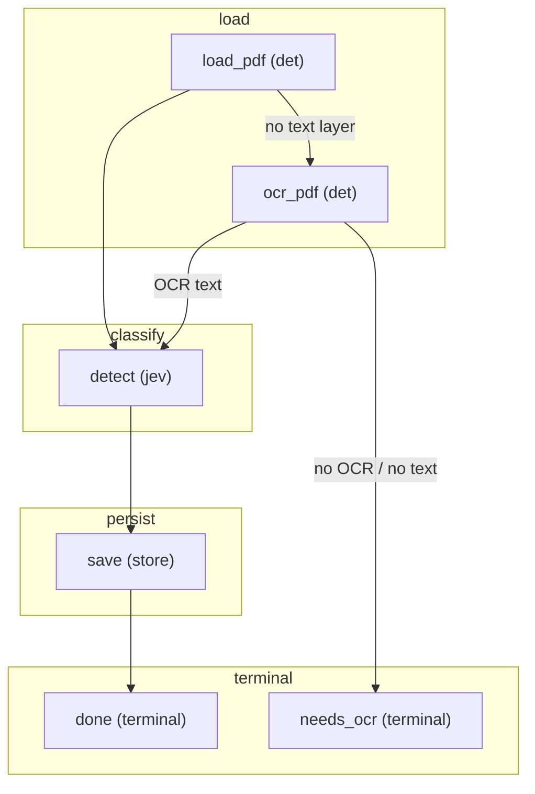

# FLOW — doc_detect

> Generated from the flow module's `CONTRACT` (`jav/flows/contract.py`, `python -m jav.cli flows`).
> Regenerate this file instead of editing it. FLOW.mmd groups the graph by phase.

## Phases and steps

### load
- **load_pdf** _(det)_ — pdfplumber word-level reconstruction, sha256 doc_id, year hint from the folder; the text-layer test of the document and of each page (167: scanned pages without text of their own, images over 30 % of the page, are the pdf:pages_without_text to-do, kept open by the ocr_coverage producer)
- **ocr_pdf** _(det)_ — a PDF without text: OCR (jav/documents/ocr.py: page images and tesseract, native or the legacy sidecar image, a disk cache) onto the same layout; the quality signals in the state

### classify
- **detect** _(jev)_ — one request, three judgements: Choice doc_type (the registry and unknown), Noul issuer_is_hungarian, Choice language; anchor hits as features; then the detailed type among the category's packs (jav/ai/detect_detail.py: the legacy anchor score, a JEV Choice when needed). Without JEV: the same three questions to GPT in one structured request, the confidence from the answer's token log-probabilities (jav/ai/detect_gpt.py); a failed call is a detect:gpt_failed to-do

### persist
- **save** _(store)_ — the documents table (the detailed type too; a detailed type left open is a detect_detail to-do; a category without a type pack too); conf < policy.detect.low_confidence -> review_queue (by reason, additive), otherwise the detect step's own earlier reasons close

### terminal
- **done** _(terminal)_ — typed
- **needs_ocr** _(terminal)_ — a PDF without text or with a broken text layer, and OCR gave no text either (or there is no engine): documents has_text=0; a to-do (producer `ocr`, ocr:*), closed by a save with text; 218: one write transaction with the OCR escalation's trace (ocr.escalation)

Terminal steps: done, needs_ocr

> M1 - the type goes into the documents table; the M2 flow of the type starts from there. The run_id is the backbone; the JEV call goes through the adapter (cache, ledger, config_hash).

## Graph (Mermaid)

