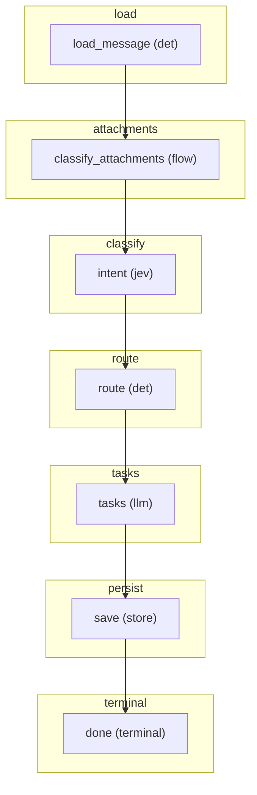

# FLOW — email_intent

> Generated from the flow module's `CONTRACT` (`jav/flows/contract.py`, `python -m jav.cli flows`).
> Regenerate this file instead of editing it. FLOW.mmd groups the graph by phase.

## Phases and steps

### load
- **load_message** _(det)_ — inbox/<mailbox>/<msgid>/message.json and files, or a ready EmailMessage (golden)

### attachments
- **classify_attachments** _(flow)_ — the M1 doc_detect graph on every PDF attachment (under the email's run_id: <run_id>-doc_detect), the result onto the attachment and documents.source_email; an image -> unsupported, known from its name -> name_only; an unreadable PDF -> unreadable and a to-do (attachment:unreadable), the email goes on

### classify
- **intent** _(jev)_ — one request: Choice intent (11 intents, the sender's purpose) and 4 Noul signals; the cleaned body and the code's features in the state. Without JEV: the same questions to GPT in one structured request, the confidence from the answer's token log-probabilities (jav/domains/email/intent_gpt.py); a failed call is an intent:gpt_failed to-do (and no attachment recognition in this flow: the attachments are recognised as items of their own). A sent message (folder = sent, 149) is not asked: no call, no to-do

### route
- **route** _(det)_ — email_rules.email_next_flow (224: the email domain's own rules, configs/email.json): the confidence threshold -> the attachment's M1 type -> the intent's default route. A sent message (149): email_rules.email_sent_route, its attachments' types, else archive:sent. 190: a route to a type pack that reads text (the quote request), with the recipe's email_text setting on, names the follow-up stage: the extraction flow on the email's own text; 192: and one on each table attachment when the pack reads tables

### tasks
- **tasks** _(llm)_ — task proposals (GPT, the legacy email-actions v1.3.0 instruction) and an evidence gate in code; only when the recipe asks, not on an email to archive; a proposal -> a to-do (a person accepts it). Not for a sent message (149)

### persist
- **save** _(store)_ — emails + email_results (the run's row, the task proposals too); an uncertain intent or a proposal -> review_queue (additive), otherwise the earlier item closes; 190: the email's own text as a document tied to the email (documents.source_email), when a follow-up extracts it

### terminal
- **done** _(terminal)_ — intent and next_flow saved

Terminal steps: done

> M3 - the input: the legacy outlook_bridge.ps1 -> jav/domains/email/ingest_server.py -> the inbox folder; next_flow is decided in code, not by a JEV question.

## Graph (Mermaid)

