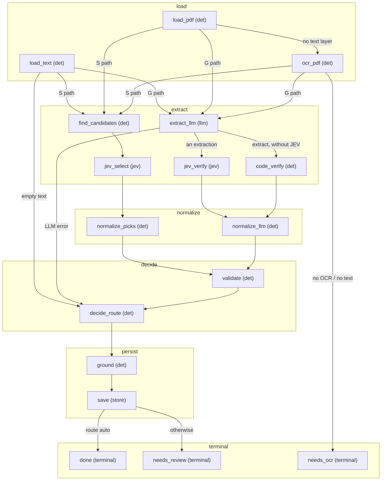

# FLOW — invoice

> Generated from the flow module's `CONTRACT` (`jav/flows/contract.py`, `python -m jav.cli flows`).
> Regenerate this file instead of editing it. FLOW.mmd groups the graph by phase.

## Phases and steps

### load
- **load_pdf** _(det)_ — pdfplumber word-level reconstruction, sha256 doc_id; the text-layer test of the document and of each page (167: scanned pages without text of their own, images over 30 % of the page, are the pdf:pages_without_text to-do); the word layer (word boxes) is saved
- **ocr_pdf** _(det)_ — a PDF without text: page images (pypdfium2) and tesseract word boxes (native, or the legacy sidecar image) -> the same line and cell building; the word layer is saved; a disk cache in runs/ocr/; the quality signals raw, weak OCR a review reason (policy ocr)
- **load_text** _(det)_ — 190: a pack that reads text or tables: an email's own text (the text's digest is the doc_id) or a text / table file (the table through the isolated native reader), laid out by the PDF reader's line and cell builder (three spaces = a column); no word layer; an empty text is a text:empty to-do

### extract
- **find_candidates** _(det)_ — S path: deterministic, ordered, masking candidate finders with the S path's candidate profile (configs/candidate_profiles.json): iban -> tax_id -> date -> invoice_number -> money; names and addresses on cells
- **jev_select** _(jev)_ — S path: batched Choice requests (parties / header / money) from the pack's select call site, a focused state, none always an option, a presence Noul per field (also without candidates, for the optional fields checked, only within an existing request)
- **extract_llm** _(llm)_ — G path: GPT extraction with the pack's legacy prompt and schema (Pydantic AI), the one generative step
- **jev_verify** _(jev)_ — G path: evidence matching in code (unsupported), then a Noul fan-out in one request (off_target, wrong_kind, incomplete, absence_wrong, and the document-level questions whose fields the extraction has) from the pack's verify call site
- **code_verify** _(det)_ — the G path without JEV: the code's own source check only (every extracted value must be printed on the document, otherwise a source:not_found to-do); no JEV question

### normalize
- **normalize_picks** _(det)_ — S path: label -> a typed value by the pack's field kinds (Decimal, date), consistency reasons from code
- **normalize_llm** _(det)_ — G path: the extraction dictionary -> a normalised record by the pack's field kinds

### decide
- **validate** _(det)_ — the pack's validators (the legacy rules.json): the VAT equation, the date order, the tax number's check digit, IBAN mod-97, format patterns
- **decide_route** _(det)_ — policy.decide: thresholds (configs/policy.json), the pack's required and high-stakes fields, the additive review latch -> auto | human

### persist
- **ground** _(det)_ — each field's source place on the word layer (S: the chosen candidate's line and the other candidates; G: a code search with the label, configs/grounding.json); on an error it goes on without a source place
- **save** _(store)_ — documents + datapoints (a confidence per field, the call site's config_hash) + review_queue; 149: an uncertain detailed type between an outgoing and an incoming pack is settled by the own parties' direction (confirm_detail_by_direction); 218: one write transaction with the route decision's trace (extract.route) and the OCR escalation's (ocr.escalation)

### terminal
- **done** _(terminal)_ — auto - accepted
- **needs_review** _(terminal)_ — human - in the review queue, with reasons
- **needs_ocr** _(terminal)_ — a PDF without text, and OCR gave no usable text either (or there is no OCR engine): documents has_text=0; a to-do (producer `ocr`, ocr:*), closed by a save with text; 218: one write transaction with the OCR escalation's trace (ocr.escalation)

Terminal steps: done, needs_review, needs_ocr

> M2 data-point extraction - one graph with two extraction paths, and every run takes exactly one of them (arm S: code candidates + JEV Choice; arm G: GPT extraction + JEV Noul verification, or the code's own source check without JEV). There is no agreement gate between the paths: the route (auto or review) comes from the policy's thresholds (configs/policy.json), the pack's required and high-stakes fields, the validators and the additive review latch. Type-independent: the type pack (configs/types/<type>.json: invoice_hu, invoice_foreign, the utility bills, ...) supplies the fields, questions, prompt and validators. A PDF without a text layer goes through the OCR step (ocr_pdf) onto the same layout. Every AI call goes through the adapter layer (cache + ledger + config_hash).

## Graph (Mermaid)

